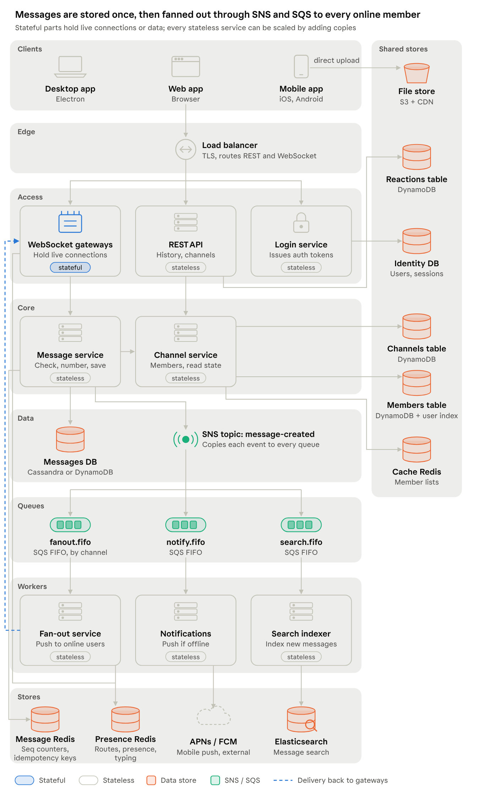

# Chat Application System Design: Slack-like (Atlassian Interview)

Nov 14, 2026 · @Arnav jain

A message is validated, given an ordered ID, stored once in Cassandra, and published to Kafka; a fan-out service then pushes it through WebSocket gateways to every online member and sends mobile pushes to the rest.

## 1. Basics and interview flow

### What we are building

A workspace chat app like Slack: companies (workspaces) have channels, people post messages in real time, reply in threads, send direct messages, share files, and search history.

**Key words**

| Word | Meaning |
| --- | --- |
| Workspace | One company, the tenant (Acme) |
| Channel | A conversation with members: public `#eng`, private `#leadership`, or a direct message (a channel with 2 members) |
| Message | Text, mentions, attachments, posted by one user in one channel |
| Thread | Replies attached to a parent message |
| Presence | Who is online, away or offline |
| Fan-out | Delivering one message to every member who should see it |

### The hard parts

1. **Real-time delivery** to millions of open connections in under \~200 ms.
2. **Fan-out:** one message in a 50,000-member channel must reach every online member without flooding the system.
3. **Ordering:** everyone sees messages in a channel in the same order.
4. **Never lose a message**, and never show it twice, even with retries and reconnects.
5. **Offline users** still get notified and catch up when they return.

### Interview flow (45–60 min)

1. **Basics and requirements (6 min)**
2. **Quick traffic estimate (3 min):** connections, messages per second, fan-out.
3. **API (5 min):** REST plus WebSocket events.
4. **High-level design (10 min):** the layered diagram.
5. **Flows (8 min):** send, deliver, offline, unread, reconnect.
6. **Data model and storage (6 min)**
7. **Deep dives (12 min):** ordering, large channels, presence, routing, search.
8. **Wrap-up (3 min)**

## 2. Requirements

### Functional

1. Send and receive messages in channels and direct messages, in real time.
2. Public channels, private channels, group and 1:1 direct messages.
3. Threads (replies to a message).
4. Message history: scroll back through older messages, paginated.
5. Unread counts and "last read" position per channel, synced across a user's devices.
6. Presence (online, away) and typing indicators.
7. Mentions and push notifications for offline or mobile users.
8. Edit and delete messages; reactions.
9. File and image sharing.
10. Search messages the user can access.

### Non-functional

- **Low latency:** a message reaches online recipients in under 200 ms p99 within a region.
- **Durable:** a message acknowledged to the sender is never lost.
- **Ordered:** all members see a channel's messages in the same order.
- **Exactly-once to the user:** retries never show duplicates.
- **Available:** 99.99% for sending and receiving; search and presence may degrade first.
- **Scale:** \~50M daily active users, tens of millions of concurrent connections, channels from 2 to 100,000+ members.
- **Multi-tenant and secure:** workspaces fully isolated; data in the tenant's region; users only see channels they belong to.

### Out of scope

- Voice and video calls.
- End-to-end encryption (messages are encrypted in transit and at rest, but the server can read them for search).
- Building the third-party app platform itself (we only emit events for bots and webhooks).

## 3. Quick traffic estimate

About 60K messages a second at peak go in, but fan-out turns them into about 1.2M deliveries a second over \~30M open connections.

**Assumptions**

- 50M daily active users; at peak \~30M are connected at once (desktop apps stay open all day).
- Each user sends \~40 messages a day.
- An average message is delivered to \~20 online members (most channels are small; a few are huge).
- One day is about 10^5 seconds; peak is about 3× average.

|  | Calculation | Result |
| --- | --- | --- |
| Messages per day | 50M × 40 | 2B |
| Messages in per second | 2B / 10^5 | 20K average, 60K peak |
| Deliveries out per second | 60K × 20 | \~1.2M at peak |
| Open WebSocket connections |  | \~30M at peak |
| Gateway servers | 30M / \~50K per server | \~600, plus headroom |
| History reads (scroll, open channel) | 50M × \~100 / 10^5 | \~50K/s average |

**What this tells us**

- Writes are modest; **fan-out and connections are the scaling problem**. Delivery must be asynchronous and spread over many servers.
- 30M long-lived connections need a dedicated gateway fleet and a registry of which user is connected to which gateway.
- Messages are append-only and read by channel and time, which suits a wide-column store partitioned by channel.

Storage is estimated in section 7.

## 4. API

REST handles requests that need a response (history, channels, uploads); one WebSocket per client carries real-time events both ways.

### REST endpoints

| Purpose | Method and path | Notes |
| --- | --- | --- |
| Send a message | `POST /v1/channels/{channelId}/messages` | Fallback when the WebSocket is down; same as the WS `send` |
| History | `GET /v1/channels/{channelId}/messages?before={messageId}&limit=50` | Cursor pagination, newest first |
| Thread replies | `GET /v1/messages/{messageId}/replies?cursor=` |  |
| Edit / delete | `PATCH` / `DELETE /v1/messages/{messageId}` | Author or admin only |
| Reactions | `POST /v1/messages/{messageId}/reactions` | Body `{ "emoji": "tada" }` |
| Channels | `POST /v1/channels`, `GET /v1/users/me/channels` | Create; list my channels with unread counts |
| Members | `POST /v1/channels/{id}/members` | Join, invite, leave |
| Mark read | `POST /v1/channels/{id}/read` | Body `{ "lastReadMessageId": "..." }` |
| Upload a file | `POST /v1/files` | Returns a pre-signed upload URL; the file goes straight to object storage |
| Search | `GET /v1/search?q=launch&in=#eng` | Only channels the user can see |

**Send (REST or WebSocket body):**

```json
POST /v1/channels/C_eng/messages
{
  "clientMsgId": "9b1c-...",        // generated by the client; makes retries safe
  "text": "Deploy at 5pm? @amit",
  "threadParentId": null,
  "fileIds": []
}

201 Created
{
  "messageId": "1730000000123-0042",  // time-ordered, see section 8
  "channelSeq": 98213,                // position in the channel
  "createdAt": "2026-11-14T12:10:03.123Z"
}
```

### WebSocket events

The client connects once (`wss://gateway.../ws`), authenticates with its token, and then receives events for **all** its channels on that one connection.

**Client → server**

| Event | Example |
| --- | --- |
| `send` | `{ "type": "send", "channelId": "C_eng", "clientMsgId": "9b1c", "text": "..." }` |
| `typing` | `{ "type": "typing", "channelId": "C_eng" }` |
| `read` | `{ "type": "read", "channelId": "C_eng", "messageId": "..." }` |
| `ping` | keep-alive every \~30 s |

**Server → client**

```json
{ "type": "ack", "clientMsgId": "9b1c", "messageId": "1730000000123-0042", "channelSeq": 98213 }

{ "type": "message", "channelId": "C_eng", "messageId": "1730000000123-0042",
  "channelSeq": 98213, "author": "riya", "text": "Deploy at 5pm? @amit" }
```

| Event | Purpose |
| --- | --- |
| `message`, `message_edited`, `message_deleted`, `reaction` | Channel content changes |
| `typing`, `presence` | Ephemeral; never stored |
| `read_state` | Another of my devices read a channel: clear its badge here too |
| `channel_changed` | Added to or removed from a channel |
| `resync_required` | Missed too much while away; fetch over REST |

## 5. High-level design

The synchronous path is short (gateway, message service, database, SNS); delivery and push happen asynchronously from SQS FIFO queues.



Read it layer by layer. Clients log in through the login service, which issues a token, then hold one WebSocket to a gateway and use REST for history and channels; files go straight to S3. The message service checks membership with the channel service, assigns an ordered ID, writes the message to the messages DB and publishes it to an SNS topic. SNS copies each event into three SQS FIFO queues, one per worker. The fan-out service looks up which gateway each online member is on (Redis) and pushes the message there (dashed path back up to the gateways); the notification service sends mobile pushes; the indexer feeds search.

**Stateful vs stateless:** gateways are stateful because each one holds specific users' live connections; if one dies, those users reconnect elsewhere. Every other service keeps no data between requests, so any copy can handle any request and they scale by adding machines. All lasting state lives in the stores.

| Component | Role | State | Technology |
| --- | --- | --- | --- |
| Desktop, web, mobile apps | One WebSocket per client; local cache; send with a client message ID | Client | Electron, browser, iOS / Android |
| Load balancer | TLS, routes REST and WebSocket upgrades | Stateless | AWS ALB |
| Login service | Checks credentials, issues and refreshes tokens | Stateless | Service + Identity DB |
| WebSocket gateways | Hold \~50K connections each; verify token; register `user → gateway` in Redis; push events | **Stateful** (live connections) | Netty / Go servers |
| REST API | History, channels, members, search, upload URLs | Stateless | Service |
| Message service | Membership check, idempotency, ID and order, store, publish to SNS | Stateless | Service |
| Channel service | Channels, membership, read positions | Stateless | Service over DynamoDB (channels + members tables) + Redis cache |
| Messages DB | All messages, append-mostly | Stateful store | Cassandra or DynamoDB, by channel + week |
| Identity DB | Users and sessions | Stateful store | Postgres |
| Channels table | One item per channel: name, type, creator, created time, latest sequence | Stateful store | DynamoDB, key = channel\_id |
| Members table | One item per (channel, member): role, added by, joined, last read, muted | Stateful store | DynamoDB, key = channel\_id + user\_id; index on user\_id |
| Reactions table | Who reacted with which emoji on each message | Stateful store | DynamoDB, key = message\_id + emoji#user\_id |
| SNS topic | Receives each `message-created` event once and copies it to every subscribed queue | Managed | Amazon SNS FIFO topic |
| SQS FIFO queues | One queue per worker; ordered per channel (message group = channel ID); de-duplicated by message ID | Managed | Amazon SQS FIFO |
| Fan-out service | Finds online members' gateways in Redis and pushes to each gateway | Stateless | Queue consumers |
| Notifications | Push for offline or backgrounded users, mention emails | Stateless | Queue consumers + APNs / FCM |
| Search indexer | Adds messages to the search index within seconds | Stateless | Queue consumers + Elasticsearch |
| Redis | Three clusters: presence (routes, presence, typing), message (sequence counters, idempotency keys), cache (member lists) | Stateful store (in memory) | Redis cluster |
| File store | Uploads and images | Stateful store | S3 + CDN |

**Why SNS + SQS FIFO instead of Kafka?** SNS publishes each message once and copies it to every subscribed queue, so each worker gets its own queue and can fall behind or retry without affecting the others. FIFO keeps messages of the same channel in order (the channel ID is the message group) and drops duplicates by message ID. It is fully managed on AWS. The trade-offs: FIFO queues have per-queue throughput limits (raised with high-throughput mode and spreading load across many message groups), and SQS cannot replay old events the way Kafka can, so rebuilding the search index means re-reading from the messages DB instead.

**Why separate gateways from the message service?** Gateways only hold connections and push bytes, so they scale with the number of online users; the message service scales with messages sent. A gateway restart drops connections but never loses a message, because messages are already stored before anyone is notified.

## 6. Flows

The sender gets an ack as soon as the message is stored (\~30 ms); delivery to others follows through Kafka (\~100 ms more).

### Flow A: Riya sends a message to #eng

1. Riya types "Deploy at 5pm? @amit". Her app shows it at once in grey ("sending") and sends `{type: send, channelId: C_eng, clientMsgId: 9b1c, text}` over her WebSocket.
2. Her **gateway** already knows she is `riya@acme` (from the token at connect time) and forwards the request to the **message service**.
3. The message service:
   1. asks the **channel service** whether Riya is a member of `C_eng` and may post (cached, \~1 ms);
   2. checks idempotency: has `(riya, 9b1c)` been seen in the last 24 h? (Redis `SET NX` with a TTL). If yes, it returns the original `messageId` and stops;
   3. assigns a **message ID** (time-ordered, section 8) and the next **channel sequence number** (`98213`);
   4. writes the message to **Cassandra** (partition `C_eng` + this week's bucket);
   5. publishes `MessageCreated` to **Kafka**, partitioned by `channelId` so a channel's events stay in order;
   6. returns `ack {clientMsgId: 9b1c, messageId, channelSeq: 98213}`.
4. Riya's app turns the message from grey to sent. Total: \~30 ms.

### Flow B: delivering to online members

1. The **fan-out service** consumes `MessageCreated` from Kafka.
2. It gets the members of `C_eng` (from a Redis cache of the channel service): say 300 members.
3. It looks up who is online and where in the **connection registry** (Redis): `amit → [gateway-17 (desktop), gateway-203 (mobile)]`, `neha → [gateway-17]`, and so on. Say 120 members are online.
4. It groups recipients **by gateway** and sends each gateway one message: "deliver message X to users \[amit, neha, ...\]". Gateway-17 gets one call, not one per user.
5. Each gateway writes the event to the matching sockets. Amit's desktop shows the message; typical total from send: 100–200 ms.
6. Clients place messages by `channelSeq` and drop any `messageId` they already have, so a duplicate delivery is harmless.

### Flow C: offline members and notifications

1. The **notification service** also consumes `MessageCreated`.
2. For each member it decides whether to notify: are they mentioned (`@amit`)? Is it a DM? Have they muted the channel? Are they in do-not-disturb hours?
3. If Amit should be notified and his only device online is a backgrounded phone (or none), it sends a push through **APNs / FCM**. If he is active on desktop, it skips the push, so his phone does not buzz while he is at his desk.
4. Unnotified offline members simply see the message when they next open the app (Flow E).

### Flow D: unread counts and read state

- Each membership row stores `lastReadSeq` (the channel sequence number the user has read up to). The channel stores `latestSeq`.
- **Unread count = latestSeq − lastReadSeq.** No per-user write happens when a message is posted, which matters for big channels.
- When Amit reads #eng on desktop, the app sends `read {messageId}`; the channel service updates `lastReadSeq` and emits `read_state` to Amit's other devices, which clear the badge.
- Mention counts (the red badge) are tracked separately per user, because they are few: incremented by the notification service, cleared on read.

### Flow E: reconnecting after being offline

1. Amit's laptop wakes up. The app reconnects to any gateway, which registers `amit → gateway-88` in Redis.
2. The app calls `GET /v1/users/me/channels` and gets each channel's `latestSeq` and his `lastReadSeq`. Channels where the app's cached `latestSeq` is behind are stale.
3. For each stale channel it fetches missing messages: `GET /v1/channels/C_eng/messages?after=98100` (only the open channel first; others when opened).
4. Messages that arrived on the socket during step 3 are merged by `channelSeq` and de-duplicated by `messageId`, so nothing is missed or shown twice.
5. If the app was away too long (days), the server replies `resync_required` and the app reloads only the most recent page of each channel.

### Flow F: opening a channel (loading 100 messages)

One database query fills the whole page; threads and reaction details load only on demand.

1. **Messages:** the app calls `GET /v1/channels/C_eng/messages?limit=100`. The messages table is partitioned by channel and already sorted by position, so this is **one query** on one partition that returns the newest 100 rows. (Strictly it is not O(1), since it reads 100 rows, but it is a single fast range read with no sorting or scanning.)
2. **Thread replies, not loaded up front:** each message row carries a small summary, `reply_count`, `last_reply_at` and the first few repliers. The page shows "5 replies, last reply 2 min ago" from that. Replies are fetched from the thread replies table only when the user clicks.
3. **Reactions, no extra call:** each message row also carries `reaction_counts`, for example `{ thumbsup: 3, tada: 1 }`, kept up to date with an atomic counter whenever someone reacts. The same single query therefore returns everything needed to draw the reactions under all 100 messages.
4. **Who reacted, on demand:** hovering over a reaction, or checking whether the current user already reacted, reads the reactions table for that one message (partition = `message_id`).

**Why not batch-fetch reactions for all 100 messages?** It works (a DynamoDB `BatchGetItem` or 100 parallel queries), but it still touches 100 different partitions on every page load. Keeping the counts on the message row turns that into zero extra calls; the reactions table is used only for the details.

| Data on the page | Where it comes from | Calls |
| --- | --- | --- |
| 100 messages | Messages table, one partition, already sorted | 1 query |
| Reply counts | Summary on each message row | 0 extra |
| Reaction counts | `reaction_counts` on each message row | 0 extra |
| Thread replies | Thread replies table, when clicked | 1 per thread opened |
| Who reacted | Reactions table, when hovered | 1 per message hovered |

## 7. Data model and storage estimate

Messages dominate storage at about 1 TB a day before replication; everything else (metadata, routes, presence) is small.

### 1. Messages (Cassandra)

```
Table messages
Partition key:  channel_id, week_bucket        -- e.g. (C_eng, 2026-W46)
Clustering key: channel_seq DESC                -- newest first for history pages
Columns:        message_id, author_id, text, thread_parent_id, reply_count,
                attachments (file ids), reaction_counts, last_reply_at, edited_at, deleted (bool), created_at
```

- **Why by channel:** the main read is "the latest 50 messages in this channel", a single-partition slice.
- **Why a week bucket:** a busy channel never becomes one giant partition; history paging moves to the previous bucket.
- **Threads:** replies are stored as messages with `thread_parent_id`, plus a table `thread_replies(parent_id, reply_seq)` for opening a thread quickly.
- **Edits and deletes:** update the row in place (`edited_at`, or `deleted = true` with the text cleared) and emit an event so clients update.

### 2. Channels and members (DynamoDB) + identity (Postgres)

**Channels table** (DynamoDB): one item per channel.

```
Partition key:  channel_id                 e.g. C_eng
Attributes:     workspace_id, name, type (public | private | dm | group_dm),
                created_by, created_at, latest_seq, dm_pair_key (DMs only)
```

**Members table** (DynamoDB): one item per member of a channel, the relationship between a user and a channel.

```
Partition key:  channel_id
Sort key:       user_id
Attributes:     role (admin | member), added_by, joined_at, last_read_seq, muted

Global secondary index "by_user":
  Partition key: user_id,  Sort key: channel_id      -- "which channels is Riya in?"
```

| Question | How it is answered |
| --- | --- |
| All members of #eng (fan-out) | Query members table, partition `C_eng` (cached in Redis) |
| Is Riya in #eng? | Get item `(C_eng, riya)` |
| Riya's sidebar: her channels | Query the `by_user` index, partition `riya` |
| Unread count | `channels.latest_seq − members.last_read_seq` |

- **One row per member, not a list in one field:** each member has their own data (role, last read, mute), joins never overwrite each other, and channels with 50,000 members stay manageable.
- **The `by_user` index updates a moment after a write** (eventually consistent), so a newly joined channel can appear in the sidebar a fraction of a second later.
- **One DM per pair of users:** a conditional write on `dm_pair_key` (the two user IDs, sorted) with "only if not exists" replaces a database uniqueness rule.

**Reactions table** (DynamoDB): one item per user per emoji per message.

```
Partition key:  message_id
Sort key:       emoji # user_id          e.g. thumbsup#amit
Attributes:     created_at
```

- Adding a reaction is a put; removing it is a delete. Reacting twice is harmless, because the key is the same.
- The message row keeps a small summary, `reaction_counts: { thumbsup: 3, tada: 1 }`, updated with an atomic counter. A history page of 100 messages shows reactions with no extra calls.
- The reactions table is read only when someone hovers to see who reacted, or to know whether the current user already reacted.

**Identity DB** (Postgres): `users(user_id, workspace_id, name, email, password_hash, status)` and `sessions(token_id, user_id, device, expires_at)`, used by the login service.

**One Redis or several?** Each key name starts with its purpose (`conn:`, `presence:`, `seq:`, `idem:`, `members:`), so one cluster can hold them all. A cluster is already many shards, each with replicas in other availability zones. We still split by job, so a spike in one kind of traffic cannot slow another:

| Cluster | Keys | Why separate | If it is lost |
| --- | --- | --- | --- |
| Presence Redis | `conn:*`, `presence:*`, typing | Highest volume: \~30M users pinging every 30 s | Rebuilt from pings within about a minute; fan-out falls back to sending to all gateways for the channel |
| Message Redis | `seq:*`, `idem:*` | On the send path; must stay fast; keys must not be evicted | Counters reset from the highest sequence in the messages DB; duplicates blocked by the DB's conditional write |
| Cache Redis | `members:*` | Only a copy of DynamoDB; may evict old keys when full | Reads go to DynamoDB until the cache refills |

Cost of splitting: three clusters to run and monitor, and services connect to more than one. In an interview: start with one cluster, split by job as traffic grows.

### 3. Ephemeral state (two Redis clusters)

Redis is split by job, so a problem in one cluster does not stop the other, and each scales on its own. Messages themselves are never stored in Redis; they live only in the messages DB.

**Presence Redis** (used by gateways, fan-out and typing):

```
conn:{user_id}        → {gateway_id, device}     e.g. conn:riya → {gateway-17, desktop}   TTL refreshed by pings
presence:{user_id}    → active | away            TTL ~60 s
typing:{channel_id}   → users typing now          TTL ~5 s
members:{channel_id}  → cached member list for fan-out
```

**Message Redis** (used by the message service):

```
seq:{channel_id}              → latest position      e.g. seq:C_eng → 98213   (atomic INCR)
idem:{user_id}:{clientMsgId}  → message_id           e.g. idem:riya:9b1c → 1730000000123-0042   TTL 24 h
```

| If this cluster fails | Effect | Fallback |
| --- | --- | --- |
| Presence Redis | Fan-out cannot find gateways; online dots unknown | Deliver to gateways subscribed to the channel; users still see messages when they open it |
| Message Redis | No new sequence numbers or duplicate checks | Rebuild counters from the highest position in the messages DB; a conditional write on the position blocks duplicates |

Each cluster is itself sharded, with replicas in other availability zones, so losing one machine never takes a whole cluster down.

### 4. Files and search

- **Files:** object storage `s3://files/{workspace}/{file_id}`; served through a CDN with short-lived signed URLs; metadata item in DynamoDB.
- **Search:** Elasticsearch index per workspace (or per group of small workspaces): message ID, channel ID, author, text, time. Queries are filtered by the channels the user belongs to.

### Storage estimate

| Data | Calculation | Result |
| --- | --- | --- |
| Messages per day | 50M users × 40 | 2B |
| Message row size | \~100 B text + \~200 B metadata + overhead | \~500 B |
| Messages per day | 2B × 500 B | \~1 TB (3 TB with 3 replicas) |
| Messages per year | 1 TB × 365 | \~365 TB (\~1.1 PB replicated) |
| Files per day | \~1% of messages × \~300 KB | \~6 TB a day in object storage |
| Search index | \~1.5× the message text | a few hundred TB per year |
| Connection routes in Redis | 30M connections × \~200 B | \~6 GB |
| Memberships | 50M users × \~100 channels × \~100 B | \~500 GB in the DynamoDB members table |

**What the numbers decide**

| Finding | Design decision |
| --- | --- |
| Petabyte-scale, append-mostly, read by channel and time | Cassandra partitioned by channel + week |
| Membership and channel data are relational and modest | DynamoDB channels table + members table, with a user-ID index |
| Routes and presence are tiny but change constantly | Redis with TTLs |
| Files are large and immutable | Object storage + CDN, uploaded directly by clients |
| Old messages are rarely read | Tiered storage: move messages older than \~1 year to cheaper storage; retention per workspace policy |

## 8. Deep dives

Ordering and large-channel fan-out are the follow-ups interviewers push on most.

### Message IDs and ordering

Two IDs per message:

- **`messageId`**, globally unique and roughly time-ordered, Snowflake-style: 41 bits of milliseconds + 10 bits of server ID + 12 bits of per-millisecond counter. Generated locally on any message-service instance, with no coordination. Used for de-duplication and links.
- **`channelSeq`**, a gap-free counter **per channel** (1, 2, 3, ...). It defines the one order everyone sees, drives unread counts, and lets a client spot a gap ("I have 98211 and 98213, so fetch 98212").

**How to assign `channelSeq` safely:** `INCR seq:{channelId}` in Redis (atomic) for most channels, persisted as `channels.latest_seq` and recovered from the max in Cassandra if Redis loses it. Kafka is partitioned by channel, so consumers process a channel's events in that order.

**Why not order by timestamp?** Server clocks differ by milliseconds, and two messages in the same millisecond tie. A per-channel counter is exact.

### Large channels (#announcements with 100,000 members)

A naive fan-out would look up 100K members and write 100K socket messages for every post.

- **Only online members:** offline members cost nothing; they read on reconnect. That alone often cuts it by half or more.
- **Group by gateway:** 100K online members sit on maybe 2,000 gateways, so the fan-out sends 2,000 internal messages, each listing its local users.
- **Gateway-side subscriptions:** better still, each gateway keeps a local map `channel → its connected members` and subscribes to that channel's topic. The fan-out service publishes once per channel; every subscribed gateway delivers locally. Cost per message is the number of gateways, not members.
- **Lazy delivery for huge, low-priority channels:** send only a small "channel has new messages" signal; clients fetch the content when the channel is opened.
- **Unread counts** use `latestSeq − lastReadSeq`, so posting causes no per-member database writes.
- Posting can be rate-limited or restricted to admins in very large channels.

### Connection routing and gateways

- On connect, the gateway writes `conn:{user}` in Redis with its own ID and device type, refreshed by heartbeats every \~30 s. If a gateway dies, the entries expire and the fan-out stops routing there.
- Gateways are stateless apart from live sockets. On a gateway restart, clients reconnect to another one (with random back-off to avoid a thundering herd) and catch up as in Flow E.
- Deploys drain gateways gradually: stop accepting new connections, then ask clients to reconnect elsewhere over a few minutes.

### Presence and typing

- **Presence** is set by heartbeats and app focus; stored in Redis with a TTL. A user with no heartbeat for \~60 s becomes away or offline.
- Presence changes are pushed only to people who can see the user **and** currently have them on screen (subscriptions), never broadcast to the whole workspace. That keeps presence traffic from exploding in big companies.
- **Typing** events are forwarded to the channel's online members and dropped if delivery is slow. Never stored.

### Exactly-once from the user's point of view

- **Sender retries:** the `clientMsgId` idempotency key returns the original message instead of creating a second one.
- **Duplicate delivery:** Kafka consumers can redeliver after a crash, but clients de-duplicate by `messageId`.
- **Gaps:** a client that sees `channelSeq` jump fetches the missing range over REST.

Together these give at-least-once delivery underneath and exactly-once display on screen.

### Search

- The indexer adds messages to Elasticsearch within a few seconds, and updates or removes them on edit and delete.
- Every query filters by channels the user belongs to (and public channels in their workspace); the membership list is passed into the query.
- One index per large workspace, shared indexes for small ones, routed by workspace ID, so one tenant's heavy search load stays on its shards.

### Notifications

- Rules: DMs and mentions notify; channel messages only if the user enabled it; respect mute and do-not-disturb.
- **Do not double-notify:** if the user is active on desktop, skip the mobile push. If they read on one device, clear the notification on others (`read_state`).
- Batch emails for users who are away for hours ("you have 12 unread mentions").

### Edits, deletes, reactions

These are updates to an existing message row plus an event (`message_edited`, `message_deleted`, `reaction`) fanned out exactly like new messages. Reaction counts are stored as a small map on the message, updated with a lightweight transaction or a counter column to avoid lost updates.

### Multi-tenancy and regions

- Each workspace lives in one home region; its messages, files and search index stay there.
- Shared channels between two companies in different regions are stored in the channel owner's region; the other side reads through a cross-region API.
- Per-workspace rate limits (from the rate limiter design) stop a runaway bot from flooding the fan-out.

## 9. Wrap-up

Store first, then deliver: an acknowledged message is always in Cassandra, and every delivery path can be retried safely.

### Consistency

| Part | Guarantee | How |
| --- | --- | --- |
| A message once acked | Durable | Written to Cassandra (quorum) before the ack |
| Order within a channel | Same for everyone | Per-channel sequence + Kafka partitioned by channel |
| Delivery | At-least-once underneath, exactly-once on screen | Retries + de-duplication by `clientMsgId` and `messageId` |
| Unread counts | Exact on read, may lag a moment across devices | `latestSeq − lastReadSeq` |
| Presence, typing | Best effort | Ephemeral, TTLs |
| Search | Seconds behind | Async indexer |

### Failure handling

| Failure | Effect | Recovery |
| --- | --- | --- |
| Client network drops | Sends queue locally, show "sending" | Retry with the same `clientMsgId`; catch up on reconnect |
| Gateway dies | Its clients disconnect | Reconnect elsewhere with back-off; registry entries expire |
| Fan-out lagging | Messages arrive late in real time | Stored already; clients still see them on open; scale consumers |
| Kafka unavailable | Sends cannot complete | Message service retries briefly, then returns an error; client retries (idempotent) |
| Cassandra node down | None visible | Replication factor 3, quorum reads and writes |
| Redis down | Fan-out cannot find routes | Fall back to broadcasting to gateways subscribed to the channel; presence shows unknown |

### Monitoring

- Send latency (send to ack) and delivery latency (send to recipient) at p99.
- Kafka consumer lag per consumer group, especially fan-out.
- Connections per gateway, reconnect rate, and failed deliveries.
- Push notification success rate from APNs / FCM.
- Sequence gaps reported by clients.

### Trade-offs to state out loud

| Decision | Gain | Cost |
| --- | --- | --- |
| Store, then fan out via Kafka | Durable before delivery; side effects decoupled | \~50–100 ms extra delivery time |
| Per-channel sequence numbers | Exact order, gap detection, cheap unread counts | A counter per channel to manage |
| Push only to online members | Cheap for huge channels | Offline users catch up by fetching |
| Gateway-side channel subscriptions | Fan-out cost scales with gateways, not members | Gateways keep extra in-memory maps |
| Cassandra for messages | Petabyte scale, fast channel slices | No joins; secondary access needs extra tables |
| One WebSocket per client for all channels | Few connections, simple client | Gateways must route events per channel |

### Interview lines

- "Clients hold one WebSocket to a stateless gateway; REST handles history, channels and uploads."
- "The message service checks membership, de-duplicates by client message ID, assigns a time-ordered message ID and a per-channel sequence, writes to Cassandra, then publishes to Kafka partitioned by channel."
- "Fan-out consumes Kafka, finds online members' gateways in Redis, and sends one batch per gateway; offline members get pushes through APNs and FCM and catch up on reconnect."
- "Unread counts are latest sequence minus last-read sequence, so big channels cost nothing per member on write."
- "Clients de-duplicate by message ID and fill gaps by sequence, giving exactly-once display on top of at-least-once delivery."
