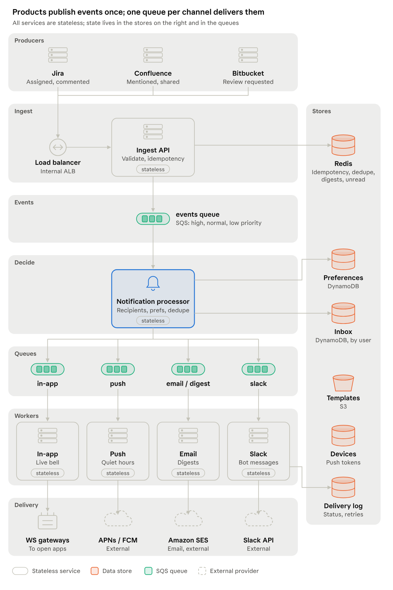

# Notification System Design (Atlassian Interview)

Nov 15, 2026 · @Arnav jain

A shared notification platform for all Atlassian products: products publish events, a processor decides who should hear about them and how, and per-channel workers deliver by in-app, email, mobile push and Slack, about 60K notifications a second at peak.

## 1. Basics, requirements and interview flow

### What it does

Amit assigns issue PAY-1 to Riya and @mentions her in a comment. Riya should see a bell badge in Jira, get a push on her phone if she is away, and maybe an email, but not three separate emails for the same burst of activity.

| Word | Meaning |
| --- | --- |
| Event | Something happened: `issue.assigned`, `comment.mentioned`, `page.shared` |
| Recipient | A user who should be told: assignee, watchers, mentioned people |
| Channel | How they are told: in-app (bell), email, mobile push, Slack |
| Preference | Per user and per event type: which channels, mute, quiet hours |
| Digest | Many notifications batched into one email ("12 updates on PAY-1") |

### Functional requirements

1. Any product publishes an event; the platform works out recipients (watchers, assignee, mentions).
2. Deliver on in-app, email, mobile push and Slack.
3. Respect each user's preferences: channels per event type, muted projects, quiet hours, time zone.
4. In-app inbox: list notifications, unread badge count, mark read or all read, synced across devices.
5. Batch noisy activity into digests; never send the same notification twice.
6. Templates per event type and language.
7. Track delivery status (sent, delivered, opened, failed) and retry failures.

### Non-functional requirements

- **Scale:** 100M daily active users, about 2B notifications a day, 60K a second at peak.
- **Latency:** in-app and push within \~5 s of the event; email within \~1 minute; digests on schedule.
- **Reliable:** at-least-once delivery underneath, no duplicates the user can see.
- **Isolated:** a bulk change in one tenant (10,000 issues edited) cannot delay everyone else's notifications.
- **Available:** 99.9%; a failing email provider must not block push or in-app.

### Out of scope

Marketing campaigns, SMS, building the email or push providers themselves.

### Interview flow (45–60 min)

1. Basics and requirements (6 min)
2. Traffic estimate and API (6 min)
3. High-level design (10 min)
4. Flows (8 min)
5. Data model and storage (6 min)
6. Deep dives (12 min): dedupe, digests, priority, provider failures, preferences
7. Wrap-up (3 min)

## 2. Traffic estimate and API

### Traffic estimate

**Assumptions:** 100M daily active users; each receives \~20 notifications a day; one day ≈ 10^5 s; peak ≈ 3× average; one event fans out to \~4 recipients on average.

|  | Calculation | Result |
| --- | --- | --- |
| Notifications per day | 100M × 20 | 2B |
| Notifications per second | 2B / 10^5 | 20K average, 60K peak |
| Events per second (before fan-out) | 20K / 4 | 5K average, 15K peak |
| In-app (every notification) |  | 2B a day |
| Email (\~20%, after digests) |  | \~400M a day, \~4K/s |
| Mobile push (\~10%) |  | \~200M a day, \~2K/s |
| Badge-count reads | 100M × \~50 page loads / 10^5 | \~50K/s |

**What this tells us:** fan-out multiplies events by \~4, so processing must be asynchronous and queue-based; email is the slowest and most failure-prone channel, so each channel needs its own queue; badge counts are read far more than written, so keep them as a counter, not a count query.

### API

**For products (internal):**

```json
POST /v1/events
Idempotency-Key: evt_9f21             // safe retries
{
  "tenant": "acme",
  "type": "issue.assigned",
  "actor": "amit",
  "entity": { "type": "issue", "id": "PAY-1", "title": "Fix checkout bug" },
  "recipients": ["riya"],            // optional; else resolved from watchers
  "priority": "normal",              // high (security, mentions) | normal | low
  "occurredAt": "2026-11-15T01:10:00Z"
}

202 Accepted
{ "eventId": "evt_9f21" }
```

**For users (REST):**

| Purpose | Method and path |
| --- | --- |
| List my notifications | `GET /v1/notifications?cursor=&limit=30` |
| Unread badge count | `GET /v1/notifications/unread-count` |
| Mark read | `POST /v1/notifications/{id}:read`, `POST /v1/notifications:readAll` |
| Get / update preferences | `GET` / `PUT /v1/preferences` |
| Register a phone for push | `POST /v1/devices` with the APNs / FCM token |

**Live:** new in-app notifications are pushed over the existing WebSocket (the same gateways as the chat design) as `{ "type": "notification", ... }`.

## 3. High-level design

Events enter once through an idempotent ingest API; one processor decides recipients and channels; each channel has its own queue and workers, so a slow provider never blocks the others.



| Component | Role | State | Technology |
| --- | --- | --- | --- |
| Producers | Jira, Confluence, Bitbucket publish events | Client | Product services |
| Ingest API | Validate, idempotency check, enqueue, return 202 | Stateless | Service behind ALB |
| Events queue | Buffers events; separate high, normal, low priority queues | Managed | Amazon SQS |
| Notification processor | Resolve recipients, permission check, preferences, dedupe, aggregate, write inbox, fan out | Stateless | Queue consumers |
| Channel queues | One per channel: in-app, push, email/digest, Slack | Managed | Amazon SQS (+ dead-letter queues) |
| Channel workers | Render template, apply quiet hours and rate limits, call provider, log result, retry | Stateless | Queue consumers |
| WebSocket gateways | Push live in-app notifications to open apps | Stateful (connections) | Shared with chat |
| APNs / FCM, SES, Slack API | Deliver push, email, Slack | External | Providers |
| Redis | Idempotency keys, dedupe keys, digest buffers, unread counters, rate limits | Stateful store | Redis cluster |
| Preferences, Inbox, Devices, Delivery log | User settings; in-app notifications; push tokens; delivery status | Stateful store | DynamoDB |
| Templates | Per event type, channel and language | Stateful store | S3 + cache |

**Where load balancers are needed:** in front of anything that receives HTTP requests. The ingest API sits behind an internal ALB, and the user-facing REST (bell list, unread count, preferences) behind the public ALB. The processor and channel workers need none: they pull from SQS, which hands each message to exactly one worker, so the queue spreads the load.

## 4. Flows

The product only publishes an event; everything after that is asynchronous and retried safely.

### Flow A: Amit assigns PAY-1 to Riya

1. **Jira** calls `POST /v1/events` (or publishes to SNS directly) with `issue.assigned`, actor Amit, entity PAY-1.
2. The **ingest API** checks the idempotency key in Redis (seen before? return the same `eventId`), stores nothing else, publishes to the **events queue** (SQS), and returns `202`. \~10 ms.
3. The **notification processor** reads the event and:
   1. **Resolves recipients:** assignee Riya + watchers of PAY-1 (from Jira's watchers API, cached), minus the actor Amit (no one is notified about their own action).
   2. **Checks permission:** can each recipient still view PAY-1? Drop those who cannot.
   3. **Loads preferences** from the preferences table (cached): Riya wants in-app + push for assignments, email only as a digest.
   4. **Dedupes:** key `dedupe:riya:PAY-1:issue.assigned` in Redis with a 10-minute TTL; if it already exists, skip.
   5. **Writes the in-app notification** to the inbox table and increments Riya's unread counter.
   6. **Fans out to channel queues:** `push` queue now; `digest` buffer for email.
4. Channel workers deliver:
   - **In-app worker:** finds Riya's gateway in Redis and pushes `{type: notification}` down her WebSocket; the bell shows 1.
   - **Push worker:** checks quiet hours in her time zone, looks up her device tokens, renders the template, sends through **APNs / FCM**.
5. Each worker writes the result to the **delivery log** (sent, failed, provider ID).

### Flow B: email digest

1. Instead of an email per event, the processor appends to Riya's digest buffer in Redis: `digest:riya → [PAY-1 assigned, PAY-1 commented, ...]`.
2. The first item schedules a flush (for example in 15 minutes, or at 9 am her time for daily digests) with a delayed SQS message or EventBridge Scheduler.
3. At flush time the **digest worker** reads the buffer, drops items she already read in-app, renders one email ("5 updates on PAY-1") and sends it via **SES**.

### Flow C: high-priority notifications

@mentions, security alerts and password resets skip digests and go to a **high-priority queue** with its own workers, so a flood of normal notifications never delays them.

### Flow D: reading notifications

1. Page load: `GET /v1/notifications/unread-count` reads Riya's counter (Redis, backed by DynamoDB). One key lookup.
2. Opening the bell: `GET /v1/notifications?limit=30` reads her inbox partition, newest first, cursor-paginated.
3. Clicking one: `:read` marks it read and decrements the counter; a `read_state` event clears the badge on her other devices. If she reads it in-app before the digest is sent, it is dropped from the email.

### Flow E: a provider fails

SES returns errors. Email workers retry with exponential back-off; after \~5 attempts the message goes to a **dead-letter queue** for inspection. Push and in-app queues are separate, so they keep flowing. A circuit breaker pauses calls to a failing provider and can switch to a backup provider.

## 5. Data model and storage estimate

The inbox dominates storage (about 1 TB a day, kept 90 days); everything else is small.

**Inbox table** (DynamoDB): one item per notification per user.

```
Partition key:  user_id
Sort key:       created_at # notification_id      -- newest first, cursor pagination
Attributes:     tenant, type, actor, entity (type, id, title), text, read (bool), link
TTL:            90 days
```

| Attribute | Example | Notes |
| --- | --- | --- |
| `user_id` (partition key) | `riya` | All of one user's notifications sit in one partition |
| `sk` (sort key) | `2026-11-15T01:10:00Z#ntf_7a1` | `created_at#notification_id`; newest first, unique even at the same millisecond |
| `notification_id` | `ntf_7a1` | Derived from `eventId + user_id`, so a retried write overwrites the same item |
| `tenant` | `acme` |  |
| `type` | `issue.assigned` | Used to pick the icon and text |
| `actor` | `amit` | Who did it |
| `entity` | `{type: issue, id: PAY-1, title: "Fix checkout bug"}` | Copied in, so the list renders without calling Jira |
| `text` | `Amit assigned PAY-1 to you` | Rendered once at write time |
| `link` | `/browse/PAY-1` | Where a click goes |
| `read` | `false` | Flipped on click or "mark all read" |
| `group_key` | `PAY-1#issue.updated` | Bursts update one item ("Amit made 15 changes") |
| `expires_at` | 90 days later | DynamoDB TTL deletes it automatically |

| Query | How |
| --- | --- |
| Open the bell (latest 30) | Query partition `riya`, newest first, limit 30, cursor = last `sk` |
| Mark one read | Update item `(riya, sk)` set `read = true`; `unread:riya` − 1 |
| Mark all read | Set `unread:riya = 0`; a background job flips `read` on unread items |
| Rebuild the badge if Redis is lost | Count items with `read = false` in the partition (rare) |

**Unread counter** (Redis, persisted in a DynamoDB counters table): `unread:{user_id} → 7`. Incremented on new notification, decremented on read, reset on read-all. Reading the badge is one lookup, never a count query.

**Preferences table** (DynamoDB): partition `user_id`, sort key `event_type` (plus a `*` default row). Attributes: channels (in\_app, email, push, slack), email mode (instant | digest\_15m | daily), muted projects, quiet hours, time zone, language.

```
Partition key:  user_id
Sort key:       event_type            -- e.g. comment.mentioned, issue.assigned, or * for defaults
```

| user\_id | event\_type | in\_app | push | email | slack | extra |
| --- | --- | --- | --- | --- | --- | --- |
| riya | `*` (defaults) | on | on | digest\_15m | off | quiet hours 22:00–07:00, time zone Asia/Kolkata, language en |
| riya | comment.mentioned | on | on | instant | on |  |
| riya | issue.updated | on | off | daily | off | muted projects: \[OLD\] |

- **Lookup:** the processor reads the row for the event type and falls back to `*` for anything not set. Both rows come from one query on partition `riya` and are cached for a few minutes.
- **Company defaults:** a tenant-level row (`user_id = tenant#acme`) supplies admin defaults, overridden by the user's own rows.
- **Changes:** `PUT /v1/preferences` writes the row and invalidates the cache; email unsubscribe links do the same.
- **Order of checks:** muted project? → channel on for this event type? → quiet hours now in the user's time zone? → rate cap reached? Only then is the notification queued for that channel.

**Devices table** (DynamoDB): partition `user_id`, sort key `device_id`; push token, platform (iOS, Android), last seen. Tokens the provider reports as invalid are deleted.

**Templates** (S3 + cache): one per event type, channel and language, for example `issue.assigned/email/en.html`, with placeholders like `{{actor}} assigned {{entity.title}} to you`.

**Delivery log** (DynamoDB, TTL 30 days): partition `notification_id`, sort key `channel`; status (queued, sent, delivered, opened, failed), provider message ID, attempts, last error.

```
Partition key:  notification_id
Sort key:       channel               -- in_app | push | email | slack
GSI "by_user":  user_id + created_at  -- support: "what did Riya get today?"
TTL:            30 days
```

| notification\_id | channel | user\_id | status | attempts | provider\_msg\_id | last\_error | updated\_at |
| --- | --- | --- | --- | --- | --- | --- | --- |
| ntf\_7a1 | in\_app | riya | delivered | 1 | — | — | 01:10:01 |
| ntf\_7a1 | push | riya | delivered | 1 | fcm-8812 | — | 01:10:02 |
| ntf\_7a1 | email | riya | failed | 5 | ses-77f | 550 mailbox full | 01:25:40 |

**Status lifecycle:** `queued → sent → delivered → opened`, or `→ failed` (with retries) or `skipped` (quiet hours, muted, rate cap).

| Who writes | When |
| --- | --- |
| Notification processor | Creates `queued` rows for each chosen channel |
| Channel workers | `sent` or `failed` after calling the provider, with attempts and error |
| Provider callbacks (SES, APNs/FCM receipts) | `delivered`, `bounced` |
| Email open / link click tracker | `opened` |

**Used for:** retries and dead-letter decisions, the worker's "already sent?" check (no duplicate sends after a crash), support questions, and delivery-rate dashboards. It is never on the user's page-load path, so it can be eventually consistent.

**Redis (ephemeral):**

```
idem:event:{eventId}                   → seen        TTL 24 h   (ingest idempotency)
dedupe:{user}:{entity}:{type}           → 1           TTL 10 min (no repeat notifications)
digest:{user}                           → list of pending items for the next digest
rate:{user}:push                        → counter     TTL 1 h    (cap pushes per user)
unread:{user}                           → count
```

### Storage estimate

| Data | Calculation | Result |
| --- | --- | --- |
| Inbox items per day | 2B × \~500 B | \~1 TB a day |
| Inbox kept 90 days | 1 TB × 90 | \~90 TB (DynamoDB, TTL deletes old items) |
| Delivery log | \~2.6B deliveries × \~200 B × 30 days | \~16 TB |
| Preferences | 100M users × \~10 rows × \~200 B | \~200 GB |
| Devices | 150M devices × \~300 B | \~45 GB |
| Redis | unread counters + dedupe + digests for active users | tens of GB |

## 6. Deep dives and wrap-up

### No duplicates

- **Ingest:** the product's `Idempotency-Key` makes a retried event a no-op.
- **Processor:** SQS delivers at least once, so every step is idempotent: the inbox item ID is derived from `eventId + user`, so writing it twice overwrites the same item.
- **Noise:** the dedupe key (`user + entity + type`, 10 minutes) stops ten edits in a row from becoming ten notifications.
- **Providers:** each send carries the notification ID so a retry after a timeout can be recognised.

### Noisy bursts and aggregation

If Amit edits PAY-1 fifteen times in five minutes, Riya gets one in-app notification that updates its text ("Amit made 15 changes to PAY-1") and, at most, one line in her digest. The processor groups by `user + entity` within a short window.

### Priority and tenant isolation

- Separate queues by priority: high (mentions, security), normal, low (bulk changes).
- A bulk change of 10,000 issues is tagged low priority and rate-limited per tenant, so it cannot starve other tenants' notifications.
- Per-user caps on push (for example 20 an hour) protect people from notification storms.

### Preferences and quiet hours

Preferences are cached in the processor (refreshed on change). Quiet hours are checked in the user's time zone at send time; pushes during quiet hours are held and folded into the next digest. Unsubscribe links in emails update the preferences table directly.

### Provider failures and bounces

Per-channel queues and circuit breakers isolate failures; dead-letter queues hold poison messages. Hard email bounces and invalid push tokens are fed back to disable that address or token.

### Consistency

| Part | Guarantee |
| --- | --- |
| Event accepted | Durable once in SQS |
| Delivery | At-least-once underneath; idempotent IDs and dedupe make it once for the user |
| Unread badge | Eventually exact; resynced from the inbox if Redis is lost |
| Ordering | Best effort; not required across notifications |

### Trade-offs to state out loud

| Decision | Gain | Cost |
| --- | --- | --- |
| One shared platform | Same preferences and inbox across Jira, Confluence, Bitbucket | Must handle every product's load and event types |
| Queue per channel | A slow channel never blocks others | More queues to run |
| Digests for email | Far fewer emails, happier users | Email can be up to the digest window late |
| Counter for unread | Badge read is O(1) | Counter can drift; periodic resync |

### Interview lines

- "Products publish events; an ingest API makes them idempotent and puts them on a queue."
- "A processor resolves recipients, checks permissions and preferences, dedupes, writes the in-app inbox, and fans out to one queue per channel."
- "Channel workers deliver through WebSocket gateways, APNs/FCM, SES and Slack, each with retries, dead-letter queues and circuit breakers."
- "Email is batched into digests; mentions and security alerts use a high-priority queue."
- "The inbox is DynamoDB keyed by user and time; the unread badge is a counter in Redis."
