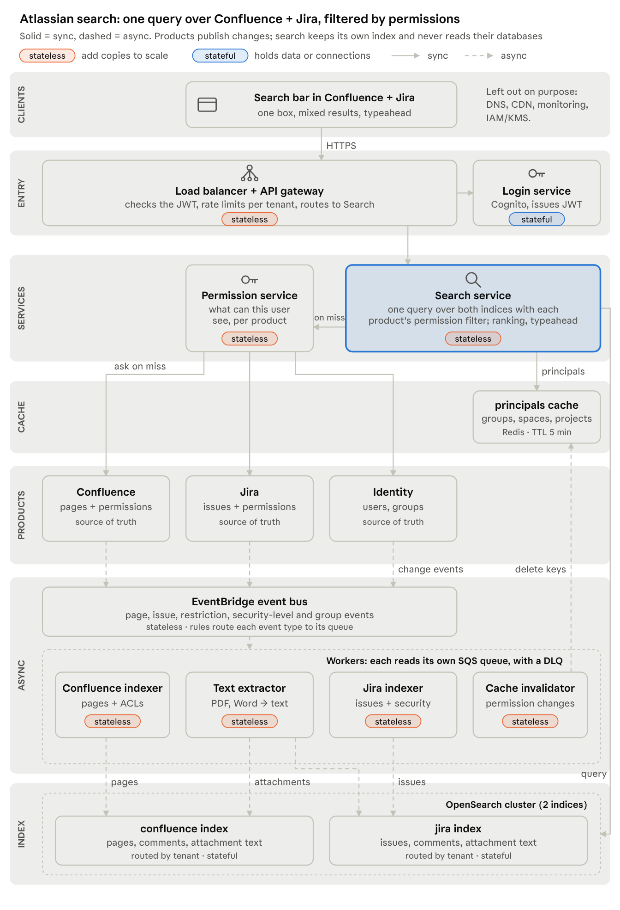

# Atlassian-wide Search (Confluence + Jira, permission-aware) – System Design

2026-11-17 · Arnav Jain

## 1. Basics and requirements

Atlassian customers keep knowledge in two places: **Confluence** (pages) and **Jira** (issues). They want **one search box** that finds a runbook page and the bug about it in the same result list. The hard part: the two products have **different permission models**, and search must respect both. It must never show a page or issue the user can't open, not its title, a snippet, or even a count.

**The words you need:**

| Word                          | Meaning                                                                             | Example                                                |
|-------------------------------|-------------------------------------------------------------------------------------|--------------------------------------------------------|
| Product                       | Where the content lives                                                             | Confluence, Jira                                       |
| Space (Confluence)            | A group of pages with its own permissions                                           | PAY space                                              |
| Page restriction (Confluence) | Extra rule on one page: only these users/groups may view it; child pages inherit it | "Legal only"                                           |
| Project (Jira)                | A group of issues; who can see them is set by the project's permission scheme       | PAY project                                            |
| Project role (Jira)           | A named group inside a project, set per project                                     | PAY developers                                         |
| Issue security level (Jira)   | Extra rule on one issue: only these roles/groups/users may view it                  | "Security bugs: PAY admins only"                       |
| Principal                     | A user, group or role that access is given to                                       | `user:u_asha`, `group:payments`, `role:PAY:developers` |
| Inverted index                | A map from each word to the documents that contain it                               | "refund" → \[pg_81c2, is_9f3a\]                        |

### Functional

1.  **One search across products:** Confluence pages, blogs, comments and attachments, plus Jira issues, comments and attachments, in **one ranked list**.

2.  **Filters and facets:** product, space or project, type, author or assignee, status, last updated. Facet counts only include what the user may see.

3.  **Permission-aware for both models:**

    - Confluence: can view the **space** AND passes any **page restriction**.

    - Jira: can **browse the project** AND passes the issue's **security level** (including rules like "the reporter can always see their own issue").

4.  **Fresh:** new or edited content is searchable within a few seconds.

5.  **Fast revocation:** when someone loses access, the item leaves their results within seconds.

6.  **Typeahead** on page titles and issue summaries from both products.

7.  **Attachments:** text inside PDFs and Word files from both products is searchable.

8.  **Search from inside one product** still works: Jira's search bar can ask for Jira results only.

### Non-functional

| Property     | Target                                                   | Why                                            |
|--------------|----------------------------------------------------------|------------------------------------------------|
| Scale        | 100M DAU, ~200K tenants, both products                   | Atlassian size                                 |
| Latency      | Search p99 \< 500 ms, typeahead p99 \< 100 ms            | Feels instant                                  |
| Freshness    | Changes searchable \< 5 s; revocations \< 5 s            | Users expect it; revocation is a security need |
| Security     | Zero leaks across tenants, products or permissions       | A leak is a security incident                  |
| Availability | 99.9%; if search is down, Confluence and Jira still work | Search is a separate system that reads copies  |

### Out of scope

- Jira's structured query language (JQL); this is keyword search. JQL stays inside Jira.

- Other products (Bitbucket, Trello); the design adds them the same way (see 8.9).

- Semantic / AI search (an extension in 8.9).

## 2. Quick traffic estimate

Reads dominate (~90K/s at peak), but Jira makes the write side much bigger than Confluence alone: ~20K index writes/s at peak.

**Assumptions to say out loud**

- 100M DAU; each runs 5 searches a day, with ~4 typeahead calls per search.

- Confluence: ~110M page edits and new pages a day.

- Jira: ~500M issue writes a day (create, edit, comment, transition), from the Jira design.

- ~2M attachments a day across both products.

| What                     | Math                | Average | Peak (×3) |
|--------------------------|---------------------|---------|-----------|
| Searches                 | 100M × 5 = 500M/day | ~6K/s   | ~18K/s    |
| Typeahead                | 500M × 4 = 2B/day   | ~23K/s  | ~70K/s    |
| Index writes: Confluence | 110M/day            | ~1.3K/s | ~4K/s     |
| Index writes: Jira       | 500M/day            | ~6K/s   | ~17K/s    |
| Attachments to extract   | 2M/day              | ~25/s   | ~70/s     |

**What this tells us**

- ~90K reads/s: each query must hit one shard per index (route by tenant), and each user's permissions must come from a cache, not from asking Confluence and Jira on every keystroke.

- ~20K writes/s: bulk writes into OpenSearch, fully async, so saving a page or an issue never waits for search.

- Jira writes are 5× Confluence's, so the Jira indexer scales separately from the Confluence one.

## 3. API

REST over HTTPS with a Cognito JWT; `tenantId` and `userId` always come from the token.

| Method + path            | What it does                                                |
|--------------------------|-------------------------------------------------------------|
| `GET /v1/search`         | One search across products, with filters, facets and paging |
| `GET /v1/search/suggest` | Titles and issue summaries while typing                     |
| `POST /v1/admin/reindex` | Rebuild a tenant's index for one product, in the background |

**Search (from the unified search bar)**

``` json
GET /v1/search?q=refund+timeout&products=confluence,jira&limit=20

200 OK
{ "results": [
    { "product": "jira", "id": "is_9f3a", "title": "Refund fails for UPI after timeout",
      "project": "PAY", "status": "In Progress", "assignee": "u_asha",
      "snippet": "...gateway <em>timeout</em> after 30 s, <em>refund</em> stays pending...",
      "updatedAt": "2026-11-16T18:20:00Z" },
    { "product": "confluence", "id": "pg_81c2", "title": "Refund runbook",
      "space": "PAY", "type": "page",
      "snippet": "If a <em>refund</em> hits a <em>timeout</em>, retry once...",
      "updatedAt": "2026-11-12T09:30:00Z" } ],
  "facets": { "product": { "jira": 31, "confluence": 12 },
              "spaceOrProject": { "PAY": 40, "OPS": 3 } },
  "approxTotal": 43,
  "nextCursor": "eyJzIjpbOS4xLCJpc185ZjNhIl19" }
```

Facets and `approxTotal` are computed **after** the permission filter, so they never hint at hidden items. Jira's own search bar sends `products=jira`.

**Events coming in** (each product publishes its own changes; search never reads the products' databases directly)

``` json
{ "type": "confluence.page.updated", "tenantId": "acme", "pageId": "pg_81c2", "spaceId": "PAY", "updatedAt": "2026-11-12T09:30:00.120Z" }
{ "type": "confluence.page.restriction_changed", "tenantId": "acme", "pageId": "pg_40d1", "view": ["group:legal"] }
{ "type": "jira.issue.updated", "tenantId": "acme", "issueId": "is_9f3a", "projectId": "PAY", "updatedAt": "2026-11-16T18:20:00.050Z" }
{ "type": "jira.issue.security_changed", "tenantId": "acme", "issueId": "is_77b2", "securityLevel": "sec_admins" }
{ "type": "identity.group.member_removed", "tenantId": "acme", "groupId": "payments", "userId": "u_ravi" }
{ "type": "jira.project.permissions_changed", "tenantId": "acme", "projectId": "PAY" }
```

## 4. HLD (high-level design)



Read it top to bottom; every arrow says who talks to whom.

- **Entry:** the search bar in Confluence or Jira → load balancer + API gateway (JWT check, rate limit) → Search service.

- **Services (both stateless):**

  - **Search service:** builds **one** OpenSearch query over both indices, with each product's own permission filter, then ranks, highlights and counts facets.

  - **Permission service:** answers "what can this user see?" per product: their groups, the Confluence spaces they can view, the Jira projects they can browse and their roles in each. On a cache miss it asks Confluence, Jira and Identity.

- **Cache:** the **principals cache** (Redis) holds that answer per user for 5 minutes, so ~90K reads/s don't hit the products.

- **Products (sources of truth):** Confluence, Jira and Identity own all content and permissions. Search **never reads their databases**; it only gets their change events and asks their permission APIs.

- **Async:** every product publishes change events to an **EventBridge bus**; rules send each kind of event to its own SQS queue and worker:

  - **Confluence indexer:** pages, comments, page restrictions → `confluence` index;

  - **Jira indexer:** issues, comments, security levels → `jira` index;

  - **Text extractor:** downloads attachments from either product (through its file API) and indexes their text into the matching index;

  - **Cache invalidator:** group, space-permission and project-permission changes → deletes the affected users' principals keys.

- **Index:** one OpenSearch cluster with two indices (different fields per product); one query searches both.

| Box                          | Stateless or stateful          | Talks to                                                   | Why it exists                                                 |
|------------------------------|--------------------------------|------------------------------------------------------------|---------------------------------------------------------------|
| Load balancer + API gateway  | stateless                      | Login service, Search service                              | Front door: JWT, rate limits                                  |
| Login service (Cognito)      | stateful                       | —                                                          | Signs users in, issues the JWT                                |
| Search service               | stateless                      | principals cache, Permission service (on miss), OpenSearch | One query, both products, permission filters, ranking         |
| Permission service           | stateless                      | Confluence, Jira, Identity permission APIs                 | Computes a user's principals per product                      |
| Principals cache (Redis)     | stateful                       | —                                                          | User → groups, spaces, projects, roles; TTL 5 min             |
| Confluence / Jira / Identity | stateful (their own DBs)       | Event bus                                                  | Sources of truth; publish every change                        |
| EventBridge bus → SQS        | bus stateless, queues stateful | Workers                                                    | Routes each event type to the right worker; DLQs              |
| Confluence indexer           | stateless                      | confluence index                                           | Page documents and page-restriction ACLs                      |
| Jira indexer                 | stateless                      | jira index                                                 | Issue documents and security-level ACLs                       |
| Text extractor               | stateless                      | Products' file APIs, both indices                          | Makes attachments searchable; separate pool because it's slow |
| Cache invalidator            | stateless                      | principals cache                                           | Fast revocation after group or permission changes             |
| OpenSearch (2 indices)       | stateful                       | —                                                          | Inverted index + permission fields; a rebuildable copy        |

**Left out of the HLD on purpose** (say them out loud if asked): DNS, CDN, monitoring, IAM/KMS, and the products' internals (covered in the Jira and Confluence designs).

## 5. Flows

Two paths again: the **write path** keeps both indices in sync with the products, and the **read path** runs one query that only sees what the user may see.

### Flow A: A Confluence page is edited → searchable in ~2 s

1.  Asha saves page `pg_81c2` in Confluence. Confluence saves it and publishes `confluence.page.updated` to the EventBridge bus.

2.  A bus rule sends it to `confluence-index-q` → Confluence indexer.

3.  The indexer calls Confluence's internal API for the **current** page (title, body, space, ancestors, restriction) instead of trusting the event body, so a late event just re-indexes the latest state.

    The event on the bus is small. It says **what** changed, not the new content:

    ``` json
    {
      "source": "confluence",
      "detail-type": "page.updated",
      "time": "2026-11-18T10:02:05Z",
      "detail": {
        "eventId": "evt_7c41",
        "tenant": "acme",
        "pageId": "pg_81c2",
        "spaceKey": "ENG",
        "version": 14,
        "changedBy": "u_asha",
        "change": "content"
      }
    }
    ```

    The indexer then fetches the page as it is **now**:

    ``` json
    GET /internal/confluence/acme/pages/pg_81c2?expand=body,ancestors,restrictions

    200 OK
    {
      "pageId": "pg_81c2", "version": 15, "status": "current",
      "title": "Onboarding guide", "spaceKey": "ENG",
      "body": "Welcome to the ENG team. Day 1: laptop setup …",
      "ancestors": ["pg_12"],
      "restrictions": { "view": [], "inherited_view": ["group:eng-staff"] },
      "updatedAt": "2026-11-18T10:02:09Z"
    }
    ```

    The event said version 14, but the page is already at 15 (Asha saved again 4 seconds later). The indexer writes version 15 to the index, with `version` as the document's external version, so if the version-14 event is processed later it changes nothing: OpenSearch refuses a write with a lower version.

4.  It builds the document: text fields + `space_id` + `view_acl` (the page's own restriction, its closest restricted parent's, or `["*"]`).

5.  Upsert into the `confluence` index with **external version = `updatedAt` in ms**, so an older event can never overwrite a newer one. Searchable after the next 1 s refresh.

### Flow B: A Jira issue is updated → searchable in ~2 s

1.  Ravi changes issue `is_9f3a` in Jira. Jira publishes `jira.issue.updated` (project PAY).

2.  Bus rule → `jira-index-q` → Jira indexer, which fetches the current issue from Jira's API.

3.  It builds the document: summary, description, comments, status, assignee, `project_id`, and `view_acl` from the issue's security level:

    - no security level → `view_acl = ["*"]` (anyone who can browse the project);

    - level "PAY admins + reporter" → `["role:PAY:administrators", "user:u_meena"]` (Meena reported it, so she keeps access).

4.  Upsert into the `jira` index with the same external versioning.

### Flow C: Search "refund timeout" across both products

1.  `GET /v1/search?q=refund timeout&products=confluence,jira` → Search service.

2.  Load Asha's principals from Redis, `principals:acme:v42:u_asha`: `{ groups: [payments, eng], spaces: [PAY, ENG], projects: [PAY, OPS], roles: [role:PAY:developers] }`. On a miss, the Search service asks the Permission service, which asks Identity (groups), Confluence (viewable spaces) and Jira (browsable projects, roles), then caches the answer for 5 min.

    **Why load principals first, if permissions are re-checked later?** The re-check (step 4) only sees the 20 hits OpenSearch already chose. Without principals in the query, Asha's top 20 for "salary" would be mostly HR pages she can't see: the re-check would drop 18 and leave 2 results, counts and facets would reveal hidden pages ("HR (36)"), and page 2 couldn't be computed. With principals in the query, OpenSearch only ranks what she can see, so results, counts, facets and paging are correct, and the re-check catches only changes from the last few minutes.

    | Check                   | Job                                | Fresh?          | Cost                        |
    |-------------------------|------------------------------------|-----------------|-----------------------------|
    | Principals in the query | Main filter over all documents     | up to 5 min old | almost free (cached filter) |
    | Re-check of the top 20  | Safety net for very recent changes | exact, now      | one batch call for 20 items |

    **What is stored where** (this entry is Asha's side only, not a permission per issue or page):

    | Where                                            | What                                                                                           | Example                                                                 |
    |--------------------------------------------------|------------------------------------------------------------------------------------------------|-------------------------------------------------------------------------|
    | Confluence and Jira (source of truth)            | Space permissions, page restrictions, permission schemes, project roles, issue security levels | —                                                                       |
    | Redis `principals:…` (one entry per user, 5 min) | Her groups, roles, and the spaces and projects she can open                                    | `{ groups: [payments, eng], spaces: [PAY, ENG], projects: [PAY, OPS] }` |
    | Search index (on each restricted item)           | That item's extra rule, `view_acl`                                                             | `pg_81c2: [group:hr-leads]`, `SEC-41: [group:security]`                 |

    The query joins both sides: "space or project in her list" **and** "no `view_acl`, or `view_acl` contains one of her groups or roles". Giving a group a whole space changes only cached user entries (no re-indexing); restricting one page changes only that page's document.

    **How big can the entry get?**

    | Case                                  | Contents                                              | Size    |
    |---------------------------------------|-------------------------------------------------------|---------|
    | Typical user                          | ~20 groups, ~10 roles, ~150 spaces + projects         | ~1–5 KB |
    | Worst realistic (admin at a huge org) | 500 groups, 1,000 roles, 5,000 spaces, 2,000 projects | ~100 KB |

    Redis allows 512 MB per value, so Redis isn't the limit. OpenSearch is: a terms filter allows at most 65,536 values by default, and long lists slow every query, so the practical cap is about 1,000 spaces or projects. Past that:

    - **Don't list open spaces:** pages in spaces open to all site users are indexed with `visible_to: all_users`; the query adds `visible_to = all_users OR space IN [her other spaces]`.

    - **Filter by groups instead of spaces:** index each document with the groups that can see its space (`space_acl`), so the query sends her ~20–500 groups, never 5,000 space keys. The cost is re-indexing a space's pages in the background when its permissions change.

    - **Site admins** who can see everything get a `browse_all` flag and skip the space filter.

    Overall: ~5M users active within 5 minutes × ~3 KB ≈ 15 GB of Redis.

3.  Build **one** OpenSearch query over both indices. The text part is shared; each product gets its own permission filter:

``` json
{ "query": { "bool": {
    "must": [ { "multi_match": { "query": "refund timeout",
                "fields": ["title^3", "body", "comments", "attachment_text^0.5"] } } ],
    "filter": [ { "term": { "tenant_id": "acme" } } ],
    "should": [
      { "bool": { "filter": [
          { "term":  { "_index": "confluence" } },
          { "terms": { "space_id": ["PAY", "ENG"] } },
          { "terms": { "view_acl": ["*", "user:u_asha", "group:payments", "group:eng"] } } ] } },
      { "bool": { "filter": [
          { "term":  { "_index": "jira" } },
          { "terms": { "project_id": ["PAY", "OPS"] } },
          { "terms": { "view_acl": ["*", "user:u_asha", "group:payments", "group:eng", "role:PAY:developers"] } } ] } } ],
    "minimum_should_match": 1 } },
  "aggs": { "product": { "terms": { "field": "product" } } },
  "size": 20 }
```

4.  The query goes to `confluence,jira` with `routing = acme`, so it touches one shard in each index. OpenSearch scores only documents that pass their product's filter; facets are counted on the same filtered set.

5.  **Safety net:** for the top 20 hits, the Search service asks the Permission service one batch question, "can Asha still see these?", which it answers from the products' permission APIs. Any "no" is dropped. This covers a change made in the last few seconds.

6.  Return one mixed, ranked list with snippets, facets and a cursor.

### Flow D: Ravi is removed from the payments group

1.  An admin removes Ravi in Identity. Identity publishes `identity.group.member_removed`.

2.  Bus rule → `perm-q` → Cache invalidator → deletes `principals:acme:v*:u_ravi` in Redis.

3.  His next search rebuilds his principals without `payments`. **No document changes**, in either index, because documents store groups, not people. Takes about 1 s.

### Flow E: An issue is moved to a security level

1.  A security bug `is_77b2` gets level "PAY admins only". Jira publishes `jira.issue.security_changed`.

2.  Bus rule → `jira-index-q` → Jira indexer re-fetches the issue and sets `view_acl = ["role:PAY:administrators"]` on the issue **and** its attachment documents.

3.  Until that lands (a second or two), the safety net in Flow C step 5 hides it from everyone else.

### Flow F: A space's or project's permissions change

1.  Someone gives group `contractors` view access to space PAY (or removes it from project PAY). The product publishes `…permissions_changed`.

2.  Bus rule → `perm-q` → Cache invalidator bumps `acl_version:acme` in Redis (v42 → v43). Every cached principals entry for that tenant has the old version in its key, so all are ignored at once and rebuilt on next use; the old keys expire by themselves.

3.  Again **no documents change**: space and project lists live in the query, not in the documents.

### Flow G: An attachment is uploaded (either product)

1.  Confluence or Jira publishes `attachment.created` with the parent page or issue.

2.  Bus rule → `extract-q` → Text extractor gets a short-lived download URL from that product's file API, downloads the file and extracts up to 1 MB of text (Apache Tika; OCR for scanned PDFs).

3.  It writes an attachment document into the matching index, copying the parent's `space_id`/`project_id` and `view_acl`, so the attachment is exactly as visible as its page or issue.

## 6. Data model

The search system owns only **copies**: two OpenSearch indices and a Redis cache. Confluence, Jira and Identity stay the source of truth, so any index can be rebuilt from them.

### OpenSearch: `confluence` index (one document per page, blog, comment or attachment)

``` json
{ "tenant_id": "acme", "product": "confluence", "doc_id": "pg_81c2", "type": "page",
  "space_id": "PAY", "ancestors": ["pg_10"],
  "title": "Refund runbook", "body": "If a refund hits a timeout, retry once...",
  "labels": ["runbook"], "author_id": "u_asha",
  "updated_at": "2026-11-12T09:30:00Z", "views_30d": 412,
  "view_acl": ["*"] }
```

### OpenSearch: `jira` index (one document per issue, comment or attachment)

``` json
{ "tenant_id": "acme", "product": "jira", "doc_id": "is_9f3a", "type": "issue",
  "project_id": "PAY", "issue_type": "Bug", "status": "In Progress", "priority": "High",
  "title": "Refund fails for UPI after timeout",
  "body": "Gateway times out after 30 s; refund stays pending...",
  "comments": ["Seen again on 16 Nov"], "assignee_id": "u_asha", "reporter_id": "u_meena",
  "updated_at": "2026-11-16T18:20:00Z",
  "view_acl": ["*"] }
```

**How each product's permissions become fields:**

|                                   | Confluence                                                    | Jira                                                                  |
|-----------------------------------|---------------------------------------------------------------|-----------------------------------------------------------------------|
| Container rule (in the **query**) | `space_id IN` the user's viewable spaces                      | `project_id IN` the user's browsable projects                         |
| Item rule (in the **document**)   | `view_acl` from the page restriction (inherited from parents) | `view_acl` from the issue security level                              |
| "Anyone allowed by the container" | `["*"]`                                                       | `["*"]` (no security level)                                           |
| Typical restricted value          | `["group:legal", "user:u_cfo"]`                               | `["role:PAY:administrators", "user:u_meena"]` (reporter keeps access) |

- Both indices share the same field names for common things (`title`, `body`, `tenant_id`, `product`, `view_acl`, `updated_at`), so one query can search both.

- Product-only fields (`status`, `assignee_id`, `space_id`, `ancestors`) live only in their index.

- `tenant_id`, `space_id`, `project_id`, `view_acl` are exact-match keyword fields; `title` also has a `search_as_you_type` sub-field for typeahead.

### Redis: principals cache

| Key                                         | Value                                                                               | TTL                                       |
|---------------------------------------------|-------------------------------------------------------------------------------------|-------------------------------------------|
| `principals:{tenant}:v{acl_version}:{user}` | `{ groups: [...], spaces: [...], projects: [...], roles: ["role:PAY:developers"] }` | 5 min; deleted on any change to that user |
| `acl_version:{tenant}`                      | A number, bumped when a space's or project's permissions change                     | none                                      |

Everything else (pages, issues, permission schemes, group memberships, attachment files) stays in the products' own stores.

## 7. Storage estimate

The two indices together grow ~280 TB a year including one replica; Jira's index is the bigger one because Jira has far more writes and comments.

**Assumptions:** index size ≈ 1.5× the raw text, plus 1 replica (×2 overall ≈ ×3 the raw text).

| Data                   | Math                    | Per day | Per year        | Where              |
|------------------------|-------------------------|---------|-----------------|--------------------|
| Confluence pages       | 10M new × 10 KB × 3     | 300 GB  | ~110 TB         | `confluence` index |
| Jira issues            | 20M new × 2 KB × 3      | 120 GB  | ~44 TB          | `jira` index       |
| Jira comments          | 100M × 500 B × 3        | 150 GB  | ~55 TB          | `jira` index       |
| Confluence comments    | 20M × 500 B × 3         | 30 GB   | ~11 TB          | `confluence` index |
| Attachment text (both) | 2M × 20 KB × 3          | 120 GB  | ~44 TB          | the matching index |
| Principals cache       | 20M active users × 4 KB | —       | ~80 GB (steady) | Redis              |

**What the numbers decide**

| Finding                         | Decision                                                                                                             |
|---------------------------------|----------------------------------------------------------------------------------------------------------------------|
| ~280 TB/year across two indices | Each index has its own shards (~30–50 GB each), routed by tenant; rarely searched old data on warm nodes (UltraWarm) |
| Jira grows ~2× faster           | Jira indexer and Jira shards scale on their own; no need to grow Confluence's                                        |
| Indices are copies              | Rebuild a product's index from that product (new index + alias swap), never treat OpenSearch as the backup           |
| ~90K reads/s need principals    | An ~80 GB Redis cluster; products' permission APIs only see cache misses                                             |

## 8. Deep dives

What the interviewer will push on: one index or two, how two permission models become one filter, how to rank a page against an issue, and how permission changes reach search fast.

### 8.1 One index or one per product?

|                       | One shared index                                               | One index per product (our design)                    | Separate search systems per product                        |
|-----------------------|----------------------------------------------------------------|-------------------------------------------------------|------------------------------------------------------------|
| Fields                | Every field of every product in one mapping; many empty fields | Each product its own fields and analyzers             | Each its own                                               |
| Scaling               | One size for all                                               | Jira's index grows and scales on its own              | Separate everything                                        |
| One mixed result list | Easy                                                           | Easy: one query over both indices (`confluence,jira`) | Hard: two queries, then merge two differently scored lists |
| Adding a product      | Changes everyone's mapping                                     | Add an index + an indexer                             | A whole new system                                         |

We take the middle: **separate indices in one cluster, searched by one query**. Common fields share names (`title`, `body`, `tenant_id`, `view_acl`) so scores are comparable.

### 8.2 Two permission models, one filter

Both products follow the same shape: a **container** rule plus an optional **item** rule.

|                    | Container rule                                                                 | Item rule                                                                     |
|--------------------|--------------------------------------------------------------------------------|-------------------------------------------------------------------------------|
| Confluence         | View permission on the space                                                   | Page restriction (inherited by child pages)                                   |
| Jira               | "Browse projects" in the project's permission scheme                           | Issue security level                                                          |
| Where we check it  | In the **query**: lists of spaces and projects from the principals cache       | In the **document**: `view_acl`                                               |
| What changes often | People joining groups, space/project permission edits: **no document rewrite** | Restrictions and security levels: rewrite just those documents (and children) |

**Jira's tricky cases:**

- **Project roles:** "developers can see security-level X" means the role, not a group. Principals carry roles per project (`role:PAY:developers`), and `view_acl` stores the role.

- **"Reporter" or "assignee" in a security level:** these depend on the issue, so the indexer writes the actual person into `view_acl` (`user:u_meena`). If the reporter or assignee changes, the issue is re-indexed anyway.

- **Customer portals ("customers see only their own requests"):** the same trick: `user:<reporter>` in `view_acl`, and the project isn't in the customer's browsable list. Customers only match through their own user id.

### 8.3 Ranking a page against an issue

- **Shared base score:** BM25 on the shared fields with the same boosts in both indices: title ×3, body ×1, comments ×0.7, attachment text ×0.5. Same fields + same analyzer = comparable scores.

- **Where the search started:** from inside Jira, Jira results get a small boost (and vice versa); from the unified bar, no boost.

- **About me:** a boost for issues assigned to or reported by the user, and pages they wrote or watch.

- **Freshness and state:** recency decay for both; a small penalty for closed Jira issues and archived pages.

- **Popularity:** log of views (pages) or of watchers and comments (issues).

- **Later:** learning-to-rank trained on clicks across both products.

### 8.4 What each permission change touches

| Change                               | Product    | What we update                                                                                             | Takes effect in                            |
|--------------------------------------|------------|------------------------------------------------------------------------------------------------------------|--------------------------------------------|
| User added to / removed from a group | Identity   | Delete that user's principals key                                                                          | ~1 s                                       |
| User's project role changed          | Jira       | Delete that user's principals key                                                                          | ~1 s                                       |
| Space permission changed             | Confluence | Bump `acl_version:{tenant}`                                                                                | ~1 s                                       |
| Project permission scheme changed    | Jira       | Bump `acl_version:{tenant}`                                                                                | ~1 s                                       |
| Page restricted / unrestricted       | Confluence | Confluence indexer updates the page, its children and their attachments (`update_by_query` on `ancestors`) | Seconds; the top-20 recheck covers the gap |
| Issue security level set or changed  | Jira       | Jira indexer updates the issue and its attachments                                                         | Seconds; recheck covers the gap            |
| Issue moved to another project       | Jira       | Jira indexer re-writes `project_id` and `view_acl`                                                         | Seconds                                    |

### 8.5 Keeping two indices in sync

- Each product publishes events; **search never reads a product's database**, so products can change their schemas freely.

- Indexers **re-fetch the current item** from the product's API, so late or duplicate events are harmless.

- **External versioning** (`updatedAt` in ms) stops an older write from overwriting a newer one.

- **Bulk writes** of up to 500 documents or 1 s per index.

- **DLQ** on every queue (3 tries) plus a nightly reconciler per product: compare counts per space/project with the product's own counts and re-index any drift.

- **Rebuild one product** (new analyzer, new field): build `jira-v2` from Jira's bulk export API, double-write new events, then switch the alias `jira` → `jira-v2`. Confluence is untouched.

### 8.6 The safety net: recheck the top 20

- Early binding (permissions in the query and documents) is fast but can lag for a second or two after a change.

- So before returning, the Search service sends the top 20 ids to the Permission service, which asks each product's **bulk permission check** ("can u_asha view these 12 pages and 8 issues?") and drops any "no".

- One batched call per product, done in parallel, so it costs ~10–30 ms.

### 8.7 Typeahead across both products

- `search_as_you_type` on page titles and issue summaries, same tenant + permission filters (never a shared prefix cache: two users typing "ref" can see different titles).

- Return 4 pages + 4 issues, plus recently viewed items merged in by the browser. Debounce ~150 ms → p99 \< 100 ms.

### 8.8 Multi-tenancy and sharding

- Each index is routed by `tenant_id`, so a tenant's query touches one shard per index.

- `tenant_id` is also a filter in every query; a routing bug can't leak another tenant's data.

- Huge tenants get their own indices; busy cells add replicas without re-indexing.

### 8.9 Extensions

- **More products** (Bitbucket, Trello): add an index, an indexer and a permission adapter in the Permission service. The query adds one more `should` clause with that product's container + item filter.

- **Semantic search:** embeddings for page chunks and issues in a k-NN field, combined with BM25; the same permission filters are applied before the vector search.

- **Ask a question (AI answers):** retrieve only permitted chunks from both products and pass those to an LLM, never anything the user can't see.

## 9. Wrap-up

**30-second summary:**

> "Confluence, Jira and Identity stay the sources of truth and publish change events to an EventBridge bus. Rules route them to SQS queues for a Confluence indexer, a Jira indexer, a text extractor and a cache invalidator, which keep two OpenSearch indices in one cluster in sync, using versioned upserts. Both products' permissions follow the same pattern: a container rule (space or project) that goes into the query from a Redis principals cache, and an item rule (page restriction or issue security level) stored on each document as view_acl. One query searches both indices, each with its own filter, so results, snippets and facet counts never leak. A batch recheck of the top 20 against the products covers the seconds after a change; group and permission changes only invalidate the cache, never rewrite documents."

| Decision                                               | Why                                                                        | Trade-off                                                    |
|--------------------------------------------------------|----------------------------------------------------------------------------|--------------------------------------------------------------|
| One index per product, one cluster, one query          | Own fields and scaling per product; still one mixed list                   | Shared field names must be kept consistent                   |
| Container rule in the query, item rule in the document | Group, space and project changes never rewrite documents                   | Users in thousands of spaces/projects send long filter lists |
| Products publish events; search never reads their DBs  | Products evolve freely; search can be rebuilt from them                    | Indexers depend on product APIs being available              |
| Redis principals cache + `acl_version`                 | ~90K reads/s without asking the products; instant tenant-wide invalidation | Another store; invalidation must be right                    |
| Recheck top 20 with the products                       | Fresh after revocations, correct counts                                    | ~10–30 ms extra per search                                   |
| Same fields and boosts in both indices                 | Page and issue scores are comparable                                       | Less freedom to tune each product alone                      |
| Separate extractor pool                                | Big files never delay page or issue indexing                               | One more worker fleet                                        |

**If they push further:** more products (one index + indexer + permission adapter each), semantic search with the same permission pre-filter, AI answers over only permitted content, learning-to-rank from clicks, and GDPR deletion (delete in the product → event → documents removed).
