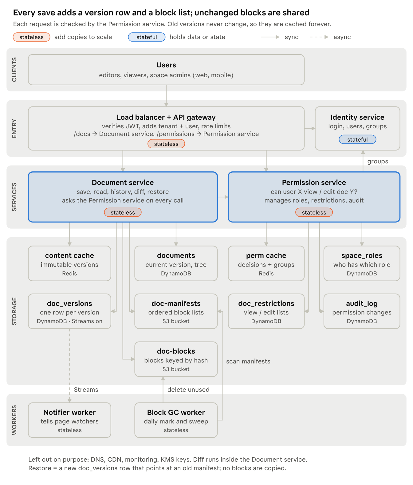

# Document Version Control with Permissions – System Design

Nov 17, 2026 · Arnav Jain

## 1. Basics and requirements

A document version control system keeps **every saved version** of a document forever, so people can see who changed what, compare two versions and go back to an old one. **Permissions** decide who can see a document (and all its old versions) and who can change it. Example at Atlassian: Confluence page history ("v5 by Ravi, 10:02 — fixed pricing table"), page restrictions ("only the Finance group can view this page") and space permissions.

This is not real-time co-editing (that's the Collab design). Here the unit is a **saved version**: Asha clicks Save (or Publish) and v5 is created.

**The words you need:**

| Word | Meaning | Example |
| --- | --- | --- |
| Version | One saved, never-changing copy of a document | `pg_81c2` v5, saved by Ravi at 10:02 |
| Block | One piece of a document: a paragraph, heading, table or image | `b_7f`: "Pricing starts at $10" |
| Content hash | A fingerprint of a block's content (SHA-256); same content = same hash | `sha256("Pricing starts at $10")` = `9a1c…` |
| Manifest | The list of blocks (in order) that make up one version | v5 = `[b_1:4e2a, b_7f:9a1c, b_9:77d0]` |
| Base version | The version your edit started from | Asha opened v4, so she saves with `baseVersion: 4` |
| Conflict | Someone else saved after you opened the doc | Ravi saved v5 while Asha was still editing v4 |
| Restore | Make an old version the newest again, by creating a new version | Restore v3 → creates v6 with v3's content |
| Space | A container of documents with its own members and roles | Space `FIN` (Finance) |
| Role | What a person can do in a space | admin, editor, viewer |
| Restriction | An extra rule on one document that narrows who can view or edit it | "View: only group `finance-leads`" on `pg_81c2` |
| Principal | A user or a group that a permission is given to | `user:asha`, `group:finance-leads` |
| Inheritance | A view restriction on a parent page also applies to its child pages | Restricting "Budget 2027" hides all pages under it |
| `acl_version` | A counter that goes up whenever permissions change, used to throw away old cached answers | space FIN `acl_version` 41 → 42 |

### Functional

1. **Create and save:** create a document; every save creates the next version (v1, v2, v3 …) with author, time and an optional message.
2. **Read:** open the latest version quickly.
3. **History:** list all versions of a document, newest first, and open any old version.
4. **Compare:** show what changed between any two versions (added, removed, changed blocks, and the words inside them).
5. **Restore:** bring back an old version. History is never rewritten: restore creates a new version.
6. **Safe concurrent saves:** two people saving at the same time must never overwrite each other silently; the second one is told and offered a merge.
7. **Permissions:**
   - Space roles: **admin** (manage permissions, purge versions), **editor** (create, edit, restore), **viewer** (read, history, compare).
   - Document restrictions: "only these people/groups can **view**" and "only these can **edit**". View restrictions are inherited by child pages; edit restrictions are not.
   - Every read, history view, compare, save and restore is checked.
   - Permissions apply to **all versions** of a document: if you can't see the page now, you can't see any of its old versions either.
8. **Revoking works fast:** when Ravi is removed, he loses access within a few seconds.
9. **Audit:** every permission change is recorded (who changed what, when).
10. **Purge:** an admin can permanently delete a version (for example one with a leaked password).

### Non-functional

| Need | Target | Why |
| --- | --- | --- |
| Durability | Never lose a saved version (S3: 11 nines) | Version history is a legal and audit record |
| Read latency | Latest version p99 < 200 ms | Opening a page is the most common action |
| Save latency | p99 < 500 ms | Saves are less frequent and can be a bit slower |
| Permission check | < 10 ms (cached) | It runs on every request |
| Consistency | Version numbers are exact: never two v5s, never a gap | People refer to "v5" in discussions |
| Revocation | Effective within \~5 s | Removing access is a security action |
| Availability | 99.99% for reads, 99.9% for saves | Reading must almost never fail |
| Multi-tenant | Each customer's data and permissions are isolated | Atlassian Cloud has many customers on shared infrastructure |

### Out of scope

- Real-time co-editing (see the Collab design); here a version is created on Save.
- Branches and merge requests like Git (mentioned in "If they push further").
- Search, comments, attachments (attachments would be versioned the same way as blocks).
- Login itself (we use an existing identity service for users and groups).

## 2. Quick traffic estimate

Reads dominate. Every request also needs a **permission check**, so that check must be cheap.

**Assumptions:** 100M daily active users; each opens \~20 documents a day; 1 in 10 users edits, saving \~5 times a day; average document \~50 KB in \~200 blocks; a save changes \~2 blocks (\~4 KB).

| What | Per day | Per second (avg) | Peak (×3) |
| --- | --- | --- | --- |
| Open latest version | 100M × 20 = 2B | \~23K | \~70K |
| Permission checks (one per request) | \~2.1B | \~24K | \~75K |
| Saves (new versions) | 10M × 5 = 50M | \~600 | \~2K |
| History list / old version views | \~1% of reads = 20M | \~230 | \~700 |
| Compare (diff) | \~10M | \~120 | \~400 |
| Restores | \~1M | \~12 | \~40 |
| Permission changes | \~5M | \~60 | \~200 |

**What this tells us:**

- **\~70K reads/s at peak:** reading must be served from caches. Old versions never change, so a version can be cached forever.
- **\~75K permission checks/s:** checking DynamoDB tables every time is too much; cache the answers and throw them away when permissions change.
- **\~2K saves/s:** easy for DynamoDB, but each save must get an exact next number (v5, never two v5s).
- **50M versions/day:** storing a full copy per version (50 KB) is 2.5 TB/day. Storing only the changed blocks (\~4 KB) plus a small block list is \~10x less (section 7).

## 3. API

All calls carry a JWT; the gateway puts `tenantId` and `userId` on every request. Every endpoint does a permission check first.

| Endpoint | Needs | What it does |
| --- | --- | --- |
| `POST /v1/docs` | editor in the space | Create a document (v1) |
| `GET /v1/docs/{id}` | can view | Latest version + what you're allowed to do |
| `PUT /v1/docs/{id}` | can edit | Save a new version (needs `baseVersion`) |
| `GET /v1/docs/{id}/versions` | can view | Version history, newest first, paged |
| `GET /v1/docs/{id}/versions/{v}` | can view | One old version |
| `GET /v1/docs/{id}/diff?from=3&to=5` | can view | What changed between two versions |
| `POST /v1/docs/{id}/restore` | can edit | Make an old version the newest (creates a new version) |
| `PUT /v1/docs/{id}/restrictions` | can edit + admin or owner | Set who can view / edit this document |
| `PUT /v1/spaces/{id}/permissions` | space admin | Give a user or group a role in the space |
| `GET /v1/docs/{id}/access` | can view | Who can view / edit, and why ("via group finance-leads") |
| `DELETE /v1/docs/{id}/versions/{v}` | space admin | Purge one version permanently |

**Save a new version**

```json
PUT /v1/docs/pg_81c2
{
  "baseVersion": 4,
  "message": "Fixed pricing table",
  "blocks": [
    { "id": "b_1",  "type": "heading",   "text": "Pricing" },
    { "id": "b_7f", "type": "paragraph", "text": "Pricing starts at $12" },
    { "id": "b_9",  "type": "table",     "rows": [["Plan", "Price"], ["Pro", "$12"]] }
  ]
}

201 Created
{ "docId": "pg_81c2", "version": 5, "createdAt": "2026-11-17T10:02:00Z", "author": "user:ravi" }
```

If someone else saved first:

```json
409 Conflict
{ "error": "version_conflict", "yourBase": 4, "currentVersion": 5, "currentAuthor": "user:asha" }
```

The client then fetches v5 and merges (Flow B).

**Open the latest version**

```json
GET /v1/docs/pg_81c2

200 OK
{
  "docId": "pg_81c2", "title": "Pricing", "spaceId": "FIN",
  "version": 5, "updatedBy": "user:ravi", "updatedAt": "2026-11-17T10:02:00Z",
  "blocks": [ … ],
  "you": { "canView": true, "canEdit": true, "canAdmin": false }
}
```

**Version history**

```json
GET /v1/docs/pg_81c2/versions?limit=2

200 OK
{
  "versions": [
    { "version": 5, "author": "user:ravi", "at": "2026-11-17T10:02:00Z", "message": "Fixed pricing table", "changedBlocks": 2 },
    { "version": 4, "author": "user:asha", "at": "2026-11-16T15:40:00Z", "message": "Added Pro plan", "changedBlocks": 1 }
  ],
  "nextCursor": "v3"
}
```

**Compare two versions**

```json
GET /v1/docs/pg_81c2/diff?from=3&to=5

200 OK
{
  "from": 3, "to": 5,
  "changes": [
    { "block": "b_7f", "type": "changed", "words": [ { "removed": "$10" }, { "added": "$12" } ] },
    { "block": "b_9",  "type": "added" },
    { "block": "b_4",  "type": "removed" }
  ]
}
```

**Restore**

```json
POST /v1/docs/pg_81c2/restore
{ "fromVersion": 3, "baseVersion": 5 }

201 Created
{ "version": 6, "restoredFrom": 3 }
```

**Set restrictions on a document**

```json
PUT /v1/docs/pg_81c2/restrictions
{
  "view": ["group:finance-leads", "user:asha"],
  "edit": ["user:asha"]
}

200 OK
{ "docId": "pg_81c2", "aclVersion": 18 }
```

An empty list means "no extra restriction": everyone with a role in the space can view (or edit, if they're an editor).

**Who has access**

```json
GET /v1/docs/pg_81c2/access

200 OK
{
  "canView": [ { "principal": "group:finance-leads", "via": "restriction on pg_81c2" }, { "principal": "user:asha", "via": "restriction on pg_81c2" } ],
  "canEdit": [ { "principal": "user:asha", "via": "restriction on pg_81c2 + editor in FIN" } ]
}
```

## 4. HLD (high-level design)



Read it top to bottom. Every request goes through the gateway to one of two services. The **Document service** owns documents and their versions (left side of storage). The **Permission service** owns who can do what (right side of storage). The Document service asks the Permission service before doing anything.

**The big idea: a version is a list of block fingerprints.** A document is split into blocks (paragraphs, headings, tables). Each block is stored once in S3 under its content hash. A version is just an ordered list of those hashes (a manifest). When Ravi changes one paragraph, only that one new block is uploaded; the other 199 blocks are shared with the previous version.

```
v4 manifest: [b_1:4e2a, b_7f:9a1c, b_9:77d0]          ← "Pricing starts at $10" is 9a1c
v5 manifest: [b_1:4e2a, b_7f:c3f1, b_9:77d0]          ← only b_7f changed: new block c3f1 "… $12"
doc-blocks:  4e2a, 9a1c, 77d0, c3f1                     ← 4 blocks stored, not 6
```

This makes three things cheap: **saving** (upload only changed blocks), **comparing** (compare two lists of hashes; same hash = unchanged) and **restoring** (point a new version at an old manifest; nothing is copied).

**What each part does**

- **Entry**
  - **Load balancer + API gateway:** verifies the JWT, adds `tenantId` and `userId`, rate limits, and routes `/docs` to the Document service and `/permissions` to the Permission service.
  - **Identity service:** login, users and group memberships ("Ravi is in `finance-leads`"). An existing system; we only read groups from it.
- **Services**
  - **Document service** (stateless): create, save, read, history, diff and restore. Before any of these it asks the Permission service "can this user view / edit this doc?" and sends the doc's space and its ancestor pages with the question.
  - **Permission service** (stateless): answers those questions in a few milliseconds from its cache, and manages space roles, document restrictions and the audit log.
- **Storage, documents side**
  - **`documents`** (DynamoDB): one row per document: space, parent page, ancestor pages, title and the **current version number**. The current version number is how we make sure two saves never both become v5.
  - **`doc_versions`** (DynamoDB): one row per version: author, time, message and where its manifest is. Streams are on, so every new version is also an event.
  - **`doc-manifests`** (S3 bucket): one small JSON file per version, the ordered list of `blockId:hash`.
  - **`doc-blocks`** (S3 bucket): block contents, keyed by hash. Written once, never changed.
  - **content cache** (Redis): fully assembled versions, keyed by doc + version number. A version never changes, so a cached copy is never stale.
- **Storage, permissions side**
  - **`space_roles`** (DynamoDB): who is admin / editor / viewer in each space.
  - **`doc_restrictions`** (DynamoDB): per-document view and edit lists.
  - **`audit_log`** (DynamoDB): every permission change, written together with the change itself.
  - **perm cache** (Redis): recent yes/no answers and each user's groups, tagged with the `acl_version` they were computed at.
- **Workers**
  - **Notifier worker:** reads `doc_versions` Streams and tells page watchers "Ravi updated Pricing (v5)".
  - **Block GC worker:** once a day, finds blocks that no manifest uses any more (after a purge) and deletes them.

| Box | Stateless or stateful | Talks to | Why it exists |
| --- | --- | --- | --- |
| Load balancer + API gateway | stateless | Document service, Permission service, Identity | Auth, tenant, rate limits, routing |
| Identity service | stateful | — | Users and groups (existing system) |
| Document service | stateless | Permission service, `documents`, `doc_versions`, `doc-manifests`, `doc-blocks`, content cache | Everything about documents and versions, including diff |
| Permission service | stateless | Identity, perm cache, `space_roles`, `doc_restrictions`, `audit_log` | One place that decides access, so every path checks the same way |
| `documents` (DynamoDB) | stateful | — | Current version number (the lock for saves) and the page tree |
| `doc_versions` (DynamoDB) | stateful | Streams → Notifier | Version history list |
| `doc-manifests` (S3) | stateful | — | Which blocks, in which order, make each version |
| `doc-blocks` (S3) | stateful | — | Block contents, stored once per unique content |
| content cache (Redis) | stateful | — | Fast reads of popular versions |
| `space_roles` (DynamoDB) | stateful | — | Space-level roles |
| `doc_restrictions` (DynamoDB) | stateful | — | Page-level view / edit lists |
| `audit_log` (DynamoDB) | stateful | — | Who changed which permission, when |
| perm cache (Redis) | stateful | — | Fast permission answers (\~75K checks/s) |
| Notifier worker | stateless | `doc_versions` Streams | Watcher notifications without slowing down saves |
| Block GC worker | stateless | `doc-manifests`, `doc-blocks` | Frees storage after purges |

**Left out on purpose** (say them out loud if asked): DNS, CDN, monitoring, KMS encryption keys, and search indexing (it would be one more worker on the same Streams). Diff is not a separate service: it is a small computation inside the Document service.

## 5. Flows

One running example: tenant `acme`, space `FIN`, page `pg_81c2` "Pricing", currently at **v4**. Asha and Ravi are editors in FIN.

### Flow A: Ravi saves a new version (v4 → v5)

1. Ravi opened v4 and changed one paragraph (`b_7f`: "$10" → "$12"). He clicks Save: `PUT /v1/docs/pg_81c2` with `baseVersion: 4` and all blocks.
2. **Permission check:** the Document service asks the Permission service "can `user:ravi` edit `pg_81c2` (space FIN, ancestors `pg_12`)?" → yes (Flow G).
3. **Hash the blocks:** for each block, `sha256(tenant + content)`. 199 hashes are the same as in v4; one is new: `c3f1`.
4. **Upload only new blocks:** `PUT doc-blocks/acme/c3f1` with "only if it doesn't exist" (`If-None-Match: *`). If it already exists (same content saved before), nothing to do.
5. **Write the manifest:** `doc-manifests/acme/pg_81c2/5.json` = `[b_1:4e2a, b_7f:c3f1, b_9:77d0, …]`.
6. **Claim v5 atomically:** one DynamoDB transaction does both:
   - `documents`: set `current_version = 5` **only if** `current_version = 4`.
   - `doc_versions`: insert `pg_81c2 / v5` (author ravi, message, manifest key, parent 4).
7. If the condition held → `201 { version: 5 }`. If someone saved first → the transaction fails → `409` (Flow B). The uploaded block and manifest are harmless leftovers; the GC worker removes them later if nothing uses them.
8. **After the save (async):** `doc_versions` Streams → Notifier worker → "Ravi updated Pricing (v5)" to watchers.

**Why this order (blocks → manifest → DynamoDB):** the DynamoDB row is what makes v5 "exist". Writing it last means a reader can never find v5 whose blocks aren't uploaded yet.

### Flow B: Asha and Ravi save at the same time (conflict)

| Time | Asha | Ravi | `current_version` |
| --- | --- | --- | --- |
| 10:00 | opens v4 | opens v4 | 4 |
| 10:02 |  | saves with base 4 → condition `= 4` holds → **v5** | 5 |
| 10:03 | saves with base 4 → condition fails → **409** |  | 5 |
| 10:03 | client fetches v5 and merges |  | 5 |
| 10:04 | saves the merge with base 5 → **v6** |  | 6 |

**The merge (3-way, block by block):** compare base (v4), mine (Asha's edit) and theirs (v5) by block id:

| Block | v4 (base) | Asha | Ravi (v5) | Result |
| --- | --- | --- | --- | --- |
| `b_7f` | $10 | $10 | $12 | only Ravi changed it → take $12 |
| `b_9` | old table | new row added | old table | only Asha changed it → take hers |
| `b_3` | "Draft" | "Final" | "Approved" | both changed → **conflict**: Asha picks |

Most saves merge automatically, because two people rarely edit the same paragraph. Nobody's work is ever silently lost.

### Flow C: Opening the latest version

1. `GET /v1/docs/pg_81c2` → Permission check ("can view"), usually a cache hit.
2. Read `documents/pg_81c2` → `current_version = 5`.
3. Look in the content cache for `acme:pg_81c2:v5`. **Hit** (most of the time) → return it. Done in a few ms.
4. **Miss** → read manifest `5.json`, fetch its 200 blocks from S3 in parallel, assemble, put in the cache (no expiry needed: v5 never changes; Redis evicts unused ones), return.

The cache key includes the version number, so when v6 is saved, readers simply ask for `v6`. There is nothing to invalidate.

### Flow D: Viewing history and an old version

1. `GET /v1/docs/pg_81c2/versions` → permission check ("can view" is enough) → query `doc_versions` where `PK = pg_81c2`, newest first, 20 at a time.
2. Asha clicks v3 → `GET …/versions/3` → same as Flow C with `v3` (cache, else manifest `3.json` + blocks).

### Flow E: Comparing v3 and v5

1. Load both manifests (`3.json`, `5.json`).
2. Line them up by block id and compare hashes:
   - same hash → unchanged (skip, no download)
   - different hash → **changed** → download both blocks and do a word diff inside them
   - id only in v5 → **added**; id only in v3 → **removed**
   - same ids in a different order → **moved**
3. Return the list of changes. For 200 blocks with 3 changed, only 6 blocks are downloaded.

### Flow F: Restoring v3 (current is v5)

1. `POST …/restore { fromVersion: 3, baseVersion: 5 }` → permission check ("can edit").
2. Copy the **manifest** only: `6.json` = the same list as `3.json` (a few KB). No blocks are copied; they're already there.
3. Same transaction as Flow A: `current_version` 5 → 6 if still 5; insert v6 with `restoredFrom: 3`.
4. History now reads: v6 "Restored v3" by Asha, v5, v4 …. Nothing was deleted, so a restore can itself be undone by restoring v5.

### Flow G: The permission check (with inheritance)

The page tree in space FIN:

```
FIN (space)                     roles: group:finance = viewer, group:finance-editors = editor
└── pg_12 "Budget 2027"         view restriction: group:finance-leads
    └── pg_81c2 "Pricing"       edit restriction: user:asha, user:ravi
```

**Can Ravi view `pg_81c2`?** All must be true:

1. Ravi has a role in FIN (viewer or higher)? He's in `finance-editors` → editor. ✔
2. For the page and **every ancestor** with a view restriction, Ravi is on the list? `pg_12` allows `finance-leads`; Ravi is in it. `pg_81c2` has no view restriction. ✔

**Can Ravi edit it?** Can view ✔, role is editor or admin ✔, and the page's **own** edit restriction (if any) includes him: `user:ravi` ✔. Edit restrictions are not inherited.

**Bob** is a viewer in FIN but not in `finance-leads` → rule 2 fails at `pg_12` → he can't see `pg_81c2` or any of its versions, and it doesn't appear in his lists.

**How it's fast:**

- The `documents` row keeps `restricted_ancestors: [pg_12]` (only ancestors that have a view restriction), so the check doesn't walk the whole tree. The Document service sends this with the question.
- Ravi's groups come from the perm cache (`groups:acme:ravi`), else from the Identity service.
- The final answer is cached as `perm:acme:ravi:pg_81c2 → {view: yes, edit: yes, at: acl 42/18}` (space acl\_version 42, doc acl\_version 18). On the next request, if both versions still match, the cached answer is used: about 1 ms.

### Flow H: Removing Ravi's access (revocation in seconds)

1. An admin removes Ravi from the edit restriction on `pg_81c2`: `PUT …/restrictions`.
2. The Permission service, in one DynamoDB transaction: updates `doc_restrictions`, **bumps** the doc's `acl_version` 18 → 19, and writes an `audit_log` row ("admin removed user:ravi from edit on pg\_81c2").
3. It also writes the new `acl_version` to Redis (`aclv:acme:doc:pg_81c2 = 19`).
4. Ravi's next save: the cached answer says `at: 18`, current is `19` → thrown away → recomputed → **no edit**. He loses access on his very next request.
5. Removing Ravi from a **group** (in the Identity service) sends an event; the Permission service deletes his cached groups (`groups:acme:ravi`). As a safety net, group cache entries expire after 60 s anyway.

### Flow I: Purging a version that contains a password

1. v4 contained a database password by mistake. A space admin calls `DELETE …/versions/4`.
2. The `doc_versions` row for v4 is marked `purged` (history shows "v4 — removed by admin") and `4.json` is deleted. An `audit_log` row records who purged it.
3. The content cache entry `acme:pg_81c2:v4` is deleted.
4. The block with the password may still exist in S3, but no manifest points to it. The **Block GC worker** finds it on its next run and deletes it (Deep dive 8.5).
5. If a later version (v5) still contains the password, v5 must be purged too; the system warns the admin by checking which other manifests use that block hash.

## 6. Data model

Every key starts with the tenant (`acme#…`), so one customer's data can never be read with another customer's key.

**`documents`** (DynamoDB): one row per document.

| Attribute | Example | Note |
| --- | --- | --- |
| PK | `acme#pg_81c2` | tenant + doc id |
| space\_id | `FIN` |  |
| parent\_id | `pg_12` |  |
| ancestors | `[pg_12]` | full path to the space root |
| restricted\_ancestors | `[pg_12]` | only ancestors with a view restriction; used by the permission check |
| title | `Pricing` |  |
| current\_version | `5` | **the lock**: saves use `current_version = :base` as the condition |
| acl\_version | `18` | bumped whenever this doc's restrictions change |
| updated\_at, updated\_by | `2026-11-17T10:02Z`, `ravi` |  |
| GSI `by_parent` | PK `acme#pg_12`, SK `title` | list a page's children |

**`doc_versions`** (DynamoDB, Streams on): one row per version.

| Attribute | Example | Note |
| --- | --- | --- |
| PK | `acme#pg_81c2` | all versions of one doc together |
| SK | `v#0000000005` | zero-padded so they sort in order; query newest first |
| author, created\_at | `ravi`, `2026-11-17T10:02Z` |  |
| message | `Fixed pricing table` |  |
| manifest\_key | `acme/pg_81c2/5.json` | where the block list is |
| parent\_version | `4` | the base it was saved from |
| restored\_from | — (or `3`) | set on restores |
| changed\_blocks, size\_bytes | `1`, `51,200` | shown in history; no S3 read needed |
| status | `active` (or `purged`) | purged versions stay in the list as a gap marker |

**`space_roles`** (DynamoDB): one row per grant.

| Attribute | Example | Note |
| --- | --- | --- |
| PK | `acme#FIN` | tenant + space |
| SK | `group:finance-editors` | the principal |
| role | `editor` | admin, editor or viewer |
| granted\_by, granted\_at | `admin1`, `2026-10-01` |  |
| GSI `by_principal` | PK `acme#group:finance-editors` | "which spaces does this group have?" |
| Meta row | SK `#meta`, `acl_version: 42` | bumped on every role change in the space |

**`doc_restrictions`** (DynamoDB): one row per principal per kind.

| Attribute | Example | Note |
| --- | --- | --- |
| PK | `acme#pg_12` | tenant + doc |
| SK | `view#group:finance-leads` | `view#…` or `edit#…` + principal |
| added\_by, added\_at | `admin1`, `2026-11-02` |  |

All restrictions of a doc come back in one query (`PK = acme#pg_12`).

**`audit_log`** (DynamoDB): one row per permission change; written in the same transaction as the change.

| Attribute | Example | Note |
| --- | --- | --- |
| PK | `acme#FIN` | tenant + space |
| SK | `2026-11-17T10:05:00Z#evt_91` | time first, so it reads in order |
| actor | `admin1` |  |
| action | `restriction.remove` | also `role.grant`, `version.purge`, … |
| target | `pg_81c2 edit user:ravi` |  |
| TTL | 7 years | compliance |

**`doc-manifests`** (S3), key `acme/pg_81c2/5.json`:

```json
{
  "doc": "pg_81c2", "version": 5,
  "blocks": [
    { "id": "b_1",  "hash": "4e2a…" },
    { "id": "b_7f", "hash": "c3f1…" },
    { "id": "b_9",  "hash": "77d0…" }
  ]
}
```

**`doc-blocks`** (S3), key `acme/c3f1…` (the hash): `{ "type": "paragraph", "text": "Pricing starts at $12" }`. Written once with `If-None-Match: *`, never changed, encrypted per tenant.

**Redis keys**

| Key | Value | Expiry |
| --- | --- | --- |
| `ver:acme:pg_81c2:5` (content cache) | the assembled version | none needed (never stale); evicted when unused |
| `perm:acme:ravi:pg_81c2` (perm cache) | `{ view: true, edit: true, spaceAcl: 42, docAcl: 18 }` | 10 min, and ignored if the acl versions don't match |
| `aclv:acme:space:FIN`, `aclv:acme:doc:pg_81c2` | `42`, `19` | none (rewritten on every change) |
| `groups:acme:ravi` | `[finance, finance-editors, finance-leads]` | 60 s, deleted on group-change events |

## 7. Storage estimate

**Assumptions:** 2B documents exist today, \~10 versions each = 20B versions; a document is \~50 KB in \~200 blocks; a save adds \~4 KB of new blocks; a manifest is \~200 entries × \~40 bytes ≈ 8 KB.

| Store | Math | Size |
| --- | --- | --- |
| `doc-blocks` (S3) | first versions 2B × 50 KB + later versions 18B × 4 KB | \~100 TB + \~72 TB ≈ **170 TB** |
| `doc-manifests` (S3) | 20B × 8 KB | **\~160 TB** |
| `doc_versions` (DynamoDB) | 20B × \~300 B | **\~6 TB** |
| `documents` (DynamoDB) | 2B × \~500 B | **\~1 TB** |
| `space_roles`, `doc_restrictions` | most docs have no restrictions | < 100 GB |
| `audit_log` | \~5M changes/day × \~300 B × 7 years | \~4 TB |
| content cache (Redis) | hottest \~10M versions × 50 KB | \~500 GB (a cluster of \~10 nodes) |
| perm cache (Redis) | active users × recent docs × \~100 B | \~30 GB |

**Compared with a full copy per version:** 20B × 50 KB = **1 PB**. Blocks + manifests are \~330 TB, about 3x less.

**Growth per day:** 50M versions × (8 KB manifest + 4 KB new blocks) ≈ **600 GB/day** in S3 (\~220 TB/year) and \~15 GB/day in `doc_versions`.

**Now the manifests are the biggest cost**, because every version lists all 200 blocks even if one changed. The fix (Deep dive 8.1): store a manifest as "changes from the parent version" (\~1 KB), with a full manifest every 20 versions so rebuilding one never needs more than 20 steps. That brings manifests from \~160 TB to \~25 TB, and growth to \~250 GB/day.

Old versions are rarely read, so blocks and manifests older than 90 days move to S3 Infrequent Access automatically (about half the price).

## 8. Deep dives

What the interviewer is most likely to push on.

### 8.1 How to store versions: three options

| Option | How it works | Save cost | Read an old version | Storage | Verdict |
| --- | --- | --- | --- | --- | --- |
| Full copy per version | Store all 50 KB every time | 50 KB | 1 read | 1 PB | Simple, too expensive at our scale |
| Delta chain | Store "what changed" from the previous version | \~4 KB | Replay many deltas (slow for old versions) | small | Old versions get slower; one bad delta breaks the chain |
| **Blocks by hash + manifest** (chosen) | Store each unique block once; a version is a list of hashes | \~4 KB + manifest | Read manifest + blocks in parallel, always 2 steps | \~330 TB (\~190 TB with manifest deltas) | Fast for any version, cheap diff and restore |

This is the same idea Git uses (objects by hash, commits pointing at trees). The one weakness, big manifests, is fixed by storing manifests as deltas with a full one every 20 versions. Rebuilding v47 then means: full manifest v40 + 7 small deltas.

### 8.2 Exact version numbers and safe retries

- **One conditional transaction** (`current_version = :base` → `:base + 1`, plus the new `doc_versions` row) gives exactly one winner for v5. No locks are held while the user types, and no separate counter service is needed.
- **Why not a lock while editing?** People open a doc and leave for lunch. Locks would block others for hours; optimistic saves + merge (Flow B) don't.
- **Retries:** if Ravi's network drops after the save succeeded, his app retries. Each save carries a `saveId` (a UUID made by the client), stored on the version row. A retry with the same `saveId` returns the existing v5 instead of a 409 or a v6.

### 8.3 The permission model

- **Two layers, like Confluence:** space roles (RBAC: admin / editor / viewer) for the common case, plus per-document restrictions (ACLs) for exceptions. Most documents have no restrictions, so most checks only need the space role.
- **Restrictions only narrow access.** A view restriction can't let in someone who has no role in the space. This keeps the rule simple: role in space **and** on every restricted ancestor's list.
- **View inherits, edit doesn't.** Hiding a parent must hide its children (otherwise "Salaries 2027" leaks through a child page). Edit restrictions are usually about one page, so they stay on that page.
- **Permissions are current, not historical.** Old versions are checked against today's permissions. If Bob loses access today, he can't open v1 from last year either. (Storing a permission snapshot per version would let removed people keep reading old copies, which is what admins don't want.)
- **One place decides.** Every path (read, history, diff, restore, export) calls the same Permission service, so there's no endpoint that "forgot" a check. If the Permission service can't answer, the Document service **denies** (fail closed).
- **Lists are filtered too:** "children of Budget 2027" or "recently updated" ask the Permission service with a batch of up to 100 doc ids in one call.

### 8.4 Caching without serving stale permissions

| Cache | Can it be stale? | Why it's safe |
| --- | --- | --- |
| Content (`ver:…:5`) | No | Versions never change; a new save is a new key |
| Permission answers | Only until the next check | Each answer carries the acl versions it was computed at; a mismatch throws it away |
| Groups | Up to 60 s if an event is lost | Group-change events delete it at once; 60 s expiry is the safety net |

The content cache never decides access: every read does the permission check first, then reads content. So a cached v5 is never shown to someone who just lost access.

### 8.5 Purge and block garbage collection

- A block can be shared by many versions (and by restored versions), so deleting a version can't delete its blocks right away.
- **Mark and sweep (daily, per tenant):**
  1. **Mark:** read all live manifests and collect every hash in use.
  2. **Sweep:** list the tenant's blocks; delete those not in the set **and** older than 24 hours.
- The 24-hour rule protects a save in progress: its blocks are uploaded before its manifest exists (Flow A), so for a moment they look unused.
- **Why not reference counts?** A counter per block must be updated in the same step as every save, restore and purge; one missed update deletes a block that's still needed, which is data loss. Mark and sweep is slower but can only make the mistake of keeping garbage a day longer.

### 8.6 Don't share blocks across customers

If identical content were stored once for all tenants, a user could learn whether another company has a document containing "Acme acquisition price $2B" by saving that text and timing the upload (an existing block uploads instantly). So the hash includes the tenant (`sha256(tenant + content)`), blocks live under the tenant's prefix, and each tenant's blocks are encrypted with its own key. Dedupe still works within a tenant, where most repetition is anyway.

### 8.7 Big and hot documents

- **A huge document** (10K blocks): the manifest is split into pages of 1,000 entries; a save rewrites only the pages that changed.
- **A hot document read by thousands** (an all-company announcement): served from the content cache; Redis can keep a copy on several nodes for one very hot key.
- **A document many people save at once:** they'll keep hitting 409s. That's a sign the page needs real-time co-editing (the Collab design), which creates versions from one server instead of competing saves.

### 8.8 Moving a page

Moving `pg_12` (with 500 child pages) under another parent changes their `ancestors` and `restricted_ancestors`. The Document service updates `pg_12` immediately and a background job updates the children in batches, bumping each doc's `acl_version`. Until a child is updated, its permission check uses **both** the old and new restricted ancestors (the stricter result), so the move never briefly exposes a page.

## 9. Wrap-up

**30-second summary**

> "A document is a list of blocks. Each unique block is stored once in S3 under a tenant-scoped content hash, and each version is a small manifest listing its block hashes, so a save uploads only changed blocks, a diff compares hash lists and a restore is a new version pointing at an old manifest. A DynamoDB transaction moves `current_version` from the base to base+1 and inserts the version row, which gives exact version numbers and turns concurrent saves into a 409 plus a block-level 3-way merge. Permissions are space roles plus per-document view/edit restrictions, with view restrictions inherited down the page tree; one Permission service checks every request, caches answers tagged with acl versions so a revocation takes effect on the next request, and applies today's permissions to all old versions. Versions are immutable, so assembled versions are cached forever; purges are cleaned up by a daily mark-and-sweep of blocks."

| Decision | Choice | Why |
| --- | --- | --- |
| Version storage | Blocks by content hash + per-version manifest | Cheap saves, fast old versions, cheap diff and restore |
| Manifest size | Delta manifests, full one every 20 versions | Manifests were the biggest cost |
| Version numbers | Conditional DynamoDB transaction on `current_version` | Exactly one v5; no locks while typing |
| Concurrent edits | 409 + block-level 3-way merge | Nobody's work is silently lost |
| Retries | Client `saveId` stored on the version | A retried save doesn't create a duplicate |
| Restore | New version pointing at an old manifest | History is never rewritten; nothing copied |
| Permission model | Space roles + document restrictions; view inherits, edit doesn't | Matches how teams work; simple rule |
| Old versions | Checked against today's permissions | Removed people lose all copies |
| Enforcement | One Permission service, fail closed | Every path checks the same way |
| Revocation | `acl_version` on cached answers; group events + 60 s expiry | Takes effect on the next request |
| Read speed | Content cache keyed by version number | Versions never change, so no invalidation |
| Purge | Mark and sweep with a 24 h grace period | Safe with shared blocks and in-flight saves |
| Multi-tenant | Tenant in every key and in the block hash; per-tenant encryption | No cross-customer leaks, even through dedupe |

**If they push further:** branches and merge requests on documents (a manifest per branch head, merging with the same 3-way block merge), named versions and labels ("Approved by Legal"), legal hold (purge disabled for a space), point-in-time export of a whole space (all manifests as of a date), attribute-based rules ("only employees in the EU can view"), and showing "who viewed which version" for compliance.
