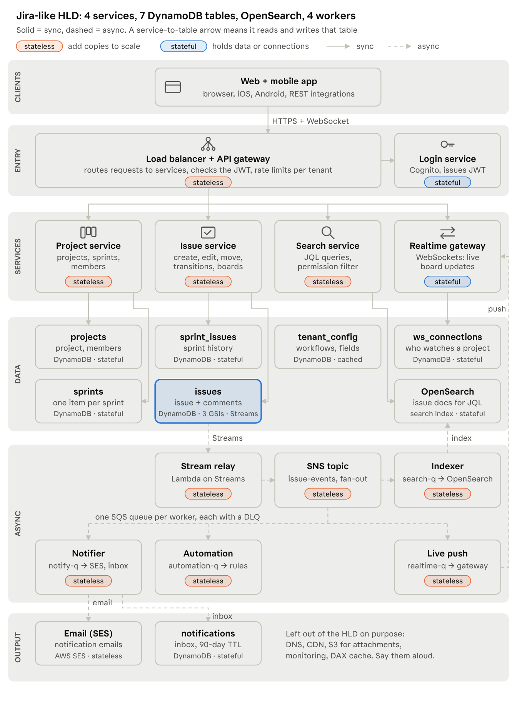

# Project Management Tool (Jira-like) – System Design

Nov 15, 2026 · Arnav Jain

## 1. Basics and requirements

A Jira-like tool lets teams track work as **issues** (bug, story, task). Each issue lives in a **project**, moves through a **workflow** (To Do → In Progress → Done), and shows up on **boards** and in **search**.

**The words you need:**

| Word | Meaning | Example |
| --- | --- | --- |
| Tenant | One customer company | acme.atlassian.net |
| Project | A container of issues with its own workflow and members | PAY (Payments) |
| Issue | One piece of work, with a key | `is_9f3a` "Refund fails for UPI" |
| Workflow | Allowed statuses and moves between them | To Do → In Progress → In Review → Done |
| Board | A view, not something you create: a project's issues (or one sprint's issues) as columns | Payments board, Sprint 42 board |
| Sprint | A 2-week box of issues for a Scrum team | Sprint 42 |
| JQL | The search language | `project = PAY AND status = "In Progress" AND assignee = currentUser()` |

### Functional

1. **Projects:** an admin creates a project (name, description, lead), picks its workflow and issue types, adds members with roles (admin, member, viewer), and can archive or delete it. Every issue lives in exactly one project.
2. Create, view, edit and delete issues. Fields: summary, description, type, priority, assignee, reporter, labels, plus **custom fields** per project.
3. Every issue gets a unique ID from the backend (e.g. `is_9f3a`). It never changes, even if the issue moves to another project.
4. Move an issue through its project's **workflow**. Only allowed transitions; some need a field (for example a resolution when closing).
5. **Boards:** Kanban and Scrum. Drag cards between columns (status change). Inside a column, cards are ordered by priority, then newest first. A board is not created or stored; it is a view. The project board shows a project's issues, and a sprint board shows one sprint's issues, both as columns of the workflow's statuses.
   - **Two different relationships:** a **project owns issues** (permanent: `issues.project_id`). A **sprint is a 2-week time box** that groups some of those issues (temporary: `issues.sprint_id`, which changes when work rolls over). A sprint never contains projects.
   - **Project vs sprint, by example** (Payments project, 5 issues):

     | Issue | Project (always one, never changes) | Sprint (optional, can change) |
     | --- | --- | --- |
     | Refund fails for UPI | Payments | Sprint 42 |
     | Add retry to webhook | Payments | Sprint 42 |
     | Upgrade Stripe SDK | Payments | Sprint 43 |
     | Improve error messages | Payments | none (backlog) |
     | Old cleanup task | Payments | none (backlog) |
   - **One open sprint at a time:** an issue can be in at most one active or planned sprint. Issues with no sprint sit in the **backlog**.
   - **Carry-over:** if an issue isn't finished when a sprint ends, it moves to the next sprint (Sprint 42 → 43). So over its life an issue can appear in several sprints, and sprint reports (velocity, carried-over work) need that history.
   - **Where a board sits:** nowhere in the database. It is computed from the project (or the sprint) plus the workflow's statuses as columns, so there is nothing to create and nothing to keep in sync.
   - **Project board (Kanban style):** all open issues of the project as columns; no sprint needed.
   - **Sprint board (Scrum style):** only the issues of one sprint as columns; the **backlog** holds the project's issues with no sprint. Each sprint (e.g. Sprint 42, 2 weeks) belongs to one project.
   - **Viewing a board** = `GET /v1/sprints/s_42/board` (Sprint 42's issues grouped into columns) or `GET /v1/projects/p_pay/board` (all of Payments).
   - **Trade-off:** real Jira lets one project have several saved boards (one per team), each with its own sprints. We skip that: one active sprint per project. If two teams need separate sprints, they use two projects.
6. **Sprints:** create a sprint in a project (name, start/end dates, goal); add issues from the backlog or remove them; **start** it (only one active sprint per project); **complete** it, moving unfinished issues to the next sprint or back to the backlog.
7. **Comments**, @mentions, attachments.
8. **Search** with filters and JQL, sorted and paginated.
9. **Notifications** (email, in-app) and a **history** of every change.
10. **Permissions:** who can browse, create, edit or transition issues in a project.
11. **Real-time:** a board updates for everyone when someone moves a card.

### Non-functional

| Property | Target | Why |
| --- | --- | --- |
| Scale | 100M DAU, \~200K tenants | Atlassian size |
| Latency | Issue view p99 < 200 ms, board load < 500 ms, search < 1 s | Used all day |
| Consistency | Each save is atomic; edits to different fields never clash; search may lag \~1–2 s | Two people changing different fields both keep their change |
| Availability | 99.95% | Core work tool |
| Isolation | One tenant's data never visible to another; a noisy tenant cannot slow others | Multi-tenant SaaS |
| Durability | No accepted change is lost | Work history is a record |

### Out of scope

- Reports and dashboards (burndown charts): mention only.
- Manual drag-to-reorder inside a column (ranking): cards are ordered by priority, then newest first.
- Marketplace apps, billing, migration tools.

## 2. Quick traffic estimate

The system is read-heavy, about 10 reads per write: \~50K reads/s and \~5K writes/s on average, \~150K and \~15K at peak. Rule of thumb: 1 day ≈ 10^5 seconds; peak ≈ 3× average.

**Assumptions to say out loud**

- 100M daily active users.
- Each user makes about 50 reads a day (open issue, load board, list) and 5 writes (create, edit, comment, transition).
- About 10 searches per user per day.
- 2% of users upload one attachment a day, average 500 KB.

| What | Math | Average | Peak (×3) |
| --- | --- | --- | --- |
| Reads | 100M × 50 = 5B/day | 50K/s | 150K/s |
| Writes | 100M × 5 = 500M/day | 5K/s | 15K/s |
| Searches (JQL) | 100M × 10 = 1B/day | 10K/s | 30K/s |
| Events to fan out | 1 per write × \~4 consumers | 20K/s | 60K/s |
| Attachment uploads | 2M/day × 500 KB | \~1 TB/day | — |
| Open WebSockets (boards open) | \~10% of DAU online | — | \~10M |

**What this tells us**

- Reads dominate, so every main screen must be one key lookup or one GSI query in DynamoDB (single-digit ms), and search is served from OpenSearch.
- 15K writes/s at peak is fine for DynamoDB: it splits tables into partitions by itself, so there are no shards to manage. We only need keys that spread the load (tenant + issue id).
- Each write triggers \~4 side jobs (search index, notifications, live updates, automation), so they run async through DynamoDB Streams → SNS → SQS, never inside the write request.

## 3. API

REST over HTTPS, plus one WebSocket for live board updates. Every call carries a Cognito JWT; `tenantId` and `userId` come from the token, never from the URL or body.

| Method + path | What it does |
| --- | --- |
| `POST /v1/issues` | Create an issue (returns its unique `id`) |
| `GET /v1/issues/{key}` | Get one issue with fields, comments count, allowed transitions |
| `PATCH /v1/issues/{key}` | Edit only the fields sent (field-level, last write wins) |
| `POST /v1/issues/{key}/transitions` | Move to another status through the workflow |
| `POST /v1/issues/{key}/comments` | Add a comment |
| `POST /v1/issues/{key}/attachments` | Get a pre-signed S3 upload URL |
| `GET /v1/sprints/{sprintId}/board` | Sprint board: columns with cards ordered by priority (project board: GET /v1/projects/{projectId}/board) |
| `POST /v1/sprints/{id}/start` · `/complete` | Sprint lifecycle |
| `GET /v1/search?jql=...&cursor=&limit=50` | JQL search, cursor pagination |
| `GET /v1/issues/{key}/history?cursor=` | Change history |
| `wss://realtime/v1/projects/{projectId}` | Live events for an open board |

**Projects and sprints**

| Method + path | What it does |
| --- | --- |
| `POST /v1/projects` | Create a project (name, lead, workflow, members) |
| `PATCH /v1/projects/{projectId}` | Rename, change workflow, archive |
| `POST /v1/projects/{projectId}/members` | Add a member with a role |
| `POST /v1/projects/{projectId}/sprints` | Create a sprint (name, dates, goal) |
| `POST /v1/sprints/{sprintId}/issues` · `DELETE .../issues/{issueId}` | Add or remove issues |

```json
POST /v1/projects/p_pay/sprints
{ "name": "Sprint 43", "startDate": "2026-11-15", "endDate": "2026-11-28",
  "goal": "Ship UPI refunds" }

201 Created  { "id": "s_43", "projectId": "p_pay", "state": "future" }
```

**Create an issue**

```json
POST /v1/issues
Idempotency-Key: 4c1e-77ab
{
  "projectId": "p_pay",
  "type": "Bug",
  "summary": "Refund fails for UPI",
  "priority": "High",
  "assigneeId": "u_ravi",
  "fields": { "cf_severity": "S2", "cf_customer": "Acme" }
}

201 Created
{ "id": "is_9f3a", "projectId": "p_pay", "status": "To Do",
  "createdAt": "2026-11-15T13:00:00Z" }
```

**Edit (send only the changed fields)**

```json
PATCH /v1/issues/is_9f3a
{ "set": { "assigneeId": "u_asha", "priority": "Highest" } }

200 OK  { "id": "is_9f3a", "updatedAt": "2026-11-15T13:04:10Z" }
```

Only `assignee_id` and `priority` are written. A field nobody sent is never touched, so two people changing different fields both keep their change.

**Transition**

```json
POST /v1/issues/is_9f3a/transitions
{ "transitionId": "t_start_progress" }

200 OK  { "id": "is_9f3a", "status": "In Progress" }
400 Bad Request { "error": "TRANSITION_NOT_ALLOWED", "from": "Done", "to": "In Progress" }
```

**Move to another project**

```json
POST /v1/issues/is_9f3a/move
{ "targetProjectId": "p_ops", "statusMapping": { "In Review": "In Progress" },
  "dropFields": ["cf_customer"] }

200 OK
{ "id": "is_9f3a", "projectId": "p_ops", "status": "In Progress" }
```

The `id` stays the same, so every link, comment and attachment keeps working; only `project_id` changes.

**Board**

```json
GET /v1/sprints/s_42/board

200 OK
{ "sprint": { "id": "s_42", "name": "Sprint 42", "projectId": "p_pay", "ends": "2026-11-28" },
  "columns": [
    { "name": "To Do", "issues": [ { "id": "is_a1c0", "summary": "...", "priority": "High" } ] },
    { "name": "In Progress", "issues": [ { "id": "is_9f3a", "summary": "...", "priority": "Highest" } ] }
  ] }
```

**Real-time event** (server → browser on an open board)

```json
{ "type": "issue.updated", "id": "is_9f3a", "updatedAt": "2026-11-15T13:05:00.120Z",
  "changes": { "status": ["To Do", "In Progress"] }, "by": "u_ravi" }
```

## 4. HLD (high-level design)



Read it top to bottom; every arrow says who talks to whom.

- **Entry:** all traffic hits one load balancer + API gateway, which checks the JWT from the Login service and routes to a service.
- **Services (4):** Project service (projects, sprints, members), Issue service (issues and board loads), Search service (JQL), Realtime gateway (live board updates). All are stateless except the Realtime gateway, which holds WebSockets.
- **Data: 7 DynamoDB tables + OpenSearch,** each with one owner:
  - Project service → `projects`, `sprints`.
  - Issue service → `issues` (the main table: 3 GSIs, Streams on) and `sprint_issues`.
  - Realtime gateway → `ws_connections`.
  - Notifier worker → `notifications`.
  - `tenant_config` (workflows, custom fields) is read by every service and cached in memory.
  - Search service → OpenSearch.
- **Async:** DynamoDB Streams on `issues` → Stream relay (Lambda) → SNS topic → one SQS queue per worker (each with a DLQ) → 4 workers:
  - **Indexer** (search-q) writes OpenSearch;
  - **Notifier** (notify-q) sends emails through SES and writes the `notifications` inbox;
  - **Automation** (automation-q) runs rules and webhooks;
  - **Live push** (realtime-q) tells the Realtime gateway to push the change to open boards.

| Box | Stateless or stateful | Talks to | Why it exists |
| --- | --- | --- | --- |
| Load balancer + API gateway | stateless | Login service, all 4 services | One front door: routing, JWT check, rate limits |
| Login service (Cognito) | stateful | — | Signs users in, issues the JWT |
| Project service | stateless | projects, sprints | Projects, sprints, members |
| Issue service | stateless | issues, sprint\_issues | Create, edit, move, transition issues; load boards through GSIs |
| Search service | stateless | OpenSearch | JQL queries with a permission filter |
| Realtime gateway | stateful | Browsers (WebSocket), ws\_connections | Pushes live board changes |
| `projects` table | stateful | — | Project META + MEMBER items |
| `sprints` table | stateful | — | One item per sprint, keyed by project |
| `issues` table | stateful | Stream relay (through Streams) | Source of truth for issues, comments, history; 3 GSIs for boards and "my issues" |
| `sprint_issues` table | stateful | — | Every sprint an issue was ever in (reports) |
| `tenant_config` table | stateful | read by all services | Workflows and custom fields |
| `ws_connections` table | stateful | — | Which gateway connection watches which project |
| `notifications` table | stateful | — | In-app inbox, 90-day TTL |
| OpenSearch | stateful | — | Search on any field |
| Stream relay (Lambda) → SNS | stateless | 4 SQS queues | Every change fans out without slowing the write |
| Indexer, Notifier, Automation, Live push | stateless | OpenSearch / SES + notifications / webhooks / Realtime gateway | One job each, each with its own queue and DLQ |

**Left out of the HLD on purpose** (say them out loud if asked): DNS (Route 53), CDN + WAF (CloudFront), S3 for attachments, monitoring (CloudWatch, X-Ray), IAM/KMS, and DAX (a cache in front of DynamoDB, added only if a board gets very hot). They don't change how the system works, so they'd only clutter the picture.

Why workers need no load balancer: they pull from SQS. Only the services that receive HTTP or WebSocket traffic sit behind the ALB.

## 5. Flows

Every write follows one pattern: write to DynamoDB (one item, or one `TransactWriteItems` for the issue + its history item), reply to the user, and let DynamoDB Streams → SNS → SQS do everything else (search, notifications, live updates). No outbox table is needed: the stream is the outbox.

### Flow A: Create an issue

1. The browser sends `POST /v1/issues` with a Cognito JWT. Load balancer + API gateway → Issue service.
2. The Issue service reads tenantId from the token. Every DynamoDB key starts with it, so one tenant can never read another's data.
3. Permission check: does the user have "Create issues" in project PAY? (Read the member item from DynamoDB; the answer is cached in the service's memory for 60 s.)
4. Validate fields against the project's issue type and custom-field schema.
5. One `TransactWriteItems` call:
   - The service has already generated the issue id (64-bit, Snowflake-style): no counter, no lock.
   - Put the issue item `is_9f3a` with status = the workflow's initial status, with the condition `attribute_not_exists(PK)`.
   - Put a history item "created".
6. Return `201 { id: is_9f3a }`. The user sees the issue at once.
7. DynamoDB Streams emits the new item. The Stream relay (Lambda) publishes `issue.created` to SNS topic issue-events, using the issue id as the message group so events for one issue stay in order.
8. SNS fans out to SQS queues, each with a worker:
   - search-q → Indexer writes the issue document to OpenSearch (searchable in \~1 s).
   - notify-q → Notifier emails the assignee and watchers (SES) and writes in-app notifications.
   - realtime-q → Realtime gateway pushes to everyone who has the Payments board open.
   - automation-q → Automation engine runs rules ("when a Bug is created with S1, page on-call") and webhooks.

### Flow B: Move a card (transition To Do → In Progress)

1. Drag on the board → `POST /transitions { transitionId }` → Issue service.
2. The Issue service loads the project's workflow (an item in DynamoDB, cached in memory) and checks:
   - Is there a transition from the current status to the target?
   - Do its conditions pass (e.g. only the assignee)?
   - Do its validators pass (e.g. a required field is set)?
3. `UpdateItem` on the issue: `SET status = 'In Progress', updated_at = now` with `ConditionExpression: status = 'To Do'`. The condition makes sure the card is still where the user saw it. If it fails (`ConditionalCheckFailedException`), someone already moved it → 409, and the UI reloads.
4. The same `TransactWriteItems` adds a history item. The stream then triggers the post-functions async (e.g. set resolution, notify).
5. Other people's boards update within about a second through the realtime path.

### Flow C: Load a board

1. `GET /v1/sprints/s_42/board` → Issue service. (Project board: `GET /v1/projects/p_pay/board`.)
2. Read the sprint item and the project's workflow (its statuses are the columns) from DynamoDB, by key. There is no board item to read.
3. Query GSI2 with `PK = sprint s_42`: the sprint's cards, already sorted by status, then priority, then newest first. (Project board: query GSI1 with `PK = project p_pay`, `SK begins_with <status>`, one query per column.)
4. The GSI copies the card fields (summary, status, assignee, priority), so no second read is needed.
5. Group the cards into columns by status. A board with 200 cards is one or two queries, tens of milliseconds.
6. The browser opens `wss://realtime/v1/projects/p_pay` to receive live changes.

### Flow D: JQL search

1. `GET /v1/search?jql=project = PAY AND status = "In Progress" ORDER BY priority DESC`.
2. The **Search service** parses JQL into a syntax tree and checks field names against the tenant's fields.
3. It translates the tree to an OpenSearch query and **always adds** two filters: `tenant_id = acme` and `project_id IN (projects the user may browse)`. Issue-level security levels are also filtered.
4. OpenSearch returns ids + sort values. The cursor is `search_after` (no deep offset).
5. Each OpenSearch document already holds the card fields, so the Search service returns 50 rows straight from it.

### Flow E: Two people edit the same issue (field-level, last write wins)

1. Asha and Ravi both open issue is\_9f3a.
2. Asha changes the priority → `PATCH { set: { priority } }`. Only the `priority` attribute is written (UpdateItem SET priority).
3. Ravi changes the assignee → `PATCH { set: { assigneeId } }`. Only `assignee_id` is written. Both changes survive.
4. If both change the **same** field at the same moment, the later save wins. History (DynamoDB) records both changes, and every open board shows the final value within a second.

### Flow F: Move an issue to another project (Payments → Ops)

1. `POST /v1/issues/is_9f3a/move { targetProjectId: p_ops, statusMapping }`.
2. Permission check: "Move" in PAY and "Create" in OPS.
3. Validate:
   - every status maps to one in OPS's workflow;
   - OPS's required fields are filled;
   - fields OPS doesn't have are dropped or hidden.
4. One `TransactWriteItems`:
   - `UpdateItem` on `is_9f3a`: `SET project_id = p_ops, status = mapped REMOVE sprint_id`. It is the same item and the same id, so comments, attachments, history and links stay attached.
   - The project GSI key changes from PAY to OPS, so DynamoDB moves the card from the PAY board to the OPS board by itself.
   - Put a history item "moved from Payments to Ops".
5. Sub-tasks move in the same transaction (up to 100 items per transaction); they keep their own ids.
6. Async through Streams → SNS → SQS: reindex in OpenSearch, notify watchers, update both boards live.
7. Links keep working: URLs use the id (`/issues/is_9f3a`), which never changes, so no redirect is needed.

## 6. Data model

All core data lives in **DynamoDB**. DynamoDB has no joins, so we list the screens first (the access patterns below) and design each key so that every screen is one lookup or one query. Every key starts with the tenant, so tenants never mix. Search on any field goes to OpenSearch.

### DynamoDB tables (every key starts with the tenant)

```
Table: projects                       -- one project = a few items under one PK
  PK = T#acme#P#p_pay
    SK = META                 -> name, lead, workflow_id, issue_types
    SK = MEMBER#u_ravi        -> role (admin | member | viewer)
    (no board items: a board is a view; its columns = the workflow's statuses)

Table: sprints                        -- a sprint belongs to a project
  PK = T#acme#P#p_pay   SK = SPRINT#s_42
    -> name, state (future | active | closed), start, end, goal

Table: issues                         -- one issue = its fields + comments + history
  PK = T#acme#I#is_9f3a
    SK = META                 -> project_id, type, summary, description, status,
                                 priority, assignee_id, reporter_id, parent_id,
                                 sprint_id, custom {cf_severity: "S2"},
                                 created_at, updated_at
                                 (no version: field-level, last write wins)
    SK = COMMENT#2026-11-15T13:05#c_1   -> author_id, body
    SK = HIST#2026-11-15T13:05#ch_7     -> who, field, old -> new
    SK = ATT#a_1                        -> s3_key, file_name, size_bytes

  GSI1 (project board)  PK = T#acme#P#p_pay    SK = <status>#<priority>#<created_at>
  GSI2 (sprint board)   PK = T#acme#S#s_42     SK = <status>#<priority>#<created_at>
                                               (only issues in a sprint)
  GSI3 (my issues)      PK = T#acme#U#u_asha   SK = <updated_at>

Table: tenant_config
  PK = T#acme
    SK = WORKFLOW#wf_1        -> statuses, transitions, conditions, validators, post-functions
    SK = FIELD#cf_severity    -> name, type, options

Streams: ON for issues, projects and sprints (new and old image)
```

```
Table: sprint_issues                  -- every sprint an issue was ever in (for reports)
  PK = T#acme#S#s_42   SK = I#is_9f3a
    -> added_at,
       removed_at   (set when carried over or pulled out),
       completed    (finished inside this sprint?)
```

`sprint_id` on the issue holds the current sprint, or is missing for the backlog. That also keeps GSI2 small: backlog issues simply aren't in it. `sprint_issues` keeps the full history, e.g. Sprint 42 (carried over) and Sprint 43 (completed).

**Identity:** `issues.id` is the only issue identifier. It is the primary key, foreign key, event key, search document id and URL. It never changes, even when the issue moves to another project.

**Optional extension:** if the product wants Jira-style keys like `PAY-123`, add `projects.next_issue_num`, `issues.issue_num` (incremented in the same transaction) and an `issue_aliases` table for moves. The rest of the design doesn't change.

**Why custom fields are a map attribute:** each tenant adds its own fields. DynamoDB items have no fixed schema, so a `custom` map holds them without any migration. Search on them happens in OpenSearch anyway.

### Access patterns (design the keys around these)

| Screen or action | How DynamoDB answers it |
| --- | --- |
| Open an issue | GetItem `PK = T#acme#I#is_9f3a`, `SK = META` |
| Issue + comments + history | One Query on `PK = T#acme#I#is_9f3a` (sorted by SK) |
| Sprint board (active sprint) | Query GSI2 `PK = T#acme#S#s_42` |
| Project board | Query GSI1 `PK = T#acme#P#p_pay`, `SK begins_with "In Progress#"` (one query per column) |
| My open issues | Query GSI3 `PK = T#acme#U#u_asha` |
| A project's members | Query projects `PK = T#acme#P#p_pay` |
| Sprints of a project | Query sprints `PK = T#acme#P#p_pay` |
| Sprint report | Query sprint\_issues `PK = T#acme#S#s_42` |
| Move to another project | UpdateItem `project_id` (GSI1 follows by itself) |
| Transition guard | UpdateItem with `ConditionExpression: status = :from` |
| Notifications | notifications table `PK = T#acme#U#u_asha`, `SK = ts`, TTL 90 days |
| Live board viewers | ws\_connections table `PK = project_id`, `SK = connection_id` |
| Anything else (JQL) | OpenSearch, not DynamoDB |

### OpenSearch: one document per issue

```json
{ "tenant_id": "acme", "issue_id": "is_9f3a", "project_id": 17,
  "type": "Bug", "status": "In Progress", "priority": 2, "assignee": "u_asha",
  "labels": ["payments", "upi"], "sprint_id": 42,
  "summary": "Refund fails for UPI", "description": "...",
  "cf_severity": "S2", "security_level": null, "updated_at": "2026-11-15T13:05:00Z" }
```

Index per tenant group, routing key `tenant_id`, so one tenant's search touches one shard.

### Cache (only if needed)

No Redis. DynamoDB already answers in single-digit milliseconds. Workflows and permissions are cached in each service's memory for 60 s. If one huge board gets very hot, add **DAX** (DynamoDB's own cache) in front of the issues table; the code barely changes.

### S3

`s3://pm-attachments/{tenant}/{issue_id}/{attachment_id}/{file_name}`. Uploaded from the browser with a pre-signed URL, served through CloudFront signed URLs, and scanned for viruses by a Lambda on upload.

## 7. Storage estimate

Attachments are the biggest data (\~365 TB a year in S3). Everything in DynamoDB grows \~75 TB a year; DynamoDB spreads it across partitions by itself, so there is no sharding work.

**Assumptions:** 20M new issues a day (0.2 per user), 100M comments a day, 500M field changes a day (one per write), 300M notifications a day.

| Data | Math | Per day | Per year | Where |
| --- | --- | --- | --- | --- |
| Issues | 20M × 2 KB (fields + description + custom map) | 40 GB | \~15 TB | DynamoDB issues (META items) |
| Comments | 100M × 500 B | 50 GB | \~18 TB | DynamoDB issues (COMMENT# items) |
| Change history | 500M × 200 B | 100 GB | \~36 TB (older than 2 years → S3) | DynamoDB issues (HIST# items) |
| Notifications | 300M × 300 B, kept 90 days | 90 GB | \~8 TB steady | DynamoDB notifications (TTL) |
| Search index | \~1.5× issues + comments text, plus 1 replica | — | \~100 TB | OpenSearch |
| Attachments | 2M × 500 KB | \~1 TB | \~365 TB | S3 (IA after 90 days) |

**What the numbers decide**

| Finding | Decision |
| --- | --- |
| \~75 TB/year, 15K writes/s at peak | DynamoDB on-demand; keys start with tenant + id so load spreads; no shards to manage |
| History grows 36 TB/year and is read per issue only | HIST# items under the issue; items older than 2 years exported to S3 |
| Files are 10× everything else | S3 + CloudFront, never in the database |
| 150K reads/s at peak | Key lookups and GSI queries in DynamoDB; OpenSearch for JQL; DAX only if a board gets hot |
| One DynamoDB item is at most 400 KB | Comments, history and attachments are separate items, not lists inside the issue |

## 8. Deep dives

The Jira-specific questions are issue keys, workflows, board loading and JQL with permissions; multi-tenancy is the Atlassian one.

### 8.1 Issue identity: one unique id

- Each issue gets a 64-bit **Snowflake-style id** (time + machine + sequence) generated inside the Issue service. It is unique without any database lock or shared counter.
- The id is the only identifier: URLs, API calls, events, search documents and foreign keys all use it.
- **Moving** an issue changes only `project_id`. The id, comments, attachments, history and links stay the same.
- **Creates scale freely**: no per-project counter means no row lock and no hot project.

**Why no Jira-style key like `PAY-123`?** It is a human-friendly label, not something the architecture needs. We skip it to keep creates and moves simple, and mention it as an optional extension.

|  | Unique id only (our design) | With a display key `PAY-123` (optional) |
| --- | --- | --- |
| Create | Generate id, no lock | Lock the project row to get the next number |
| Move to another project | Update `project_id` only | New key + `issue_aliases` table + redirects |
| Extra tables/columns | None | `next_issue_num`, `issue_num`, `issue_aliases` |
| Benefit | Simpler, scales freely | Easy to say and type in chat, commits, branch names |

### 8.2 Workflows as data, not code

A workflow is JSON stored per tenant:

```json
{ "statuses": ["To Do", "In Progress", "In Review", "Done"],
  "transitions": [
    { "id": "t_start", "from": ["To Do"], "to": "In Progress",
      "conditions": ["isAssignee"], "validators": [], "postFunctions": ["notifyWatchers"] },
    { "id": "t_done", "from": ["In Review"], "to": "Done",
      "validators": [{"required": "resolution"}], "postFunctions": ["setResolutionDate"] } ] }
```

The workflow engine is a small state machine:

1. Load the workflow (an item in tenant\_config, cached in memory).
2. Is the transition allowed from the current status?
3. Run the conditions: may this user do it?
4. Run the validators: is the data complete?
5. Update the status with a condition on the old status, plus a history item, in one `TransactWriteItems`.
6. The post-functions run async from the DynamoDB stream.

Editing a workflow creates a new version; issues on the old version are migrated by a background job.

### 8.3 Card order: no manual ranking

We leave drag-to-reorder inside a column out of scope. Dragging a card to another column still works, because that is a status change. Inside a column, cards follow a fixed rule: **priority first, then newest first**. The board GSIs use that rule as their sort key, so DynamoDB returns the cards already in order and nothing extra is stored.

- **What we save:** no rank attribute, no rank API, no rebalancing job, and no question of two people dropping cards into the same gap.
- **What users lose:** they can't put a Low-priority card above a High one by hand.
- **If asked to add it later:** store a LexoRank string on the issue (e.g. `a`, `b`, `an`). A drop sends "before card X"; the server picks a string between the neighbours, so only the moved card is written. A background job rebalances strings that get long.

### 8.4 Concurrent edits: field-level, last write wins

We keep it simple and do not version issues. Each edit sends only the fields it changed, and the server writes only those columns: `UPDATE issues SET priority = ?, updated_at = now() WHERE id = ?`.

- **Different fields never clash.** Asha's priority change and Ravi's assignee change both survive.
- **Same field, same second:** the later save wins. That is rare, and history shows both changes, so nothing is hidden.
- **Transitions** add a guard: `WHERE status = 'To Do'`. Two people can't both move the same card from To Do; the second gets told it already moved.
- **Comments** never conflict: they are inserts.
- **If an interviewer pushes** for no lost updates on long text (description), add optimistic locking later: a `version` column and `WHERE version = ?`, with a `409` when it doesn't match.

### 8.5 JQL search with permissions

- **Parse → validate → translate:** JQL goes to an AST, field names are checked against the tenant's fields, and the AST is turned into an OpenSearch bool query.
- **Permission filter is not optional.** The service always appends `tenant_id` and `project_id IN (browsable projects)`; issue security levels add `security_level IN (user's levels)`. The browsable set is computed once per user and cached for 60 s.
- **Freshness:** OpenSearch lags writes by \~1 s. Right after you create or edit an issue, the UI patches its own change into the results (read-your-writes on the client), so you never see a stale list of your own work.
- **Heavy queries:** max 1,000 results per page, 5 s timeout, per-tenant rate limit (the rate-limiter design).

### 8.6 Multi-tenancy: cells

- A cell = one set of DynamoDB tables + an OpenSearch domain + service tasks, serving a few thousand tenants. DynamoDB doesn't need cells to scale; we use them to limit the blast radius and for data residency.
- A small global tenant directory maps tenant → cell. The load balancer routes by host name (acme.example.net) to the right cell.
- Benefits: a bad deploy or a noisy tenant hurts one cell, not everyone; data residency (EU tenants in EU cells); huge tenants get a dedicated cell.
- Moving a tenant between cells: copy the tenant's items (every key starts with `T#acme`), replay the stream changes made during the copy, flip the directory entry, then delete the old copy.

### 8.7 Real-time board updates

- Browsers hold a WebSocket to the **Realtime gateway** (stateful, ECS behind the ALB, sticky per connection). The gateway records `project_id → connection` in DynamoDB `ws_connections`.
- The gateway's SQS consumer reads `realtime-q`, finds the connections watching the affected project, and pushes the event.
- Events carry the issue's `updatedAt`. The browser ignores any event older than what it already shows, so out-of-order delivery is harmless.
- If the socket drops, the browser reconnects and reloads the board once.

### 8.8 Event ordering and SNS/SQS choice

- DynamoDB Streams keeps the changes to one item in order. The Stream relay publishes them to issue-events, an SNS FIFO topic with messageGroupId = issue id, so each SQS FIFO queue gets one issue's events in order while different issues go in parallel.
- If FIFO throughput limits are reached, switch to standard SNS/SQS. Every consumer already compares updatedAt and drops stale events, so correctness holds either way.
- Every queue has a DLQ (3 tries). The indexer is idempotent: upsert by issue id, skipping events older than the stored updated\_at.
- Stream records are kept for 24 hours, so if the relay is down for a while nothing is lost, as long as it catches up within a day.

### 8.9 Attachments

1. The client asks for a pre-signed S3 PUT URL (valid 5 min, size-limited).
2. The browser uploads straight to S3. App servers never carry file bytes.
3. The S3 event triggers a Lambda that scans for viruses and makes thumbnails, then marks the attachment `ready`.
4. Downloads use CloudFront signed URLs after a permission check.

### 8.10 DynamoDB: limits to know

- **Hot partitions:** a project with 200k issues puts every card of that project under one GSI1 key. Split it with a suffix (`T#acme#P#p_pay#3`) and query the pieces in parallel when the board loads.
- **400 KB per item:** comments, history and attachments are separate items; a very large description is capped or stored in S3.
- **Transactions:** `TransactWriteItems` takes up to 100 items. "Complete sprint" with 500 unfinished issues runs in batches of 100, then writes the sprint's closed state last.
- **No ad-hoc queries:** every new screen needs a key or a GSI designed for it. Anything else goes to OpenSearch.
- **No GROUP BY:** velocity and burndown reports are pre-computed by a worker from the stream.

## 9. Wrap-up

**30-second summary:**

> "Stateless services on ECS behind a load balancer, with Cognito for login. Projects, sprints, issues, comments and history live in DynamoDB; every key starts with the tenant. A board is not stored: GSIs serve the project board, the sprint board and 'my issues'. Each write updates only the changed fields, with a condition where needed (the status guard). Each issue is identified by a unique id generated by the service. DynamoDB Streams feeds a small Lambda that publishes to SNS, which fans out to SQS queues for search indexing (OpenSearch), notifications (SES), automation and real-time board updates over WebSockets. JQL goes to OpenSearch; cards in a column are ordered by priority, then newest first (manual ranking left out)."

| Decision | Why | Trade-off |
| --- | --- | --- |
| DynamoDB as the source of truth | Every main screen is a key lookup or a GSI query; scales without sharding | Keys must be designed up front; no joins or GROUP BY |
| DynamoDB Streams + SNS/SQS | Write path stays fast; no outbox table; side jobs scale and fail independently | Search and notifications lag \~1 s |
| OpenSearch for JQL | Flexible filters on any field, fast sorting | A second store to keep in sync |
| Field-level last write wins | Simple; edits to different fields never clash | Same field at the same second: later save wins (history keeps both) |
| Workflows as JSON data | Each tenant customizes without deploys | Engine must validate definitions |
| Cells per group of tenants | Blast radius, residency, noisy neighbours | More infrastructure to run |
| Board = a view, not a stored thing | Nothing to create or sync; columns come from the workflow | One active sprint per project; two teams need two projects |
| No manual ranking | Fewer APIs and writes; GSIs sort by priority + date | No reordering inside a column; add LexoRank later if needed |

**If they push further:** dashboards and burndown (pre-aggregate from events), cross-project epics, offline mobile, AI triage (auto-label, duplicate detection with embeddings), and GDPR deletion across all stores.
