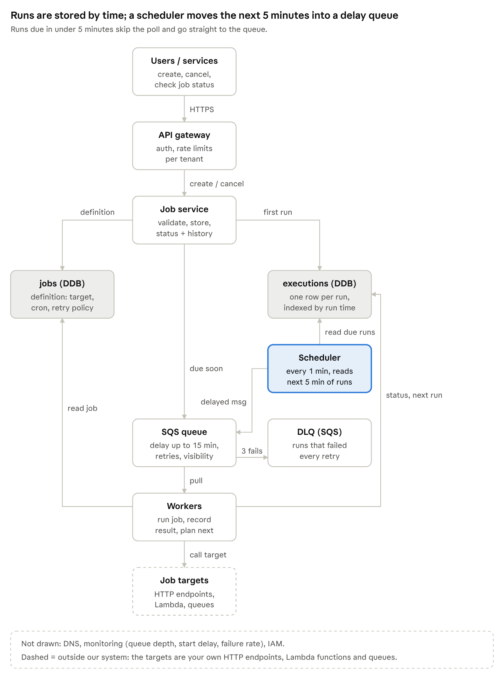

# Distributed Job Scheduler — System Design

Nov 22, 2026 · Arnav Jain

## 1. Requirements

Users and services schedule jobs to run once at a set time, or repeatedly on a cron schedule. A job starts within 5 seconds of its time, is retried if it fails, and has its status and history available. Think of Jira Automation's "every Monday at 09:00, post the sprint summary to Slack", or a reminder "ping me in 2 hours".

### Words used in this doc

| Word               | What it means                                               | Example                                                                             |
|--------------------|-------------------------------------------------------------|-------------------------------------------------------------------------------------|
| Job                | The definition: what to run, when, and how to retry         | "Every Monday 09:00 IST, call POST https://automation.acme.internal/sprint-summary" |
| Execution (run)    | One time a job runs                                         | The run for Monday 24 Nov 2026, 09:00 IST                                           |
| One-time job       | A job that runs once                                        | "Remind Asha at 15:30 today"                                                        |
| Cron expression    | A text format for repeating times                           | 0 9 \* \* MON = 09:00 every Monday                                                  |
| Target             | What the job calls when it runs                             | An HTTP endpoint, a Lambda function or a message queue                              |
| Scheduler (poller) | The process that finds runs that are due soon               | Every minute, it reads runs due in the next 5 minutes                               |
| Delay queue        | A queue that holds a message until a set time               | SQS with DelaySeconds = 47 delivers the message 47 s later                          |
| Worker             | The process that actually runs the job                      | Calls the target URL and records "succeeded in 180 ms"                              |
| At-least-once      | Every run happens, but rarely twice                         | A worker crashes after calling the target; the retry calls it again                 |
| Idempotency key    | An ID the target uses to ignore a repeat                    | Idempotency-Key: exec_7f21                                                          |
| Visibility timeout | While a worker holds a message, other workers can't see it  | 60 s; if the worker dies, the message comes back                                    |
| Lease              | A time-limited claim on work                                | Scheduler 2 owns shards 0 to 24 for 30 s, and renews every 10 s                     |
| DLQ                | Dead letter queue: where runs go after the last retry fails | Run exec_7f21 failed 3 times and moves to the DLQ                                   |

### Functional

1.  Create a one-time job (run at a set time) or a recurring job (cron expression + time zone).

2.  Run the job at its time by calling its target: an HTTP endpoint, a Lambda function or a queue.

3.  Retry failed runs with a backoff, up to a limit, then mark them failed.

4.  Cancel, pause and resume a job.

5.  See a job's status and the history of its runs.

### Non-functional

- **On time:** a run starts within 5 s of its scheduled time (p99), even at busy minutes like 09:00 on Monday.

- **Never lost:** once a job is accepted, every run happens. At-least-once, with an idempotency key so targets can ignore repeats.

- **Scale:** 100M DAU, 200M active jobs, 1B runs a day, with peaks of hundreds of thousands per second at the top of the hour.

- **Highly available:** no single scheduler machine whose death stops all jobs.

- **Fair:** one tenant scheduling 10M jobs for 09:00 must not delay everyone else.

Out of scope: workflows where one job depends on another (DAGs), and running user code inside our system. We only call targets.

## 2. Traffic estimate

The average is easy (about 12,000 runs a second). The hard part is the top of the hour: people pick round times, so about 20M runs can be due at Monday 09:00 exactly. The design must absorb that burst, and it can, because a scheduler knows its load ahead of time.

| Quantity                   | Math                                                          | Result                                                                         |
|----------------------------|---------------------------------------------------------------|--------------------------------------------------------------------------------|
| Daily active users         | Given                                                         | 100M                                                                           |
| Active jobs                | 2 per DAU                                                     | 200M                                                                           |
| Runs per day               | Most jobs are daily or hourly                                 | about 1B, so 11,600/s on average                                               |
| Peak minute (Monday 09:00) | About 2% of daily runs share that minute                      | about 20M runs in 1 minute, about 333,000/s                                    |
| Jobs created or changed    | 100M × 0.1 a day                                              | 10M a day, about 116/s                                                         |
| Status and history reads   | 100M × 0.5 a day                                              | 50M a day, about 580/s                                                         |
| Scheduler reads            | 1 query per shard per minute, for the next 5 minutes          | Small: 100 shards = 100 queries a minute                                       |
| One run                    | An HTTP call of about 200 ms                                  |                                                                                |
| Runs per worker            | 500 calls in flight at once ÷ 0.2 s                           | about 2,500 runs/s                                                             |
| Workers                    | 11,600 / 2,500 on average; 333,000 / 2,500 at the peak minute | 5 on average, about 140 at the peak; scaled up before the peak (deep dive 8.4) |

## 3. API

A small REST API, called by people (through a UI) and by other services. Every call carries a token, and the API gateway turns it into a tenantId.

### Create a recurring job

POST /v1/jobs  
Idempotency-Key: acme-sprint-summary-v1  
{  
"name": "Weekly sprint summary",  
"schedule": { "type": "CRON", "cron": "0 9 \* \* MON", "timezone": "Asia/Kolkata" },  
"target": {  
"type": "HTTP",  
"method": "POST",  
"url": "https://automation.acme.internal/sprint-summary",  
"body": { "project": "PAY" }  
},  
"retry": { "maxAttempts": 3, "backoff": "EXPONENTIAL", "initialDelaySec": 30 },  
"timeoutSec": 30  
}  
  
201 Created  
{ "jobId": "job_4c19", "nextRunAt": "2026-11-24T03:30:00Z" }

nextRunAt is in UTC: 09:00 in Kolkata is 03:30 UTC.

### Create a one-time job

POST /v1/jobs  
{  
"name": "Remind Asha about the design review",  
"schedule": { "type": "ONCE", "runAt": "2026-11-22T10:00:00Z" },  
"target": { "type": "QUEUE", "queueUrl": "https://sqs.../reminders", "body": { "userId": "asha" } }  
}  
  
201 Created  
{ "jobId": "job_4c20", "nextRunAt": "2026-11-22T10:00:00Z" }

### Pause, resume, cancel

POST /v1/jobs/job_4c19/pause -\> 204  
POST /v1/jobs/job_4c19/resume -\> 204  
DELETE /v1/jobs/job_4c19 -\> 204

### Job status and run history

GET /v1/jobs/job_4c19/runs?limit=3  
  
200 OK  
{  
"job": { "jobId": "job_4c19", "status": "ACTIVE", "nextRunAt": "2026-11-24T03:30:00Z" },  
"runs": \[  
{ "executionId": "exec_7f21", "scheduledAt": "2026-11-17T03:30:00Z", "startedAt": "2026-11-17T03:30:01.2Z",  
"status": "SUCCEEDED", "attempt": 1, "httpStatus": 200, "durationMs": 180 },  
{ "executionId": "exec_6a02", "scheduledAt": "2026-11-10T03:30:00Z", "startedAt": "2026-11-10T03:30:02.0Z",  
"status": "SUCCEEDED", "attempt": 2, "httpStatus": 200, "durationMs": 240 }  
\],  
"nextCursor": "exec_6a02"  
}

### What the target receives

POST https://automation.acme.internal/sprint-summary  
Idempotency-Key: exec_7f21  
X-Job-Id: job_4c19  
X-Scheduled-At: 2026-11-17T03:30:00Z  
X-Attempt: 1  
{ "project": "PAY" }

The target should ignore a second request with the same Idempotency-Key. This is what makes at-least-once delivery safe.

## 4. High-level design

The design has two layers. Every future run is stored in DynamoDB, indexed by its run time. Every minute, a scheduler moves the runs due in the next 5 minutes into an SQS queue, each with a delay that releases it at exactly its time. Workers take messages from the queue, call the target, record the result and plan the next run.

job scheduler HLD · store by time, poll 5 minutes ahead, delay queue

### Following one run: the Monday sprint summary

1.  On Friday, Asha creates job_4c19 (0 9 \* \* MON, Asia/Kolkata). The **job service** validates the cron expression and target and saves the definition in **jobs**.

2.  It computes the next run (Monday 24 Nov, 09:00 IST = 03:30 UTC) and writes one row to **executions**: exec_7f21, SCHEDULED.

3.  Monday 03:26 UTC: the **scheduler**, which polls every minute, asks the executions due index for runs between 03:26 and 03:31. It finds exec_7f21.

4.  It changes the row's status from SCHEDULED to QUEUED, only if it is still SCHEDULED, and sends an SQS message with DelaySeconds = 240. The message is invisible to workers until 03:30:00.

5.  At 03:30:00 a **worker** receives the message. For 60 s, no other worker can see it (the visibility timeout).

6.  It reads job_4c19 from **jobs**: still active, not paused. It marks the run RUNNING.

7.  It calls the **target**: POST https://automation.acme.internal/sprint-summary with Idempotency-Key: exec_7f21. The call returns 200 after 180 ms.

8.  It marks the run SUCCEEDED, writes next Monday's run (exec_8a10, 1 Dec 03:30 UTC, SCHEDULED) to executions, and deletes the SQS message.

Shortcut: a job due in under 5 minutes ("remind me in 2 minutes") would miss the next poll window. So the job service sends it to SQS itself, with the right delay.

### Components

| Box                           | Stateless or stateful                            | Talks to                             | Why it exists                                                                                               |
|-------------------------------|--------------------------------------------------|--------------------------------------|-------------------------------------------------------------------------------------------------------------|
| API gateway                   | Stateless                                        | Job service                          | Auth, and rate limits per tenant                                                                            |
| Job service                   | Stateless                                        | jobs, executions, SQS                | Validates and stores jobs, plans the first run, serves status and history                                   |
| jobs (DynamoDB)               | Stateful                                         | Job service, workers                 | The definition: what to run, when, the retry policy, active or paused                                       |
| executions (DynamoDB)         | Stateful                                         | Job service, scheduler, workers      | One row per run; the due index finds "runs due in the next 5 minutes" quickly                               |
| Scheduler (several instances) | Stateless; each owns some shards through a lease | executions, SQS                      | Turns stored future runs into timed messages; never runs jobs itself                                        |
| SQS queue                     | Stateful                                         | Job service, scheduler, workers, DLQ | Delays each message to the right second, hides it while a worker runs it, re-delivers it if the worker dies |
| DLQ (SQS)                     | Stateful                                         | SQS queue                            | Runs that failed every retry, kept for alerts and manual replay                                             |
| Workers                       | Stateless, auto-scaled                           | SQS, jobs, executions, targets       | Run the job, record the result, plan the next run                                                           |
| Job targets                   | External                                         | Workers                              | The tenant's own endpoint, Lambda function or queue                                                         |

### Left out on purpose

- **Running user code.** We call targets; we don't host containers. Long jobs are covered in deep dive 8.7.

- **Job dependencies (DAGs).** "Run B after A succeeds" is a workflow engine such as Step Functions or Airflow.

- **Several regions.** One region with 3 availability zones; see Wrap-up.

- **DNS, monitoring and IAM.** These are in the diagram's note, not drawn as boxes.

## 5. Flows

Seven flows: creating a job, a job due very soon, the scheduler's poll, a successful run, a failing run, a scheduler that dies, and cancelling a job.

### Flow A: Asha creates a weekly job

1.  POST /v1/jobs with 0 9 \* \* MON, Asia/Kolkata and Idempotency-Key: acme-sprint-summary-v1.

2.  The job service checks the key (seen before: return the same job) and validates the cron expression and the target URL (HTTPS, on the tenant's allowed list).

3.  It writes job_4c19 to jobs with status = ACTIVE.

4.  It computes the next run: Monday 24 Nov 09:00 IST = 2026-11-24T03:30:00Z.

5.  That's more than 5 minutes away, so it writes exec_7f21 to executions as SCHEDULED, with dueBucket = 2026-11-24T03:30#17 (deep dive 8.4).

6.  It returns 201 {jobId, nextRunAt}.

### Flow B: Ravi asks "remind me in 2 minutes"

1.  POST /v1/jobs with runAt = now + 120 s.

2.  The job service writes the job and the run (exec_7f30) as usual.

3.  The run is less than 5 minutes away, so a poll might have already passed that window. The job service marks it QUEUED itself and sends the SQS message with DelaySeconds = 120.

4.  A worker receives it in 2 minutes; the rest is Flow D.

### Flow C: The scheduler polls (every minute)

1.  At 03:26:00 the scheduler instance that owns shards 0 to 24 queries the due index for each of its shards: due between 03:26:00 and 03:31:00, status SCHEDULED.

2.  For each run it finds, it does a conditional update: SET status = QUEUED IF status = SCHEDULED. If another scheduler already queued it, the update fails and the run is skipped. This stops double queuing.

3.  It sends the SQS message {executionId: exec_7f21, jobId: job_4c19, scheduledAt} with DelaySeconds = scheduledAt − now = 240. It uses batches of 10 (SQS's batch limit) across many parallel threads.

4.  Messages become visible at their exact second. SQS delay is accurate to about a second, which meets the 5 s target.

### Flow D: A worker runs the job

1.  At 03:30:00 the worker receives the message. SQS hides it from other workers for 60 s (the job's 30 s timeout + margin).

2.  It reads job_4c19. If the job is paused or deleted, it marks the run SKIPPED and deletes the message.

3.  Conditional update: SET status = RUNNING, attempt = 1, startedAt IF status IN (QUEUED, RETRYING).

4.  It calls the target with Idempotency-Key: exec_7f21: 200 OK in 180 ms.

5.  It marks the run SUCCEEDED with httpStatus = 200, durationMs = 180.

6.  Cron job: it computes the next time (1 Dec 03:30 UTC) and writes exec_8a10 as SCHEDULED.

7.  It deletes the SQS message. That is the "done" signal.

### Flow E: The target is down

1.  The call to the target returns 503.

2.  The worker marks the run RETRYING, attempt = 1, lastError = 503.

3.  It doesn't delete the message. It sets the visibility timeout to the backoff from the job's retry policy: 30 s, then 60 s, then 120 s.

4.  Attempt 2 also fails, and attempt 3 is the job's last (maxAttempts = 3).

5.  After the third failure, the worker marks the run FAILED, copies the message to the DLQ and deletes it from the main queue. (A crashed worker that never got that far leaves the message to SQS, and the redrive policy sends it to the DLQ after the 4th receive.)

6.  It still plans next Monday's run: one failed week does not stop a cron job. It sends a job.failed event, so the owner can be alerted.

### Flow F: A scheduler instance dies

1.  Scheduler 2 owns shards 0 to 24 through a lease row in DynamoDB (owner = sched-2, expiresAt = now + 30 s), renewed every 10 s.

2.  It crashes at 03:26:15, in the middle of a poll.

3.  At 03:26:45 the lease expires. Scheduler 3 takes it over with a conditional write (IF expiresAt \< now).

4.  Scheduler 3 re-runs the poll for shards 0 to 24. Runs that scheduler 2 already queued are now QUEUED, so they're skipped. The rest are queued now, still minutes before they are due, because of the 5-minute lookahead.

### Flow G: Asha cancels the job

1.  DELETE /v1/jobs/job_4c19: the job service sets status = DELETED in jobs.

2.  It deletes the next SCHEDULED run row if there is one.

3.  If the run is already QUEUED in SQS, it stays there, but the worker checks the job's status first (Flow D step 2) and skips it.

## 6. Data model

Two main tables: jobs holds what to run, and executions holds when it runs and how it went. A sparse index on executions is what the scheduler polls.

### jobs (DynamoDB)

| Column       | Type      | Example                                                     | Notes                                                                           |
|--------------|-----------|-------------------------------------------------------------|---------------------------------------------------------------------------------|
| jobId (PK)   | string    | job_4c19                                                    |                                                                                 |
| tenantId     | string    | acme                                                        | For per-tenant limits and listing                                               |
| name         | string    | Weekly sprint summary                                       |                                                                                 |
| scheduleType | string    | CRON                                                        | CRON or ONCE                                                                    |
| cron         | string    | 0 9 \* \* MON                                               | Empty for one-time jobs                                                         |
| timezone     | string    | Asia/Kolkata                                                | Cron is read in this zone (deep dive 8.6)                                       |
| runAt        | timestamp |                                                             | One-time jobs only                                                              |
| target       | map       | {type: HTTP, method: POST, url, body}                       |                                                                                 |
| retry        | map       | {maxAttempts: 3, backoff: EXPONENTIAL, initialDelaySec: 30} |                                                                                 |
| timeoutSec   | number    | 30                                                          | Sets the SQS visibility timeout                                                 |
| status       | string    | ACTIVE                                                      | ACTIVE, PAUSED, DELETED                                                         |
| version      | number    | 4                                                           | Goes up on every edit; a queued run made from an older version re-reads the job |

GSI by_tenant (PK tenantId, SK jobId) lists a tenant's jobs.

### executions (DynamoDB): one row per run

| Column                            | Type      | Example                 | Notes                                                            |
|-----------------------------------|-----------|-------------------------|------------------------------------------------------------------|
| jobId (PK)                        | string    | job_4c19                | History of one job = one query                                   |
| scheduledAt (SK)                  | timestamp | 2026-11-24T03:30:00Z    | Newest first for the history page                                |
| executionId                       | string    | exec_7f21               | Sent to the target as the idempotency key                        |
| status                            | string    | SUCCEEDED               | SCHEDULED, QUEUED, RUNNING, RETRYING, SUCCEEDED, FAILED, SKIPPED |
| attempt                           | number    | 1                       |                                                                  |
| startedAt / finishedAt            | timestamp | 03:30:01.2 / 03:30:01.4 | Start delay = startedAt − scheduledAt; it's watched              |
| httpStatus, durationMs, lastError |           | 200, 180, empty         |                                                                  |
| dueBucket                         | string    | 2026-11-24T03:30#17     | Only while SCHEDULED; removed when queued                        |
| expiresAt                         | number    | 30 days after finishing | DynamoDB TTL deletes old history                                 |

**GSI due_index:** partition key dueBucket, sort key scheduledAt.

- dueBucket = the run's minute + \# + a shard number from 0 to 99 (hash(jobId) mod 100). The 20M runs due at 09:00 IST are spread over 100 partitions instead of one.

- The index is **sparse**: a row is in it only while it has a dueBucket. Once queued, the attribute is removed, so the index only ever holds future, not-yet-queued runs. Polls stay small.

- The scheduler's query: dueBucket = "2026-11-24T03:30#17" for each minute in the 5-minute window and each shard it owns.

### scheduler_leases (DynamoDB)

| Column          | Type      | Example    | Notes                                                                    |
|-----------------|-----------|------------|--------------------------------------------------------------------------|
| shardRange (PK) | string    | 0-24       | 4 ranges of 25 shards each                                               |
| owner           | string    | sched-2    |                                                                          |
| expiresAt       | timestamp | now + 30 s | Renewed every 10 s; taken over with a conditional write after it expires |

### SQS message

{ "executionId": "exec_7f21", "jobId": "job_4c19", "scheduledAt": "2026-11-24T03:30:00Z", "jobVersion": 4 }

The message is small (under 1 KB). The worker reads the full job from jobs, so an edit made after queuing still takes effect.

## 7. Storage estimate

Run history is the big part: about 9 TB at any time with a 30-day TTL. Job definitions are about 200 GB. Everything fits easily in DynamoDB.

| Store                               | Math                                                                 | Size                         |
|-------------------------------------|----------------------------------------------------------------------|------------------------------|
| jobs                                | 200M × 1 KB                                                          | about 200 GB                 |
| executions, history                 | 1B runs a day × 300 B × 30 days (TTL)                                | about 9 TB, stays flat       |
| executions, future runs (SCHEDULED) | About 1 next run per active job: 200M × 300 B                        | about 60 GB                  |
| due_index                           | Only SCHEDULED rows, with a few columns each                         | about 20 GB                  |
| SQS in flight                       | Up to 5 minutes of runs: at the 09:00 peak about 20M messages × 1 KB | about 20 GB for a short time |
| scheduler_leases                    | 4 rows                                                               | tiny                         |

One-time jobs that finished, and their runs, also expire after 30 days unless the tenant asks to keep them longer.

## 8. Deep dives

### 8.1 Why two layers: store by time, then a delay queue

| Option                                                | How it works                                                                                                                  | Problem                                                                                   |
|-------------------------------------------------------|-------------------------------------------------------------------------------------------------------------------------------|-------------------------------------------------------------------------------------------|
| Poll the database every second                        | Workers query "due now" constantly                                                                                            | 86,400 queries a day per shard, and a run is late by up to the poll interval              |
| Put every run in the queue at creation                | SQS delay holds it                                                                                                            | SQS delay is at most 15 minutes; a job next Monday can't wait in SQS                      |
| One big Redis sorted set (score = time)               | Pop everything with score ≤ now                                                                                               | Holds 200M future runs in memory; losing Redis loses runs unless it's carefully persisted |
| **Store + 5-minute lookahead + delay queue (chosen)** | DynamoDB keeps every future run safely; the scheduler hands over only the next 5 minutes; SQS releases each one on its second | Two moving parts, but each does what it's good at                                         |

Why 5 minutes: the window must be well under SQS's 15-minute delay limit, and long enough that a scheduler crash (30 s lease) is recovered before the runs are due. Polling every minute with a 5-minute window means each run is seen in up to 5 polls. The conditional SCHEDULED → QUEUED update makes sure it is queued only once.

### 8.2 Duplicates: at-least-once, made safe

Exactly-once across a network isn't possible in general, so we aim for **at-least-once delivery + idempotent effects**.

| Where a repeat could happen                                      | Guard                                                                                                                           |
|------------------------------------------------------------------|---------------------------------------------------------------------------------------------------------------------------------|
| Two schedulers poll the same shard                               | Conditional update IF status = SCHEDULED; only one wins                                                                         |
| SQS delivers a message twice (standard queues can)               | Worker's conditional update to RUNNING IF status IN (QUEUED, RETRYING); a second copy finds RUNNING or SUCCEEDED and is dropped |
| A worker calls the target, then crashes before recording success | The message reappears and the target is called again; the target ignores it because of Idempotency-Key: exec_7f21               |

The last case is why we document the idempotency key in the API: only the target can make its own side effect safe to repeat.

### 8.3 The scheduler: no single point of failure

- The 100 shards are split into 4 ranges. Each scheduler instance holds a lease on one or more ranges in scheduler_leases and renews it every 10 s.

- If an instance dies, its lease expires after 30 s and another instance takes it with a conditional write. The 5-minute lookahead means nothing is late.

- To scale, add instances and split the ranges further. A poll is light (one query per shard-minute), so 4 instances easily handle 333,000 runs/s of queuing.

- The scheduler never runs jobs. It only moves runs to SQS, so a slow target can never slow down scheduling.

### 8.4 The 09:00 Monday spike

20M runs due in the same minute is the hardest part of this problem.

1.  **Spread the writes:** dueBucket adds a shard number (0 to 99), so the minute's runs sit in 100 DynamoDB partitions, not 1.

2.  **Queue early:** with a 5-minute lookahead, all 20M messages are queued between 08:55 and 09:00, at about 70,000/s instead of 333,000/s.

3.  **Scale workers before the spike:** we know the future! A capacity job counts the due index for the next 15 minutes and raises the worker count ahead of time (140 workers at 08:55, back to 5 by 09:10). Normal auto-scaling reacts too late for a 1-minute spike.

4.  **Allow jitter where it's fine:** jobs can opt in to "run within 5 minutes" (flexWindowSec = 300). Their runs get a random delay in that window, which flattens the spike. Exact-time jobs keep 0.

5.  **Fairness:** each tenant has a running-jobs limit (for example 10,000 at once). Runs over the limit wait a few seconds, so one tenant's 10M jobs at 09:00 can't delay everyone else.

### 8.5 Retries and timeouts

- The SQS visibility timeout is set to the job's timeout + 30 s. If a worker hangs, the message comes back after that and another worker retries.

- A long-running call can extend its own visibility (a heartbeat every 20 s), so a 5-minute job isn't retried while still running.

- Retry delays come from the job's policy (30 s, 60 s, 120 s), with jitter so many failing runs don't retry at once.

- What counts as a failure: a timeout, a connection error, or HTTP 5xx or 429 is retried. A 4xx (except 429) is the target saying the request itself is wrong, so it fails at once without retrying.

- After the last attempt: FAILED, the message is moved to the DLQ, and a job.failed event is sent so the owner can be alerted. Messages in the DLQ can be replayed from the UI.

### 8.6 Cron, time zones and daylight saving

- The next run is computed from the cron expression **in the job's time zone**, then converted to UTC for storage. 0 9 \* \* MON in America/New_York is 14:00 UTC in winter and 13:00 UTC in summer.

- **Daylight saving gaps:** a 02:30 job on a night when clocks jump from 02:00 to 03:00 has no 02:30. Rule: run at the first valid time after it (03:00).

- **Daylight saving overlaps:** when clocks go back, 01:30 happens twice. Rule: run once, at the first one.

- **Only one future run exists per job.** The worker plans the next run after each run (Flow D step 6). Editing a job only means replacing one SCHEDULED row; there is no long list of future rows to fix.

- **Missed runs** (the whole system was down for an hour): when it recovers, runs whose time has passed are run once, not once per missed occurrence, unless the job asks for catch-up.

### 8.7 Long jobs

An HTTP call should finish in seconds. For jobs that take minutes or hours (a nightly report), the target should accept the work and answer at once:

- The target returns 202 Accepted with a callbackToken. The run becomes WAITING_CALLBACK.

- When the work finishes, the target calls POST /v1/runs/exec_7f21/complete with the result.

- If no callback arrives before timeoutSec, the run is retried or failed.

This keeps workers free; they never sit for an hour holding one connection.

## 9. Wrap-up

### 30-second summary

Jobs are definitions in DynamoDB, and each job has exactly one future run row in an executions table. A sparse index, sharded by minute and shard number, holds only runs that are not yet queued. Every minute, schedulers (with failover through leases) read the next 5 minutes of runs. They mark each one QUEUED with a conditional write and send it to SQS with a delay that releases it at the exact second. Workers pull messages, re-check the job, call the target with the execution ID as an idempotency key, record the result and plan the next cron run. Retries use the visibility timeout with backoff, and failures end in a DLQ. The 09:00 spike is handled by sharded buckets, early queuing, pre-scaling from the known schedule, and per-tenant limits.

### Decisions

| Decision               | Chosen                                                                   | Instead of                                       | Why                                                                                      |
|------------------------|--------------------------------------------------------------------------|--------------------------------------------------|------------------------------------------------------------------------------------------|
| Scheduling             | DynamoDB store + 5-minute lookahead + SQS delay                          | Constant DB polling, or a giant Redis sorted set | Durable storage for far-future runs, second-level timing for near ones                   |
| Finding due runs       | Sparse GSI keyed by minute + shard (0 to 99)                             | Scanning the table, or one partition per minute  | Polls read only what's due; the 09:00 minute is spread over 100 partitions               |
| Future rows per job    | One: the next run, planned after each run                                | Pre-computing a year of runs                     | Edits and cancels touch one row; no huge backlog                                         |
| Delivery               | At-least-once + idempotency key                                          | Trying for exactly-once                          | Exactly-once across a network isn't achievable; idempotent targets make repeats harmless |
| Scheduler availability | Several instances with 30 s shard leases                                 | One leader                                       | No single point of failure, and it scales by adding instances                            |
| Peak handling          | Pre-scale workers from the due index + opt-in jitter + per-tenant limits | Reactive auto-scaling only                       | The schedule tells us the load before it arrives                                         |
| Long jobs              | 202 + completion callback                                                | Workers holding long connections                 | Keeps workers free and cheap                                                             |

### If they push further

- **"Job B must run after job A."** Add a workflow layer: on A's success event, create B's run. Or use Step Functions or Airflow for full DAGs.

- **"Run it in several regions."** Run the same stack in each region, with DynamoDB global tables. Each job has a home region that schedules it; if that region fails, another takes over its leases.

- **"Sub-second precision."** SQS delay works to about a second. For milliseconds, use an in-memory timing wheel per worker, fed 10 s ahead.

- **"Priorities."** Use a separate high-priority SQS queue that workers always check first, with its own reserved workers.

- **"Why not Kafka?"** Kafka has no per-message delay or per-message retry, so you would rebuild both. SQS gives delay, visibility timeout and a DLQ out of the box. Kafka fits better for streaming the job.succeeded and job.failed events to other teams.
