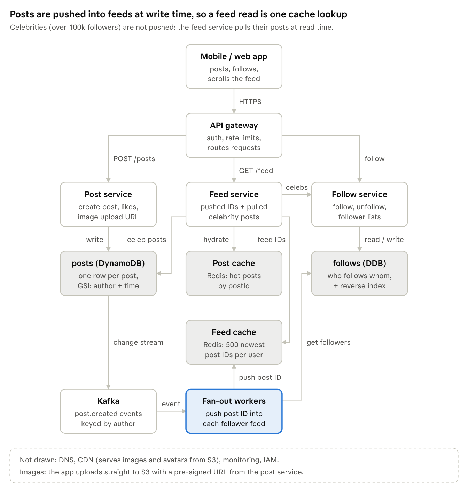
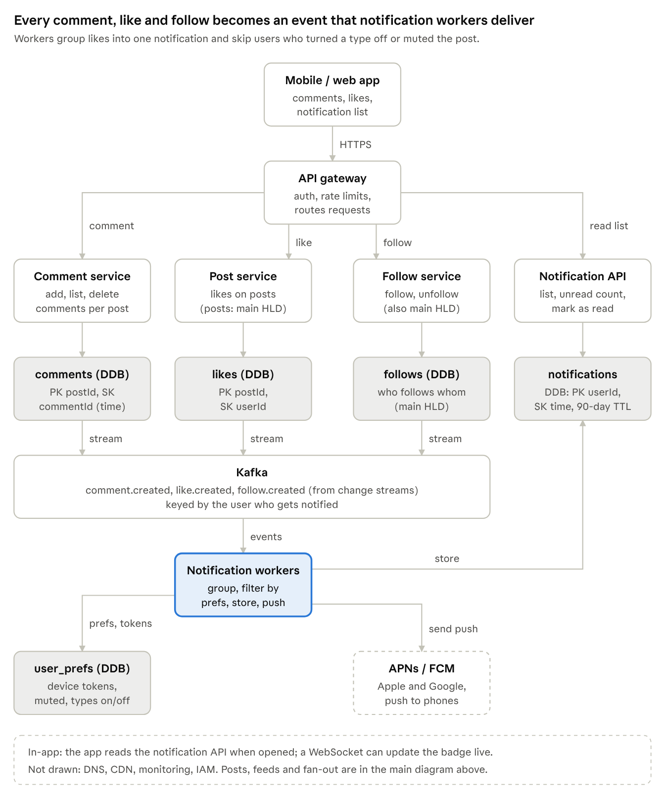

# News Feed — System Design

2026-11-22 · Arnav Jain

## 1. Requirements

Users post updates and follow other users. Each user sees a feed of the newest posts from the people they follow, which loads in under 500 ms. A new post may take a few seconds to reach followers' feeds. Users can comment on posts, and are notified, in the app and by phone push, when someone likes, comments on or mentions their post, or follows them.

### Words used in this doc

| Word                    | What it means                                                            | Example                                                           |
|-------------------------|--------------------------------------------------------------------------|-------------------------------------------------------------------|
| Post                    | Text, with optional images, that a user shares                           | Asha posts "Shipped the new search page!" with a screenshot       |
| Follow                  | A one-way link: the follower sees the followee's posts                   | Ravi follows Asha; Asha does not have to follow Ravi back         |
| Feed (timeline)         | The list of posts a user sees, newest first                              | Ravi's feed shows Asha's post from 2 minutes ago at the top       |
| Fan-out                 | Copying a new post's ID into each follower's feed                        | Asha has 300 followers, so 300 feed updates                       |
| Fan-out on write (push) | Do the fan-out when the post is created                                  | The work happens once, at post time; reading is cheap             |
| Fan-out on read (pull)  | Build the feed when the user opens it, by reading every followee's posts | No work at post time; reading is expensive                        |
| Celebrity               | A user with a very large number of followers (here, over 100k)           | Bob the cricketer has 20M followers                               |
| Hybrid fan-out          | Push for normal users, pull for celebrities                              | Ravi's feed = pushed IDs + Bob's latest posts pulled at read time |
| Feed cache              | A per-user list of post IDs in Redis                                     | `feed:ravi` holds his 500 newest post IDs                         |
| Hydration               | Turning post IDs into full posts (text, author name, like count)         | `p_9001` becomes Asha's post with her name and photo              |
| Cursor                  | A bookmark for "give me the next page"                                   | `cursor = p_8840` means "posts older than p_8840"                 |
| Snowflake ID            | A 64-bit ID that starts with the time, so sorting by ID sorts by time    | `p_9001` is newer than `p_8840`                                   |

Words for comments and notifications:

| Word              | What it means                                                                            | Example                                              |
|-------------------|------------------------------------------------------------------------------------------|------------------------------------------------------|
| Comment           | A reply under a post, shown when the post is opened                                      | Ravi comments "Looks great!" on Asha's post          |
| Notification      | A message telling a user something happened to them                                      | "Ravi commented on your post"                        |
| Push notification | A notification delivered to the phone's lock screen through Apple (APNs) or Google (FCM) | Asha's phone buzzes                                  |
| Device token      | The address APNs or FCM needs to reach one app on one phone                              | `fcm:dK3x…` for Asha's Android phone                 |
| Grouping          | Merging many similar events into one notification                                        | 42 likes become "Ravi and 41 others liked your post" |
| Unread count      | The number on the red badge                                                              | 3                                                    |

### Functional

1.  Create a post with text and optional images.

2.  Follow and unfollow users.

3.  View the feed: posts from followed users, newest first, 20 at a time with infinite scroll.

4.  Like a post; the feed shows like and comment counts.

5.  Comment on a post and read a post's comments, oldest first, 20 at a time.

6.  Get notified when someone likes or comments on your post, mentions you, or follows you. Notifications appear in an in-app list with an unread badge, and as phone push notifications.

### Non-functional

- **Scale:** 100M daily active users (DAU), 500M users in total.

- **Fast reads:** the feed loads in under 500 ms (p99). Reads outnumber writes about 100 to 1.

- **Eventual consistency is fine:** a post may take up to 5 s to appear in followers' feeds. The author sees their own post at once.

- **Highly available:** reading the feed matters more than perfect freshness (we prefer availability over consistency, the AP side of CAP).

- **Handles celebrities:** one post from a user with 20M followers must not slow down the system.

- **Timely, not noisy, notifications:** a comment notification arrives within a few seconds. Many likes are grouped into one, and users can turn notification types off.

- **Posting never waits on notifications:** if the push system is slow or down, posting, liking and commenting still work.

Out of scope: ads, search, direct messages and email notifications.

## 2. Traffic estimate

Feed reads peak at about 35,000 a second, while new posts are only about 350 a second. But each post is copied into about 200 feeds, so the fan-out writes about 70,000 feed entries a second at peak. That's why the feed lives in a cache built at write time.

| Quantity                       | Math                       | Result                                                     |
|--------------------------------|----------------------------|------------------------------------------------------------|
| Daily active users             | Given                      | 100M                                                       |
| Feed opens (including scrolls) | 100M × 10 a day            | 1B a day, about 11,600/s                                   |
| Peak feed reads                | 3 × average                | about 35,000/s                                             |
| New posts                      | 10% of DAU post once a day | 10M a day, about 116/s; peak about 350/s                   |
| Average followers              | Assumption                 | 200                                                        |
| Fan-out writes                 | 10M posts × 200 followers  | 2B feed inserts a day, about 23,000/s; peak about 70,000/s |
| Likes                          | 100M × 10 likes a day      | 1B a day, about 11,600/s                                   |
| Follows / unfollows            | 100M × 0.1 a day           | 10M a day, about 116/s                                     |
| Images uploaded                | 20% of posts × 500 KB      | 2M a day, about 1 TB a day                                 |
| Feed response size             | 20 posts × about 1 KB      | about 20 KB, with images loaded separately from the CDN    |

Comments and notifications add about 3,500 writes a second each at peak. That is far less than the fan-out, because comments and notifications go to one person or one post, not to 200 feeds.

| Quantity                             | Math                                                           | Result                                        |
|--------------------------------------|----------------------------------------------------------------|-----------------------------------------------|
| New comments                         | 100M × 2 a day                                                 | 200M a day, about 2,300/s; peak about 7,000/s |
| Comment list reads                   | 30% of feed opens open one post                                | 300M a day, about 3,500/s                     |
| Events that can notify               | 1B likes + 200M comments + 10M follows                         | about 1.2B a day                              |
| Notifications stored, after grouping | Likes grouped about 5 to 1                                     | about 400M a day, about 4,600/s               |
| Push notifications sent              | Users allow push on about 60% of notifications; per-user limit | about 200M a day, about 2,300/s               |
| Notification list reads              | 100M × 3 opens a day                                           | 300M a day, about 3,500/s                     |

## 3. API

REST endpoints for posts, follows, the feed, likes, comments and notifications. Every call carries the user's access token, and the API gateway turns it into a `userId`.

### Get an upload URL for an image

The app uploads images straight to S3, so big files never pass through our services.

``` http
POST /v1/media/upload-url
{ "contentType": "image/png", "sizeBytes": 482113 }

200 OK
{
  "mediaId": "m_77a1",
  "uploadUrl": "https://media-upload.s3.amazonaws.com/m_77a1?X-Amz-Signature=...",
  "expiresIn": 300
}
```

### Create a post

``` http
POST /v1/posts
Idempotency-Key: 5f1c-asha-001
{ "text": "Shipped the new search page!", "mediaIds": ["m_77a1"] }

201 Created
{ "postId": "p_9001", "createdAt": "2026-11-22T10:02:11Z" }
```

The `Idempotency-Key` means a retry after a network error does not create the post twice.

### Follow and unfollow

``` http
PUT /v1/users/asha/followers/ravi      -> 204 No Content
DELETE /v1/users/asha/followers/ravi   -> 204 No Content
```

PUT and DELETE are safe to repeat: following twice is still one follow.

### Read the feed

``` http
GET /v1/feed?limit=20&cursor=p_8840

200 OK
{
  "items": [
    {
      "postId": "p_8839",
      "author": { "userId": "asha", "name": "Asha", "avatarUrl": "https://cdn.example.com/u/asha.jpg" },
      "text": "Shipped the new search page!",
      "media": ["https://cdn.example.com/m/m_77a1.png"],
      "likeCount": 42,
      "likedByMe": false,
      "createdAt": "2026-11-22T10:02:11Z"
    }
  ],
  "nextCursor": "p_8790"
}
```

The first page has no `cursor`. Each next page sends the `nextCursor` from the previous one.

### Like a post

``` http
PUT /v1/posts/p_9001/likes/me     -> 204 No Content
DELETE /v1/posts/p_9001/likes/me  -> 204 No Content
```

### Add a comment

``` http
POST /v1/posts/p_9001/comments
Idempotency-Key: 8a2e-ravi-014
{ "text": "Looks great! @meera have you seen this?" }

201 Created
{ "commentId": "c_5120", "createdAt": "2026-11-22T10:06:40Z" }
```

### Read comments on a post

``` http
GET /v1/posts/p_9001/comments?limit=20&cursor=c_5100

200 OK
{
  "items": [
    {
      "commentId": "c_5120",
      "author": { "userId": "ravi", "name": "Ravi" },
      "text": "Looks great! @meera have you seen this?",
      "createdAt": "2026-11-22T10:06:40Z"
    }
  ],
  "nextCursor": "c_5120"
}
```

### Read notifications

``` http
GET /v1/notifications?limit=20

200 OK
{
  "unreadCount": 3,
  "items": [
    {
      "notifId": "n_7731",
      "type": "LIKE_GROUP",
      "text": "Ravi and 41 others liked your post",
      "postId": "p_9001",
      "read": false,
      "updatedAt": "2026-11-22T10:07:00Z"
    },
    {
      "notifId": "n_7730",
      "type": "COMMENT",
      "text": "Ravi commented: Looks great!",
      "postId": "p_9001",
      "read": false,
      "updatedAt": "2026-11-22T10:06:41Z"
    }
  ],
  "nextCursor": "n_7730"
}
```

### Mark notifications as read, register a phone, set preferences

``` http
POST /v1/notifications/read            { "upTo": "n_7731" }                   -> 204
PUT  /v1/devices/dev_ab12              { "platform": "android", "token": "fcm:dK3x..." } -> 204
PUT  /v1/notification-prefs            { "likes": false, "comments": true, "quietHours": "23:00-07:00" } -> 204
```

## 4. High-level design

The design is hybrid fan-out. When a normal user posts, fan-out workers push the post ID into every follower's feed cache, so reading a feed is one Redis read plus hydration. Posts from celebrities are not pushed; the feed service pulls them when the feed is read.



### Following one post from Asha to Ravi's screen

1.  Asha taps Post. The app has already uploaded her screenshot straight to S3 with a pre-signed URL, so it sends only `{text, mediaIds}`.

2.  The **API gateway** checks her token and rate limit, and sends the request to the **post service**.

3.  The post service creates the ID `p_9001` (a Snowflake ID, so it sorts by time) and writes the row to **posts**. It also adds `p_9001` to Asha's own feed at once, so she sees her post immediately.

4.  The posts table's **change stream** (DynamoDB Streams) puts a `post.created` event on **Kafka**. The event comes from the database's own log, so it fires exactly when the write succeeded: no dual write that could fail half-way.

5.  A **fan-out worker** reads the event. Asha has 300 followers (under 100k), so she is not a celebrity. It reads her follower list from **follows** in pages of 1,000.

6.  For each follower it runs `ZADD feed:{followerId} p_9001` in the **feed cache** and trims the list to 500. Ravi's feed now starts with `p_9001`. Elapsed time is under 1 s.

7.  Ravi opens the app: `GET /v1/feed`. The **feed service** reads the 20 newest IDs from `feed:ravi`.

8.  It asks the **follow service** which celebrities Ravi follows (Bob), and reads Bob's newest posts from the posts table's author index. It merges the two lists by ID, newest first, and keeps 20.

9.  It **hydrates** the 20 IDs in one batch from the **post cache** (text, author, like count), reading misses from posts. Then it returns the page and a `nextCursor`.

### Components

| Box                | Stateless or stateful | Talks to                                       | Why it exists                                                                                                         |
|--------------------|-----------------------|------------------------------------------------|-----------------------------------------------------------------------------------------------------------------------|
| Mobile / web app   | Client                | API gateway, S3 (uploads), CDN                 | Shows the feed and sends posts                                                                                        |
| API gateway        | Stateless             | All services                                   | One door: auth, rate limits, routing                                                                                  |
| Post service       | Stateless             | posts, S3 (pre-signed URLs)                    | Creates posts and likes, and hands out upload URLs                                                                    |
| Follow service     | Stateless             | follows                                        | Owns the follow graph; answers "who follows Asha" and "which celebrities does Ravi follow"                            |
| Feed service       | Stateless             | Feed cache, post cache, posts, follow service  | Builds a page: pushed IDs + pulled celebrity posts, then hydration                                                    |
| posts (DynamoDB)   | Stateful              | Post service, feed service, Kafka (via stream) | Source of truth for every post                                                                                        |
| follows (DynamoDB) | Stateful              | Follow service, fan-out workers                | Source of truth for the follow graph, with a reverse index for follower lists                                         |
| Post cache (Redis) | Stateful              | Feed service                                   | Most feed reads hit recent posts; caching them avoids about 700,000 database reads a second (35,000 feeds × 20 posts) |
| Feed cache (Redis) | Stateful              | Feed service, fan-out workers                  | The pre-built feed: 500 newest post IDs per active user                                                               |
| Kafka              | Stateful (log)        | posts stream, fan-out workers                  | Buffers post events, so a burst of posts never slows down posting                                                     |
| Fan-out workers    | Stateless             | Kafka, follows, feed cache                     | Do the push: 1 post becomes about 200 feed inserts                                                                    |

### Comments and notifications

Comments are stored per post and are not fanned out: you see them when you open a post. Notifications are a separate, asynchronous path. The change streams of `comments`, `likes` and `follows` feed Kafka, and notification workers turn the events into stored notifications and phone pushes.



Following Ravi's comment to Asha's phone:

1.  Ravi comments "Looks great! @meera have you seen this?" on `p_9001`. The **comment service** writes `{postId: p_9001, commentId: c_5120, authorId: ravi, text}` to **comments** and returns at once.

2.  The comments change stream puts `comment.created` on **Kafka**.

3.  A **notification worker** works out who should hear about it: Asha (her post) and Meera (mentioned). Not Ravi himself.

4.  It reads **user_prefs**: Asha allows comment notifications; Meera muted mentions, so only Asha gets one.

5.  It writes `{userId: asha, notifId: n_7730, type: COMMENT, text: "Ravi commented: Looks great!"}` to **notifications** and adds 1 to Asha's unread count in Redis.

6.  It looks up Asha's device token and sends the push through **FCM**. Her Android phone buzzes, about 1 s after Ravi tapped Send.

7.  Later Asha opens the bell icon. The **notification API** reads her newest 20 notifications, and marks them read when she views them.

| Box                      | Stateless or stateful | Talks to                                     | Why it exists                                                              |
|--------------------------|-----------------------|----------------------------------------------|----------------------------------------------------------------------------|
| Comment service          | Stateless             | comments                                     | Adds and lists comments per post                                           |
| comments (DynamoDB)      | Stateful              | Comment service, Kafka (via stream)          | All comments on a post in one partition, sorted by time                    |
| likes (DynamoDB)         | Stateful              | Post service, Kafka (via stream)             | One row per like, so liking twice is still one like; source of like events |
| Notification workers     | Stateless             | Kafka, user_prefs, notifications, APNs / FCM | Decide who, filter by preferences, group, store, push                      |
| notifications (DynamoDB) | Stateful              | Workers, notification API                    | Each user's in-app list, kept for 90 days                                  |
| user_prefs (DynamoDB)    | Stateful              | Workers                                      | Device tokens, muted posts, notification types turned on or off            |
| Notification API         | Stateless             | notifications, Redis unread count            | Serves the bell list and badge                                             |
| APNs / FCM               | External              | Workers                                      | Apple's and Google's services that deliver pushes to phones                |

### Left out on purpose

- **Ranking.** The feed is newest first; a ranking step can be added later (deep dive 8.9).

- **Ads.** They would be one more service reading the same events.

- **Several regions.** One region at first; see Wrap-up.

- **DNS, CDN, monitoring and IAM.** These are in the diagram's note, not drawn as boxes.

## 5. Flows

Ten flows: posting, fan-out, reading the first page, scrolling to the next page, a celebrity post, following someone, deleting a post, commenting, grouped likes, and a failed push.

### Flow A: Asha creates a post

1.  The app calls `POST /v1/media/upload-url`, gets a pre-signed URL and uploads the 480 KB screenshot straight to S3.

2.  The app calls `POST /v1/posts` with `Idempotency-Key: 5f1c-asha-001`.

3.  The post service checks the key in Redis. It hasn't been seen, so it continues. (On a retry with the same key, it returns the same `p_9001`.)

4.  It writes `{postId: p_9001, authorId: asha, text, mediaKeys, createdAt, likeCount: 0}` to posts.

5.  It runs `ZADD feed:asha p_9001`, so Asha sees her own post at once.

6.  It returns `201 {postId: p_9001}`. Total time is about 30 ms; the fan-out happens afterwards, in the background.

### Flow B: Fan-out to 300 followers

1.  DynamoDB Streams turns the new posts row into the Kafka event `{postId: p_9001, authorId: asha, createdAt}`, keyed by `asha`.

2.  A fan-out worker reads it and looks up Asha's follower count (300). That is under 100k, so it pushes.

3.  It reads the reverse index of follows: `followeeId = asha`, 1,000 at a time. Here that's 1 page of 300.

4.  For each follower, in Redis pipelines of 500 commands: `ZADD feed:{id} p_9001` then `ZREMRANGEBYRANK feed:{id} 0 -501`, which keeps the newest 500.

5.  Followers who haven't opened the app in 30 days have no feed cache, so they are skipped (deep dive 8.4).

6.  It commits the Kafka offset. If the worker crashed before that, another worker repeats the event, and a repeated `ZADD` of the same ID changes nothing.

### Flow C: Ravi opens the app (first page)

1.  `GET /v1/feed?limit=20`.

2.  The feed service runs `ZREVRANGE feed:ravi 0 19` and gets 20 IDs, `p_9001` first.

3.  It asks the follow service for Ravi's celebrity followees: `[bob]`, a list cached for 5 minutes.

4.  It reads Bob's 20 newest post IDs from the post cache key `author_posts:bob` (falling back to the posts author index).

5.  It merges the two sorted lists and takes the 20 newest: 18 pushed IDs and 2 of Bob's.

6.  It runs `MGET post:{id}` for the 20 IDs in the post cache: 19 hits, and 1 miss read from posts and then cached.

7.  It adds author names and avatars from a user cache and `likedByMe` from the likes table, and returns the 20 items with `nextCursor = p_8790` (the oldest ID shown).

### Flow D: Ravi scrolls (next page)

1.  `GET /v1/feed?limit=20&cursor=p_8790`.

2.  The feed service reads IDs lower than `p_8790` from `feed:ravi` (`ZREVRANGEBYSCORE` with `(p_8790` as the maximum), and Bob's posts older than `p_8790`.

3.  It merges, hydrates and returns the next 20.

4.  The cursor is a post ID, not a page number, so new posts arriving at the top don't shift the pages and cause duplicates.

5.  After 500 items the feed cache runs out. The feed service then falls back to pull mode for older posts (deep dive 8.3).

### Flow E: Bob (20M followers) posts

1.  The post is saved exactly like Asha's, and the event reaches a fan-out worker.

2.  Bob's follower count is 20M, over the 100k limit, so the worker does not push. It only adds the ID to `author_posts:bob` in the post cache (his 100 newest posts).

3.  When any of Bob's followers opens the feed, Flow C step 4 pulls Bob's new post in.

4.  Without this rule, one post from Bob would mean 20M Redis writes, about 5 minutes of the fan-out workers' total capacity at 70,000 writes a second.

### Flow F: Ravi follows Meera

1.  `PUT /v1/users/meera/followers/ravi`.

2.  The follow service writes `{followerId: ravi, followeeId: meera}`; the reverse index updates automatically.

3.  Backfill: it reads Meera's 20 newest post IDs and adds them to `feed:ravi`, so her posts appear right away rather than only when she next posts.

4.  Unfollowing does the opposite: delete the row and remove her post IDs from `feed:ravi`.

### Flow G: Asha deletes her post

1.  `DELETE /v1/posts/p_9001`: the post service sets `deleted = true` on the row and deletes `post:p_9001` from the post cache.

2.  Removing `p_9001` from 300 feeds is not needed right away. At hydration the feed service skips any deleted post, and the feed simply shows the next one.

3.  A background job later removes the ID from the feeds, using the same fan-out path.

### Flow H: Ravi comments, and Asha is notified

1.  `POST /v1/posts/p_9001/comments` with "Looks great! @meera have you seen this?".

2.  The comment service writes `c_5120` to comments (`PK p_9001, SK c_5120`) and returns `201`. It deletes the cached first page of comments for `p_9001`.

3.  The comments stream puts `comment.created {postId: p_9001, commentId: c_5120, authorId: ravi, mentions: [meera]}` on Kafka.

4.  A counter worker adds 1 to `p_9001.commentCount`, batched once a second.

5.  A notification worker picks the targets: Asha (post author) and Meera (mentioned). It never notifies Ravi about his own comment.

6.  It reads user_prefs: Asha has comments on; Meera has mentions muted, so she is skipped.

7.  It writes `n_7730 {type: COMMENT}` for Asha, runs `INCR unread:asha`, and sends a push through FCM to her one device token.

### Flow I: 42 people like Asha's post in a minute

1.  Each like writes a row to likes and produces a `like.created` event, keyed by `asha` (the person to notify).

2.  Because of that key, all 42 events reach the same worker. The first opens a 1-minute group for `(asha, p_9001, LIKE)`, writes `n_7731 "Ravi liked your post"` and sends one push.

3.  The next 41 events in that minute only update the group: `n_7731` becomes "Ravi and 41 others liked your post". No more pushes are sent, because of the 1 per minute limit.

4.  After the minute, the next like starts a new group, which updates the same notification row and may push once more.

### Flow J: A push can't be delivered

1.  FCM returns `UNREGISTERED` for Asha's old phone: she uninstalled the app there.

2.  The worker deletes that token from user_prefs. It does not retry.

3.  For a temporary error (FCM `503`), it retries 3 times (1 s, 5 s, 30 s), then gives up.

4.  Either way the notification is already stored, so Asha sees it in the bell list the next time she opens the app.

## 6. Data model

DynamoDB holds the source of truth: posts, follows, likes, users, comments, notifications and preferences. Redis holds what can be rebuilt: the feed cache and the post cache.

### `posts` (DynamoDB)

| Column      | Type      | Example                        | Notes                                                   |
|-------------|-----------|--------------------------------|---------------------------------------------------------|
| postId (PK) | string    | `p_9001`                       | Snowflake: time + machine + sequence, so newer = larger |
| authorId    | string    | `asha`                         |                                                         |
| text        | string    | `Shipped the new search page!` | Up to 5,000 characters                                  |
| mediaKeys   | list      | `["m/m_77a1.png"]`             | S3 keys; served via the CDN                             |
| createdAt   | timestamp | 2026-11-22T10:02:11Z           |                                                         |
| likeCount   | number    | 42                             | Updated in batches (deep dive 8.7)                      |
| deleted     | bool      | false                          | Soft delete                                             |

**GSI `by_author`:** partition key `authorId`, sort key `postId`. "Bob's newest 20 posts" is one query, newest first.

`posts` also has `commentCount`, updated in batches the same way as `likeCount`.

### `follows` (DynamoDB)

| Column          | Type      | Example              | Notes                   |
|-----------------|-----------|----------------------|-------------------------|
| followerId (PK) | string    | `ravi`               |                         |
| followeeId (SK) | string    | `asha`               | "Who does Ravi follow?" |
| createdAt       | timestamp | 2026-11-20T08:00:00Z |                         |

**GSI `by_followee`:** partition key `followeeId`, sort key `followerId`. "Who follows Asha?" is what the fan-out needs.

### `users` (DynamoDB)

| Column        | Type      | Example              | Notes                                                    |
|---------------|-----------|----------------------|----------------------------------------------------------|
| userId (PK)   | string    | `bob`                |                                                          |
| name          | string    | `Bob`                |                                                          |
| avatarKey     | string    | `u/bob.jpg`          |                                                          |
| followerCount | number    | 20,000,000           |                                                          |
| isCelebrity   | bool      | true                 | Set when followerCount passes 100k; decides push or pull |
| lastActiveAt  | timestamp | 2026-11-22T09:58:00Z | Inactive for 30 days = no feed cache                     |

### `likes` (DynamoDB)

| Column      | Type      | Example              | Notes                                               |
|-------------|-----------|----------------------|-----------------------------------------------------|
| postId (PK) | string    | `p_9001`             |                                                     |
| userId (SK) | string    | `ravi`               | One row per like, so liking twice is still one like |
| createdAt   | timestamp | 2026-11-22T10:05:00Z |                                                     |

### `comments` (DynamoDB)

| Column         | Type   | Example                                   | Notes                                                      |
|----------------|--------|-------------------------------------------|------------------------------------------------------------|
| postId (PK)    | string | `p_9001`                                  | All comments on a post in one partition                    |
| commentId (SK) | string | `c_5120`                                  | Snowflake, so oldest-first or newest-first is a plain sort |
| authorId       | string | `ravi`                                    |                                                            |
| text           | string | `Looks great! @meera have you seen this?` | Up to 2,000 characters                                     |
| mentions       | list   | `["meera"]`                               | Parsed when written; used by notifications                 |
| deleted        | bool   | false                                     | Soft delete; shown as "comment removed"                    |

### `notifications` (DynamoDB)

| Column       | Type   | Example                | Notes                                           |
|--------------|--------|------------------------|-------------------------------------------------|
| userId (PK)  | string | `asha`                 | The person notified                             |
| notifId (SK) | string | `n_7731`               | Snowflake, so the newest come first             |
| type         | string | `LIKE_GROUP`           | LIKE_GROUP, COMMENT, MENTION, FOLLOW            |
| actorIds     | list   | `["ravi", "meera", …]` | Up to 3 kept for display, plus a count          |
| actorCount   | number | 42                     | "Ravi and 41 others"                            |
| postId       | string | `p_9001`               | What tapping opens                              |
| groupKey     | string | `asha#p_9001#LIKE`     | Finds the notification to update while grouping |
| read         | bool   | false                  |                                                 |
| expiresAt    | number | 90 days ahead          | DynamoDB TTL deletes old notifications for free |

### `user_prefs` (DynamoDB)

| Column       | Type   | Example                                                         | Notes                                     |
|--------------|--------|-----------------------------------------------------------------|-------------------------------------------|
| userId (PK)  | string | `asha`                                                          |                                           |
| devices      | list   | `[{deviceId: dev_ab12, platform: android, token: fcm:dK3x…}]`   | One per phone or browser                  |
| enabledTypes | map    | `{likes: true, comments: true, mentions: true, follows: false}` |                                           |
| mutedPostIds | list   | `["p_7000"]`                                                    | "Turn off notifications for this post"    |
| quietHours   | string | `23:00-07:00`                                                   | Store, but don't push, during these hours |

### Redis keys

| Key                     | Type                       | Example                                                  | Notes                                           |
|-------------------------|----------------------------|----------------------------------------------------------|-------------------------------------------------|
| `feed:{userId}`         | Sorted set; score = postId | `feed:ravi` → `p_9001, p_8999, …`                        | 500 newest; 30-day TTL, refreshed on every read |
| `post:{postId}`         | Hash                       | `post:p_9001` → `{authorId, text, mediaKeys, likeCount}` | Hot posts; 3-day TTL                            |
| `author_posts:{userId}` | Sorted set                 | `author_posts:bob` → his 100 newest IDs                  | Only for celebrities; used by the pull          |
| `user:{userId}`         | Hash                       | `user:asha` → `{name, avatarKey}`                        | For hydration; 1-hour TTL                       |
| `idem:{key}`            | String                     | `idem:5f1c-asha-001` → `p_9001`                          | 24-hour TTL; stops duplicate posts on retry     |

Extra Redis keys for comments and notifications:

| Key                      | Type          | Example                                                         | Notes                                                                  |
|--------------------------|---------------|-----------------------------------------------------------------|------------------------------------------------------------------------|
| `comments_p1:{postId}`   | String (JSON) | `comments_p1:p_9001`                                            | First page of comments; 5 s TTL, deleted on a new comment              |
| `unread:{userId}`        | Integer       | `unread:asha` → 3                                               | The badge; set to 0 when the list is opened                            |
| `notif_group:{groupKey}` | Hash          | `notif_group:asha#p_9001#LIKE` → `{notifId: n_7731, count: 42}` | Open 1-minute group; 60 s TTL                                          |
| `push_limit:{userId}`    | String        | `push_limit:asha`                                               | Set for 60 s after a grouped push; blocks more pushes until it expires |

## 7. Storage estimate

Images dominate at about 365 TB a year in S3. The feed cache needs about 1 TB of Redis memory: big, but fine spread over a cluster.

| Store                     | Math                                                      | Size                                                                      |
|---------------------------|-----------------------------------------------------------|---------------------------------------------------------------------------|
| posts                     | 10M a day × 1 KB                                          | 10 GB a day, about 3.7 TB a year                                          |
| Images in S3              | 2M a day × 500 KB                                         | 1 TB a day, about 365 TB a year                                           |
| follows (+ reverse index) | 500M users × 200 follows × 50 B × 2                       | about 10 TB                                                               |
| likes                     | 1B a day × 40 B                                           | 40 GB a day, about 15 TB a year                                           |
| users                     | 500M × 500 B                                              | 250 GB                                                                    |
| Feed cache                | 100M active users × 500 IDs × 8 B, × 2 for Redis overhead | about 800 GB, so a cluster of about 16 nodes at 64 GB each, plus replicas |
| Post cache                | 3 days of posts: 30M × 1 KB                               | about 30 GB                                                               |
| Kafka post.created        | 116/s × 200 B × 7 days × 3 replicas                       | about 40 GB                                                               |

Comments and notifications add about 40 TB a year, small next to the images.

| Store                                | Math                                     | Size                            |
|--------------------------------------|------------------------------------------|---------------------------------|
| comments                             | 200M a day × 300 B                       | 60 GB a day, about 22 TB a year |
| notifications (90-day TTL)           | 400M a day × 300 B × 90 days             | about 11 TB, stays flat         |
| user_prefs                           | 500M × 500 B                             | 250 GB                          |
| Redis unread counts + groups         | 100M active users × about 50 B           | about 5 GB                      |
| Kafka (comment, like, follow events) | 1.2B a day × 200 B × 7 days × 3 replicas | about 5 TB                      |

Post rows are tiny compared with images, and old images can move to cheaper S3 storage classes after 90 days.

## 8. Deep dives

### 8.1 Fan-out on write, on read, or both

|                                               | Fan-out on write (push)          | Fan-out on read (pull)        | Hybrid (chosen)                                      |
|-----------------------------------------------|----------------------------------|-------------------------------|------------------------------------------------------|
| When Asha (300 followers) posts               | 300 Redis writes                 | Nothing                       | 300 Redis writes                                     |
| When Bob (20M followers) posts                | 20M Redis writes, minutes of lag | Nothing                       | 1 write to `author_posts:bob`                        |
| When Ravi (follows 200 people) opens the feed | 1 Redis read                     | 200 queries, then merge: slow | 1 Redis read + 1 small read per celebrity he follows |
| Feed read latency                             | Lowest                           | Highest                       | Low                                                  |
| Wasted work                                   | Pushing to inactive users        | None                          | Inactive users skipped                               |

Reads outnumber posts 100 to 1, so doing the work at write time pays off. Pull is kept only where push is unreasonable: celebrities.

### 8.2 The celebrity problem

- **Threshold:** an author with over 100k followers is marked `isCelebrity`. The fan-out worker checks this flag before pushing.

- **Read cost:** a typical user follows only a few celebrities, so the pull adds 1 to 5 small reads of `author_posts:{id}` from Redis, a few milliseconds.

- **Edge case: someone who follows 300 celebrities.** Cap the pull at the 50 celebrities they interact with most. The rest appear only when the feed cache is rebuilt.

- **Hot keys:** `author_posts:bob` is read by millions of feeds. Keep a copy in each feed service's local memory for 10 s, and use Redis read replicas.

### 8.3 Pagination and older posts

- The cursor is the last post ID shown. Because Snowflake IDs grow with time, "older than the cursor" is a simple range read, and new posts at the top never shift the page.

- The feed cache holds 500 IDs, about 25 pages, and few users scroll further. Past that, the feed service switches to pull: it reads each followee's posts older than the cursor from the posts author index, merges and returns them. It's slow, but rare.

### 8.4 Keeping the feed cache small

- Only active users (seen in the last 30 days) get a feed cache. That's 100M of 500M users, so the cache is 800 GB instead of 4 TB.

- When an inactive user comes back, the feed service rebuilds their cache: read their followees, take each one's 20 newest posts, merge, and keep 500. That takes about 200 ms once, and the user sees a short spinner.

- If a Redis node is lost, its users' feeds are rebuilt the same way on their next read. The cache is never the source of truth.

### 8.5 Consistency and ordering

- **Eventual consistency:** followers see a post within about 1 s normally, and within 5 s under load. Fan-out lag is watched as a metric.

- **Read your own writes:** the post service writes the author's own feed synchronously (Flow A step 5), so Asha never posts and then sees nothing.

- **Ordering:** Snowflake IDs start with a millisecond timestamp. Posts made in the same millisecond by different servers are ordered by machine ID, which is fine for a feed.

- **Duplicates:** Kafka is at-least-once, so an event can arrive twice. `ZADD` of an existing ID changes nothing, so the fan-out is idempotent.

### 8.6 Comments

- **Storage:** `comments` is partitioned by `postId` and sorted by `commentId` (a Snowflake ID). "Comments on p_9001, oldest first, 20 at a time" is one query with a cursor.

- **Hot posts:** a viral post can get 5,000 comments a minute. All of them go to one DynamoDB partition, which is fine for writes up to about 1,000 a second per partition. The first page of comments is cached in Redis for 5 s, so millions of readers don't hit the table.

- **Comment count:** the feed shows "12 comments" without reading the comments. A counter on the posts row is updated by a stream consumer in batches (deep dive 8.7).

- **Comments are not fanned out.** They aren't in the feed; only the post is. Comments reach people through notifications (8.8).

### 8.7 Like and comment counters on hot posts

One viral post may get 10,000 likes a second. Updating `likeCount` on one row at that rate would throttle the partition.

- Each like writes its own row in `likes` (`PK postId, SK userId`), spread out by user and safe to repeat.

- A counter worker reads the likes change stream, adds up likes per post for 1 s, and does a single `ADD likeCount :n` per post per second.

- The count shown can be up to a few seconds behind, which nobody notices.

### 8.8 Notifications

**What creates one:** a like, a comment or a reply, a new follower, a mention. Each comes from the change stream of `likes`, `comments` or `follows` as a Kafka event. The services don't call the notification system, so it can be down without breaking posting.

**What the worker does with each event:**

1.  **Decide who:** the post's author for a like or comment, everyone mentioned, and the person followed for a follow. Never the person who acted (Asha liking her own post gives no notification).

2.  **Check preferences:** skip if Ravi turned off like notifications or muted this post.

3.  **Group:** likes are grouped per post in a 1-minute window. 42 like events become one notification, "Ravi and 41 others liked your post", which updates in place.

4.  **Store:** write to `notifications` (`PK userId, SK notifId`) and add 1 to the unread count in Redis.

5.  **Push:** look up the user's device tokens and send through APNs (iPhone) or FCM (Android). At most 1 push per user per minute for grouped types; comments and mentions are sent at once.

**Delivery:**

- The in-app list comes from `GET /v1/notifications`. The red badge is the unread count from Redis.

- If APNs or FCM fails, the push is retried 3 times with growing delays, then dropped. The notification is still in the in-app list, so nothing is lost.

- A token that APNs or FCM reports as invalid (app uninstalled) is deleted.

**Celebrities:** a celebrity's post may get 1M likes. Grouping turns that into a few dozen notification updates, and the push limit keeps Bob's phone quiet.

### 8.9 Ranking (optional)

This design is newest first. To rank, take the 500 IDs from the feed cache as candidates. Score each one by how often Ravi interacts with the author, how fresh it is and how many likes it has. Return the top 20. The cursor becomes an offset into a ranked list cached for 10 minutes, so the order stays stable while Ravi scrolls.

## 9. Wrap-up

### 30-second summary

For 100M DAU, we pre-build each active user's feed. A new post's change stream goes to Kafka, and fan-out workers push the post ID into every follower's Redis feed (500 newest IDs). Reading the feed is then one Redis read, a merge with posts pulled from the few celebrities the user follows, and a batch hydration from the post cache. Celebrities (over 100k followers) are never pushed, which avoids 20M writes per post. Cursors are Snowflake post IDs, so infinite scroll is stable. Comments live in their own table, partitioned by post. Likes, comments and follows also flow through Kafka to notification workers, which group, filter by preferences, store, and push through APNs and FCM.

### Decisions

| Decision      | Chosen                                           | Instead of                                    | Why                                                          |
|---------------|--------------------------------------------------|-----------------------------------------------|--------------------------------------------------------------|
| Feed building | Hybrid: push for most, pull for celebrities      | Push only or pull only                        | Cheap reads for everyone, without 20M-write fan-outs         |
| Feed storage  | Redis sorted set of 500 post IDs per active user | Full posts in each feed                       | IDs are 8 bytes; post text is stored once and hydrated       |
| Event source  | DynamoDB change streams into Kafka               | The service writing to the database and Kafka | No dual write: an event exists only if the row was saved     |
| Pagination    | Cursor = last post ID                            | Page numbers                                  | New posts don't shift pages or cause duplicates              |
| Counters      | Like rows + 1-second batched count updates       | Increment on every like                       | Hot posts would throttle one row                             |
| Comments      | Own table, partitioned by postId, not fanned out | Comments inside the post row                  | A post can have thousands; they're read only when opened     |
| Notifications | Async workers: group, filter, store, push        | The service sending the push directly         | Posting never waits on APNs or FCM, and likes can be grouped |
| Database      | DynamoDB                                         | Postgres                                      | Simple key access at very large scale; no joins needed       |

### If they push further

- **"Make it ranked, like Instagram."** Use the feed cache as candidates, score them with a model, and cache the ranked list per session (deep dive 8.9).

- **"Go global."** Run a full copy in each region, with DynamoDB global tables. The fan-out runs in each region from its local stream, and users are served by their home region.

- **"A celebrity drops below 100k followers."** Use two thresholds (switch to pull at 100k, back to push below 80k) so accounts don't flip back and forth.

- **"Live updates without refreshing."** Keep a WebSocket open, and have the fan-out also publish "new posts available" to a Redis channel. The app then shows a "3 new posts" pill, without reordering the feed under the user's thumb.

- **"Notification storm: a post goes viral at 2 am."** Use quiet hours from user preferences, grouped likes, and a per-user push limit. Send a daily digest instead of 500 pushes.
