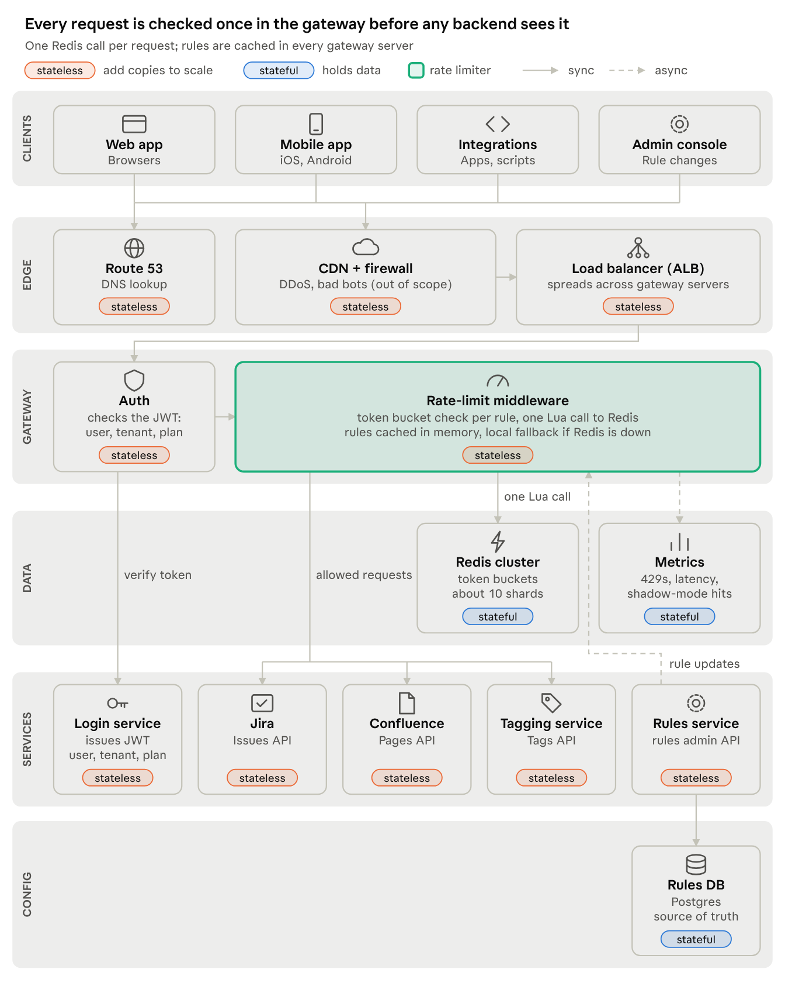

# Rate Limiter System Design (Atlassian Interview)

Nov 14, 2026 · @Arnav jain

A distributed rate limiter inside the API gateway, using token buckets in Redis, that checks about 300K requests a second at peak and adds under 5 ms.

## Interview flow (45–60 min)

1. **Basics and requirements (7 min):** what we limit, by whom, and how strictly. Confirm before moving on.
2. **Quick traffic estimate (2 min):** requests per second the limiter must check.
3. **API (5 min):** the rule-management API and what clients see (headers, 429).
4. **Algorithm choice (8 min):** compare the five classic algorithms and pick one.
5. **High-level design (8 min):** where the limiter sits and its components.
6. **Request flows (5 min):** an allowed request, a rejected one, and a rule change.
7. **Data model and memory (5 min):** rules table, Redis keys, memory needed.
8. **Deep dives (12 min):** races, Redis failure, hot keys, multi-region.
9. **Wrap-up (3 min):** monitoring and trade-offs.

## 1. Basics: what a rate limiter is

A rate limiter caps how many requests a caller can make in a period, and rejects the rest with `429 Too Many Requests`.

**Everyday example:** an ATM lets you withdraw at most 5 times a day. The 6th try is refused until tomorrow. A rate limiter does the same for API calls: "Riya can call the API at most 100 times a minute."

**Why Atlassian needs one**

- **Noisy neighbours:** one company's runaway script must not slow down every other company on shared services (the multi-tenancy requirement from the tagging design).
- **Protection:** stop abuse, scraping, brute-force logins and accidental retry storms before they overload databases.
- **Fairness and plans:** free, standard and enterprise plans get different limits.
- **Cost control:** expensive endpoints (search, bulk jobs) get tighter limits than cheap reads.

**Who gets limited (the "key")**

| Key | Example | Typical use |
| --- | --- | --- |
| User | riya@acme | Fair use per person |
| Tenant (company) | acme | Noisy-neighbour protection |
| API token or app | integration app\_42 | Third-party apps and scripts |
| IP address | 203.0.113.7 | Unauthenticated traffic, login pages |
| Endpoint | `POST /search` | Expensive operations |

A request is usually checked against several keys at once, for example per user and per tenant.

**Where it sits:** inside the API gateway, before any backend service. Rejecting early is cheapest: a blocked request never touches Jira, Confluence or the tagging service. Network-level floods (DDoS) are handled even earlier, at the edge (CDN or firewall), and are out of scope here.

## 2. Requirements

### Functional

1. Limit requests per key: user, tenant, API token, IP address and endpoint, alone or combined.
2. Support several rules per request (for example 100 per minute per user **and** 10,000 per minute per tenant); a request must pass all of them.
3. Different limits per plan (free, standard, enterprise) and per endpoint.
4. Rejected requests get `429 Too Many Requests` with a `Retry-After` header; every response shows the remaining quota in headers.
5. Admins create, update and delete rules without redeploying the gateway; changes apply within about 30 seconds.
6. A rule can run in **shadow mode**: log what it would block, without blocking.

### Non-functional

- **Low latency:** adds under 5 ms at p99 to each request.
- **Scale:** about 300K checks a second at peak (section 3).
- **Highly available:** if the limiter fails, traffic keeps flowing (fail open). It must never be the reason the product is down.
- **Accurate enough:** limits hold across all gateway servers. Small overshoot (a few percent) during races is acceptable; a 10× overshoot is not.
- **Multi-tenant:** each company's counters are isolated; one company's traffic cannot use another's quota.
- **Observable:** metrics on allowed and rejected requests per rule and tenant.

### Out of scope

- Network-level DDoS protection (handled at the CDN or firewall).
- Billing based on usage.
- Queuing rejected requests to run later (we reject, the client retries).

## 3. Quick traffic estimate

Every API request through the gateway is one rate-limit check, so the limiter must handle about 100K checks a second on average and 300K at peak.

**Assumptions to say out loud**

- 100M daily active users across Atlassian products (same as the tagging design).
- About 100 API requests per user per day (page loads make many calls; integrations add more).
- One day is about 10^5 seconds; peak is about 3× average.
- Each request is checked against about 2–3 rules (user, tenant, endpoint).

|  | Calculation | Result |
| --- | --- | --- |
| Requests per day | 100M × 100 | 10B |
| Average requests per second | 10B / 10^5 | 100K |
| Peak requests per second | 100K × 3 | 300K |
| Counter operations at peak | 300K × \~3 rules | about 1M Redis operations a second (batched into \~300K round trips) |

**What this tells us**

- Every check is on the hot path of every request, so it must be one fast round trip: an in-memory store (Redis), not a database.
- 300K round trips a second needs a Redis **cluster** (one Redis node handles roughly 100K simple operations a second), sharded by key.
- The gateway must cache rules locally; reading rules from a database on every request is impossible at this rate.

Memory is estimated in section 9, once the data model defines a key.

## 4. API

The limiter has two faces: what every API caller sees (headers and 429), and an admin API to manage rules. There is no public "check" endpoint; the gateway calls the limiter library in-process.

### What every caller sees

**Allowed request:**

```
HTTP/1.1 200 OK
X-RateLimit-Limit: 100          // allowed per window
X-RateLimit-Remaining: 37       // left right now
X-RateLimit-Reset: 1763112660   // when the quota is full again (Unix time)
```

**Rejected request:**

```json
HTTP/1.1 429 Too Many Requests
Retry-After: 12                 // seconds to wait
X-RateLimit-Limit: 100
X-RateLimit-Remaining: 0

{
  "error": {
    "code": "RATE_LIMITED",
    "message": "Limit of 100 requests per minute per user exceeded",
    "rule": "user-default",
    "retryAfterSeconds": 12
  }
}
```

Well-behaved clients read `Retry-After` and back off; the headers let them slow down before they hit the limit.

### Rule management API (admins)

| Purpose | Method and path | Notes |
| --- | --- | --- |
| Create a rule | `POST /v1/rate-limit/rules` | Returns `ruleId` |
| List rules | `GET /v1/rate-limit/rules?scope=tenant` | Filter by scope or tenant |
| Get a rule | `GET /v1/rate-limit/rules/{ruleId}` |  |
| Update a rule | `PATCH /v1/rate-limit/rules/{ruleId}` | Applies within \~30 s |
| Delete a rule | `DELETE /v1/rate-limit/rules/{ruleId}` |  |
| Current usage | `GET /v1/rate-limit/usage?key=tenant:acme` | Debugging and support |

**Create a rule:**

```json
POST /v1/rate-limit/rules
{
  "name": "search-per-user",
  "scope": "user",                      // user | tenant | token | ip
  "match": { "method": "POST", "path": "/v1/search", "plan": "standard" },
  "limit": 30,                           // tokens (requests)
  "window": "1m",                        // refill: 30 per minute
  "burst": 10,                           // extra tokens for short spikes
  "mode": "enforce"                      // enforce | shadow
}

201 Created
{ "ruleId": "r_17", "name": "search-per-user", "version": 1 }
```

## 5. Algorithms compared

Token bucket is the choice: two numbers per key, O(1) per check, and it allows short bursts while holding the average rate.

### 1. Fixed window counter

Count requests in fixed blocks of time (10:00:00–10:00:59, then 10:01:00–10:01:59). Reject when the count passes the limit; reset at each new block.

- **Pros:** simplest; one counter per key (`INCR` + expiry).
- **Cons:** **boundary burst.** With 100 per minute, a caller can send 100 at 10:00:59 and 100 more at 10:01:00, so 200 requests in 2 seconds.

### 2. Sliding window log

Store the timestamp of every request. On each request, drop timestamps older than one window and count the rest.

- **Pros:** exact; no boundary burst.
- **Cons:** memory grows with the limit (100 timestamps per key for 100/min); too heavy at our scale.

### 3. Sliding window counter

Keep the current and previous fixed-window counts and weight the previous one by how much of it still overlaps the sliding window:

```
estimate = current_count + previous_count × (1 − elapsed_fraction_of_current_window)
```

At 15 seconds into a minute with 40 requests last minute and 20 so far: 20 + 40 × 0.75 = 50.

- **Pros:** two counters per key; smooths the boundary burst; close to exact.
- **Cons:** an approximation; no deliberate burst allowance.

### 4. Token bucket (chosen)

Each key has a bucket holding up to `capacity` tokens. Tokens refill at a steady `rate` (100 per minute = 1 every 0.6 s). Each request takes one token; no token means 429.

```
Capacity 10, refill 1 token/second
10:00:00  bucket 10 → a burst of 10 requests all pass → bucket 0
10:00:01  refilled to 1 → 1 request passes
10:00:05  refilled to 4 → 4 requests pass
```

Stored per key: only `tokens` and `last_refill_time`. Refill is computed lazily on each request: `tokens = min(capacity, tokens + elapsed × rate)`, so there is no background timer.

- **Pros:** O(1) time and two numbers of memory per key; allows short bursts (good for page loads that fire 20 calls at once) while capping the average; easy to reason about.
- **Cons:** two parameters (capacity and rate) to tune per rule.

### 5. Leaky bucket

Requests enter a queue that drains at a fixed rate; when the queue is full, new requests are dropped.

- **Pros:** perfectly smooth output rate, which protects a fragile downstream.
- **Cons:** adds queueing delay; bursts are delayed rather than served; we chose not to queue.

### Summary

| Algorithm | Memory per key | Boundary burst | Allows bursts | Accuracy | Fit here |
| --- | --- | --- | --- | --- | --- |
| Fixed window | 1 counter | Yes (up to 2×) | Unplanned | Low at edges | Simple quotas only |
| Sliding window log | 1 timestamp per request | No | No | Exact | Too much memory |
| Sliding window counter | 2 counters | Mostly smoothed | No | High | Good alternative |
| **Token bucket** | **2 numbers** | **No** | **Yes, controlled** | **High** | **Chosen** |
| Leaky bucket | Queue | No | No (queued) | Exact rate | Not for an API gateway |

**Interview line:** "I'd use a token bucket: two numbers per key, constant time, refill computed lazily, and it tolerates the short bursts a page load creates while holding the average rate. A sliding window counter is my alternative when a strict per-minute quota matters more than bursts."

## 6. High-level design

The limiter is middleware inside every API gateway server; buckets live in a shared Redis cluster, and rules are cached in memory on each server.



A request passes the edge and the load balancer, is authenticated, and then checked by the rate-limit middleware with one call to Redis. Allowed requests go on to the services; rejected ones get a 429 straight from the gateway. The rules service stores rules in Postgres and pushes changes to every gateway.

| Layer | Component | Stateless or stateful | Role | Technology |
| --- | --- | --- | --- | --- |
| Edge | Route 53 | stateless | Turns the domain name into the load balancer's address | AWS Route 53 |
| Edge | CDN + firewall | stateless | Absorbs network floods and known bad bots before they reach us | Managed CDN / WAF (out of scope) |
| Edge | Load balancer | stateless | Spreads requests over many gateway servers | ALB |
| Gateway | Auth | stateless | Checks the JWT; gives user, tenant and plan, which the rules need | Gateway module |
| Gateway | Rate-limit middleware | stateless | Matches rules, runs the token-bucket Lua script, sets headers or returns 429 | Library in the gateway process |
| Gateway | Local rule cache + fallback limiter | in memory, rebuildable | All rules in memory (push + 30 s poll); rough per-server buckets only when Redis is down | In-process map |
| Data | Redis cluster | stateful | Token buckets for every key, sharded by key, with replicas | Redis Cluster, \~10 primaries |
| Data | Metrics | stateful | Allowed and rejected counts, latency, shadow-mode hits | Metrics pipeline (async) |
| Services | Login service | stateless | Signs users in and issues the JWT with user, tenant and plan | Identity platform (SSO) |
| Services | Rules service | stateless | Admin API for rules; publishes rule changes to every gateway | Small service |
| Config | Rules DB | stateful | Source of truth for rules | Postgres |

**Why in the gateway and not in each service?** One place to enforce every limit, blocked traffic never costs backend resources, and services stay simple. A service can still add its own finer limits for special cases.

**Why a shared Redis and not counters in each gateway?** The load balancer spreads one user's requests over many gateway servers. Separate counters per server would let a user get N times the limit across N servers. A shared store keeps one bucket per key.

## 7. Request flows

Each request costs one Redis round trip: a Lua script checks and updates every matching bucket atomically.

### Flow A: an allowed request

1. Riya's browser calls `POST /v1/search`. The load balancer sends it to any gateway server.
2. The gateway verifies her token: user `riya`, tenant `acme`, plan `standard`.
3. The rate-limit middleware finds the matching rules in its **local rule cache** (no network call):
   - `user-default`: 100/min per user
   - `search-per-user`: 30/min per user on `POST /v1/search`
   - `tenant-standard`: 10,000/min per tenant
4. It builds one Redis key per rule: `rl:user-default:riya`, `rl:search-per-user:riya`, `rl:tenant-standard:acme`.
5. It runs **one Lua script** on Redis with those keys. The script refills each bucket, checks that every bucket has a token, and only then takes one from each.
6. All buckets had tokens, so the script returns "allowed" plus the smallest remaining count.
7. The gateway adds the `X-RateLimit-*` headers and forwards the request to the search service.

### Flow B: a rejected request

Steps 1–5 are the same. The `search-per-user` bucket is empty, so the script returns "denied" with the time until the next token. It takes **no** tokens from the other buckets, so a rejected request does not eat Riya's general or company quota. The gateway returns `429` with `Retry-After`, and the search service never sees the request. A metric `rate_limited{rule="search-per-user"}` is emitted.

### The Lua script (token bucket, atomic)

Redis runs a Lua script as one uninterruptible step, so two gateway servers can never both take the last token.

```lua
-- KEYS = bucket keys; ARGV = now_ms, then capacity and rate (tokens per ms) per key
local now = tonumber(ARGV[1])
local state, minLeft, waitMs = {}, math.huge, 0
for i, key in ipairs(KEYS) do
  local cap  = tonumber(ARGV[2*i])
  local rate = tonumber(ARGV[2*i + 1])
  local b = redis.call('HMGET', key, 'tokens', 'ts')
  local tokens = tonumber(b[1]) or cap
  local ts     = tonumber(b[2]) or now
  tokens = math.min(cap, tokens + (now - ts) * rate)       -- lazy refill
  state[i] = {tokens, cap, rate}
  if tokens < 1 then waitMs = math.max(waitMs, (1 - tokens) / rate) end
end
if waitMs > 0 then return {0, math.ceil(waitMs)} end    -- denied, take nothing
for i, key in ipairs(KEYS) do
  local t = state[i][1] - 1
  redis.call('HSET', key, 'tokens', t, 'ts', now)
  redis.call('PEXPIRE', key, math.ceil(state[i][2] / state[i][3]) * 2)  -- idle keys vanish
  minLeft = math.min(minLeft, t)
end
return {1, math.floor(minLeft)}                           -- allowed, remaining
```

- `now` comes from the gateway, which syncs its clock with NTP; or use `redis.call('TIME')` so every check uses one clock.
- The keys of one request must sit on the same Redis shard for a multi-key script. If user and tenant keys live on different shards, run one script per shard in parallel (see deep dives).

### Flow C: an admin changes a rule

1. The admin calls `PATCH /v1/rate-limit/rules/r_17` with a new limit of 50.
2. The rules service saves it in Postgres with `version: 2` and publishes `RuleChanged` on the event bus.
3. Every gateway server receives the event and reloads its local rule cache. As a fallback, each server also polls for changes every 30 seconds.
4. New requests use the new limit. Existing buckets keep their token counts and simply refill toward the new capacity.

## 8. Data model

Two kinds of data: a small, durable rules table in Postgres, and millions of short-lived bucket states in Redis.

### Rules (Postgres, the source of truth for configuration)

```sql
CREATE TABLE rate_limit_rules (
  rule_id      VARCHAR(32) PRIMARY KEY,
  name         VARCHAR(100),
  scope        VARCHAR(16),     -- user | tenant | token | ip
  tenant_id    VARCHAR(64) NULL,-- NULL = applies to all tenants; set = override for one tenant
  plan         VARCHAR(16) NULL,-- free | standard | enterprise
  method       VARCHAR(8)  NULL,-- e.g. POST
  path_pattern VARCHAR(200) NULL,-- e.g. /v1/search
  capacity     INT,             -- bucket size (burst)
  refill_per_s DOUBLE PRECISION,-- tokens added per second
  mode         VARCHAR(8),      -- enforce | shadow
  priority     INT,             -- most specific rule wins on overlap
  version      INT,
  updated_at   TIMESTAMP
);
```

| rule\_id | name | scope | tenant | plan | path | capacity | refill/s | mode |
| --- | --- | --- | --- | --- | --- | --- | --- | --- |
| r\_1 | user-default | user | — | — | \* | 100 | 1.67 | enforce |
| r\_17 | search-per-user | user | — | standard | /v1/search | 30 | 0.5 | enforce |
| r\_20 | tenant-standard | tenant | — | standard | \* | 10,000 | 166.7 | enforce |
| r\_42 | acme-override | tenant | acme | — | \* | 50,000 | 833.3 | enforce |

A tenant-specific rule (`r_42`) overrides the plan default (`r_20`) through `priority`. The table holds thousands of rows, so every gateway keeps all of it in memory.

### Buckets (Redis, fast and disposable)

```
Key:    rl:{rule_id}:{scope_value}
        rl:r_1:riya          rl:r_17:riya          rl:r_20:acme
Value:  hash { tokens: 37.4, ts: 1763112648123 }   -- ts in ms
TTL:    about 2× the time to refill an empty bucket; idle keys disappear
```

- **Why a hash with two fields:** the token bucket needs only the token count and the last refill time.
- **Why a TTL:** a user who stops calling would leave a full bucket forever. When the key expires, the next request starts with a full bucket, which is exactly what it would have refilled to.
- **Losing Redis data is acceptable:** buckets are rebuilt as full on the next request. The worst case is a short window of extra allowance, never a lost record.
- **Cluster placement:** for a multi-key script, put a request's keys on one shard with a hash tag, for example `rl:{riya}:r_1` and `rl:{riya}:r_17`. Tenant keys hash on `{acme}` and are checked in a parallel call.

## 9. Memory estimate

All live buckets fit in about 30 GB of Redis; with replicas, a cluster of roughly 10 shards covers both memory and throughput.

**Size of one bucket**

| Part | Size |
| --- | --- |
| Key, e.g. `rl:{riya}:r_17` | \~30 B |
| `tokens` + `ts` fields | \~20 B |
| Redis overhead (hash, expiry, pointers) | \~50 B |
| **Total** | **\~100 B** |

**How many buckets at once**

- About 100M users a day, each with \~3 user-level rules → at most 300M buckets.
- TTLs remove idle buckets, so only users active in the last few minutes hold keys. Planning for all of them at once is a safe upper bound.
- Tenant, token and IP buckets add a few million more; small by comparison.

|  | Calculation | Result |
| --- | --- | --- |
| Upper bound | 300M × 100 B | about 30 GB |
| With 1 replica per shard | 30 GB × 2 | about 60 GB |
| Rules table | thousands of rows × \~300 B | under 1 MB, held in every gateway's memory |

**What the numbers decide**

| Finding | Design decision |
| --- | --- |
| \~30 GB of state | Fits in RAM; no disk database needed for counters |
| \~300K round trips a second at peak | Redis cluster of about 10 primary shards (\~30K ops/s each, with headroom) |
| Rules under 1 MB | Cached in-process in every gateway; Postgres is touched only on rule changes |

## 10. Deep dives

Pick two or three; races and Redis failure are the ones interviewers push on most.

### Race condition: two gateways, one last token

Without atomicity, two gateway servers can both read `tokens = 1`, both decide "allowed", and both write `0`. Two requests pass where one should.

| Step | Gateway 1 | Gateway 2 |
| --- | --- | --- |
| 1 | Reads tokens = 1 |  |
| 2 |  | Reads tokens = 1 |
| 3 | Allows, writes 0 |  |
| 4 |  | Allows, writes 0 (wrong) |

**Fix:** do read-refill-check-take inside one **Lua script**, which Redis runs as a single step. Alternatives such as `WATCH`/`MULTI` transactions retry under contention and are slower; a distributed lock adds a round trip and is overkill.

### Redis is down or slow: fail open

The limiter must never take the product down.

- Each Redis call has a short timeout (about 5 ms) and a circuit breaker.
- On timeout or error, the gateway **fails open**: it allows the request and emits a metric.
- Optionally it falls back to a **local in-memory token bucket** per gateway with the limit divided by the number of gateways (100/min across 50 gateways = 2/min each). Rough, but it still stops a runaway client.
- **Fail closed** only for security-critical rules, such as login attempts per IP, where letting traffic through is worse than blocking it.

### Hot keys: one huge tenant

A big company's tenant bucket (`rl:{acme}`) might receive 20K checks a second, all landing on one Redis shard.

- **Local token leasing:** each gateway takes tokens in batches (for example 100 at a time) and spends them locally, so Redis sees 1 call per 100 requests. The cost is small inaccuracy: unused leased tokens may go unspent.
- **Split the bucket:** `rl:{acme}:0` to `rl:{acme}:7`, each holding 1/8 of the limit; a request picks one by hashing the user. Load spreads over 8 shards.

### Latency: keeping it under 5 ms

- Rules come from the in-process cache; no network call.
- All of a request's user-level keys share one hash tag, so one script call checks them.
- Tenant keys sit on another shard; the gateway calls both shards **in parallel**, so the cost is one round trip (\~1 ms inside the data centre).
- Connection pooling and pipelining keep per-call overhead low.

### Multi-region

Atlassian runs in several regions (US, EU, AU), each with its own gateways and Redis.

- **Per-region limits (chosen):** each region enforces its own buckets. Most tenants are served from one home region, so this is accurate in practice and needs no cross-region calls.
- **Global limits** (a tenant's total across regions) would need cross-region synchronisation: either a central Redis (adds \~100 ms, unacceptable on the hot path) or each region syncing usage asynchronously every few seconds and accepting small overshoot.

### Rolling out a new rule safely

1. Create it in **shadow mode**: it is evaluated and logged as "would have blocked", but nothing is blocked.
2. Watch the metrics for a few days: how many requests, which tenants, any false positives.
3. Switch to **enforce** once the numbers look right.

### Clock skew

Gateways' clocks can differ by a few milliseconds. Using the Redis server's `TIME` inside the script gives every check on a key the same clock. With NTP-synced gateway clocks, small skew only slightly changes refill and is acceptable.

## 11. Wrap-up

The limiter trades a little accuracy for speed and availability: atomic per-key checks in Redis, local rules, and fail-open when Redis is unhealthy.

### Consistency

| Part | Consistency | Why acceptable |
| --- | --- | --- |
| A single bucket | Strong (atomic Lua script on one shard) | No double-spend of the last token |
| Rule changes | Eventual, within \~30 s | Limits rarely need to change instantly |
| Leased or split hot buckets | Approximate, a few percent | Huge tenants; exactness costs too much |
| Across regions | Per region | Most tenants live in one home region |
| During Redis failure | Fail open (fallback local limits) | Availability beats exact limits |

### Monitoring

- Allowed vs rejected requests per rule, tenant and endpoint.
- Added latency at p50 and p99 (target under 5 ms).
- Redis errors, timeouts and circuit-breaker state; fail-open count.
- Top limited tenants and users, to spot abuse or a limit set too low.
- Shadow-mode "would have blocked" counts before enforcing a rule.

### Trade-offs to state out loud

| Decision | Gain | Cost |
| --- | --- | --- |
| Token bucket | O(1), two numbers per key, allows bursts | Two parameters to tune per rule |
| Central Redis vs per-gateway counters | Limits hold across all gateways | One network round trip per request |
| Lua script | No races | Keys of one call must share a shard |
| Fail open | Product stays up | Limits briefly not enforced |
| Local rule cache | No lookup cost per request | Rule changes take up to \~30 s |
| Per-region limits | No cross-region latency | Global totals not enforced exactly |

### Interview lines

- "The limiter runs as middleware in the API gateway, so blocked requests never reach backend services."
- "I use a token bucket per key in Redis: tokens and last-refill time, refilled lazily, checked and taken in one Lua script so concurrent gateways can't double-spend."
- "Rules live in Postgres and are cached in every gateway, pushed on change and polled every 30 seconds."
- "Redis is a cluster sharded by key; hot tenants use split buckets or token leasing; and on Redis failure we fail open with a local fallback limit."
- "Clients get `429` with `Retry-After` and `X-RateLimit-*` headers so they can back off."
