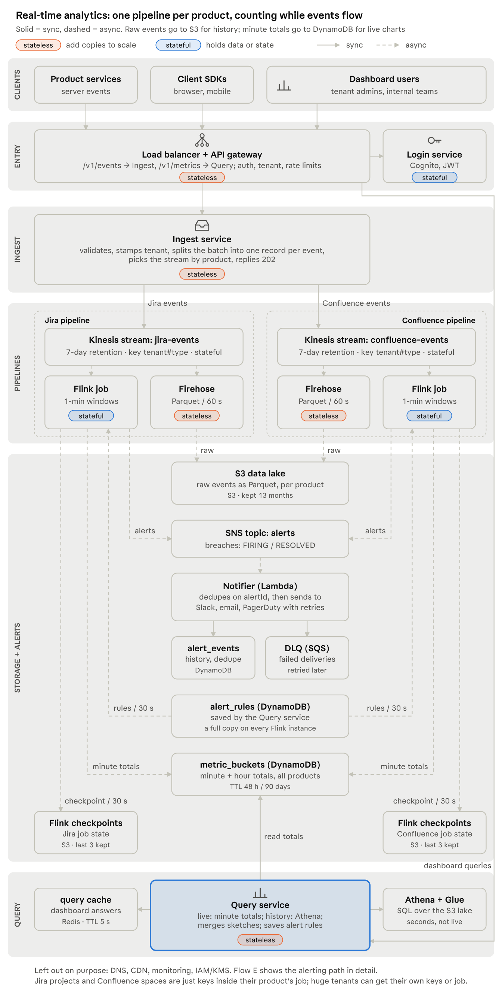
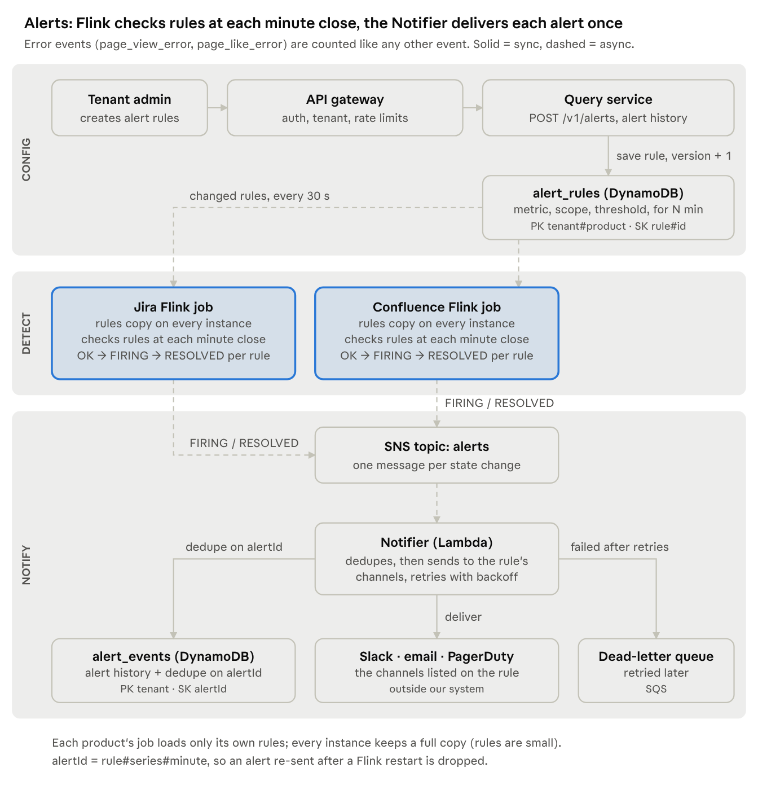

# Real-time Analytics Platform – System Design

Nov 17, 2026 · Arnav Jain

## 1. Basics and requirements

A real-time analytics platform takes a **stream of events** ("Asha viewed page pg\_81c2", "Ravi created issue is\_9f3a") from all products and turns them into **live numbers** on dashboards within seconds: page views per minute, active users, issues created, error rates. Example at Atlassian: Confluence page analytics for customers, and product-health dashboards for internal teams.

**The words you need:**

| Word | Meaning | Example |
| --- | --- | --- |
| Event | One thing that happened, with a time and some fields | `page_viewed` by u\_asha at 10:00:03 |
| Metric | A number computed from events | page views, unique users, p95 load time |
| Dimension | A field you can group or filter by | product, space, country, device |
| Window | A time slice that events are counted in | 10:00:00–10:00:59 (one minute) |
| Bucket | One stored count for one window and one set of dimensions | views of pg\_81c2 at 10:00 = 42 |
| Late event | An event that arrives after its window closed (phone was offline) | a 09:58 view arriving at 10:05 |
| Data lake | Cheap storage of every raw event for history and ad-hoc questions | S3 + Parquet files |

### Functional

1. **Ingest** events from product services (server side) and from browsers/mobile apps (client side).
2. **Live dashboards:** counts, unique users, sums, averages and percentiles (p95 latency), for the last 15 min / 1 h / 24 h, refreshing every \~5–10 s.
3. **Group and filter** by a fixed set of dimensions (product, space or project, event type, country, device).
4. **History:** the same metrics for past weeks and months, plus ad-hoc SQL on raw events.
5. **Alerts:** e.g. "error rate > 5% for 5 minutes" → notify the team.
6. **Multi-tenant:** a customer sees only their own data; internal teams can see across tenants.

### Non-functional

| Property | Target | Why |
| --- | --- | --- |
| Scale | 100M DAU, \~700K events/s at peak | Every click and API call can be an event |
| Freshness | Event → dashboard in < 10 s | "Real-time" |
| Dashboard latency | p99 < 300 ms | Charts must feel instant |
| Accuracy | Each event counted exactly once in the stored numbers; late events up to 1 h still counted | Wrong numbers lose trust |
| Durability | An acknowledged event is never lost | Analytics and billing depend on it |
| Availability | Ingest 99.95% (clients buffer and retry); dashboards 99.9% | Losing events is worse than a slow chart |

### Out of scope

- Fully ad-hoc slicing by *any* field in real time (an OLAP store such as ClickHouse or Pinot; see 8.7).
- Machine-learning models on top of the data.
- Top-N lists (most viewed pages, busiest projects). Left out of this design for now.
- The product events' business meaning (each product defines its own events).

## 2. Quick traffic estimate

Writes dominate here, the opposite of most designs: \~700K events/s in at peak, but only a few thousand dashboard queries per second. So we **count while events flow** and store small totals, instead of counting raw events at query time.

**Assumptions to say out loud**

- 100M DAU × \~200 events per user per day (views, clicks, API calls, page loads).
- \~1 KB per event (JSON), \~200 B after compression in Parquet.
- \~1M people look at a dashboard each day, \~20 refreshes each.

| What | Math | Average | Peak (×3) |
| --- | --- | --- | --- |
| Events in | 100M × 200 = 20B/day | \~230K/s | \~700K/s |
| Bytes in | 20B × 1 KB = 20 TB/day | \~230 MB/s | \~700 MB/s |
| Kinesis shards | 1 MB/s or 1K records/s per shard (records batched) | — | \~800 shards |
| Aggregate rows written | \~5M (tenant, metric, dimensions) combos per minute | \~80K/s | \~250K/s (batched) |
| Dashboard queries | 1M × 20 refreshes × \~10 tiles = 200M/day | \~2.3K/s | \~7K/s |

**What this tells us**

- 700K events/s can't be written to a database one by one and then counted per dashboard view. We **aggregate in the stream** (per minute) and store only the totals.
- The ingest path must be **cheap and async**: validate, batch, append to a stream, reply `202 Accepted`. Clients batch too.
- Raw events still go to **cheap storage** (S3) for history and ad-hoc questions, compressed \~5×.
- Dashboard reads are small and repeated: a short cache in front of the aggregates absorbs most of them.

## 3. API

Two sides: **ingest** (many small writes, async) and **query** (dashboard reads). Product services use a service credential; browsers use the user's JWT; `tenantId` always comes from the credential, never from the body.

| Method + path | What it does |
| --- | --- |
| `POST /v1/events` | Send a batch of up to 500 events; returns `202 Accepted` |
| `GET /v1/metrics/{metric}` | Time series for one metric, with filters and grouping |
| `POST /v1/alerts` | Create an alert rule |
| `POST /v1/sql` | Ad-hoc SQL on history (internal only; async, returns a job id) |

**Ingest a batch**

```json
POST /v1/events
{ "events": [
    { "eventId": "ev_01J9Z7K3", "type": "page_viewed", "time": "2026-11-17T10:00:03.120Z",
      "userId": "u_asha", "product": "confluence",
      "props": { "pageId": "pg_81c2", "spaceId": "PAY", "device": "web", "loadMs": 840 } },
    { "eventId": "ev_01J9Z7K4", "type": "issue_created", "time": "2026-11-17T10:00:03.410Z",
      "userId": "u_ravi", "product": "jira",
      "props": { "projectId": "PAY", "issueType": "Bug" } } ] }

202 Accepted
{ "accepted": 2, "rejected": [] }
```

- `eventId` is made by the sender (a unique id, ULID-style) and is how duplicates are removed later, so retries are safe.
- `time` is when it happened (event time), not when it arrived; windows use event time.

**Query a metric for a dashboard tile**

```json
GET /v1/metrics/page_views?from=now-1h&step=1m&filter=spaceId:PAY&groupBy=device

200 OK
{ "metric": "page_views", "step": "1m", "freshUntil": "2026-11-17T10:00:50Z",
  "series": [
    { "device": "web",    "points": [["09:01", 1180], ["09:02", 1204], "...", ["10:00", 1312]] },
    { "device": "mobile", "points": [["09:01", 402],  ["09:02", 397],  "...", ["10:00", 455]] } ] }
```

`freshUntil` tells the dashboard how current the last point is (the latest closed minute plus the live partial one).

## 4. HLD (high-level design)



Read it top to bottom. There are two paths that never block each other: **events in** (left side) and **dashboards out** (right side).

- **Entry:** one load balancer + API gateway. `/v1/events` goes to the Ingest service; `/v1/metrics` goes to the Query service. The gateway checks credentials, sets the tenant and rate-limits each sender.
- **Ingest service** (stateless): validates each event, stamps tenant and arrival time, splits the client's batch into one Kinesis record per event, and writes each record to **its product's stream** (`jira-events` or `confluence-events`), partition key = tenant + event type. It replies `202` once Kinesis has them: the events are durable from then on.
- **One pipeline per product** (same code, separate resources), so a bug, deploy or traffic spike in one product never slows another:
  - **Kinesis stream** (`jira-events`, `confluence-events`; 7-day retention) with two readers, each at its own pace:
  - **Flink job** (Amazon Managed Service for Apache Flink, stateful, checkpoints every 30 s to its own S3 bucket, coordinated by Flink's JobManager): removes duplicate `eventId`s, counts events in 1-minute windows by event time, writes minute and hour totals to DynamoDB, and checks alert rules at each minute close, publishing breaches to the SNS topic `alerts`. The **Notifier** (Lambda) dedupes each alert in `alert_events` and delivers it to Slack, email or PagerDuty, with failed deliveries parked in a DLQ. Rules live in `alert_rules`, saved by the Query service and copied to every Flink instance every 30 s (details in Flow E).
  - **Firehose** (stateless): batches raw events every 60 s into Parquet files in the product's folder of the S3 data lake.
- **Storage, one job each, shared by all products:**
  - **S3 data lake**: every raw event for 13 months, folders by product, day and tenant.
  - `metric_buckets` (DynamoDB): minute totals for 48 h, hour totals for 90 days; what live charts read.
- **Query side:**
  - **Query service** (stateless): reads the cache; on a miss sums the right DynamoDB buckets, or runs Athena for old or ad-hoc questions. For cross-product numbers ("active users across Jira and Confluence") it merges each product's unique-user sketches, so no extra pipeline is needed.
  - **Query cache** (Redis): dashboard answers for 5 s.
  - **Athena + Glue**: SQL over the S3 lake (seconds, not live).

| Box | Stateless or stateful | Talks to | Why it exists |
| --- | --- | --- | --- |
| Load balancer + API gateway | stateless | Login, Ingest, Query | Auth, tenant, rate limits per sender |
| Ingest service | stateless | Both Kinesis streams | Validates, stamps, routes each event to its product's stream |
| Kinesis `jira-events` / `confluence-events` | stateful | Their product's Flink job and Firehose | Durable buffer per product; replayable for 7 days |
| Flink job (one per product) | stateful (window state, seen ids, rules copy, alert state) | DynamoDB, SNS, its checkpoint bucket; reads `alert_rules` | Counts while events flow; exactly-once totals; checks alert rules at each minute close |
| Flink checkpoints (one S3 bucket per product) | stateful | — (written by its Flink job) | Every 30 s the job saves its counters, seen ids and Kinesis positions here; after a crash it restarts from the latest one. Last 3 kept |
| Firehose (one per product) | stateless | S3 data lake | Turns each stream into compressed Parquet files |
| S3 data lake | stateful | — | Cheap full history, folders per product |
| `metric_buckets` (DynamoDB) | stateful | — | Small totals for fast live charts, all products |
| Query service | stateless | Redis, DynamoDB, Athena, `alert_rules`, `alert_events` | One API for live and historical numbers; merges sketches across products; saves alert rules and shows alert history |
| Query cache (Redis) | stateful | — | Absorbs repeated dashboard refreshes |
| Athena + Glue | stateless (catalog in Glue) | S3 data lake | SQL on history without running servers |
| `alert_rules` (DynamoDB) | stateful | — (read by the Flink jobs every 30 s) | The alert rules each tenant created |
| SNS topic `alerts` | stateless | Notifier | Decouples Flink from delivery; one message per alert state change |
| Notifier (Lambda) | stateless | `alert_events`, Slack / email / PagerDuty, dead-letter queue | Dedupes on `alertId`, then delivers with retries |
| `alert_events` (DynamoDB) | stateful | — | Alert history, and the dedupe check (conditional put on `alertId`) |
| Dead-letter queue (SQS) | stateful | Notifier | Holds deliveries that kept failing, so they're retried later instead of lost |

**Left out of the HLD on purpose** (say them out loud if asked): DNS, CDN, monitoring, IAM/KMS, the dashboard UI itself, and the schema registry (a small service that stores each event type's schema).

## 5. Flows

### Flow A: An event becomes a number on a chart (\~5–10 s)

1. **10:00:03.120** Asha opens page pg\_81c2. The browser SDK adds a `page_viewed` event (with a unique `eventId`) to its local batch.
2. **10:00:05** The SDK sends its batch (every 2 s or 50 events) → `POST /v1/events` → gateway (auth, tenant `acme`, rate limit) → Ingest service.
3. Ingest validates the event against the `page_viewed` schema, adds `tenantId` and `arrivedAt`, and calls Kinesis on the product's own stream (confluence-events) `PutRecords` with partition key `acme#page_viewed`. Kinesis stores it on 3 AZs → Ingest replies `202`. **The event is now durable.**
4. **Flink** reads it within \~1 s:
   - **dedupe:** has `ev_01J9Z7K3` been seen in the last hour? No → keep it (ids kept in Flink state);
   - **assign to a window** by event time: 10:00:00–10:00:59;
   - **add** to the counters for every dimension set we track: (acme, page\_views, all), (acme, page\_views, space=PAY), (acme, page\_views, page=pg\_81c2), (acme, page\_views, device=web)…
5. Every \~5 s Flink writes the **partial** totals of the open minute to DynamoDB (so the chart's last point keeps moving); at 10:01:00 + 30 s grace it writes the **final** minute total.
6. **10:00:10** Asha's admin has a dashboard open; it refreshes → `GET /v1/metrics/page_views?from=now-1h&step=1m&filter=spaceId:PAY`.
7. Query service: Redis cache miss → one DynamoDB query for `acme#page_views#space=PAY`, minute buckets 09:01–10:00 → 60 numbers → stored in Redis for 5 s → returned. The 10:00 point already includes Asha's view.

#### Flow A in detail

**1) What Ingest does to a client batch (it doesn't forward the same batch)**

| Step | What happens to a batch of 50 events |
| --- | --- |
| Validate | Each event is checked against its type's schema; bad ones are dropped and listed in `rejected` |
| Enrich | Each event gets `tenantId` (from the credential, never from the client) and `arrivedAt` |
| Split | Each event becomes **its own Kinesis record**; the client's batch boundary disappears |
| Pick the stream | By the event's product: `jira-events` or `confluence-events` |
| Pick the shard | Partition key `tenant#type` (e.g. `acme#page_viewed`), so events of one batch can land on different shards |
| Write | One `PutRecords` call per stream (up to 500 records) |
| Partial failure | Kinesis may reject some records (busy shard); Ingest retries only those, then replies `202` |

**2) Inside the Flink job: user abc opens pages for 2 seconds**

Events from tenant acme, user abc: `ev_1` pg\_1 at 10:00:01, `ev_2` pg\_2 at 10:00:02, `ev_3` pg\_1 at 10:00:03, and `ev_2` arriving a **second time** (the SDK retried). Flink is a chain of small steps, each running on many machines in parallel:

1. **Read:** reader tasks each own some Kinesis shards and pull the 4 records.
2. **Remove duplicates** (grouped by `eventId`): Flink remembers every id from the last hour. `ev_1`, `ev_2`, `ev_3` are new; the second `ev_2` is dropped.
3. **Fan out into series:** each event becomes a "+1" for every view the dashboards need. `ev_1` → `acme#page_views#all`, `acme#page_views#space=PAY`, `acme#page_views#page=pg_1`, `acme#page_views#device=web` (+1 each) and `acme#unique_users#all` (add abc).
4. **Group by series:** every "+1" for the same series goes to the same Flink task, which holds that series' counter for the open minute (10:00:00–10:00:59).
5. **Count.** After the 3 real events the 10:00 window holds:

| Series | Window 10:00 |
| --- | --- |
| `acme#page_views#all` | 3 |
| `acme#page_views#space=PAY` | 3 |
| `acme#page_views#page=pg_1` | 2 |
| `acme#page_views#page=pg_2` | 1 |
| `acme#page_views#device=web` | 3 |
| `acme#unique_users#all` | sketch {abc} → 1 |

6. **Write** these totals to DynamoDB (when: see 5 below).
7. **Checkpoint** every \~30 s: all counters, the seen-ids list and the Kinesis read positions are saved to S3, so after a crash Flink resumes exactly there and nothing is double-counted.

Flink never stores the events themselves; it keeps small counters per series per minute.

**3) Does Flink group events into 1-minute windows?** Yes, by when the event **happened** (its `time`), not when it arrived:

| Event happened | Arrived at Flink | Goes into window |
| --- | --- | --- |
| 10:00:03 | 10:00:05 | 10:00 |
| 10:00:59.9 | 10:01:02 | 10:00 |
| 10:01:10 | 10:01:12 | 10:01 |

A minute stays open until \~30 s after it ends (the 10:00 window closes \~10:01:30) to wait for slightly slow events; events up to 1 h late can still re-open it (Flow D).

**4) How much past data is kept for dedupe?** Only the event **ids**, for the **last 1 hour** (it matches how late we still accept events); older ids are deleted automatically. At \~700K events/s that's up to \~2.5B ids, \~50–100 GB spread over all Flink machines, kept on local disk (RocksDB) and backed up in checkpoints. If that's too big, 10 minutes catches almost all duplicates (retries happen within seconds) at a sixth of the size.

**5) When does Flink write to DynamoDB?** For the 10:00 window of one series:

| When | What Flink writes | Why |
| --- | --- | --- |
| Every \~5 s while the minute is open | `count = <current total>`, `final = false` | The chart's last point moves live |
| \~10:01:30, when the window closes | `count = 1312`, `final = true` | The minute is done |
| Later, if a late event (< 1 h) arrives | `count = 1313`, `final = true` | Correct the total |
| 11:00:30, when the hour closes | Hour bucket `H#10` = sum of 60 minutes | 30-day charts read fewer rows |

Writes are "**set** the count to 1312", never "add 1" (safe to repeat after a restart), and they're batched (25 items per call), so 700K events/s becomes far fewer writes.

**6) One Flink job per product, not per project**

|  | One job for all products | One job per product (our design) |
| --- | --- | --- |
| A bad deploy or bug | Breaks every product's metrics | Breaks one product |
| A traffic spike (Jira has \~5× Confluence's volume) | Slows Confluence's numbers too | Only Jira's job falls behind |
| Scaling | One big job sized for everyone's peak | Each job sized for its product |
| Recovery | One huge checkpoint to restore | Small, fast checkpoints |
| Ownership | Shared code and deploys | Each product team ships its own metrics |

- Each product also gets **its own Kinesis stream and Firehose**, otherwise a Jira flood would still slow Confluence's reads.
- **Per Jira project or Confluence space: no.** There are millions of them; they're just part of the key inside the product's job (`acme#issues_created#project=PAY`), spread across its machines.
- **Huge tenants** can get their own partition keys, or even their own job, so they can never slow everyone else.
- **Cross-product numbers** (active users across Jira and Confluence) need no extra pipeline: the Query service merges both products' unique-user sketches.

**7) What's stored in DynamoDB: minute, hour and day rows**

One series, `acme#page_views#space=PAY`, at three levels, all under the **same partition key**, so any chart is one Query with a sort-key range:

| Level | Sort key (SK) | Example row | Kept for |
| --- | --- | --- | --- |
| Minute | `M#2026-11-17T10:00` | count 1312, uniques sketch, `final = true` | 48 hours |
| Hour | `H#2026-11-17T10` | count 74,210 (sum of 60 minutes), merged uniques sketch | 90 days |
| Day | `D#2026-11-17` | count 1,402,880 (sum of 24 hours), merged uniques sketch | 13 months |

| Chart range | Level read | Rows read |
| --- | --- | --- |
| Last 1 hour | minutes | 60 |
| Last 7 days | hours | 168 |
| Last 12 months | days | 365 |
| Older, or an unusual breakdown | Athena on S3 | — |

Unique-user sketches are **merged**, never added, so a person seen in several minutes still counts once in the hour and the day.

**8) When a batch reaches Flink, when is DynamoDB written?** Counting happens **immediately in Flink's memory**; writing happens on a timer and at a few fixed moments. Example: 3 page views arrive at 10:00:05 for a series at 120:

| Time | Inside Flink | Written to DynamoDB |
| --- | --- | --- |
| 10:00:05 | 120 → 123 at once | nothing yet |
| 10:00:10, :15, :20 … every \~5 s | keeps counting | `M#10:00` set to the latest total, `final = false` |
| \~10:01:30 (minute closes) | 1312 final | `M#10:00` count 1312, `final = true` |
| 10:07 (a late 10:00 event) | 1313 | `M#10:00` set to 1313 (correction) |
| \~11:00:30 (hour closes) | sums its 60 minutes | `H#10` count 74,210 |
| \~00:00:30 next day (day closes) | sums its 24 hours | `D#2026-11-17` count 1,402,880 |

**9) How the write happens: no read first, just an overwrite.** Each series is handled by exactly **one** Flink task, which keeps the running counts for its open minute, hour and day in its own state. When it writes, it sends the number it already has:

```
UpdateItem  PK = acme#page_views#space=PAY,  SK = M#2026-11-17T10:00
            SET count = 1312, uniques = <sketch>, final = true
```

| Approach | Problem |
| --- | --- |
| Read the row, add, write back | 2 calls per write; two writers can overwrite each other |
| `ADD count 3` (atomic add) | Not safe to repeat: after a crash Flink replays from its checkpoint and adds the same 3 again |
| **`SET count = 1312`** (our choice) | One call, no read, repeating it gives the same result; only one Flink task owns each series |

- **Late event (under 1 h):** Flink still holds that minute's counter, computes 1313, sends `SET count = 1313`, and re-writes the hour and day sums the same way.
- **Crash and restart:** counters come back from the checkpoint with the matching Kinesis position; Flink re-reads the events after it, reaches the same totals and re-sends the same `SET` values.
- Only the nightly correction job (for events more than 1 h late) writes from S3 instead of Flink, also with `SET`.

**10) What Flink keeps in memory, and for how long**

| Level | Kept in Flink until | Then |
| --- | --- | --- |
| Minute | The minute closes + 1 h for late events | Dropped; DynamoDB keeps the final row |
| Hour | The hour closes + a short grace period | Dropped; DynamoDB has the hour row |
| Day | The day closes + a short grace period | Dropped; DynamoDB has the day row |

Flink holds only the **open, recent** counters; DynamoDB holds the history.

**11) Space views are counted on their own, not summed from pages.** Nobody views a space by itself; a space view is a page view of any page in that space. But Flink adds +1 to the page's series **and** the space's series (and the site total) for every event, and stores them all:

| Series updated for "abc viewed pg\_1 in space PAY" | +1 |
| --- | --- |
| `acme#page_views#page=pg_1` | ✓ |
| `acme#page_views#space=PAY` | ✓ |
| `acme#page_views#all` | ✓ |

|  | Sum the pages at query time | Pre-count the space (our design) |
| --- | --- | --- |
| "PAY space views, last hour" | 5,000 pages × 60 minutes = **300,000 rows** to read | **60 rows** (one series) |
| Speed | Seconds | A few ms |
| **Unique viewers** | **Wrong**: abc viewed 2 pages, so adding page uniques counts abc twice | **Right**: the space series has its own sketch; abc counts once |
| Cost | Cheap writes, very expensive reads | 3–5 counters per event (in memory, written every \~5 s), cheap reads |

- The event records the page's space at the moment of the view, so if a page later moves, old views stay with the old space.

**12) Flink stores counters, not events.** When an event arrives Flink adds +1 to a few numbers and the event itself is gone from Flink. For the day level it keeps **one running number and one small sketch per series**, not a day of events (the same for the hour and the minute). It also writes partial totals every \~5 s, not only at the end.

| Series `acme#page_views#space=PAY` | What Flink holds |
| --- | --- |
| Minute 10:00 | `count = 1312`, sketch (\~1 KB) |
| Hour 10 | `count = 74,210`, sketch |
| Day 2026-11-17 | `count = 1,402,880`, sketch |

**13) What happens if Flink goes down: nothing is lost.**

- **The events never lived only in Flink.** They are in **Kinesis**, kept 7 days whether Flink is up or down; Flink is only a reader that remembers how far it has read.
- **Every \~30 s Flink saves a checkpoint to S3:** all counters, the recent seen-ids list and the exact Kinesis read position, together.

Example: Flink crashes at 10:00:50; its last checkpoint was at 10:00:30.

| Time | What happens |
| --- | --- |
| 10:00:30 | Checkpoint saved: counters as of :30 + Kinesis position "record #9001" |
| 10:00:30–:50 | Flink keeps counting; at :35 and :45 it writes partial totals to DynamoDB |
| 10:00:50 | **Flink crashes.** Counters it had in memory since :30 are lost |
| 10:00:50 → \~10:01:30 | Ingest keeps writing new events to Kinesis; dashboards show the last written numbers, a little behind (`freshUntil` tells the UI) |
| \~10:01:30 | The managed Flink service restarts the job from the **10:00:30 checkpoint**: counters back to their :30 values, reading restarts at record #9001 |
| \~10:01:30–:40 | Flink re-reads the events after #9001 (same totals as before the crash), then catches up on the new ones at full speed |
| After | It writes `SET count = …` for the affected minutes; the partial values from :35 and :45 are simply overwritten. **No double counting, nothing lost** |

- **Why the re-read doesn't double-count:** counters and read position are restored **together, from the same moment**, so Flink counts the events after it exactly once; DynamoDB writes are overwrites, so repeating them is harmless.
- **During the outage:** Ingest is unaffected (it only writes to Kinesis); the S3 lake is unaffected (Firehose is a separate reader); live dashboards and alerts are a minute or two behind, then catch up.
- **A long outage (hours):** Kinesis still has up to 7 days of events. On restart Flink catches up from its last checkpoint, temporarily with more machines so it reads faster than events arrive. That's why Kinesis retention must be longer than the longest outage we plan for.
- **Interview line:** "Kinesis holds the events; Flink holds only counters, checkpointed every 30 s together with its Kinesis position. After a crash it restores both and re-reads from there, and the DynamoDB writes are idempotent overwrites, so the result is exactly-once."

**14) Where the checkpoint is stored and who writes it.** It lives in **S3**, not in DynamoDB or Redis, and Flink writes it itself. None of our services touch it.

| Part of Flink | Its job in a checkpoint |
| --- | --- |
| **JobManager** (the coordinator, one per job) | Every 30 s it starts a checkpoint, waits for every worker to report back, then marks it "complete" |
| **TaskManagers** (the workers that count) | Each one saves its own slice of state (its counters, seen ids and Kinesis shard positions) and uploads it to S3 |
| **DynamoDB sink** (one of the workers) | Flushes its buffered writes to DynamoDB before it reports "done" |
| **HA store** (ZooKeeper or Kubernetes; on AWS managed Flink, the service runs this) | Keeps a small pointer: "the latest complete checkpoint is #1042" |

What one checkpoint looks like in S3:

```
s3://analytics-flink-checkpoints/jira-job/chk-1042/
   _metadata        ← list of all the pieces below
   task-0-state     ← counters for pages hashed to worker 0 + its shard positions
   task-1-state
   ...
```

One checkpoint, step by step (10:01:00):

1. The JobManager sends a "checkpoint 1042" marker into the stream.
2. When a worker sees the marker, it notes its Kinesis position (e.g. shard 3 at #9500) and copies its counters.
3. Each worker uploads its piece to S3. The counters live in RocksDB on the worker's local disk, and only the files that changed since the last checkpoint are uploaded (an incremental checkpoint), so it stays small.
4. The DynamoDB sink flushes its writes, then confirms.
5. Once every worker has confirmed, the JobManager writes `_metadata` and moves the pointer. Checkpoint 1042 is now complete.
6. Older checkpoints are deleted automatically; Flink keeps only the last 1–3.

On a crash, the new JobManager reads the pointer (#1042), the workers download their pieces from S3, and they resume reading Kinesis from the saved positions. S3 is used because it is durable and cheap and survives the machine dying. The local RocksDB copy is only the fast working copy.

**15) What if Flink read events but hadn't written them to DynamoDB yet?** Nothing is lost, because of two rules:

- The Kinesis read position only moves forward inside a checkpoint, together with the counters.
- A checkpoint isn't complete until the DynamoDB sink has flushed every buffered write. If a write fails, the checkpoint fails and the previous one stays the "last good" one.

| Case | What happens |
| --- | --- |
| **A. Read and counted, crashed before the next checkpoint** | Restores the 10:00:30 counters and position #9001, re-reads #9001–#9500 from Kinesis, counts them once, then writes. Correct; the work was just done twice |
| **B. Checkpointed, but the write never went out** | Can't happen: the checkpoint only completes after the writes succeed. If a write went out but its checkpoint wasn't recorded, Flink later re-sends the same `SET count = N`, which is a harmless overwrite |
| **C. DynamoDB is down or throttling** | The sink retries with backoff, checkpoints stall, and Flink stops reading (backpressure). New events wait in Kinesis, Ingest is unaffected, and dashboards are slightly stale. When DynamoDB recovers, Flink catches up |

Timers ("write the final minute at 10:01:30", "write the day at 00:00:30") are part of the checkpoint too, so they still fire after a restart.

- **Interview line:** "Flink checkpoints its state and Kinesis positions to S3 every 30 s, coordinated by the JobManager, and a checkpoint only completes after the sink flushes its DynamoDB writes. A crash means re-reading from the last checkpoint, and repeated writes are idempotent overwrites. On AWS, Managed Service for Apache Flink handles the checkpoint storage and failover."

**16) How the space counter stays exact when its pages are on different Flink instances.** This is how point 11 (space views are pre-counted) works inside Flink.

**One event, no separate space event.** The client sends one `page_view`, and it carries the space:

```
{ type: page_view, tenant: acme, page: pg_2, space: A, user: ravi, ts: 10:01:00.4 }
```

The SDK includes `spaceId` (the page knows its space), and Ingest stamps it if it's missing. There is no separate "space\_view" event, so one visit can never count twice. Opening the space's home page is a normal `page_view` too. Only actions on the space itself (`space_created`, `space_archived`) are separate event types.

**Three steps inside Flink:**

1. **Read:** whichever instance reads that Kinesis shard gets the event.
2. **Fan out** (on the same instance): one event becomes `page:pg_2 +1`, `space:A +1`, `tenant:acme +1`.
3. **keyBy(seriesKey):** each update is sent over the network to the one instance that owns that key, and that instance adds it to its counter. This redistribution is called a shuffle.

**Example: pg\_2's event is read on instance 1, pg\_3's on instance 2, and instance 2 owns `space:A`.**

|  | Instance 1 | Instance 2 (owner of `space:A`) |
| --- | --- | --- |
| Counters it owns | `page:pg_2 = 5` | `page:pg_3 = 7`, `space:A = 12` |
| What it does for space A | Sends "A +5" to instance 2; keeps **no** space A counter | Adds its own +7 and the +5 it received: A = 12 |
| DynamoDB rows it writes | `page:pg_2` | `page:pg_3` and `space:A` |

The instances don't need to know about each other. Instance 1 doesn't tell instance 2 "I got pg\_2"; it just pushes "A +1" to whoever owns A. Instance 2 adds up whatever arrives, without knowing which page or instance it came from. There is one `space:A` row in DynamoDB, holding the full total and written only by its owner. The Query service never adds up pieces.

**How every instance knows the owner without asking.** Flink hashes each key into one of a fixed number of **key groups** (for example 128) and gives each instance a range of them:

```
4 instances:  I1 → groups 0–31,  I2 → 32–63,  I3 → 64–95,  I4 → 96–127
space:A → hash → group 40 → instance 2   (every instance calculates the same answer)
```

**Flink state is local, not shared.** Each instance keeps its counters in its own RocksDB (memory + local disk) and only for the key groups it owns. No instance reads another's state; it sends a message to the owner instead. So there are no locks and no conflicts, and lookups are fast. The S3 checkpoint (point 14) is only a backup, used for recovery and rescaling.

**Scaling from 4 to 8 instances:** Flink takes a checkpoint and splits the ranges smaller (I1 → 0–15, I2 → 16–31, …). Each instance downloads only its own key groups' state from S3. Group 40, holding space A, moves with its data to its new owner.

**A very hot space (say 200K views/s).** Sending every +1 to one owner would overload it. Each instance instead keeps a short "to send" amount for A and pushes "A +340" about once a second, then resets it to 0. That pending number is never written to DynamoDB. This stays exact because counts simply add; unique users work the same way by merging HyperLogLog sketches. The pending amounts are in the same checkpoint as the counters, so a crash rolls both back together.

**A page moves to another space:** each event carries the space it was in at view time, so views before the move count for A and later ones for B.

- **Interview line:** "Each event carries spaceId and fans out into page, space and tenant updates. `keyBy(seriesKey)` sends each update to the one instance that owns that key's key group, so `space:A` has a single owner, a single counter and a single DynamoDB writer. State is local per instance; S3 checkpoints are only for recovery and rescaling. Hot spaces are pre-added per instance for about a second, which is exact for counts and HyperLogLog."

### Flow B: The same event goes to the data lake

1. The product's Firehose reads its own stream (confluence-events), independently of that product's Flink job.
2. Every 60 s (or 128 MB) it converts the batch to Parquet (columnar, compressed \~5×) and writes `s3://analytics-lake/events/dt=2026-11-17/tenant=acme/hour=10/part-0042.parquet`.
3. The Glue catalog knows the table `events` and its partitions, so Athena can query it right away.

### Flow C: A dashboard asks for the last 30 days

1. `GET /v1/metrics/page_views?from=now-30d&step=1d&filter=spaceId:PAY`.
2. Query service picks the cheapest source: 30 days → **hour totals** in DynamoDB (720 rows), summed into 30 daily points. Still \~50 ms.
3. Older than 90 days, or a dimension we don't pre-aggregate (e.g. "by browser version") → Athena SQL over the lake; takes seconds, so the UI shows a spinner and the answer is cached for an hour.

### Flow D: A phone sends events 2 hours late

1. Ravi used the mobile app on a plane; at landing it sends 80 events from 08:00–08:30.
2. Ingest accepts them (they're durable in Kinesis and go to the lake as usual).
3. Flink sees their event time is **older than the 1-hour lateness limit**: their windows are already final. It does **not** reopen them; it counts them in a `late_events` metric instead.
4. The lake still has them, so the **nightly correction job** (8.3) re-counts yesterday from S3 and fixes the hour totals. Live charts are a tiny bit low for those minutes; daily numbers end up exact.

### Flow E: An alert fires

1. Rule: "If the **page view error rate** in space ENG is **above 5% for 3 minutes in a row**, notify #eng-oncall on Slack."
2. Each minute, the Flink instance that owns `space:ENG` computes `page_view_error ÷ (page_view + page_view_error)` when the minute closes.
3. At 10:03 it's above 5% for the 3rd minute in a row → Flink publishes `{ alertId: r_77#space:ENG#10:03, state: FIRING, value: 8% }` to the SNS topic `alerts`.
4. The Notifier saves the alert to `alert_events` only if that `alertId` is new, then sends it to Slack. Flink remembers the rule is firing, so it won't re-send every minute; it sends "resolved" when the rate drops back.

#### Flow E in detail



Read it top to bottom: an admin saves a rule, each Flink job picks it up, the instance that owns the counter checks it every minute, and a breach travels through SNS to the Notifier, which delivers it once.

**1) Where the rules are stored: DynamoDB table `alert_rules`.** A tenant admin creates a rule on the dashboard (`POST /v1/alerts` → Query service), saved as one item:

| Field | Example |
| --- | --- |
| PK | `acme#confluence` (tenant + product) |
| SK | `rule#r_77` |
| metric | `error_rate(page_view)` = `page_view_error ÷ (page_view + page_view_error)` |
| scope | `space:ENG` (could be one page, the whole tenant, …) |
| condition | `> 5%` |
| for | 3 minutes in a row |
| min\_volume | 100 events per minute (1 failure out of 3 is not an alert) |
| channels | `slack:#eng-oncall`, `email:asha@acme.com` |
| cooldown | 30 min (no repeat while it's still firing) |
| version | 4 (goes up on every edit) |

The different error cases are the same shape with different values:

| Rule | metric | scope |
| --- | --- | --- |
| Page view errors | `error_rate(page_view)` | `page:pg_81c2` |
| Space view errors | `error_rate(page_view)` | `space:ENG` |
| Page like errors | `error_rate(page_like)` | `page:pg_81c2` |
| Space like errors | `error_rate(page_like)` | `space:ENG` |
| Like failures spike | `count(page_like_error)` | `tenant` |

**2) The error events.** When a view or like fails, the client or product service sends `page_view_error` or `page_like_error` with the page and space on it. Flink counts them exactly like views (Flow A, point 16): `page:pg_81c2#page_view_error +1`, `space:ENG#page_view_error +1`. So the space-level error count is exact with no extra work.

**3) How Flink gets the rules: a full copy on every instance ("broadcast state").** Rules are small (100K rules × \~300 bytes ≈ 30 MB), so every instance keeps all of its product's rules, unlike counters, which are split between instances.

- **At startup** a rules loader inside the job reads all rules for its product (the Confluence job loads only `…#confluence` rules).
- **Every \~30 s** it reads only rules changed since the last read (a GSI on `updated_at`) and broadcasts them to every instance. A new rule works within about 30 s.
- **Deleted rules** are kept as a tombstone (`deleted = true`) so the loader sees the delete.
- The rules copy is part of the **checkpoint**, so after a crash every instance has its rules back immediately.
- Faster option if needed: DynamoDB Streams on `alert_rules` feeding a small rules stream into Flink (about 1 s), at the cost of one more moving part.

**4) How a rule is checked: on the instance that owns the counter.** `space:ENG#page_view` and `space:ENG#page_view_error` live on the instance that owns `space:ENG`, and that instance also has every rule. When the 10:01 window closes (10:01:30, after the watermark) it:

1. Finds the rules whose scope is `space:ENG`: r\_77.
2. Computes `60 errors ÷ (940 views + 60 errors) = 6%`, volume 1,000 ≥ 100. Above 5%.
3. Updates the rule's small state for this series, keyed by `r_77 + space:ENG`:

| Minute | Error rate | Breaches in a row | State | Action |
| --- | --- | --- | --- | --- |
| 10:00 | 2% | 0 | OK | none |
| 10:01 | 6% | 1 | OK | none (needs 3) |
| 10:02 | 7% | 2 | OK | none |
| 10:03 | 8% | 3 | **FIRING** | send `r_77#space:ENG#10:03` |
| 10:04–10:20 | 6–9% | … | FIRING | none (cooldown, no spam) |
| 10:21 | 3% | 0 | **RESOLVED** | send "resolved" |

The state is a few numbers per rule and series (breach count, current state, last-sent time) and is checkpointed with everything else.

**5) How the notification reaches people.**

1. Flink publishes `{ alertId: "r_77#space:ENG#10:03", state: FIRING, value: 8%, rule: r_77 }` to SNS.
2. The Notifier does a **conditional put** of `alertId` into `alert_events`; if it already exists, it skips. After a crash Flink replays from its checkpoint and may publish the same alert again, but the id (rule + series + minute) is the same, so the duplicate is dropped.
3. It sends to the rule's channels with retries and backoff. If a channel keeps failing, the message goes to a dead-letter queue (SQS) and is retried later.
4. `alert_events` is also what the dashboard shows as alert history (read by the Query service).

**6) Why the check runs in Flink and not by querying DynamoDB.** A separate checker reading DynamoDB every minute for every rule means millions of reads a minute and is always a bit behind. Flink already holds the exact counter when the minute closes, so checking there costs nothing extra and the alert goes out seconds after the minute ends.

**7) Edge cases.**

| Situation | What happens |
| --- | --- |
| No events for the space this minute | The window-close timer still runs for series with active rules, treats it as volume 0 (below `min_volume`), so silence doesn't alert. A separate "no data" rule type can be added |
| Rule edited while FIRING | The new version arrives by broadcast and applies from the next window; the state resets if the condition changed |
| 10K rules on one space | Rules are indexed by scope on each instance, so a window close only checks that key's rules |
| Jira rules | Live in the Jira job's broadcast state; per-product isolation stays |

- **Interview line:** "Rules live in DynamoDB. A loader in each product's Flink job polls for changes and broadcasts them, so every instance has all rules. Error events are counted like any other metric. At each window close, the instance that owns a series checks the rules for that key and keeps a tiny state machine (OK → FIRING → RESOLVED) with 'for N minutes' and a cooldown. Breaches go to SNS, then a Notifier that dedupes on a deterministic alert id and delivers to Slack, email or PagerDuty."

### Flow F: A bug in the counting logic

1. Someone shipped a Flink change that counted bot traffic as page views for 6 hours.
2. Fix the code, then **replay**: start a new Flink job from Kinesis 6 hours back (Kinesis keeps 7 days), writing to the same buckets. Writes are "set to this total", not "add", so replaying is safe.
3. For anything older than 7 days, re-compute from the S3 lake with the batch job.

## 6. Data model

**An event** (what clients send, what Kinesis and the lake keep)

| Field | Example | Notes |
| --- | --- | --- |
| event\_id | `ev_01J9Z7K3` | Unique, made by the sender; used to drop duplicates |
| tenant\_id | `acme` | Set by Ingest from the credential, never by the client |
| type | `page_viewed` | Each type has a schema (allowed props) |
| time | `2026-11-17T10:00:03.120Z` | When it happened (event time) |
| arrived\_at | `2026-11-17T10:00:05.410Z` | When we got it (for lateness checks) |
| user\_id | `u_asha` | Hashed before it reaches the lake if the tenant opts for that |
| product | `confluence` |  |
| props | `{ pageId, spaceId, device, loadMs }` | Type-specific fields |

**`metric_buckets`** (DynamoDB; written by Flink; read by the Query service)

| Item | PK / SK | Attributes |
| --- | --- | --- |
| Minute total | `acme#page_views#space=PAY` / `M#2026-11-17T10:00` | count (1312), sum, min, max, hll (unique-user sketch), final (true/false), ttl (48 h) |
| Hour total | same PK / `H#2026-11-17T10` | same fields, rolled up from 60 minutes; ttl (90 days) |

- The **partition key** is one series (tenant + metric + one dimension filter); the **sort key** is the time bucket. A chart = **one** Query on one PK with an SK range, already in time order.
- Unique users can't be added up across minutes (the same person would be counted twice), so each bucket stores a **HyperLogLog** sketch (\~1 KB) that can be merged; percentiles store a **t-digest** sketch the same way.
- Supported dimension sets are configured per metric (e.g. by space, by page, by device); each one becomes its own series. Anything else goes to Athena.

**S3 data lake**

- `s3://analytics-lake/events/dt=YYYY-MM-DD/tenant=<id>/hour=HH/*.parquet`, so a query for one tenant and one day only reads that folder.
- Glue table `events` with the columns above; Athena queries it with plain SQL:

```sql
SELECT props.pageId, count(*) AS views
FROM events
WHERE dt = '2026-11-16' AND tenant = 'acme' AND type = 'page_viewed'
GROUP BY props.pageId ORDER BY views DESC LIMIT 10;
```

**Query cache** (Redis): `q:{sha256(tenant + normalized query)}` → the JSON answer, TTL 5 s for live ranges, 1 h for history.

**`alert_rules`** (DynamoDB): one item per rule.

| Attribute | Example | Note |
| --- | --- | --- |
| PK | `acme#confluence` | tenant + product; each product's Flink job loads only its own |
| SK | `rule#r_77` |  |
| metric | `error_rate(page_view)` | or `count(page_like_error)`, … |
| scope | `space:ENG` | page, space or tenant; also the counter key the rule is checked on |
| condition, for | `> 5%`, 3 minutes |  |
| min\_volume, cooldown | 100 / min, 30 min | no alert on tiny traffic, no repeats while firing |
| channels | `slack:#eng-oncall`, `email:asha@acme.com` |  |
| version, updated\_at, deleted | 4, `2026-11-17T10:00Z`, false | GSI on `updated_at` lets the loader read only changes; deletes are tombstones |

**`alert_events`** (DynamoDB): one item per alert state change.

| Attribute | Example | Note |
| --- | --- | --- |
| PK | `acme` | tenant |
| SK | `r_77#space:ENG#2026-11-17T10:03` | the `alertId`: rule + series + minute; written with `attribute_not_exists`, so a replayed alert is dropped |
| state, value | FIRING, 8% |  |
| delivered\_to | `slack:#eng-oncall` |  |
| TTL | 13 months |  |

## 7. Storage estimate

Raw events are the big data (\~4 TB a day after compression), and they live in S3, the cheapest place. The totals that dashboards read are small.

| Data | Math | Size | Where |
| --- | --- | --- | --- |
| Raw events in flight | 20 TB/day × 7 days | \~140 TB of stream retention | Kinesis (paid per shard-hour + retention) |
| Raw events, history | 20 TB/day ÷ 5 (Parquet) = 4 TB/day × 395 days | \~1.6 PB | S3 data lake (Intelligent-Tiering) |
| Minute totals | \~5M series-minutes × 1,440/day × \~300 B, kept 48 h | \~4 TB | DynamoDB |
| Hour totals | \~5M series × 24/day × \~1 KB, kept 90 days | \~11 TB | DynamoDB |
| Flink state | dedupe ids for 1 h + open windows | \~200 GB, checkpointed | Flink + S3 checkpoints |
| Query cache | hot dashboard answers | \~20 GB | Redis |

**What the numbers decide**

| Finding | Decision |
| --- | --- |
| 700 MB/s in at peak | \~800 Kinesis shards (on-demand mode scales them); Ingest batches with `PutRecords` |
| Raw history is \~1.6 PB | Parquet + partitions + S3 tiers; never in a database |
| Dashboards read small totals | DynamoDB buckets with TTL; one Query per chart line |
| Many people watch the same dashboards | 5 s Redis cache: one read per tile per 5 s regardless of viewers |

## 8. Deep dives

What the interviewer will push on: counting each event exactly once, late events, windows, unique users and percentiles, hot keys, and lambda vs kappa.

### 8.1 Exactly-once counts on an at-least-once pipeline

Anything can be sent twice: the SDK retries after a timeout, Ingest retries a Kinesis write, Flink restarts from a checkpoint. Three things make the stored totals exact anyway:

| Where a duplicate can appear | What removes it |
| --- | --- |
| Client or Ingest retries → the same event twice in Kinesis | Flink keeps every `eventId` seen in the last hour (in its state) and drops repeats |
| Flink crashes and re-reads from its last checkpoint | Flink's checkpoints store the window counters **and** the Kinesis position together, so after a restart it resumes as if nothing happened |
| Flink writes the same minute total twice | Writes are **"set this bucket to 1312"**, never "add 1", so writing twice gives the same result (idempotent) |

### 8.2 Windows and event time

- **Tumbling 1-minute windows** by **event time** (when it happened), not arrival time, so a slow network doesn't move a click into the wrong minute.
- Flink uses a **watermark** ("I've probably seen everything up to 10:00:30") to decide when a window is done; the watermark trails the newest event by \~30 s.
- **Partial results:** while 10:00 is still open, Flink writes its running total every \~5 s with `final = false`, so the chart's last point moves live; then the final total.
- **Sliding views** ("last 15 minutes") aren't separate windows: the Query service sums the 15 most recent minute buckets (or 14 + the partial one).
- **Roll-ups:** at each full hour Flink also writes the hour total, so 30-day charts read 720 rows, not 43,200.

### 8.3 Late events

| How late | What happens |
| --- | --- |
| Within the 30 s watermark delay | Counted normally |
| Up to 1 h (allowed lateness) | Flink re-opens that minute, adds it, re-writes the bucket with the new total |
| More than 1 h | Not added to live buckets; counted in `late_events`; the event still goes to the lake |
| Any lateness, next day | A **nightly correction job** re-counts yesterday from S3 and overwrites the hour totals, so history is exact |

The 1-hour limit is a trade-off: longer means more Flink state kept in memory.

### 8.4 Unique users and percentiles

- **Unique users:** a minute's "42 unique users" plus the next minute's "40" is not 82 (many are the same people). Each bucket stores a **HyperLogLog** sketch (\~1 KB, \~1% error) that can be **merged**, so any time range can be answered by merging sketches.
- **p95 load time:** percentiles can't be averaged either. Each bucket stores a **t-digest** sketch, merged the same way.

### 8.5 Hot keys and scaling

- **Kinesis:** partition key `tenant#type` spreads load; a huge tenant's busy event type gets a random suffix (`acme#page_viewed#7`) over 16 sub-keys, merged again in Flink.
- **Flink:** parallelism up to the number of shards; state is partitioned by the same keys, so adding parallelism spreads it.
- **DynamoDB:** one partition per series; a very hot series (all page views of a giant tenant) is written once every \~5 s by Flink, not per event, so it stays far below DynamoDB's per-key limit.

### 8.6 Lambda vs kappa

|  | Lambda architecture | Kappa architecture (our base) |
| --- | --- | --- |
| Idea | A fast stream path for live numbers + a separate batch path that recomputes the truth | One stream path; to fix or recompute, replay the stream |
| Code | Two implementations of every metric | One |
| Fixing history | Batch job | Replay Kinesis (7 days) |

We are **mostly kappa**: one Flink job produces every number, and fixes are replays. We keep a small batch piece only where the stream can't reach: the nightly correction from S3 for very late events and anything older than 7 days.

### 8.7 When to add a real-time OLAP store

Pre-aggregated buckets answer the dashboards we planned for. If product teams want to **slice by any field** in real time ("page views by browser version and country, last 2 hours"), add an OLAP database such as **ClickHouse**, **Apache Pinot** or **Druid**: it ingests raw events from Kinesis and answers group-by queries over billions of rows in under a second. The trade-off is a large stateful cluster to run.

### 8.8 Multi-tenancy and privacy

- `tenant_id` is set by Ingest from the credential and is the first part of every key, partition and S3 path; the Query service always filters by the caller's tenant.
- Per-tenant ingest limits at the gateway, so one tenant's event storm can't slow others.
- PII: user ids can be hashed per tenant; a GDPR delete removes the user's raw events from S3 (partition by tenant makes this a targeted rewrite) and the totals stay, since they hold no personal data.

## 9. Wrap-up

**30-second summary:**

> "Clients and services send batched events with unique ids to a stateless Ingest service, which validates them, stamps the tenant and appends them to a Kinesis stream; once Kinesis has them they are durable. Two consumers read the stream: a Flink job that removes duplicates, counts events in 1-minute event-time windows with a watermark and 1 hour of allowed lateness, and writes idempotent minute and hour totals (with HyperLogLog and t-digest sketches) to DynamoDB, plus alerts to SNS; and Firehose, which writes Parquet files to an S3 data lake that Athena queries. The Query service serves dashboards from a 5-second Redis cache, then from DynamoDB buckets for recent ranges and Athena for history. Fixes are replays of the stream; a nightly job corrects history from S3."

| Decision | Why | Trade-off |
| --- | --- | --- |
| Aggregate in the stream (Flink), store totals | 700K events/s in, charts read a few rows | Only pre-planned dimensions are fast |
| Kinesis as the durable buffer, 7-day retention | Decouples ingest from processing; replayable | Cost per shard |
| Event time + watermark + 1 h lateness | Correct minutes despite slow networks | Up to \~30 s before a minute is final; more Flink state |
| Dedupe by eventId + idempotent "set" writes | Exactly-once totals on an at-least-once pipeline | Flink holds an hour of ids |
| Sketches (HyperLogLog, t-digest) | Mergeable uniques and percentiles | \~1% error |
| Raw events in S3 Parquet + Athena | Cheap full history and ad-hoc SQL | Seconds, not real time |
| 5 s Redis cache | Many viewers → one read per tile | Charts can be up to 5 s behind |
| Mostly kappa + a nightly correction | One codebase; history still exact | A small batch job to run |
| One stream + Flink job + Firehose per product | A bug, deploy or spike in one product never slows another; each scales alone | More jobs to run; cross-product numbers merge sketches at query time |

**If they push further:** a real-time OLAP store (ClickHouse/Pinot) for free slicing, a schema registry with versioning, sampling for ultra-high-volume events, per-tenant data residency (lake per region), and anomaly detection instead of fixed alert thresholds.
