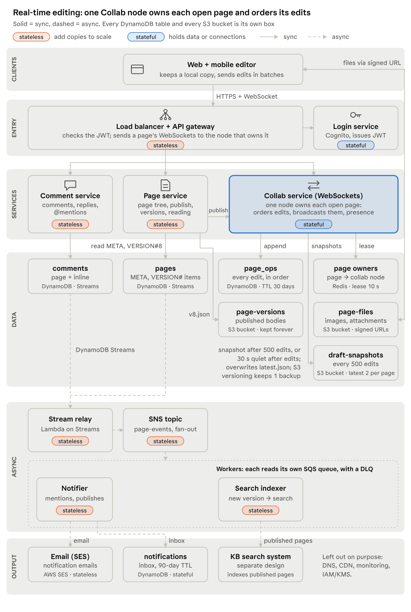

# Real-time Collaboration Tool (Confluence-like) – System Design

Nov 16, 2026 · Arnav Jain

## 1. Basics and requirements

A Confluence-like tool lets teams write **pages** inside **spaces**. Several people can edit the same page **at the same time** and see each other's typing live, like Google Docs. Readers see the **published** version; editors work on a shared **draft** and press Publish to make a new version.

**The words you need:**

| Word | Meaning | Example |
| --- | --- | --- |
| Tenant | One customer company | acme |
| Space | A group of pages with its own permissions | PAY (Payments team) |
| Page | One document in a page tree | "Refund policy" |
| Draft | The live, shared copy that editors are changing right now | Asha and Ravi typing together |
| Version | A published snapshot that readers see; history keeps all of them | v8, published Nov 16 |
| Step (operation) | One small edit | insert "refund" at position 57 |
| Seq | The order number the server gives each step on a page | step 1235 |
| Presence | Who is on the page and where their cursor is | Ravi's blue cursor in paragraph 3 |
| Snapshot | The full draft saved at some seq, so we don't replay every step from the start | snapshot at seq 1200 |

### Functional

1. **Pages:** create a page in a space, under a parent page (page tree); move, archive, delete.
2. **Real-time co-editing:** many users edit the same page at once; everyone sees changes within \~200 ms; no edit is ever lost, and everyone ends up with the same text.
3. **Presence:** see who is on the page, with live cursors and selections.
4. **Draft and publish:** edits change the shared draft; Publish creates a new version; view history, compare and restore old versions.
5. **Comments:** page comments and inline comments on selected text, with replies, resolve and @mentions (mentions notify people).
6. **Reconnect:** after a short network drop, the editor catches up and sends what it typed while offline.
7. **Permissions:** view and edit rights per space and per page.
8. **Attachments and images** in pages.

### Non-functional

| Property | Target | Why |
| --- | --- | --- |
| Scale | 100M DAU, \~1M people editing at the same moment at peak | Atlassian size |
| Latency | A keystroke reaches other editors in < 200 ms (p99) | Feels live |
| Durability | An edit the server has acknowledged is never lost | Losing someone's writing is the worst bug |
| Consistency | All editors converge to the same document | Otherwise people overwrite each other |
| Availability | 99.9%; if a server dies, editors reconnect in seconds | Docs are critical work |
| Page size | Up to \~100 live editors and thousands of readers on one page | Big all-hands pages |

### Out of scope

- Search (see the separate *Knowledge Base Search* design: published pages are sent to it).
- Templates, macros, export to PDF/Word, page analytics.

## 2. Quick traffic estimate

The heavy part is not page views; it's the stream of small edits while people type: \~400K edit batches a second at peak, each sent to the other editors of that page.

**Assumptions to say out loud**

- 100M DAU; each views \~20 pages a day.
- 20% of them (20M) edit something, for \~30 minutes a day, within an 8-hour workday.
- The editor groups keystrokes into one batch every \~100 ms while typing; with pauses, that averages \~20 batches a minute per editor.
- On average a page being edited has \~2 other people on it who must receive each batch.

| What | Math | Average | Peak (×3) |
| --- | --- | --- | --- |
| Page views | 100M × 20 = 2B/day | \~23K/s | \~70K/s |
| People editing at the same moment | 20M × 30 min ÷ 480 min | \~1.25M | \~3M |
| Edit batches in | 20M × 30 min × 20/min = 12B/day | \~140K/s | \~420K/s |
| Edit messages out (×2 others) | 2 × batches | \~280K/s | \~840K/s |
| Open WebSockets | editors + readers watching live | \~2M | \~5M |

**What this tells us**

- Millions of open WebSockets: the realtime layer must be a fleet of stateful servers, each holding tens of thousands of connections.
- \~420K edit batches/s, but each page only sees a few per second. So we split work **by page**: one server owns a page and handles all of its edits in memory. That's easy to scale out.
- Every acknowledged batch must be saved before we say "OK" (durability), so the edit log needs a store that takes \~400K small writes/s spread across millions of keys: DynamoDB, partitioned by page.

## 3. API

Two kinds of API: **REST** for normal actions (create, publish, comment, read history) and one **WebSocket per open page** for live editing and presence. Every call carries a Cognito JWT; `tenantId` and `userId` come from the token.

**REST**

| Method + path | What it does |
| --- | --- |
| `POST /v1/spaces/{spaceId}/pages` | Create a page (title, parentId) |
| `GET /v1/pages/{pageId}` | Read the published version |
| `POST /v1/pages/{pageId}/publish` | Turn the current draft into a new version |
| `GET /v1/pages/{pageId}/versions` · `GET .../versions/{n}` | Version history, one old version |
| `POST /v1/pages/{pageId}/versions/{n}/restore` | Make an old version the draft again |
| `POST /v1/pages/{pageId}/comments` | Add a page or inline comment |
| `PATCH /v1/comments/{commentId}` | Edit or resolve a comment |
| `GET /v1/pages/{pageId}/comments?version={n}` | Comments with their positions in version n, so readers can highlight them (Flow H) |
| `POST /v1/pages/{pageId}/presence` | Reader heartbeat every 30 s; returns how many are viewing and who is editing (Flow I) |
| `GET /v1/pages/{pageId}/threads/{threadId}` | One thread (comment + all replies) by the mark id found in the document, one DynamoDB query |

```json
POST /v1/pages/pg_81c2/publish
{ "message": "Added UPI timelines", "atSeq": 1290 }

200 OK
{ "pageId": "pg_81c2", "version": 8, "seq": 1290, "publishedAt": "2026-11-16T10:02:11Z" }

409 Conflict   (only if we choose "review first" and the draft moved past atSeq)
{ "error": "page_changed", "currentSeq": 1296 }
```

```json
POST /v1/pages/pg_81c2/comments
{ "body": "@ravi is 5 days right?", "anchorId": "cmt_mark_17" }

201 Created  { "commentId": "c_301", "anchorId": "cmt_mark_17" }
```

`anchorId` is a mark the editor puts around the selected text inside the draft, so the comment moves with the text when people edit around it.

**WebSocket: `wss://collab/v1/pages/{pageId}`**

```json
// client -> server: join, saying the last seq I have (0 = nothing)
{ "type": "join", "lastSeq": 0 }

// server -> client: the current draft
{ "type": "snapshot", "seq": 1234, "doc": { "type": "doc", "content": [ ... ] } }

// client -> server: a batch of steps made on top of seq 1234
{ "type": "steps", "clientId": "c_asha_7", "clientSeq": 18, "baseSeq": 1234,
  "steps": [ { "op": "insert", "pos": 57, "text": "refund" } ] }

// server -> sender: saved, your batch is seq 1235
{ "type": "ack", "clientSeq": 18, "seq": 1235 }

// server -> everyone else on the page
{ "type": "steps", "seq": 1235, "clientId": "c_asha_7",
  "steps": [ { "op": "insert", "pos": 57, "text": "refund" } ] }

// presence, both directions, not saved
{ "type": "presence", "userId": "u_ravi", "cursor": { "from": 120, "to": 120 }, "color": "blue" }
```

## 4. HLD (high-level design)



Read it top to bottom; every arrow says who talks to whom.

- **Entry:** the load balancer + API gateway checks the JWT from the Login service. REST calls go to the Comment or Page service. A page's WebSocket goes to the **Collab node that owns that page** (routing by a hash of the page id).
- **Services:**
  - **Comment service** (stateless): page and inline comments, replies, @mentions.
  - **Page service** (stateless): page tree, reading published versions, version history. On Publish it asks the Collab node for the latest draft.
  - **Collab service** (stateful, the heart of the design): a fleet of WebSocket servers. **Exactly one node owns each open page.** It keeps the draft in memory, gives every edit a seq number, saves it, then broadcasts it to everyone on the page. Presence (cursors) lives here too, in memory only.
- **Data:**
  - Comment service → `comments`.
  - Page service → `pages` (tree + version list) and S3 (published version bodies).
  - Collab service → `page_ops` (every edit, appended in order), `page owners` in Redis (which node owns which page, as a 10-second lease) and S3 (draft snapshots).
- **Async:** DynamoDB Streams on `comments` and `pages` → Stream relay (Lambda) → SNS → one SQS queue per worker:
  - **Notifier:** @mentions, replies and "page published" → email (SES) and the in-app `notifications` inbox;
  - **Search indexer:** sends each new published version to the KB search system (separate design).
- `page_ops` has **no** stream on purpose: it gets hundreds of thousands of tiny writes a second, and nothing downstream needs every keystroke.

**What the Collab service is, in plain words:** a group of servers whose only job is live editing. Think of each one as a meeting room for the pages it owns. It keeps the page's current draft in memory; everyone editing that page connects to the **same** server; and when anyone types, that server puts the change in order, saves it, and sends it to everyone else in the room. The **browser** opens the connection (a WebSocket) when the user clicks Edit. Reading, publishing and history stay with the Page service and never need a live connection.

**Who talks to S3:** the **Page service** fetches page bodies (small JSON) and returns them in the API response; the **Collab service** reads and writes draft snapshots; the **browser** uploads and downloads images and files **directly** with short-lived signed URLs, so big files never pass through our servers (the right-hand arrow in the diagram). Details in 6. Data model → S3.

| Box | Stateless or stateful | Talks to | Why it exists |
| --- | --- | --- | --- |
| Load balancer + API gateway | stateless | Login service, 3 services | Front door; routes a page's WebSocket to its owner |
| Login service (Cognito) | stateful | — | Signs users in, issues the JWT |
| Comment service | stateless | comments | Page and inline comments |
| Page service | stateless | pages, S3, Collab service | Tree, publish, versions, reading |
| Collab service | **stateful** (open sockets + drafts in memory) | page\_ops, page owners, S3 | Orders, saves and broadcasts every edit; presence |
| `comments` table | stateful | Streams | Comments with their text anchor |
| `pages` table | stateful | Streams | Page tree, current version, version list |
| `page_ops` table | stateful | — | The ordered edit log for each draft; source of truth until the next snapshot |
| Page owners (Redis) | stateful | — | Page → owning node, 10 s lease |
| S3 | stateful | — | 3 buckets: page-versions (published bodies), draft-snapshots (Collab), page-files (images, attachments) |
| Stream relay (Lambda) → SNS | stateless | 2 SQS queues | Fan-out of comments and publishes |
| Notifier | stateless | SES, notifications | Emails and in-app inbox |
| Search indexer | stateless | KB search system | Keeps search in sync with published pages |

**Left out of the HLD on purpose** (say them out loud if asked): DNS, CDN for page reads and images, monitoring, IAM/KMS, the permission service (reused from the KB search design).

## 5. Flows

The core idea in one line: **one server per page puts every edit in a single order, saves it, then tells everyone.** All the flows below follow from that.

### Flow A: Open a page for editing

1. The browser calls `GET /v1/pages/pg_81c2` (Page service): title, permission check, published version.
   - The load balancer + API gateway checks the JWT and sends the request to the Page service.
   - Page service → DynamoDB `pages`: `GetItem PK = T#acme#PG#pg_81c2, SK = META` → title, `space_id`, `current_version = 8`.
   - Permission check: can this user view the space (and the page, if it is restricted)? The answer is cached for 60 s.
   - Page service → DynamoDB `pages`: `GetItem SK = VERSION#0008` → `s3_key = versions/acme/pg_81c2/v8.json`.
   - Page service → S3: `GetObject` on that key → the page body (JSON, see 6. Data model). Popular pages are cached in the CDN, so S3 isn't hit every time.
   - Response: `{ pageId, title, version: 8, canEdit: true, body: { ... } }`. The browser draws the page. **Reading needs no WebSocket**; steps 2–5 below happen only when the user starts editing.
2. It opens `wss://collab/v1/pages/pg_81c2`. The browser opens it only when the user clicks Edit; reading needs no live connection. The load balancer hashes the page id, so every editor of pg\_81c2 always lands on the same Collab server, node 7.
3. Node 7 checks Redis: nobody owns `pg_81c2`, so it takes the lease: `SET owner:pg_81c2 node7 NX EX 10` (renewed every 3 s while the page is open).
4. It loads the latest draft snapshot from S3 (at seq 1200), reads edits 1201–1234 from `page_ops`, replays them, and now holds the draft in memory at seq 1234.
5. It sends `{ type: snapshot, seq: 1234, doc }` to the browser and announces Asha in presence.
6. If the page is already open, step 3–4 are skipped: the draft is already in node 7's memory. If another node owns it (rare, during a resize), node 7 forwards the socket to the owner.

### Flow A2: Two users open version 1

**Case 1: User 2 is only reading.** User 2 sees **version 1**, the published page from the Page service. User 1's typing goes into the **draft**, which readers don't see; User 2 can see a banner, "Asha is editing this page". When User 1 clicks Publish, version 2 is created and User 2 sees it on refresh (or gets an "updated" nudge). This is on purpose: readers never see half-written sentences.

**Case 2: User 2 also clicks Edit.** Both now see exactly the same draft, live:

| Time | What happens |
| --- | --- |
| 10:00:00 | User 1 clicks Edit. The browser connects to node 7, which loads the draft (made from version 1) and sends it. Draft is at seq 100. |
| 10:00:05 | User 2 clicks Edit. Same page id → same node 7. The draft is already in memory, so User 2 gets the same draft at seq 100. Both screens match. |
| 10:00:05 | Node 7 tells each user about the other: avatars and live cursors (presence). |
| 10:00:10 | User 1 types "Hello". It shows on User 1's screen instantly; the browser sends it to node 7. |
| +20 ms | Node 7 makes it seq 101 and saves it to `page_ops`. |
| +40 ms | Node 7 acks User 1 ("saved as 101") and sends "insert Hello at 57, seq 101" to User 2. |
| +60 ms | User 2's editor applies it; "Hello" appears next to User 1's cursor. |
| 10:00:12 | Both type at the same moment. Node 7 orders the two edits (102, 103), adjusts the second one's position if needed (Flow C), and sends both to both. Same text on both screens. |
| 10:05:00 | User 1 clicks Publish: version 2 is created from the draft at seq 140. Readers now see version 2. |

Why both see the same view: they are connected to the **same server**, which holds **one** copy of the draft and sends every change to everyone **in the same order**.

This is different from a chat service, where members of one group sit on different servers and messages are passed between servers. See 8.8 for why.

### Flow B: Type a word (the hot path, \~100 ms)

1. Asha types "refund". The editor applies it locally at once (no waiting) and groups the keystrokes for \~100 ms into one batch: `{ clientSeq: 18, baseSeq: 1234, steps: [insert "refund" at 57] }`.
2. Node 7 sees `baseSeq` equals its current seq (1234), so the batch fits as-is. It gives it seq **1235**.
3. It saves the batch: `PutItem page_ops (PK = page, SK = 1235)` with the condition "seq 1235 doesn't exist yet".
4. Only after the save does it reply `ack { clientSeq: 18, seq: 1235 }` to Asha and broadcast `steps { seq: 1235 }` to Ravi and everyone else on the page. Their editors apply it.
5. Every 500 edits (or after 30 s of quiet following some edits; no new edits means no new snapshot) the node writes a new snapshot to S3 in the background.
   - **Edit vs snapshot:** each edit (\~200 B) is a row in DynamoDB `page_ops`, saved before every ack. A snapshot is the **whole page** (\~20 KB) written to the S3 `draft-snapshots` bucket. Think of a bank account: the snapshot is the opening balance, and `page_ops` holds every transaction since. Loading = latest snapshot + replay the edits after it (at most \~500).
   - **Who does this:** only the **page's owner node** (node 7). It is the only node writing that page's edits, so it knows when 500 edits have passed and does every step below. The one exception is the final delete of expired rows, which DynamoDB's TTL does by itself.
   - **The safe order when node 7 snapshots (e.g. at seq 1200):**
     1. Write `draft-snapshots/acme/pg_81c2/1200.json` to S3.
     2. Only after that succeeds, update the page's `META` to `snapshot_seq = 1200`, with the condition that the old value is 700, so an older snapshot can never overwrite a newer pointer.
     3. Delete the oldest snapshot (200); **keep the latest 2** (1200, plus 700 as a backup in case 1200 is broken). So a page never has more than 2 snapshot files. Simplest safe way to do this in S3: one fixed file per page, draft-snapshots/acme/pg\_81c2/latest.json, with bucket versioning on. Each snapshot overwrites latest.json; S3 keeps the previous copy as a noncurrent version, and a lifecycle rule deletes noncurrent versions after 7 days while always keeping the newest one. So there is always the latest snapshot plus one backup, an idle page never loses its snapshot (only old copies expire), and a node crash can't leave junk behind. (A plain age-based lifecycle rule on separate files would be wrong: it can't keep "the 2 newest per page" and would delete an idle page's only snapshot.) Publishing doesn't touch snapshots: the draft just continues from the published seq; optionally record snapshot\_seq = 1290 pointing at v8.json so the published body doubles as a snapshot.
     4. Set `expires_at = now + 1 day` (we use up to 30 days) on edit rows up to 700, the ones already inside **both** kept snapshots.
     - A crash anywhere in the middle leaves at worst an extra file or a longer replay, never a missing edit.
   - **Why not a fixed short TTL (e.g. 40 s) on every edit?** The snapshot is a goal, not a promise: steady typing may not hit 500 edits or a quiet 30 s, and an S3 write or the node itself can fail. A user reconnecting after 2 minutes needs the edits since their `lastSeq` to merge their offline typing (Flow E), and the backup snapshot needs the edits after it. DynamoDB TTL deletes are also not exact (often hours late), so they're for cleanup, never for timing. **Rule:** an edit row gets a TTL only after it is covered by the second-latest snapshot, and that TTL is longer than the reconnect window.
   - **History is not lost:** published versions stay in `page-versions` forever (view, compare, restore). Only the keystroke-level log goes after the TTL; for a full audit trail, copy it to S3 Glacier before it expires.

### Flow C: Two people type at the same time

1. Asha and Ravi both have seq 1235. Ravi inserts 6 letters at position 10; at the same moment Asha deletes positions 40–45. Both batches say `baseSeq: 1235`.
2. Ravi's batch arrives first and becomes seq 1236.
3. Asha's batch is now one step behind. Node 7 **transforms** it over Ravi's edit: Ravi added 6 letters before position 40, so Asha's delete becomes 46–51. It becomes seq 1237.
4. Both editors receive 1236 and 1237 in the same order and end with the same text. Asha's editor does the same shift on its local copy when it sees Ravi's step arrive before its ack.

### Flow C2: How Collab merges changes and how they reach every screen

**What each browser keeps** (the editor library, e.g. ProseMirror/TipTap, does this):

| Part | Meaning | Example |
| --- | --- | --- |
| Confirmed doc + `confirmedSeq` | The page as of the last edit the server confirmed | text at seq 1235 |
| In-flight batch | The one batch sent and waiting for an ack (only one at a time) | `clientSeq 18` |
| Pending | Typing done since, not sent yet | the next few keystrokes |

The screen always shows confirmed + in-flight + pending, so your own typing appears instantly. When the ack arrives, the in-flight batch becomes confirmed and the pending typing is sent as the next batch.

**What the Collab node keeps:** the draft at its current seq, the last \~1,000 edits in memory (to fix up late batches), and the last `clientSeq` per client (to ignore duplicates).

**Example.** Both Asha and Ravi see `Refunds take 5 days.` at seq 1235. The "5" is at position 13.

| Step | Asha's browser | Collab node 7 | Ravi's browser |
| --- | --- | --- | --- |
| 1 | Types " working" after "5" (position 14). Screen shows it at once. Sends `{ clientSeq 18, baseSeq 1235, insert " working" at 14 }` |  | Types "Full " at the start (position 0). Screen shows it at once. Sends `{ clientSeq 7, baseSeq 1235, insert "Full " at 0 }` |
| 2 |  | Ravi's batch arrives first. Its baseSeq equals the current seq (1235), so it fits as-is. It becomes **seq 1236**, is saved to `page_ops`, then acked to Ravi and broadcast to Asha | Gets `ack { clientSeq 7, seq 1236 }`; his batch is now confirmed |
| 3 |  | Asha's batch arrives with baseSeq 1235, but the page is at 1236, so it is one edit behind. **Transform:** Ravi inserted 5 letters before position 14, so Asha's insert moves to 14 + 5 = **19**. It becomes **seq 1237** (insert " working" at 19), is saved, acked to Asha and broadcast to Ravi |  |
| 4 | Gets Ravi's `seq 1236: insert "Full " at 0`. Her own batch is still in flight, so her editor applies Ravi's insert at 0 and shifts her own in-flight insert to 19 (the same fix-up the server did) |  |  |
| 5 | Gets `ack { clientSeq 18, seq 1237 }`: her batch is confirmed at 19. `confirmedSeq = 1237` |  | Gets `seq 1237: insert " working" at 19` and applies it (nothing of his own is pending) |
| 6 | `Full Refunds take 5 working days.` | Draft at 1237: same text | `Full Refunds take 5 working days.` |

**The fix-up (transform) rules, in plain words:**

| The earlier edit was… | …so a later edit at position p becomes |
| --- | --- |
| An insert of n letters before p | p + n (shift right) |
| An insert at exactly p | Tie: the lower client id goes first; the other shifts right |
| A delete of n letters before p | p − n (shift left) |
| A delete that covers p | Moves to where the deleted text started; a delete that overlaps it only removes what's left |
| An edit after p | p (no change) |

The server does this for late batches, and each browser does the same for its own unconfirmed typing when someone else's edit arrives first. Because both sides apply the same rules in the same seq order, every screen ends with the same text. Remote cursors are shifted by the same rules, so Ravi's cursor stays on the right letter while Asha types before it.

**How a change physically reaches the other screen (\~60 ms):**

1. Asha's keystrokes → her editor's local document (instant) → grouped for \~100 ms into one batch.
2. Batch → her open WebSocket → load balancer → Collab node 7 (the page's owner).
3. Node 7: order + transform in memory (< 1 ms) → conditional write to DynamoDB `page_ops` (\~5–10 ms).
4. Node 7 → `ack` on Asha's socket, and the same `steps { seq }` message on every other socket it holds for this page (Ravi, Meena…).
5. Ravi's browser receives the message on his WebSocket → the editor applies the step to its in-memory document → it redraws only the changed paragraph.

No polling, no page reload: the open WebSocket pushes every change, and the editor updates just the part of the screen that changed.

### Flow D: Publish

1. Asha clicks Publish. Her browser sends only a small request with the seq her screen shows: `POST /v1/pages/pg_81c2/publish { message, atSeq: 1290 }` → Page service. **It does not upload the document.**
2. The Page service asks the page's owner Collab node (node 7) for the draft at seq 1290. Node 7 already has it in memory (latest snapshot + every edit after it), so this is instant. It does **not** reuse a snapshot file; snapshots are internal and get deleted.
   - If the draft has moved past 1290 (someone typed in the meantime), the server either publishes exactly 1290 or replies "the page changed, please review", whichever product behaviour we choose.
3. The Page service writes the **whole body to S3** (`s3://page-versions/acme/pg_81c2/v8.json`), then in one DynamoDB transaction adds a small `VERSION#8` row (`s3_key`, `seq: 1290`, `published_by`, `published_at`, `message`) and sets `current_version = 8` on `META`. **The body is never stored in DynamoDB**, only this pointer row (optional speed-up: copy small bodies under \~50 KB into `META`).
4. Readers now get v8. The `pages` stream → SNS → the Notifier emails watchers, and the Search indexer sends v8 to the KB search system.

**Why the browser doesn't publish its own copy:**

| Problem | Example |
| --- | --- |
| The browser may be behind | Ravi's last sentence (seq 1290) hasn't reached Asha's screen yet; publishing her copy would silently drop it. |
| The browser may be ahead | Asha's newest typing isn't acked yet and may still be shifted or rejected, but it would already be published. |
| The browser can't be trusted | A modified client could publish text that never went through the edit log: no history, no audit. |
| Versions must match the log | "v8 = exactly the draft at seq 1290" keeps compare, restore and audit consistent. Only the server can guarantee it. |
| Two people press Publish together | The server handles them one at a time; two browser copies could disagree. |
| Bandwidth | A tiny request instead of uploading a 20 KB (or 2 MB) page every time. |

The server's draft is the single source of truth; the client only says which seq it saw.

### Flow E: Network drops for 20 seconds

1. Asha keeps typing; her editor queues the unsent batches locally.
2. On reconnect she sends `join { lastSeq: 1240 }`. The node sends her edits 1241–1260 that she missed (from memory, or from `page_ops`).
3. Her editor shifts its queued batches over those edits (same idea as Flow C) and sends them. Nothing is lost.
4. If she was away so long that a snapshot replaced those edits, she gets the fresh snapshot instead, then sends her queued batches.

### Flow F: A Collab node crashes

1. Node 7 dies. Its sockets drop and its Redis leases stop being renewed; they expire within 10 s.
2. Editors reconnect; the load balancer sends them to node 9, which takes the lease and loads the snapshot + `page_ops` (Flow A).
3. **Every acknowledged edit is in `page_ops`**, so nothing is lost. Edits that weren't acknowledged are still queued in the browsers and are resent (Flow E).
4. If node 7 was only frozen and wakes up, its next save fails: node 9 already wrote that seq, and the "doesn't exist yet" condition rejects node 7. It drops the page.

### Flow G: Upload an image or file

1. The browser asks the Page service: "I want to upload refund-flow.png (2 MB) to pg\_81c2".
2. The Page service checks the edit permission and returns a **pre-signed S3 PUT URL**: valid for 5 minutes, only for s3://page-`files/acme/pg_81c2/a_7/refund-flow.png`, with a size cap.
3. The browser sends the file's bytes **directly to S3**. Our servers never carry them.
4. The browser tells the Page service "done"; it saves the attachment record `ATT#a_7 → s3_key` in the `pages` table.
5. The editor inserts an image node `{ type: image, attrs: { attachmentId: a_7 } }` into the draft, an ordinary edit through Collab, so other editors see it at once.
6. To show it, the browser asks for a short-lived signed GET URL (or a CDN signed URL) and loads the image straight from S3/CDN.

### Flow H: Highlighting text and viewing highlights

"Highlight" means two different things, and they travel differently:

|  | Highlight formatting (yellow marker) | Inline comment highlight |
| --- | --- | --- |
| What it is | Part of the page's look, like bold | A comment attached to some words |
| Stored as | A `highlight` mark inside the page body | A `comment` mark in the draft + a row in `comments` |
| Who can add it | Editors only | Editors, and readers on the published page |
| When readers see it | After the next Publish | At once, even before a Publish |

**H1. An editor highlights text (formatting)**

1. Asha selects "changing limits" (positions 120–135) and picks yellow. Her editor shows it at once and sends one step: `{ op: addMark, from: 120, to: 135, mark: { type: highlight, color: yellow } }`.
2. Node 7 treats it like typing (Flow B): seq 1301 → save to `page_ops` → ack → broadcast. Ravi sees the yellow highlight \~60 ms later.
3. In the draft, the words become a text run with the mark: `{ text: "changing limits", marks: [ { type: highlight, color: yellow } ] }`.
4. Readers still see v8 without it. After Publish, `v9.json` contains the mark and every reader sees the highlight.

**H2. Someone adds an inline comment**

1. Ravi selects "5 days" and writes "@asha is 5 days right?".
2. His browser calls `POST /v1/pages/pg_81c2/comments { body, anchor: { version: 8, from: 57, to: 63, quote: "5 days" } }` → Comment service.
3. The Comment service saves a `comments` row with `anchor_id = cmt_mark_17`, the version-8 position (57–63) and the quoted words.
4. It asks the page's Collab node to add a `comment` mark (id `cmt_mark_17`) around those words in the draft, an ordinary edit. Editors see the highlight live, and because the mark is inside the text it moves when people type around it.
5. The `comments` stream → Notifier → Asha gets the @mention by email and in her inbox.

**H3. A reader opens the page and sees the highlights**

1. `GET /v1/pages/pg_81c2` → the v8 body from `page-versions` (Flow A). Yellow formatting highlights are already inside the body as `highlight` marks; the browser draws them.
2. In parallel, `GET /v1/pages/pg_81c2/comments?version=8` → Comment service → the page's comments with their v8 positions:

```json
{ "comments": [
  { "commentId": "c_301", "anchorId": "cmt_mark_17",
    "anchor": { "version": 8, "from": 57, "to": 63, "quote": "5 days" },
    "author": "u_ravi", "body": "@asha is 5 days right?", "resolved": false, "replies": 1 } ] }
```

3. The browser wraps positions 57–63 in a comment highlight; clicking it opens the thread in the side panel. Resolved comments aren't highlighted.
4. Safety check: if the text at 57–63 isn't "5 days" (the anchor went stale), the browser searches for the quote nearby; if it can't find it, the comment shows as "orphaned" in the side panel instead of highlighting the wrong words.
5. On the next Publish (v9), the `comment` marks are already in the body, so the Page service updates each comment's anchor to its v9 position, and readers of v9 get correct highlights.

### Flow I: How many people are viewing

Two different numbers, solved differently:

|  | "Who's here right now" | "How many have seen it" |
| --- | --- | --- |
| Example | "Asha and Ravi editing · 12 viewing" | "Seen by 340 people" |
| Must be | Live (within \~30 s) | Roughly right; can lag minutes |
| Stored in | Memory (Collab) + Redis, expires on its own | DynamoDB counters, kept |

**I1. Live editors:** already known. The page's Collab node holds every editor's socket in memory (presence), so it sends "Asha, Ravi" with their cursor colours to everyone editing.

**I2. Live readers:** readers have no WebSocket (Flow A), so they send a small **heartbeat**:

1. While the page is open, the browser calls `POST /v1/pages/pg_81c2/presence` every 30 s → Page service.
2. The Page service records it in Redis, one sorted set per page: `ZADD viewers:acme:pg_81c2 <now> u_meena`, and keeps the key alive with `EXPIRE 120`.
3. It drops anyone silent for over 60 s (`ZREMRANGEBYSCORE ... -inf <now - 60s>`) and counts the rest (`ZCARD`).
4. It replies `{ "viewing": 12, "editing": ["u_asha", "u_ravi"] }` (editors come from the Collab node). The browser shows "12 viewing".
5. A reader who closes the tab just stops sending heartbeats and drops out within a minute. On very popular pages, show "1K+" instead of an exact number.

Load: \~5M readers × 1 heartbeat / 30 s ≈ 170K Redis writes/s, spread over many pages, so a Redis cluster sharded by page handles it.

**I3. Total views ("seen by 340 people"):**

1. Each page read (Flow A) also sends a `page.viewed` event to an SQS queue; it is never written synchronously, so reading stays fast.
2. A **view counter** worker batches events and does one atomic `ADD views :n` per page per minute on a `page_stats` row (`PK = page`, `SK = DAY#2026-11-16`).
3. Unique viewers: the worker adds user ids to a Redis HyperLogLog per page per day (`PFADD`), a tiny structure that counts distinct users with \~1% error, and copies the count to `page_stats` once a day.
4. The page header reads `page_stats` when it loads; the number can be a few minutes behind, which is fine.

### Flow J: How an inline comment stays on its words while the text keeps changing

**The problem:** positions change all the time. "5 days" is at 13–19 now; after someone types "Full " at the start it is at 18–24. If a comment remembered only "13–19", it would soon point at the wrong words.

**The answer: the comment is not stored as a position. It is a mark on the letters themselves.** When Ravi comments on "5 days", a `comment` mark with id `cmt_mark_17` is added to exactly those letters in the draft:

```json
{ "type": "text", "text": "5 days", "marks": [ { "type": "comment", "attrs": { "id": "cmt_mark_17" } } ] }
```

The `comments` row only says "thread c\_301 belongs to mark cmt\_mark\_17" (plus the quoted words, as a backup). Wherever the letters go, the mark goes with them; nobody has to update the comment row.

**Walk-through** (draft text `Refunds take 5 days.`):

| Step | What happens | Where the comment is |
| --- | --- | --- |
| 1 | Ravi selects "5 days" and comments. One edit through Collab: `addMark comment cmt_mark_17 from 13 to 19` (seq 1240). The `comments` row is saved with `anchor_id = cmt_mark_17`, quote "5 days" | On "5 days" (13–19) |
| 2 | Asha types "Full " at position 0 (seq 1241) | The letters moved to 18–24 and the mark moved with them. Still on "5 days" |
| 3 | Meena types "working " between "5" and "days" (inside the marked words) | New letters inside a marked range get the mark too: on "5 working days" |
| 4 | Asha types " only" right after "days" (at the edge) | The comment mark doesn't stretch at its edges, so it stays on "5 working days" |
| 5 | Ravi deletes "working " | The mark shrinks with the text: on "5 days" again |
| 6 | Someone deletes the whole sentence | The marked letters are gone. The Collab node sees that mark `cmt_mark_17` no longer exists and sends `comment.orphaned` to the Comment service. The thread stays in the side panel as "Original text was deleted", showing the quote "5 days" |
| 7 | They press Undo | The letters come back with their mark, and the comment is attached again |

**Other cases:**

| Edit | Result |
| --- | --- |
| Cut the words and paste them elsewhere | The mark travels with the text; the comment follows |
| Copy and paste | The pasted copy drops the mark (one comment = one place) |
| Split the paragraph in the middle of the words | The mark stays on both halves; still one comment |
| Two people comment on overlapping words | Two marks with different ids on the same letters; both highlighted, both clickable |

**How the screen shows it:**

1. The editor draws every `comment` mark as a highlighted span (`<span data-comment="cmt_mark_17">`).
2. Clicking it looks up `cmt_mark_17` in the page's comments (`GET /v1/pages/pg_81c2/comments`) and opens thread c\_301 in the side panel.
3. Comment marks are edits like any other, so other editors see a new highlight about 60 ms later (Flow C2), and comment marks shift with the same transform rules as letters.
4. **Readers** see the published version, which has no live marks for brand-new comments yet. For them the Comment service stores the comment's position in the latest published version, plus the quote. The browser highlights that range and, if the words there don't match the quote, searches for the quote nearby (Flow H3). On each Publish, the Page service reads where each comment mark sits in the new version and updates those stored positions.

## 6. Data model

The draft is stored as **snapshot + edit log**: the latest snapshot in S3 plus every edit after it in `page_ops`. Replaying the log on top of the snapshot gives the current draft. Published versions are full copies in S3.

### DynamoDB tables

Every key starts with the tenant (`T#acme`), so one company's data never mixes with another's.

**`pages`**: owned by the Page service; Streams ON (feeds the Notifier and Search indexer).

| Item | PK / SK | Attributes |
| --- | --- | --- |
| Page | `T#acme#PG#pg_81c2` / `META` | space\_id, parent\_id, title, current\_version (8), snapshot\_seq (1200), status (current \| archived), updated\_at |
| Published version | same PK / `VERSION#0008` | s3\_key, seq (1290), published\_by, published\_at, message |
| Attachment | same PK / `ATT#a_7` | s3\_key, file\_name, size\_bytes, uploaded\_by |
| GSI: child pages | `T#acme#PG#<parent_id>` / `title` | Lists a page's children for the page tree |

**`page_ops`**: owned by the Collab service; no stream (too many tiny writes).

| Item | PK / SK | Attributes |
| --- | --- | --- |
| One edit batch | `T#acme#PG#pg_81c2` / `000001235` (the seq, zero-padded so it sorts) | client\_id, user\_id, steps (e.g. insert "refund" at 57), created\_at, expires\_at |

- Written with the condition "this (page, seq) must not exist yet": that is the fencing from 8.9.
- `expires_at` is set only after two kept snapshots cover the edit (see Flow B step 5).

**`comments`**: owned by the Comment service; Streams ON (feeds @mention notifications).

| Item | PK / SK | Attributes |
| --- | --- | --- |
| Thread root (the first comment) | `T#acme#PG#pg_81c2` / `TH#cmt_mark_17#0` | comment\_id (c\_301), author\_id, body, quote ("5 days"), version\_anchor (v8: 57–63), resolved, reply\_count, mentions \[u\_asha\], created\_at |
| Reply | same PK / `TH#cmt_mark_17#2026-11-16T10:09#c_302` | comment\_id, author\_id, body, mentions, created\_at, edited\_at |
| Page comment (not on any words) | same PK / `TH#page_c_310#0` | same as a thread root, with no quote or anchor |

The **thread id is the mark id** that sits in the document (`cmt_mark_17`), and every row of a thread shares the prefix `TH#cmt_mark_17#`. The root sorts first (`#0`); replies follow in time order. So:

| Need | One DynamoDB call |
| --- | --- |
| One thread: the comment + all its replies (click on a highlight) | `Query PK = T#acme#PG#pg_81c2, SK begins_with "TH#cmt_mark_17#"` |
| Every comment on the page (side panel) | `Query PK = T#acme#PG#pg_81c2, SK begins_with "TH#"` |
| Just the thread roots with their counts (fast side-panel list) | Same query with a filter on `#0`, or a small GSI on roots only |
| A long thread, 20 replies at a time | The thread query with `Limit 20` and the returned `LastEvaluatedKey` as the cursor |

- Replies are **flat** inside a thread (a reply to a reply is still in the same thread, in time order), like most doc tools.
- `reply_count` on the root is updated with an atomic `ADD 1` in the same transaction as each reply, so the side panel can show "3 replies" without reading them.

**`notifications`**: written by the Notifier; TTL 90 days.

| Item | PK / SK | Attributes |
| --- | --- | --- |
| Notification | `T#acme#U#u_ravi` / `<time>#<id>` | type (mention, reply, published), page\_id, comment\_id, read |

### The document (in S3 and in Collab memory)

```json
{ "type": "doc", "content": [
  { "type": "heading", "attrs": { "level": 1 },
    "content": [ { "type": "text", "text": "Refund policy" } ] },

  { "type": "paragraph", "content": [
    { "type": "text", "text": "Full refunds take " },
    { "type": "text", "text": "5 days", "marks": [ { "type": "bold" } ] },
    { "type": "text", "text": ". Ask " },
    { "type": "mention", "attrs": { "userId": "u_ravi" } },
    { "type": "text", "text": " before " },
    { "type": "text", "text": "changing limits", "marks": [
        { "type": "highlight", "attrs": { "color": "yellow" } },
        { "type": "comment", "attrs": { "id": "cmt_mark_17" } } ] },
    { "type": "text", "text": ". See " },
    { "type": "text", "text": "UPI docs",
      "marks": [ { "type": "link", "attrs": { "href": "/pages/pg_17aa" } } ] } ] },

  { "type": "bulletList", "content": [
    { "type": "listItem", "content": [
      { "type": "paragraph", "content": [ { "type": "text", "text": "Cards: 5 days" } ] } ] },
    { "type": "listItem", "content": [
      { "type": "paragraph", "content": [ { "type": "text", "text": "UPI: 2 days" } ] } ] } ] },

  { "type": "image", "attrs": { "attachmentId": "a_7", "alt": "Refund flow" } }
] }
```

This renders as: a heading **Refund policy**; a paragraph "Full refunds take **5 days**. Ask @Ravi before \<yellow highlight + comment> changing limits\</>. See \[UPI docs\]"; a two-item bullet list; an image.

**How to read it:**

- **Blocks** (heading, paragraph, list, table, image) sit in `content` arrays and can nest (a list holds list items, which hold paragraphs).
- **Formatting is `marks` on a run of text:** bold, italic, link, `highlight` with a colour, and `comment` with the inline comment's id. Highlighted text is just a text run carrying a `highlight` mark.
- **Things that aren't text** (a @mention, an image) are their own nodes with `attrs`. An image points to an attachment in S3.
- The `comment` mark is how an inline comment stays attached to its words: it is part of the text, so it moves when people type around it.

**Is it Markdown? No, on purpose.** Markdown is one plain string with symbols like `**` in it. It has no standard way to store highlight colours, @mentions, inline comment anchors or merged table cells. And if two people edit it at once, an edit that lands between `*` and `*` can break the formatting. A JSON tree gives every position a clear meaning, which the merge rules (OT, see 8.1) need. Editor libraries such as ProseMirror and TipTap use this kind of format. We still **export** to Markdown, HTML or PDF on request.

### Redis

| Key | Value | TTL |
| --- | --- | --- |
| `owner:{page}` | Collab node id | 10 s, renewed every 3 s |

### S3

Three separate buckets, because each has a different owner, access pattern and lifecycle:

| Bucket | Key | Written by | Read by | Lifecycle |
| --- | --- | --- | --- | --- |
| `page-versions` | `{tenant}/{page}/v{n}.json` | Page service (on Publish) | Page service (readers) | Kept forever; old versions move to Infrequent Access |
| `draft-snapshots` | `{tenant}/{page}/{seq}.json` | Collab service (every 500 edits) | Collab service (loading a draft) | Keep the latest 2 per page |
| `page-files` | `{tenant}/{page}/{attachment_id}/{name}` | Browser (pre-signed PUT) | Browser (signed GET / CDN) | Deleted with the page |

**Who reads and writes S3**

| What | Who fetches or stores it | Why |
| --- | --- | --- |
| Page body (JSON, \~20 KB) | **Server**: the Page service reads it and returns it inside `GET /v1/pages/{id}` | Small; the server is already checking permissions; one round trip for the browser |
| Images and attachments (MBs) | **Browser**, straight from S3 or the CDN with a short-lived signed URL | Big files shouldn't stream through our servers; the CDN makes them fast |
| Uploads | **Browser**, directly to S3 with a pre-signed PUT URL (Flow G) | Same reason; the server only checks permission and saves the record |
| Draft snapshots | **Collab service** only | Internal; used to rebuild the draft, never shown to users |

**Why bodies go to S3 and not into DynamoDB (even though an item can hold 400 KB)**

|  | Body in DynamoDB | Body in S3 |
| --- | --- | --- |
| Size limit | 400 KB per item, including every other field | Effectively none |
| Storage cost | Roughly 10× more per GB | Cheap, plus cheaper tiers for old versions |
| Read/write cost | Charged per KB, so a 20 KB body costs \~20× a tiny item on every write | Charged per request, not per KB |
| Best for | Small data that is read or changed often: `META`, the version list, the edit log, comments | Large data written once and kept: published versions, snapshots, files |
| Code | Mixing inline and S3 means two code paths | One code path |

Published versions never change and are kept forever, which is exactly what S3 is for. **Optional optimisation:** if page reads get hot, copy the current published body into `META` when it is small (say under 50 KB) to save the S3 trip, and keep the S3 pointer for bigger ones; or simply cache bodies in the CDN.

## 7. Storage estimate

The edit log is the biggest thing we write (\~2.4 TB a day), but a TTL keeps only \~70 TB of it at any time. What grows forever is published versions and attachments.

**Assumptions:** 12B edit batches a day at \~200 B each; a snapshot every 500 edits at \~20 KB; 5M publishes a day at \~20 KB; 10M new pages and 20M comments a day; 1M attachments a day at \~1 MB.

| Data | Math | Per day | Kept | Where |
| --- | --- | --- | --- | --- |
| Edit log | 12B × 200 B | 2.4 TB | \~70 TB (30-day TTL) | DynamoDB `page_ops` |
| Draft snapshots | 24M × 20 KB | 480 GB | Latest 2 per page only (\~a few TB) | S3 |
| Published versions | 5M × 20 KB | 100 GB | \~36 TB a year, forever | S3 |
| Pages + version items | 15M × 1 KB | 15 GB | \~5 TB a year | DynamoDB `pages` |
| Comments | 20M × 500 B | 10 GB | \~4 TB a year | DynamoDB `comments` |
| Attachments | 1M × 1 MB | 1 TB | \~365 TB a year | S3 |
| Drafts in memory | \~1M open pages × \~50 KB | — | \~50 GB across the Collab fleet | Collab RAM |
| Page owners | \~1M keys × 100 B | — | \~100 MB | Redis |

**What the numbers decide**

| Finding | Decision |
| --- | --- |
| 400K tiny writes/s, each page only a few per second | DynamoDB `page_ops` keyed by page: load spreads over millions of keys; no hot partition |
| The log would grow without limit | Snapshots every 500 edits + 30-day TTL on edits already in a snapshot |
| \~5M sockets, \~50 GB of drafts | \~250 Collab nodes, each with \~20K sockets and a few thousand open pages |
| Versions and files grow forever | S3, with old versions moved to Infrequent Access |

## 8. Deep dives

The interviewer will push on: how concurrent edits merge, how you make sure only one server owns a page, how you never lose an edit, and what happens on a very busy page.

### 8.1 Merging concurrent edits: OT vs CRDT

|  | OT with a central server (our design) | CRDT (e.g. Yjs, Automerge) |
| --- | --- | --- |
| Idea | The server puts every edit in one order and shifts late edits over the ones they missed | Every character gets a unique id, so edits merge in any order without a referee |
| Needs a central server | Yes, one owner per page | No; servers mostly relay and store |
| Offline for hours, peer-to-peer | Harder (long rebase on reconnect) | Natural fit |
| Memory and storage | Small: plain text + a log | Larger: ids and deleted-character markers kept around |
| Server logic | The transform rules (tricky, but well-known libraries exist) | Simple relay; complexity is inside the library |

We pick **OT with a central owner** because we already need one place per page for ordering, durability, presence and publish, and pages are usually online-edited by a handful of people. Say clearly that a CRDT is a valid choice if offline editing were a key requirement.

### 8.2 One owner per page

- **Routing:** the load balancer sends `wss://collab/v1/pages/{pageId}` to a node chosen by a consistent hash of the page id, so all editors of a page usually land on the same node.
- **Lease:** the node must hold `owner:{page}` in Redis (`SET NX EX 10`, renewed every 3 s). A node that lands on a page owned by someone else forwards the socket to the owner.
- **Fencing:** the lease alone isn't enough (a paused node may think it still owns the page). The real guard is the save: `page_ops` uses `attribute_not_exists` on (page, seq), so two nodes can never both write seq 1236. The loser drops the page and its clients reconnect.
- **Scaling the fleet:** adding nodes moves only \~1/N of pages (consistent hashing). Moved pages re-load from snapshot + log in under a second.

### 8.3 Never losing an edit

- The ack is sent **after** the `page_ops` write succeeds. Until then the browser keeps the batch and will resend it.
- Resends are safe: each batch carries `(clientId, clientSeq)`. The node remembers the last `clientSeq` per client and ignores a duplicate.
- Snapshots are written in the background; the log is the safety net, so a lost snapshot only means a longer replay.
- Only edits already covered by a snapshot get the 30-day TTL, so the log never expires anything we still need.

### 8.4 A very busy page

- **Batching:** the server merges outgoing steps into one message every \~50 ms per page, so 100 typists don't produce 100 messages per keystroke for every reader.
- **Editor cap:** up to \~100 live editors per page; above that, new people join as readers.
- **Many readers** (a company-wide announcement): readers don't need every keystroke. They get the published version from the CDN, and at most a "page was updated" nudge.
- **Presence** is throttled to \~10 cursor updates a second per user and never saved.

### 8.5 Draft, publish and history

- Editors always work on the one shared draft; readers only ever see published versions, so half-written sentences are never shown to readers.
- Publish = freeze the draft at a seq and copy it to S3 as version n. History is the list of `VERSION#` items.
- **Restore v5** = load v5's body and apply it to the draft as one big "replace everything" edit through the normal Collab path, so live editors see it instantly; publishing then creates v9 with v5's content. History is never rewritten.
- **Compare** two versions with a diff of the two JSON documents, computed on request.

### 8.6 Inline comments

- Selecting text and commenting adds a `comment` mark around that text (an ordinary edit through Collab) and a `comments` item with the same `anchor_id`.
- Because the mark is inside the text, it moves and stretches as people edit. If all the marked text is deleted, the comment shows as "orphaned" in the side panel.

### 8.7 Permissions while editing

- Checked when the WebSocket opens (edit right on the page) and on every REST call.
- If someone loses edit access while connected, the permission change event reaches the Collab node, which closes that user's socket. Edits already acknowledged stay.

### 8.8 Why all editors of a page share one server (and a chat service doesn't)

It comes down to one question: **does the connection belong to the user, or to the room?**

**Chat: the connection belongs to the user.** Your phone opens one connection for all your chats. If you are in 200 groups, the server can't be picked per group, so it is picked by **user id**. The members of one group therefore land on different servers:

- Asha → server 1, Ravi → server 5, Meena → server 9.
- Asha sends a message: server 1 saves it, then passes it to servers 5 and 9 (pub/sub or a message router), which push it to Ravi and Meena.

**Collab: the connection belongs to the page.** Clicking Edit opens a connection just for that page, so the server can be picked by **page id**:

- Asha, Ravi and Meena editing Refund policy → all on node 7.
- Asha types: node 7 numbers the edit, saves it, and sends it straight to Ravi and Meena. Nothing is passed between servers, and one server decides the order.

|  | Chat | Collab |
| --- | --- | --- |
| One connection per | User | Open page |
| Server chosen by | User id | Page id |
| Members of one room end up | On different servers | On the same server |
| A message reaches the others by | Being passed between servers | Going straight from the one server |
| Who decides the order | A sequence number in the database | The page's owner node |

**Why chat can't do the same:** routing by group would need one connection per group, so 200 open connections from one phone, which drains the battery and wastes servers. **Why it's fine for Collab:** people edit one or two pages at a time, the group per page is small (a handful of editors, max \~100), edits arrive many times a second, and their exact order matters. Putting the whole "room" on one server makes ordering free.

**When Collab would borrow the chat design:** if one page needed thousands of live viewers, or users kept dozens of pages open, add a **gateway tier** routed by user (one socket per user). Gateways forward edits to the page's owner; the owner orders and saves them, then publishes each edit to every gateway that has viewers of that page.

|  | One server per page (current) | Gateways + page owners |
| --- | --- | --- |
| Hops per edit | 1 | 2 (gateway → owner → gateways) |
| Sockets per user | One per open page | One in total |
| Huge audiences | Limited by one server | Spread over many gateways |
| Complexity | Simple | Needs pub/sub between owners and gateways |

**Interview line:** "Editors are routed by page id to the page's owner, so ordering and broadcast happen in one place, with no cross-server fan-out like chat. For huge audiences I'd add a user-routed gateway tier and have the owner publish to it."

### 8.9 Finding the owner: load balancer, Redis lease, DynamoDB fencing (and ZooKeeper)

Three separate questions, three mechanisms:

| Question | Our design | With ZooKeeper (or etcd) |
| --- | --- | --- |
| Which Collab nodes are alive? | The load balancer health-checks every node every few seconds | Each node keeps a temporary entry that disappears when it dies |
| Which node should get page pg\_81c2? | The load balancer hashes the page id onto the ring of healthy nodes (consistent hashing) | Same hashing, over the live list in ZooKeeper |
| Is that node really the owner right now? | Redis lease `SET owner:pg_81c2 node7 NX EX 10`, renewed every 3 s | Temporary entry `/owners/pg_81c2 = node7` |

**Step by step:** the browser connects → the load balancer hashes `pg_81c2` → node 7 → node 7 takes the Redis lease (if another node holds it, node 7 forwards the socket there) → node 7 serves the page. One node owns thousands of pages; each page has exactly one owner. If node 7 dies, health checks drop it within seconds, its lease expires in 10 s, and its pages hash to other nodes, which take the lease and reload the draft.

**Where DynamoDB comes in (fencing):** Redis can briefly be wrong. A node that freezes for 20 s may lose its lease without knowing. So every edit is saved to `page_ops` with the condition **"this (page, seq) must not exist yet"**:

1. Node 7 freezes; its lease expires; node 9 becomes the owner and writes seq 1235 and 1236.
2. Node 7 wakes up, still thinks it is the owner, and tries to write seq 1235.
3. DynamoDB rejects it, because 1235 already exists. Node 7 knows it lost the page, drops it, and its users reconnect to node 9.

Redis says who **should** own the page; the DynamoDB condition guarantees two nodes can **never** write the same edit number.

**Redis lease vs ZooKeeper:**

|  | Redis lease (our design) | ZooKeeper / etcd |
| --- | --- | --- |
| Consistency | Can briefly be wrong; DynamoDB fencing covers it | Strongly consistent; an entry disappears exactly when the node's session ends |
| Fencing | Conditional write on (page, seq) | Built-in version numbers usable as fencing tokens |
| Operations | Usually already running | An extra 3–5 node cluster |
| Scale | \~1M page leases renewed every 3 s is fine | \~1M entries is heavy; use \~10K **shard** leases instead (`shard = hash(pageId) % 10,000`) |

**Which to pick:** for the interview, the current design is enough: Redis is already there and correctness comes from the DynamoDB condition. Say: "Routing by consistent hash, ownership by a Redis lease, safety by DynamoDB fencing. If we want stricter ownership, shard leases in ZooKeeper or etcd."

## 9. Wrap-up

**30-second summary:**

> "Editors open a WebSocket to the Collab node that owns the page, chosen by a hash of the page id and guarded by a Redis lease. The node keeps the draft in memory, gives each edit batch a seq, transforms late edits over the ones they missed, saves the batch to an append-only DynamoDB log with a 'seq must not exist' condition, and only then acks and broadcasts it. The draft is a snapshot in S3 plus the log; snapshots every 500 edits keep replay short and let a TTL clean the log. Publish freezes the draft into a version in S3 and a version item in DynamoDB; Streams → SNS → SQS drive notifications and search indexing. If a node dies, the lease expires, another node reloads snapshot + log, and clients resend anything not yet acked."

| Decision | Why | Trade-off |
| --- | --- | --- |
| One owner node per open page | Single order for edits; presence and publish in one place | Stateful fleet; a node failure means a few seconds of reconnect |
| OT with a central server | Small data, simple storage, fits online editing | Offline-for-hours editing is harder than with a CRDT |
| Ack only after the log write | An acknowledged edit is never lost | Adds a few ms of DynamoDB latency to each batch |
| Conditional write on (page, seq) | Fencing: two nodes can never both own a page's history | A paused node's late write fails and its clients reconnect |
| Snapshot + log with TTL | Fast load, bounded storage | Background snapshot job per page |
| Draft vs published versions | Readers never see half-written text; history is simple | Readers don't see live typing (by design) |
| No stream on `page_ops` | Avoids 400K events/s nobody needs | Analytics on keystrokes would need a separate pipeline |

**If they push further:** offline-first editing with a CRDT, cross-region editing (page owner pinned to the tenant's home region), page-level real-time permissions, live comment threads, and AI summaries of what changed between versions.
