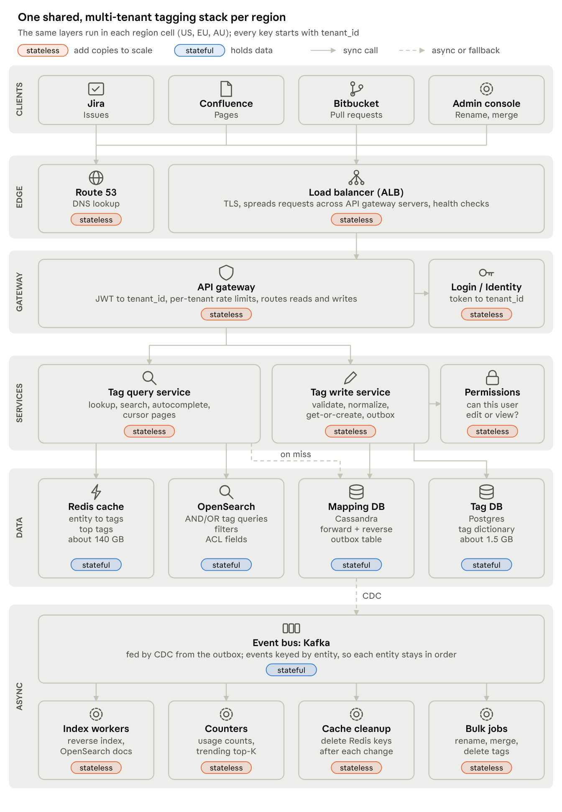

# Scalable Tagging System Design (Atlassian Interview)

Nov 13, 2026 · @Arnav jain

A shared, multi-tenant tagging platform for Jira, Confluence and Bitbucket, sized for 100M daily users, 10K QPS and a 70:30 read:write mix.

## Interview flow (45–60 min)

1. **Clarify requirements (5 min):** functional, non-functional, out of scope. Confirm with the interviewer before moving on.
2. **Quick traffic estimate (2 min):** users → QPS only. These numbers shape the architecture.
3. **API design (5 min):** the main endpoints and their contracts.
4. **High-level design (8 min):** the components and how they connect.
5. **Request flows (5 min):** walk through a write and the main reads.
6. **Data model (8 min):** tables, keys, and why each one exists.
7. **Storage estimate (3 min):** row size → storage → cache → sharding decision.
8. **Deep dives (15 min):** hot tags, permissions, multi-tenancy, rename and merge, bulk jobs.
9. **Wrap-up (5 min):** consistency, failure handling, monitoring, trade-offs.

## 1. Requirements

The service is a platform shared by all Atlassian products, not a feature of one product. State these assumptions and confirm them.

### Functional

- Add a tag to any entity (Jira issue, Confluence page, Bitbucket PR). If the tag does not exist yet, it is created automatically.
- Create a tag explicitly (for admins who set up tags in advance).
- Remove a tag from an entity.
- Get all tags of an entity, or of a batch of entities (board and list views).
- Get all entities with a given tag, including AND/OR combinations, paginated and filtered by the user's permissions.
- Suggest existing tags while typing (autocomplete), ranked by popularity.
- Show popular and trending tags per tenant, space or project.
- Admins can rename, merge and delete tags. Deleting a tag removes it from all entities.

### Non-functional

- **Scale:** 100M daily active users, 70:30 read:write, peak about 3× average.
- **Availability:** 99.9% or better. If tagging is down, products still work without tags.
- **Consistency:** read-your-writes for the user who tagged. Everyone else, and search, may lag by 1–2 seconds (eventual consistency).
- **Latency (p99):** under 50 ms for tags of an entity, under 100 ms for add and remove, under 200 ms for search and autocomplete.
- **Multi-tenancy:** strict data isolation between companies, plus per-tenant rate limits so one company's traffic cannot slow others.
- **Security:** results respect permissions. Sharing a tag never exposes an entity the user cannot see.
- **Durability:** a saved tag is never lost (replicated storage).
- **Data residency:** a tenant's data stays in its region (US, EU, AU).

### Out of scope

- ML-based tag suggestions.
- Tags shared across tenants.
- Tag hierarchies such as `team/backend` (mention as an extension).

## 2. Quick traffic estimate

Traffic only at this stage, because it shapes the architecture: 100M users → 1B ops a day → 10K QPS (7K reads, 3K writes), peaking near 30K. Storage comes in section 7, once the data model defines a row.

**Assumptions to say out loud**

- 100M daily active users across Jira, Confluence and Bitbucket.
- About 10 tag operations per user per day (view, add, remove, search).
- Read:write ratio of 70:30.
- One day is about 10^5 seconds (the real figure is 86,400; rounding keeps the math easy).
- Peak traffic is about 3× the average.

**Traffic**

|  | Per day | Avg QPS | Peak QPS (3×) |
| --- | --- | --- | --- |
| Total | 100M × 10 = 1B ops | 1B / 10^5 = 10K | 30K |
| Reads (70%) | 700M | 7K | 21K |
| Writes (30%) | 300M | 3K | 9K |

**What the 70:30 mix means for the design**

- The write path needs as much care as the read path: 9K writes a second at peak.
- Each write fans out to about 4 consumers, so expect about 36K internal events a second at peak. This processing must be asynchronous.
- Use a write-optimized store (LSM-based, such as Cassandra or DynamoDB) for the tag mappings.
- Invalidate cache entries on write instead of updating them, to avoid races between writers (details in section 4, under Cache strategy).

**Cache invalidation, explained**

- **What:** Redis keeps a copy of each item's tags (`PAY-1 → [payments]`). When a tag is added or removed, we delete that copy instead of writing the new list into it.
- **How:** save to the database first, then delete the cache key. The next reader misses the cache, reads the database and refills the cache with a TTL of about 10 minutes.
- **Why:** with about 3.5K writes a second, two people often edit the same item at once. If both update the cache, the slower one can overwrite newer data with older data:

| Step | Riya adds `urgent` | Amit adds `backend` |
| --- | --- | --- |
| 1 | Saves to DB, reads \[payments, urgent\] |  |
| 2 |  | Saves to DB, reads \[payments, urgent, backend\] |
| 3 |  | Writes cache \[payments, urgent, backend\] |
| 4 | Slow network: writes cache \[payments, urgent\] |  |
| Result | Cache is missing `backend` until it expires |  |

If both writers only delete the key, order does not matter: deleting twice equals deleting once, and the next read always gets the truth from the database. The cost is one cache miss after each change.

## 3. API design

These are REST endpoints. `tenantId` comes from the auth token, never from the URL. Pagination uses cursors, not offsets.

| Purpose | Method and path | Notes |
| --- | --- | --- |
| Add tags | `POST /v1/entities/{type}/{id}/tags` | Body `{"tags":["backend","p1"]}`. Creates a missing tag (get-or-create). Idempotent |
| Remove a tag | `DELETE /v1/entities/{type}/{id}/tags/{tagId}` | Idempotent |
| Tags for an entity | `GET /v1/entities/{type}/{id}/tags` | Hottest read path |
| Tags for many entities | `POST /v1/entities/tags:batchGet` | Up to 200 IDs; avoids N+1 calls on boards |
| Entities for a tag | `GET /v1/tags/{tagId}/entities?type=issue&cursor=&limit=50` | Permission-filtered |
| Tag search | `GET /v1/search?q=tag:backend AND tag:p1&type=issue&cursor=` | AND/OR plus product filters |
| Autocomplete | `GET /v1/tags/suggest?prefix=back&limit=10` | Ranked by usage |
| Trending | `GET /v1/tags/trending?scope=space:123&window=7d` | Precomputed |
| Create a tag | `POST /v1/tags` | Body: name, optional description and colour. 409 if it exists |
| List tags | `GET /v1/tags?cursor=&limit=50` | The tenant's tag list |
| Rename | `PATCH /v1/tags/{tagId}` | Admin only |
| Merge | `POST /v1/tags/{tagId}:merge` | Admin; returns a `jobId` |
| Delete a tag | `DELETE /v1/tags/{tagId}` | Admin; soft delete, then async cleanup of links |
| Bulk tag | `POST /v1/bulk/tag` | Returns a `jobId`; runs asynchronously |

`{type}` is the kind of entity (`issue`, `page`, `pull-request`) and `{id}` its ID within that type; together they identify one item. The tenant never appears in the path: the gateway takes it from the signed auth token.

### Request and response models

Every request carries `Authorization: Bearer <token>`; the server takes the tenant and user from it, and fills in IDs and timestamps itself. Two shared objects appear in most responses:

```json
Tag:       { "tagId": "t_81", "name": "payments", "color": "green", "usageCount": 1520 }
EntityRef: { "type": "issue", "id": "PAY-1" }
```

**1. Add tags to an entity**

```json
POST /v1/entities/issue/PAY-1/tags
Idempotency-Key: 7f3c-91ab           // safe retries
{ "tags": ["payments", "urgent"] }

200 OK
{
  "entity": { "type": "issue", "id": "PAY-1" },
  "tags": [
    { "tagId": "t_81", "name": "payments", "created": false },
    { "tagId": "t_82", "name": "urgent",   "created": true }
  ],
  "addedBy": "riya",
  "addedAt": "2026-11-13T23:57:00Z"
}
```

`created: true` means the tag did not exist and was made by get-or-create.

**2. Remove a tag from an entity**

```json
DELETE /v1/entities/issue/PAY-1/tags/t_82

204 No Content                      // also 204 if it was already removed
```

**3. Get the tags of an entity**

```json
GET /v1/entities/issue/PAY-1/tags

200 OK
{
  "entity": { "type": "issue", "id": "PAY-1" },
  "tags": [
    { "tagId": "t_81", "name": "payments", "addedBy": "riya", "addedAt": "2026-11-13T23:57:00Z" }
  ]
}
```

**4. Get tags for many entities (board view)**

```json
POST /v1/entities/tags:batchGet
{ "entities": [ { "type": "issue", "id": "PAY-1" }, { "type": "issue", "id": "PAY-2" } ] }

200 OK
{
  "results": {
    "issue:PAY-1": [ { "tagId": "t_81", "name": "payments" } ],
    "issue:PAY-2": []
  }
}
```

**5. Get entities with a tag (paginated)**

```json
GET /v1/tags/t_81/entities?type=issue&limit=2&cursor=

200 OK
{
  "tag": { "tagId": "t_81", "name": "payments" },
  "items": [
    { "type": "issue", "id": "PAY-1", "taggedAt": "2026-11-13T23:57:00Z" },
    { "type": "issue", "id": "PAY-2", "taggedAt": "2026-11-12T10:15:00Z" }
  ],
  "nextCursor": "eyJ0IjoiMjAyNi0xMS0xMiJ9"   // null on the last page
}
```

Only items the caller may see are returned.

**6. Search with tag combinations**

```json
GET /v1/search?q=tag:payments AND tag:urgent&type=issue&limit=20

200 OK
{ "items": [ { "type": "issue", "id": "PAY-1" } ], "nextCursor": null }
```

**7. Autocomplete**

```json
GET /v1/tags/suggest?prefix=pay&limit=5

200 OK
{
  "suggestions": [
    { "tagId": "t_81", "name": "payments", "usageCount": 1520 },
    { "tagId": "t_95", "name": "payroll",  "usageCount": 210 }
  ]
}
```

**8. Create a tag (admin, in advance)**

```json
POST /v1/tags
{ "name": "payments", "description": "Payment system work", "color": "green" }

201 Created
{ "tagId": "t_81", "name": "payments", "description": "Payment system work",
  "color": "green", "createdBy": "admin_1", "createdAt": "2026-11-13T09:00:00Z" }
```

**9. Delete a tag (admin)**

```json
DELETE /v1/tags/t_81

202 Accepted
{ "jobId": "job_552", "status": "removing_from_entities" }
```

202 because the tag is hidden at once but removed from every entity in the background.

**Error model (same shape for every API)**

```json
403 Forbidden
{
  "error": {
    "code": "PERMISSION_DENIED",
    "message": "You cannot edit issue PAY-1",
    "requestId": "req_8a1f"
  }
}
```

**Errors to mention:** 400 for an invalid tag name, 403 without edit permission, 409 when the tag limit per entity is reached, 429 when the tenant rate limit is exceeded.

## 4. High-level design

A write touches one store synchronously; reverse index, search, counts and webhooks are filled from the event bus.



Read it top to bottom by layer. Clients reach one gateway, which resolves the tenant through Identity. The two stateless services split reads from writes: the query service reads Redis, then the Mapping DB on a miss, and OpenSearch for tag searches; the write service checks Permissions and writes the Tag DB and Mapping DB. The outbox in the Mapping DB feeds Kafka through CDC, and the async workers keep the reverse index, search, counts and cache in step.

| Layer | Component | Stateless or stateful | Job in one line | Technology |
| --- | --- | --- | --- | --- |
| Edge | Route 53 | stateless | Turns the domain name into the load balancer's address | AWS Route 53 |
| Edge | Load balancer | stateless | TLS, spreads requests across API gateway servers, health checks | ALB |
| Gateway | API gateway | stateless | JWT to tenant\_id, per-tenant rate limits, routes reads vs writes | Envoy or a managed gateway |
| Gateway | Login / Identity | stateless | Issues and validates tokens; maps the token to tenant\_id and user\_id | Identity platform (SSO) |
| Services | Tag write service | stateless | Validate, normalize, permission check, get-or-create, write mapping + outbox in one transaction | Auto-scaled service |
| Services | Tag query service | stateless | Entity lookups, tag search, autocomplete, cursor pages | Auto-scaled service |
| Services | Permissions | stateless | Can this user edit or view this entity? | Platform permission service |
| Data | Redis cache | stateful | Tags of an entity, dictionary, top tags | Redis cluster, about 140 GB |
| Data | OpenSearch | stateful | AND/OR tag queries with filters and ACL fields | OpenSearch |
| Data | Mapping DB | stateful | Forward + reverse index and outbox | Cassandra or DynamoDB |
| Data | Tag DB | stateful | Tag dictionary (unique normalized name per tenant) | Postgres, about 1.5 GB |
| Async | Event bus | stateful | Ordered per-entity events | Kafka fed by CDC |
| Async | Index workers | stateless | Reverse index and search documents | Kafka consumers |
| Async | Counters | stateless | Usage counts and trending top-K | Kafka consumers with in-memory batching |
| Async | Cache cleanup | stateless | Deletes Redis keys after each change (second delete of the delayed double delete) | Kafka consumers |
| Async | Bulk jobs | stateless | Rename, merge, delete tags across many entities | Job workers |

### Cache strategy: invalidate on write, never update

**What it means:** the cache (Redis) keeps a copy of each entity's tags, for example `PAY-1 → [payments]`, so most reads skip the database. When a tag is added or removed that copy is out of date. We have two choices: write the new list into the cache (update), or delete the copy (invalidate). We always delete.

On every add or remove, the write service deletes the entity's cache key (`t:{tenant}:{entity}`) after the database commit. The next reader misses, reads the database and refills the cache.

**Why not update the cache with the new list?** Two writers on the same item can race, and the slower one overwrites newer data with older data:

| Step | Riya adds `urgent` | Amit adds `backend` |
| --- | --- | --- |
| 1 | Saves to DB, reads list \[payments, urgent\] |  |
| 2 |  | Saves to DB, reads list \[payments, urgent, backend\] |
| 3 |  | Writes cache \[payments, urgent, backend\] |
| 4 | Slow network: writes cache \[payments, urgent\] |  |
| Result | DB is correct, cache is missing `backend` |  |

With invalidation, both writers just delete the key. Deleting twice equals deleting once, so the order does not matter and the next read always rebuilds from the database.

- **Cost:** one cache miss after each change. With about 3.5K writes a second against 8K reads, the hit rate stays above 95%.
- **Safety net:** every cache entry has a TTL of about 10 minutes, so any rare stale entry expires on its own.
- **Stampede guard:** if many readers miss the same hot key at once, one loader fetches from the database and the others wait for it (request coalescing).
- **Read-your-writes:** the writer's own next read misses the cache and hits the database, so the user sees their tag at once.

**How we do it, step by step**

1. The write service saves the change in the database, in one transaction with the outbox event.
2. Only after the commit succeeds, it deletes the cache key for that entity. It never writes a value.
3. If the delete fails (a Redis blip), it retries a few times.
4. As a backup, the cache-cleanup consumer on the event bus deletes the same key again about a second later. This also covers the reader race below.
5. Readers use cache-aside: on a miss they read the database and set the key with a TTL of about 10 minutes.

```python
def add_tags(tenant, type, id, names, user):
    with db.transaction():
        for name in names:
            tag_id = get_or_create_tag(tenant, normalize(name))
            forward_index.put_if_absent(tenant, type, id, tag_id, user, now())
        outbox.insert(TagAdded(tenant, type, id, names))
    cache.delete(f"t:{tenant}:{type}:{id}")   # invalidate, never set

def get_tags(tenant, type, id):
    key = f"t:{tenant}:{type}:{id}"
    tags = cache.get(key)
    if tags is None:                           # miss
        tags = forward_index.read(tenant, type, id)
        cache.set(key, tags, ttl=600)
    return tags
```

**Why delete after the commit, not before?** If we delete first, a reader can refill the cache from the database before our write lands, and the old list sits in the cache until the TTL ends.

**The second, rarer race: a slow reader.** A reader misses, reads the old list from the database, then pauses. Meanwhile a writer commits and deletes the key. The reader wakes up and puts the old list into the cache. It is rare because both steps must land in a window of a few milliseconds. Three layers handle it:

- The delayed second delete from the event-bus consumer (step 4) removes the stale copy within about a second.
- The TTL caps any leftover staleness at about 10 minutes.
- If stricter freshness is ever needed, store a version with the cached list and only set the cache when the version is newer (a small Redis script).

**Interview line:** "On a write I commit to the database, then delete the entity's cache key instead of updating it. Updating can race, because a slower writer can overwrite newer data with older data. Deleting is idempotent, so the next read rebuilds from the source of truth. A delayed second delete from the event bus and a TTL clean up the rare reader race."

### Pagination: cursor, not offset

List APIs (entities for a tag, search, list tags) return one page at a time with a cursor, a signed bookmark of the last row returned, so page 50,000 costs the same as page 1.

**Why not offset (`?offset=999980&limit=20`)?**

- The database still walks past every skipped row, so deep pages get slower and slower.
- When new items arrive between calls, rows shift: the reader sees duplicates or misses items.

**How it works**

The reverse index keeps a tag's rows sorted by `created_at#entity_id`, newest first. The cursor is only an API concept: the backend turns it into a sort key, and the database simply runs a range query.

1. **First page:** no cursor. Query the partition for `limit + 1` rows.
2. **Has more?** If `limit + 1` rows came back, there is a next page; return only `limit`.
3. **Build the cursor** from the last returned row's sort key, plus the query's filters, base64-encoded and signed.
4. **Next page:** the client sends the cursor back unchanged. The backend verifies the signature, checks it matches this query, decodes the sort key, and queries `sort_key < last LIMIT limit + 1`.
5. **Last page:** fewer than `limit + 1` rows, so `nextCursor` is `null`.

```python
def get_entities_for_tag(tenant_id, tag_id, limit=20, cursor=None, type_filter=None):
    after_key = decode_cursor(cursor, tag_id, type_filter) if cursor else None  # verify + decode
    rows = db.query_reverse_index(partition=f"{tenant_id}#{tag_id}",
                                  after_key=after_key, type=type_filter, limit=limit + 1)
    has_more = len(rows) > limit
    rows = rows[:limit]
    next_cursor = encode_cursor(rows[-1].sort_key, tag_id, type_filter) if has_more else None
    return {"items": [{"type": r.entity_type, "id": r.entity_id} for r in rows],
            "nextCursor": next_cursor}
```

```sql
-- Cassandra: next page after the decoded cursor
SELECT entity_type, entity_id, sort_key
FROM   reverse_index
WHERE  partition_key = 'acme#t_81'
  AND  sort_key < '2026-11-14T09:30:00Z#PAY-7'
ORDER  BY sort_key DESC
LIMIT  21;
```

The rows are already sorted on disk, so `sort_key < X` is an index seek, not a scan. On DynamoDB the same query uses `ExclusiveStartKey` and returns `LastEvaluatedKey`; on OpenSearch it is `search_after`. In every case we wrap the database's bookmark in our own cursor so clients never depend on storage details.

**Walkthrough** (limit = 2)

| Call | Cursor sent | Database query | Response |
| --- | --- | --- | --- |
| 1 | none | newest 3 rows | PAY-9, PAY-7 + cursor(09:30#PAY-7) |
| 2 | cursor(09:30#PAY-7) | `sort_key < 09:30#PAY-7`, 3 rows | PAY-1, PAY-5 + cursor(18:00#PAY-5) |
| 3 | cursor(18:00#PAY-5) | `sort_key < 18:00#PAY-5`, 1 row | PAY-3, `nextCursor: null` |

**Details that matter**

- **Tie-breaker:** `entity_id` is in the sort key so two items tagged in the same millisecond never cause a gap or a duplicate.
- **Opaque and signed:** clients cannot read, build or tamper with cursors, and we can change the format later without breaking them. A cursor carries its filters, so it cannot be reused on a different query.
- **Permission filtering:** the backend over-fetches (about 30–40 rows for a page of 20), drops items the user cannot see, and sets the cursor at the last row it checked, so nothing is skipped or re-checked.
- **Hot tags in buckets:** the backend reads each bucket in parallel, merges by time, and the cursor stores one position per bucket, for example `{"b0": "09:30#PAY-7", "b1": "09:12#PAY-3"}`.

**Interview line:** "I use cursor pagination. Rows are sorted by `created_at#entity_id`; the cursor is the signed, base64-encoded last sort key. The backend decodes it and runs `sort_key < last LIMIT n+1`, an index seek, so every page costs the same and does not shift when new items arrive."

## 5. Request flows

Writes are acknowledged after one transaction; everything else follows asynchronously from the event bus.

### Write flow: add a tag (3K/s average, 9K/s peak)

1. The client calls `POST /v1/entities/issue/PROJ-1/tags` with `["Backend"]`.
2. The API gateway authenticates the request, resolves `tenantId` and applies the tenant's rate limit.
3. The write service asks the owning product (Jira's permission service) whether the user can edit `PROJ-1`. The answer is cached for about 30 seconds.
4. It validates and normalizes `Backend` to `backend`.
5. It gets or creates the tag: `INSERT … ON CONFLICT (tenant_id, normalized_name) DO NOTHING`, then reads `tag_id`. Hot dictionary entries are cached.
6. In one transaction, it writes the forward-index row (a conditional put, so retries are idempotent) and an outbox event `TagAdded{tenant, entity, tag_id, version}`.
7. It deletes the cache key for that entity and returns 200. The user's next read hits the store, which gives read-your-writes.
8. CDC publishes the outbox event to Kafka, partitioned by `tenant_id#entity_id` so events for one entity stay in order.
9. Consumers act independently:
   - Reverse-index writer adds the row under `tag_id#bucket`.
   - Search indexer updates the entity's document in OpenSearch, in batches with about a 1-second refresh.
   - Counter service adds to an in-memory count and flushes `usage_count` every few seconds.
   - Audit and webhook service records the change and notifies subscribers.

**Why an outbox?** You cannot write to the database and to Kafka atomically. Writing the event into the same transaction and letting CDC ship it avoids that dual-write problem. Every consumer is idempotent (upsert keyed by entity and tag, plus a version check), so redelivery is harmless.

**Remove a tag** follows the same path: delete the forward row, emit `TagRemoved`, and consumers clean up.

### Read flow: tags for an entity (most traffic of the 7K/s reads)

1. The query service checks Redis for key `t:{tenant}:{entity}`.
2. On a hit, it returns the cached tags (the target is a hit rate above 95%).
3. On a miss, it reads one partition of the forward index, joins names from the cached dictionary, writes the result to Redis with a TTL, and returns it.
4. Board views use `batchGet`: one Redis `MGET`, then one batched store read for the misses.

### Read flow: entities for a tag, or tag combinations

1. The query service builds an OpenSearch query: `tenant_id` filter, `tags: backend AND p1`, plus product filters such as project, status and type.
2. It adds the user's coarse access filter (projects or spaces they can see).
3. OpenSearch returns a page of entity IDs with a cursor.
4. The service post-filters fine-grained permissions in one batch call and over-fetches if the page comes up short.

### Read flow: autocomplete

1. The query service checks a per-tenant Redis sorted set of the top tags by usage.
2. If there are not enough matches, it queries an OpenSearch edge-ngram index on `normalized_name`, boosted by `usage_count`.
3. It returns the top 10. Clients debounce typing by about 150 ms.

## 6. Data model

Three stores, each serving one access pattern with a single-partition query. Mappings store `tag_id`, never the name, so a rename is an O(1) update.

### Tag dictionary (Postgres, sharded by tenant)

A relational store gives the uniqueness constraint and cheap renames.

```sql
CREATE TABLE tags (
  tenant_id        BIGINT,
  tag_id           BIGINT,
  display_name     VARCHAR(100),
  normalized_name  VARCHAR(100),   -- lowercase, trimmed, Unicode NFC
  status           VARCHAR(16),    -- active | merging | deleted
  alias_of         BIGINT NULL,    -- set during a merge
  usage_count      BIGINT,         -- updated in batches
  created_by       BIGINT,
  created_at       TIMESTAMP,
  PRIMARY KEY (tenant_id, tag_id),
  UNIQUE (tenant_id, normalized_name)
);
```

Normalization makes `Backend` and ` backend  ` the same tag.

### Forward index: tags for an entity (Cassandra or DynamoDB)

```
Partition key:  tenant_id # entity_type # entity_id
Sort key:       tag_id
Attributes:     created_by, created_at, version
```

### Reverse index: entities for a tag (Cassandra or DynamoDB)

```
Partition key:  tenant_id # tag_id # bucket      (bucket = hash(entity_id) % N)
Sort key:       created_at # entity_id
Attributes:     entity_type, project_or_space_id
```

The bucket spreads a hot tag (such as `bug`) across N partitions. N starts at 1 and grows once a tag passes a size threshold.

### Outbox (same database as the forward-index write)

```
outbox(event_id, tenant_id, entity_key, type, payload, created_at)
```

### Why two indexes?

Each access pattern becomes one fast partition read. The cost is extra storage and a second write. That second write is asynchronous, so the user does not wait for it.

### Limits

| Limit | Value | Reason |
| --- | --- | --- |
| Tags per entity | 50 | Bounded row and response size |
| Tag name length | 100 characters | Index size |
| Tags per tenant | 100K | Autocomplete and dictionary size |
| Bulk job size | 10K entities | Back-pressure |

## 7. Storage estimate

The links table grows to about 165 TB over 5 years, so it must be sharded; the tag list stays around 1.5 GB and fits in one database and in cache.

**Step 1: what we store.** Two things, from the data model: the tag list (one row per tag) and the links (one row per tag on an item).

**Step 2: size of one row**

| Field (links table) | Example | Size |
| --- | --- | --- |
| tenant\_id | acme | 8 B |
| entity\_type | issue | 2 B |
| entity\_id | PAY-1 | \~32 B |
| tag\_id | t\_81 | 8 B |
| created\_by | riya | 16 B |
| created\_at | 2026-11-13 10:15 | 8 B |
| Data + database overhead |  | **\~100 B per link** |

A tag-list row (tenant, tag ID, name, cleaned name, count, status, creator, time) is about 150 B.

**Step 3: how many rows.** 300M writes a day; counting them all as new links gives a safe upper bound. New tags are rare, about 10M in total.

**Step 4: totals**

| Item | Calculation | Result |
| --- | --- | --- |
| Links per day | 300M × 100 B | 30 GB |
| Links per year | 30 GB × 365 | about 11 TB |
| With 3× replication | 11 TB × 3 | about 33 TB a year |
| Over 5 years | 33 TB × 5 | about 165 TB |
| Reverse index (second copy) | × 2 | about 330 TB over 5 years |
| Tag list | 10M × 150 B | about 1.5 GB |
| Cache (80/20 rule) | 20% of 700M reads × 1 KB | about 140 GB of Redis |
| Read bandwidth | 7K × 1 KB | about 7 MB/s |
| Write bandwidth | 3K × 100 B | about 0.3 MB/s |

**What the numbers decide**

| Finding | Design decision |
| --- | --- |
| Links reach hundreds of TB | Shard by `tenant_id` + entity (forward) and `tenant_id` + tag + bucket (reverse) |
| Tag list is about 1.5 GB | Postgres, fully cached |
| 9K writes a second at peak | Write-optimized store (Cassandra or DynamoDB) |
| Hot data is about 140 GB | A small Redis cluster |

## 8. Deep dives

Pick two or three of these, or let the interviewer steer. Permissions and hot tags are the ones Atlassian interviewers probe most.

### Hot tags

A tag such as `bug` can hold 50M entities in one tenant, which makes one reverse-index partition hot.

- Split the reverse index into N buckets: `tag_id#0` to `tag_id#N-1`.
- Reads scatter across the buckets in parallel and merge by `created_at`.
- N grows with the tag. Start at 1 and raise it when a tag passes, for example, 100K entities.
- Counts use in-memory batching or sharded counters, so the dictionary row is not updated 9K times a second.

### Permission-aware results

A user must never see an entity just because it shares a tag.

| Approach | How it works | Pros | Cons |
| --- | --- | --- | --- |
| Post-filter | Fetch candidates, then batch-check permissions | Simple, always correct | Slow when most results are hidden |
| Pre-filter | Index ACL principals on each search document | Fast queries | A permission change forces a reindex |
| **Hybrid (recommended)** | Pre-filter on project or space, post-filter on fine rules such as issue security levels | Fast and correct | More moving parts |

### Multi-tenancy and data residency

- `tenant_id` comes first in every key, and sharding is by tenant.
- Regional cells (US, EU, AU) keep each tenant's data in its region.
- Per-tenant quotas and rate limits stop one tenant's bulk import from starving others.
- Very large enterprise tenants can get dedicated shards.

### Rename, merge and delete

- **Rename:** update `display_name` and `normalized_name` in the dictionary (O(1)), then reindex search documents asynchronously.
- **Merge A into B:** mark A as `merging` with `alias_of = B`, so reads resolve A to B straight away. A background job rewrites mappings in batches, idempotent and resumable from a checkpoint.
- **Delete:** soft delete first (hidden at once), then an asynchronous job removes the mappings.

### Entity deletion

Products publish an `EntityDeleted` event. The tagging service removes forward rows, reverse rows and the search document. A nightly reconciliation job catches anything missed.

### Bulk operations

Tagging 10K issues from a JQL filter returns a `jobId` at once. A worker processes the job in chunks of about 500 through a queue and reports progress. It never runs synchronously.

### Caching strategy

- Cache-aside for tags of an entity, with a TTL of about 10 minutes.
- Delete the key on write instead of updating it, to avoid races between concurrent writers.
- Cache the tag dictionary per tenant, and keep the top tags in a Redis sorted set for autocomplete.
- Protect against a stampede on a hot key with request coalescing (one loader per key).

### Sharding plan

- Forward index: partition by `tenant_id#entity`, which spreads evenly.
- Reverse index: partition by `tenant_id#tag_id#bucket`.
- Dictionary: shard Postgres by `tenant_id` with consistent hashing.
- At about 165 TB over 5 years, plan for roughly 100 storage nodes at 2 TB each, including replicas.

## 9. Consistency, reliability and trade-offs

Only the forward index is strongly consistent; every derived view catches up within seconds to minutes.

### Consistency by path

| Path | Consistency | Typical lag |
| --- | --- | --- |
| Forward index (user's own writes) | Strong, read-your-writes | None |
| Reverse index | Eventual | Under 1 second |
| Search results | Eventual | 1–2 seconds |
| Counts, trending, autocomplete ranking | Eventual | Seconds to minutes |

### Reliability and failure handling

- **Graceful degradation:** products render without tags if the service is down. Clients use circuit breakers and short timeouts.
- **Kafka:** consumer-lag alarms, retries with backoff, and a dead-letter queue for poison events.
- **Reconciliation:** a nightly job compares forward and reverse index counts per tag and repairs drift.
- **Replication:** 3 replicas per store across availability zones. Search can be rebuilt from the forward index.
- **Idempotency:** client request IDs on writes; conditional puts and versioned upserts in consumers.

### Monitoring

- p99 latency per endpoint, against the 50 ms and 100 ms targets.
- Cache hit ratio (target above 95%).
- Indexing lag from write to searchable.
- Hot-partition throttling and per-tenant QPS.
- Error rate per tenant and per product.

### Trade-offs to state out loud

| Decision | Gain | Cost |
| --- | --- | --- |
| Two indexes (forward and reverse) | One-partition reads both ways | Extra storage, eventual consistency |
| Postgres for the dictionary | Unique names, cheap renames | Separate store to operate |
| Wide-column store for mappings | Handles 9K writes/s at peak | Weaker queries, no joins |
| OpenSearch for combinations | Fast AND/OR with filters | Index lag, a third store |
| Outbox with CDC | No dual-write bugs | Pipeline to run and monitor |
| Delete cache on write | No stale races | A cache miss after every write |

### Interview tips

- Spend real time on requirements and confirm them. Atlassian rates collaboration and clarity highly.
- Bring up multi-tenancy, permissions and cross-product reuse without being asked.
- Use the round estimate chain (100M → 1B → 10K QPS → 30 GB a day) and tie each number to a design choice.
- Name trade-offs instead of presenting one right answer.
- If time is left, mention extensions: tag hierarchies, tag colours, suggested tags and analytics.
