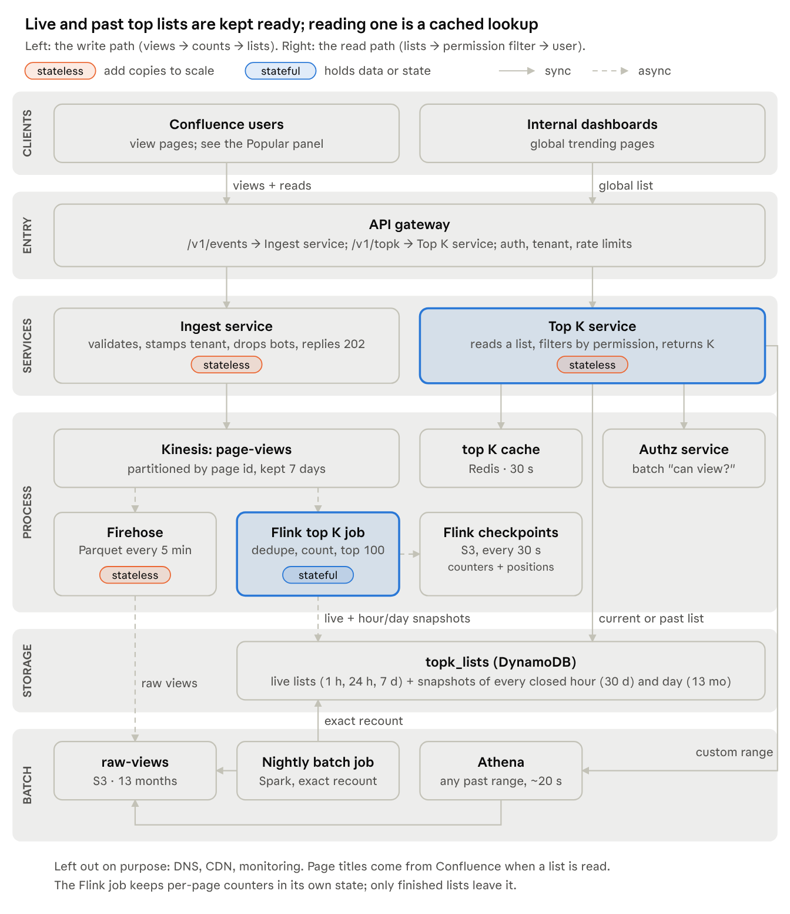

# Top K System (Most Viewed Pages) – System Design

2026-11-18 · Arnav Jain

## 1. Basics and requirements

A **top K** system answers "what are the K most popular things right now?". Here: the **most viewed Confluence pages** (and, with the same machinery, most viewed Jira issues), for a space, a whole site, or all of Atlassian, over the last hour, day or week. Example: the "Popular" list on a Confluence space home, or a "trending this week" panel.

Counting views is easy; the hard parts are **doing it continuously for millions of pages**, for **sliding time windows**, and **only showing pages the viewer is allowed to see**.

**The words you need:**

| Word                 | Meaning                                                                                      | Example                                            |
|----------------------|----------------------------------------------------------------------------------------------|----------------------------------------------------|
| K                    | How many top items we return                                                                 | top 10                                             |
| Scope                | The group the ranking is over                                                                | space `ENG`, site `acme`, or global                |
| Window               | The time range counted                                                                       | last 1 h, 24 h, 7 d                                |
| Tumbling window      | Fixed, non-overlapping buckets                                                               | 10:00–10:01, 10:01–10:02                           |
| Sliding window       | "The last 24 hours", moving every minute                                                     | at 10:05 it's yesterday 10:05 → now                |
| Heap (min-heap)      | A structure that keeps the K biggest items cheaply                                           | holds the current top 100, smallest on top         |
| Heavy hitter         | An item with a large share of all events                                                     | a viral all-company announcement                   |
| Count-Min Sketch     | A small fixed-size table that estimates counts for any number of items, never under-counting | 4 rows × 1M counters estimates views for all pages |
| Exact vs approximate | Exact = every count is right; approximate = small known error for much less memory           | per-space top K exact; global trending approximate |
| Unique view          | One person viewing a page counts once per 30 minutes, however often they refresh             | Ravi refreshes 20 times = 1 view                   |

### Functional

1.  `topK(scope, window, k)`: top K pages by views for a **space**, a **site**, or **global** (internal), for **1 h, 24 h, 7 d** windows; K up to 100.

2.  **Fresh:** the lists reflect views within about a minute.

3.  **Permission-aware:** a user only sees pages they can view; restricted pages never appear in someone else's list, not even as a count.

4.  **Fair counting:** a refresh storm or a bot doesn't make a page "popular": unique viewers per 30 minutes; known bots excluded.

5.  **Show counts:** each item has its view count for the window ("1,240 views this week").

6.  Same design for other metrics (most edited, most commented, most viewed issues) by changing the event type.

<!-- -->

7.  **Past top K, as well as current:**

    - The final top 100 of **any past hour** (last 30 days) and **any past day** (last 13 months), in one fast lookup: "top pages in ENG yesterday 15:00–16:00", "top pages on Nov 3".

    - The top K for **any custom past range** ("Nov 3–9", "October"), computed exactly from raw events in about 20 seconds and then cached.

### Non-functional

| Need          | Target                                                                                                | Why                                                    |
|---------------|-------------------------------------------------------------------------------------------------------|--------------------------------------------------------|
| Query latency | p99 \< 100 ms                                                                                         | Shown on page loads                                    |
| Freshness     | \< 1 min for 1 h; \< 5 min for 24 h / 7 d                                                             | "Trending" must feel live                              |
| Accuracy      | Per-space and per-site lists **exact** for 24 h / 7 d; global list may be approximate (± small error) | Customers compare numbers; global trending is internal |
| Scale         | ~70K views/s at peak, ~200M pages viewed per day                                                      | All Confluence traffic                                 |
| Availability  | 99.9%; if top K is down, pages still work (the panel just hides)                                      | It's a nice-to-have widget, not the core product       |
| Multi-tenant  | One site's counts never mix with another's                                                            | Isolation                                              |

### Out of scope

- Personalised recommendations ("pages you might like"): needs a model, not counting.

- Full analytics dashboards over any time range: the real-time analytics design.

- Search ranking.

## 2. Quick traffic estimate

**Assumptions:** 100M daily users, ~20 page views each; ~40% of raw views are repeats within 30 minutes (refreshes, tab switches); ~2B Confluence pages exist, ~200M are viewed on a given day, ~30M in a given hour; ~20M spaces, ~200K sites; the "Popular" panel appears on ~5% of page loads.

| What                                | Math                                                      | Average               | Peak (×3) |
|-------------------------------------|-----------------------------------------------------------|-----------------------|-----------|
| Raw view events                     | 100M × 20 = 2B/day                                        | ~23K/s                | ~70K/s    |
| Counted views (after 30-min dedupe) | ~60% of raw                                               | ~14K/s                | ~42K/s    |
| Distinct pages with views           | per hour / per day / per week                             | ~30M / ~200M / ~600M  |           |
| Top K reads                         | 2B × 5% = 100M/day                                        | ~1.2K/s               | ~4K/s     |
| Lists to keep up to date            | (space + site) × 3 windows; only scopes with recent views | ~5M active scopes × 3 |           |

**What this tells us:**

- **Writes (views) are ~10x more than reads**, and reads ask for the same few lists over and over. So compute the lists continuously as views arrive, and make reads a cached lookup.

- **Hundreds of millions of distinct pages per week** is too many to sort on every request, but it's fine to keep a counter per active page spread over many machines.

- **Most scopes are tiny.** A typical space has a few hundred pages with views; only a few have tens of thousands. Exact counting per space is affordable; it's only the **global** list that needs approximation tricks.

## 3. API

| Endpoint              | Who calls it                    | What it does                                                       |
|-----------------------|---------------------------------|--------------------------------------------------------------------|
| `POST /v1/events`     | Confluence web/mobile, servers  | A batch of view events (the analytics ingest endpoint)             |
| `GET /v1/topk`        | Confluence UI ("Popular" panel) | Top K for a scope and window, filtered by the caller's permissions |
| `GET /v1/topk/global` | Internal dashboards             | Approximate global trending                                        |

**A view event**

``` json
POST /v1/events
{ "events": [ { "eventId": "ev_91c", "type": "page_view", "tenant": "acme", "space": "ENG",
                "page": "pg_81c2", "user": "u_ravi", "ts": "2026-11-18T10:02:03Z", "client": "web" } ] }

202 Accepted
```

**Read the top 5 pages of space ENG for the last 7 days**

``` json
GET /v1/topk?scope=space:ENG&window=7d&k=5

200 OK
{
  "scope": "space:ENG", "window": "7d", "asOf": "2026-11-18T10:05:00Z",
  "items": [
    { "page": "pg_81c2", "title": "Onboarding guide",  "views": 1240 },
    { "page": "pg_17aa", "title": "On-call runbook",   "views": 982 },
    { "page": "pg_4410", "title": "Q4 roadmap",        "views": 750 },
    { "page": "pg_0912", "title": "Release notes 4.2", "views": 611 },
    { "page": "pg_9f03", "title": "Coding standards",  "views": 540 }
  ]
}
```

`asOf` says how fresh the list is. Pages the caller can't view are already removed (Flow C), and the list is still 5 long because we store 100 per scope and filter.

**Past top K: a closed hour or a closed day**

``` json
GET /v1/topk?scope=space:ENG&hour=2026-11-17T15&k=5
GET /v1/topk?scope=space:ENG&day=2026-11-03&k=5

200 OK
{ "scope": "space:ENG", "period": "hour:2026-11-17T15", "final": true,
  "items": [ { "page": "pg_4410", "title": "Q4 roadmap", "views": 212 }, … ] }
```

**Past top K: any custom range**

``` json
GET /v1/topk?scope=space:ENG&from=2026-11-03&to=2026-11-09&k=10

202 Accepted
{ "queryId": "q_7f2", "status": "running", "poll": "/v1/topk/queries/q_7f2" }

GET /v1/topk/queries/q_7f2     (about 20 s later)
200 OK
{ "status": "done", "items": [ … 10 items … ] }
```

Custom ranges run as a query over the raw events, so the API answers `202` and the UI polls; the same range asked again is served from cache.

## 4. HLD (high-level design)



Read it in two halves. **Left = write path:** every view flows Ingest → Kinesis → Flink, which keeps the counters and every minute writes the finished top-100 lists to `topk_lists`. **Right = read path:** the Top K service reads one list, removes pages the viewer can't see, and returns K. The two meet only at `topk_lists`, so heavy view traffic never slows down reads.

**The key idea:** never sort millions of pages when someone asks. Keep the answer **ready**: Flink updates small top-100 lists continuously, and a read is a single key lookup (usually from cache).

**What each part does**

- **Clients:** Confluence users send view events and load the "Popular" panel; internal dashboards read the global trending list.

- **API gateway:** `/v1/events` to Ingest, `/v1/topk` to the Top K service; auth, tenant and rate limits.

- **Ingest service** (stateless): checks events, stamps the tenant, drops known bots and crawlers by user agent, writes to Kinesis, replies `202`.

- **Kinesis: page-views:** partitioned by page id, kept 7 days so Flink can replay.

- **Flink top K job** (stateful), in two steps (Deep dive 8.3):

  1.  **Per page:** drop repeat views by the same user within 30 minutes; keep the page's counts in **minute buckets** for the last hour, **hour buckets** for the last day, **day buckets** for the last week.

  2.  **Per scope:** each page sends its new window totals to the instance owning its space (and its site); that instance keeps a top-100 per window and writes it to `topk_lists` once a minute.

- **Flink checkpoints** (S3): counters, dedupe state and Kinesis positions every 30 s, so a crash loses nothing.

- **`topk_lists`** (DynamoDB): one item per scope and window, holding the top 100 pages with counts. Small (~5 KB) and overwritten in place.

- **Top K service** (stateless): reads the list (from the cache, else DynamoDB), asks the **Authorization service** in one batch call which of the 100 the user can view, fetches titles, returns the first K.

- **top K cache** (Redis, 30 s): the same space's list is read by many people; only one read per 30 s reaches DynamoDB.

- **Firehose → `raw-views` (S3):** every raw view as Parquet.

- **Nightly batch job** (Spark): recounts yesterday exactly from S3 and overwrites the 24 h / 7 d lists if the streaming result was off (late events, a Flink bug).

**Current and past, three ways to answer**

| Question                            | Answered from                                                            | Speed            |
|-------------------------------------|--------------------------------------------------------------------------|------------------|
| Top pages **now** (1 h, 24 h, 7 d)  | Live list in `topk_lists`, rewritten every minute                        | ~5 ms (cache)    |
| Top pages of a **past hour or day** | Snapshot item in `topk_lists`, written once when that hour or day closed | ~10 ms           |
| Top pages of **any past range**     | **Athena** query over `raw-views` in S3, exact, then cached              | ~20 s first time |

- **Snapshots:** when an hour closes (and when a day closes), the Flink step-2 instance writes that period's **final** top 100 as a **new item** (`hour#2026-11-17T15`, `day#2026-11-17`) next to the live one. Live items are overwritten; snapshot items never change, except that the nightly batch job replaces day snapshots with exact recounts.

- **Athena** (new in the diagram): for ranges that aren't a single hour or day, the Top K service runs a SQL query over the Parquet files of that tenant, scope and dates, and caches the answer.

| Box                         | Stateless or stateful           | Talks to                                         | Why it exists                                                        |
|-----------------------------|---------------------------------|--------------------------------------------------|----------------------------------------------------------------------|
| API gateway                 | stateless                       | Ingest service, Top K service                    | Auth, tenant, routing                                                |
| Ingest service              | stateless                       | Kinesis                                          | Validates and buffers views; never blocks the page                   |
| Kinesis: page-views         | stateful                        | Flink, Firehose                                  | Durable buffer, replay for 7 days                                    |
| Flink top K job             | stateful                        | Flink checkpoints, `topk_lists`                  | Dedupe, sliding-window counts, top 100 per scope, hour/day snapshots |
| Flink checkpoints (S3)      | stateful                        | —                                                | Recovery without losing or double-counting views                     |
| `topk_lists` (DynamoDB)     | stateful                        | —                                                | Live lists + snapshots of past hours and days                        |
| Top K service               | stateless                       | top K cache, Authz service, `topk_lists`, Athena | Fast reads of current and past lists, permission filtering           |
| top K cache (Redis)         | stateful                        | —                                                | Absorbs repeated reads of the same list                              |
| Authz service               | stateless                       | (its own stores)                                 | Removes pages the viewer can't see                                   |
| Firehose → `raw-views` (S3) | Firehose stateless, S3 stateful | —                                                | Full history for exact recounts and custom ranges                    |
| Nightly batch job           | stateless                       | `raw-views`, `topk_lists`                        | Corrects live 7 d data and day snapshots exactly                     |
| Athena                      | stateless (serverless SQL)      | `raw-views`                                      | Exact top K for any past range                                       |

**Left out on purpose** (say them out loud if asked): DNS, CDN, monitoring; the Confluence page service that provides titles (called by the Top K service); the global heavy-hitters variant (Flow F), which runs inside the same Flink job.

## 5. Flows

Running example: site `acme`, space `ENG`, page `pg_81c2` "Onboarding guide". Ravi and Asha work there; Bob is a contractor who can't see restricted pages.

### Flow A: One view, from click to counter

1.  Ravi opens `pg_81c2` at 10:02:03. The page loads normally; the browser sends a `page_view` event in the background (batched with others).

2.  **Ingest:** checks it, stamps `tenant: acme`, drops it if the user agent is a known crawler, writes it to Kinesis (partition = hash of the page id) → `202`.

3.  **Flink step 1 (instance owning `pg_81c2`):**

    - **Dedupe:** has `u_ravi` viewed `pg_81c2` in the last 30 minutes? State `seen:pg_81c2:u_ravi` (expires after 30 min). No → count it. Yes → ignore.

    - **Count:** add 1 to the page's current **minute bucket** (10:02).

4.  That's all per event: one state lookup and one increment. Views arriving 40,000 times a second turn into small counter updates.

### Flow B: Keeping the top 100 up to date (every minute)

The page's counters, kept by the instance that owns the page:

    pg_81c2  minute buckets (last 60):  … 10:00=3, 10:01=5, 10:02=4
             hour buckets   (last 24):  … 08:00=40, 09:00=51
             day buckets    (last 7):   Nov 12=180, … Nov 17=210

At 10:03:00 (the minute closes):

1.  **Roll the windows forward:**

    - 1 h total = sum of the last 60 minute buckets. The bucket from 09:02 falls out, 10:02 comes in.

    - 24 h total = the last 23 full hours + the current hour so far.

    - 7 d total = the last 6 full days + today so far. This is a few additions per page, not a re-scan of events.

2.  **Send only changes:** if any total changed, step 1 sends `(space:ENG, pg_81c2, 1h=47, 24h=410, 7d=1240)` to the instance that owns `space:ENG` (and the same to the owner of `site:acme`).

3.  **Flink step 2 (instance owning `space:ENG`):** keeps a **top-100 heap per window**. A page's new total either updates its entry, enters the heap (if bigger than the 100th), or is ignored.

4.  Writes the three lists for `space:ENG` to `topk_lists`, once a minute and only if they changed. Same for `site:acme`.

Why it stays exact: a page's totals are always computed by **one** instance from **all** its views, and step 2 always receives the page's **full** total, not a partial count (Deep dive 8.3).

### Flow C: Bob opens the space home (read with a permission filter)

1.  The Popular panel calls `GET /v1/topk?scope=space:ENG&window=7d&k=5`.

2.  **Top K service:** cache key `topk:acme:space:ENG:7d` → hit (someone loaded it in the last 30 s) → 100 page ids with counts. Miss → read `topk_lists`, then cache.

3.  **Permission filter:** one call `check-batch(view, user:bob, [100 page ids])` to the Authz service. 7 of them are under a restricted parent Bob can't see; they're removed.

4.  Take the first 5 of the remaining 93, fetch their titles from Confluence (one batch call, cached), return.

The list is shared by everyone; **the filter is per user**. That's why we store 100 but show 5: there are always enough visible pages left.

### Flow D: The nightly exact recount

1.  At 01:00 a Spark job reads yesterday's `raw-views` files from S3.

2.  It applies the same rules (bots out, one view per user per page per 30 min) and counts exactly per page.

3.  It rebuilds the 24 h and 7 d lists per space and site as of midnight and compares them with what Flink wrote.

4.  Where they differ (late events that arrived after Flink closed a bucket, or a bug), it overwrites the day bucket totals Flink uses for the 7 d window, so the next minute's lists are exact again.

This is a small **lambda** pattern: streaming for freshness, batch for a guaranteed-correct history.

### Flow E: A page goes viral

The CEO posts "All-hands moved to Friday" in `space:ALL`; 50,000 people open it within 10 minutes.

1.  All its views go to the Flink instance that owns that page: ~100 views/s, easy for one instance (counting is one increment).

2.  Dedupe state grows by 50,000 `seen:` entries for 30 minutes: a few MB.

3.  Step 2 receives one update **per minute** for that page (not per view), so the space and site owners aren't overloaded.

4.  Reads: everyone at Acme loads the same `space:ALL` list; the 30 s Redis cache means one DynamoDB read per 30 s.

If a single page ever got more views than one instance can count, step 1 would split its counting across a few sub-keys (`pg_x#0`…`#3`) and add them up before step 2 (Deep dive 8.5).

### Flow F: Global trending (approximate)

Internal dashboards want "top 100 pages across all of Atlassian, last hour". Keeping exact counts for all pages globally in one place would mean one instance receiving every page's updates.

1.  Each step-1 instance keeps a **Count-Min Sketch** and a local top-100 for the hour over the pages it owns.

2.  Every minute it sends its local top-100 (with counts) to one global aggregator.

3.  The aggregator merges ~200 lists of 100 and keeps the global top 100.

Because each page lives on exactly one instance, merging local top lists is exact for pages that are in some local top 100. A page that is \#101 everywhere could be missed, which is acceptable for an internal "trending" view (Deep dive 8.4). The sketch is used to estimate counts for pages just outside the lists.

### Flow G: An hour closes, and its top K is saved

| Time           | What happens                                                                                                                                            |
|----------------|---------------------------------------------------------------------------------------------------------------------------------------------------------|
| 15:00–15:59    | Step 1 counts each page's views into the 15:00 hour bucket (and minute buckets), as in Flow A                                                           |
| 16:00:30       | The 15:00 hour closes (after a 30 s wait for slightly late events). Each page sends its **final** 15:00 count to its space's and site's step-2 instance |
| 16:00:31       | Step 2 builds a separate "hour 15:00" top 100 from those final counts (a one-off heap, not the live 1 h one)                                            |
| 16:00:32       | Writes `PK acme#space:ENG, SK hour#2026-11-18T15` = that top 100, `final: true`, TTL 30 days. Never updated again                                       |
| 00:00:30       | Same for the whole day: `SK day#2026-11-18`, TTL 13 months                                                                                              |
| 01:00 next day | The nightly batch job recounts the day exactly from S3 and **replaces** the day snapshot if anything differs (`source: batch`)                          |

Only scopes with at least 20 views in that hour get hourly snapshots (quiet spaces would be thousands of near-empty lists). Daily snapshots are kept for every scope with views.

### Flow H: Reading a past hour or day

1.  The UI asks `GET /v1/topk?scope=space:ENG&day=2026-11-03&k=5`.

2.  Top K service: cache, else `GetItem(PK acme#space:ENG, SK day#2026-11-03)`. One item, ~10 ms.

3.  Same permission filter as Flow C (today's permissions, applied to the past list), titles, first 5.

4.  Past snapshots never change, so they can be cached for hours, not 30 s.

### Flow I: A custom past range ("Nov 3–9")

A week from Monday to Sunday isn't a stored snapshot, and adding up seven daily top-100 lists would be **wrong** (a page ranked \#101 every day could beat a page in the weekly top 10; Deep dive 8.8). So it's computed exactly:

1.  `GET /v1/topk?scope=space:ENG&from=2026-11-03&to=2026-11-09` → `202` with a query id.

2.  The Top K service starts an Athena query:

``` sql
SELECT page, COUNT(*) AS views
FROM raw_views_deduped
WHERE tenant = 'acme' AND space = 'ENG'
  AND date BETWEEN '2026-11-03' AND '2026-11-09'
GROUP BY page ORDER BY views DESC LIMIT 150;
```

3.  Only the partitions for those dates and that tenant are read (Parquet partitions + column pruning): a few hundred MB, ~20 s.

4.  The result is stored as a snapshot-like item (`SK range#2026-11-03#2026-11-09`, TTL 7 days) so the same range is instant next time; then filtered by permission and returned.

`raw_views_deduped` is a daily table the nightly batch job writes (same 30-minute dedupe rule), so Athena doesn't redo the dedupe.

## 6. Data model

**`topk_lists`** (DynamoDB): one item per scope and window.

| Attribute         | Example                                                          | Note                                                                        |
|-------------------|------------------------------------------------------------------|-----------------------------------------------------------------------------|
| PK                | `acme#space:ENG`                                                 | tenant + scope (`space:…`, `site`, or `global` for internal)                |
| SK, live lists    | `live#1h`, `live#24h`, `live#7d`                                 | overwritten every minute                                                    |
| SK, hour snapshot | `hour#2026-11-18T15`                                             | written once when the hour closes; TTL 30 days                              |
| SK, day snapshot  | `day#2026-11-18`                                                 | written when the day closes, replaced by the nightly recount; TTL 13 months |
| SK, custom range  | `range#2026-11-03#2026-11-09`                                    | result of an Athena query; TTL 7 days                                       |
| items             | `[{page: pg_81c2, views: 1240}, {page: pg_17aa, views: 982}, …]` | up to 100 (150 for ranges), sorted                                          |
| as_of, final      | `2026-11-18T10:03:00Z`, `false`                                  | `final: true` on closed hours and days                                      |
| source            | `stream`, `batch` or `athena`                                    | who produced it                                                             |

All of a scope's lists share a PK, so "show me the last 24 hourly snapshots of ENG" is one query: `PK = acme#space:ENG AND SK BETWEEN hour#2026-11-17T16 AND hour#2026-11-18T15`.

Items are small (~100 × 40 B ≈ 4 KB) and simply overwritten, so there is no read-modify-write and no conflict between writers.

**Flink state** (per instance, in RocksDB, backed up by checkpoints)

| State          | Key                        | Value                   | Lives                                     |
|----------------|----------------------------|-------------------------|-------------------------------------------|
| Dedupe         | `seen:acme:pg_81c2:u_ravi` | `1`                     | 30 min (timer deletes it)                 |
| Minute buckets | `cnt:acme:pg_81c2`         | ring of 60 counters     | while the page had views in the last hour |
| Hour buckets   | same key                   | ring of 24 counters     | while views in the last day               |
| Day buckets    | same key                   | ring of 7 counters      | while views in the last week              |
| Scope heaps    | `heap:acme:space:ENG:7d`   | top 100 `(page, total)` | while the scope has views in the window   |

A ring of buckets means: one counter per minute (or hour, or day); when time moves on, the oldest is reset and reused. The window total is the sum of the ring.

**`raw-views`** (S3, Parquet)

    s3://raw-views/date=2026-11-18/hour=10/tenant_bucket=17/part-0042.parquet
      columns: event_id, tenant, space, page, user, ts, client

**top K cache** (Redis)

| Key                      | Value                      | Expiry |
|--------------------------|----------------------------|--------|
| `topk:acme:space:ENG:7d` | the `items` list + `as_of` | 30 s   |

## 7. Storage and memory estimate

| Store                   | Math                                                                                                                                         | Size                                                     |
|-------------------------|----------------------------------------------------------------------------------------------------------------------------------------------|----------------------------------------------------------|
| Flink: page counters    | ~30M pages with views in the last hour × ~400 B (all three rings) + ~570M more pages with views this week × ~150 B (hour and day rings only) | ~100 GB, spread over ~100 instances (~1 GB each)         |
| Flink: dedupe           | ~23K views/s × 1,800 s × ~40 B                                                                                                               | ~1.7 GB (~5 GB at peak)                                  |
| Flink: scope heaps      | ~5M active scopes × 3 windows × ~20 entries on average × ~20 B                                                                               | ~6 GB                                                    |
| `topk_lists` (DynamoDB) | ~15M items × ~1 KB average                                                                                                                   | ~15 GB; ~8K writes/s (only changed lists, once a minute) |
| top K cache (Redis)     | ~1M hot lists × ~4 KB                                                                                                                        | ~4 GB                                                    |
| `raw-views` (S3)        | 2B events/day × ~30 B (Parquet, compressed)                                                                                                  | ~60 GB/day, ~24 TB for 13 months                         |
| Flink checkpoints (S3)  | incremental, last 3 kept                                                                                                                     | ~150 GB                                                  |

**Past top K adds:**

| Store                    | Math                                                           | Size                             |
|--------------------------|----------------------------------------------------------------|----------------------------------|
| Hourly snapshots         | ~1M scopes with ≥ 20 views in an hour × 24 h × ~2 KB × 30 days | ~1.5 TB                          |
| Daily snapshots          | ~5M scopes × ~2 KB × 395 days                                  | ~4 TB                            |
| Custom range results     | cached a week; a few thousand a day                            | \< 1 GB                          |
| `raw_views_deduped` (S3) | ~1.2B rows/day × ~25 B                                         | ~30 GB/day, ~12 TB for 13 months |
| Athena scans             | a week of one space: a few hundred MB per query                | cents per query                  |

Keeping every past hour forever would be ~18 TB a year; that's why hourly snapshots expire after 30 days and only busy scopes get them, while daily ones are kept 13 months.

**What this tells us:**

- **Exact per-page counting fits easily** when spread across machines: ~1 GB of state per instance.

- **The trick that keeps it small** is buckets instead of events: a page viewed 10,000 times this week still needs only 91 counters.

- **Reads are almost free:** a few GB of cache absorbs nearly all the read traffic.

- **Global exact top K is the only expensive version**, which is why it's approximate (Flow F).

## 8. Deep dives

What the interviewer is most likely to push on.

### 8.1 Three ways to build top K

| Approach                       | How                                                                         | Freshness                    | Accuracy                               | Cost                | Use here                       |
|--------------------------------|-----------------------------------------------------------------------------|------------------------------|----------------------------------------|---------------------|--------------------------------|
| Query the raw data             | `SELECT page, COUNT(*) … GROUP BY page ORDER BY 2 DESC LIMIT 10` on request | seconds to minutes per query | exact                                  | huge at 70K reads/s | no (only for ad-hoc analysis)  |
| Batch job (MapReduce / Spark)  | Count everything every hour or night                                        | hours                        | exact                                  | cheap               | yes, as the nightly correction |
| **Streaming counters + heaps** | Count as events arrive; keep top lists ready                                | ~1 minute                    | exact per scope (approximate globally) | moderate            | yes, the main path             |

The answer most interviewers want: **streaming for freshness, batch for correctness** (Flow D), and approximation only where exactness is too expensive (global).

### 8.2 Sliding windows without storing events

- A sliding "last 24 hours" window can't be computed by keeping one counter (you'd never know what to subtract) and storing every event is too much.

- **Buckets:** keep a counter per minute / hour / day, and add up the ones inside the window. When a bucket falls out of the window, reset it.

- **Precision trade-off:** the 24 h window moves in hour steps (plus the current hour), so "last 24 h" is really "last 23–24 h". For a popularity list that's fine; it's what keeps memory small.

- **Late events** (a phone offline for 10 minutes): accepted into their correct bucket if the bucket is still in the window; otherwise counted by the nightly batch.

### 8.3 Why two steps (per page, then per scope)

- Kinesis is partitioned by **page**, so all views of a page arrive at one instance, which can dedupe and count them exactly.

- A space's pages are spread over all instances, so no single instance can see the space's ranking. Step 2 re-groups by **scope** (`keyBy(space)`): every page sends its **full** window totals to the instance that owns its space.

- Because each message carries a full total ("`pg_81c2` = 1,240"), not "+1", step 2 only needs to keep the current top 100. A page outside it gets in as soon as its next total beats the 100th.

- Sending only when a total changed, at most once a minute per page, keeps step 2's input small even for busy spaces.

- **Removal subtlety:** in sliding windows a total can also **go down** (old buckets fall out). Step 2 handles this by keeping a slightly larger heap (top 150) and rebuilding a scope's heap from its pages' latest totals if it falls below 100 entries while the scope has more pages.

### 8.4 Approximate top K: Count-Min Sketch and Space-Saving

- **Count-Min Sketch:** a table of d rows × w counters (e.g. 4 × 1M). Each item increments one counter per row (chosen by d hash functions); its estimate is the **minimum** of its d counters. It never under-counts; it over-counts by at most a small fraction of all events, with high probability. Memory is fixed no matter how many distinct pages exist.

- **CMS + min-heap:** on each event, update the sketch and, if the estimate beats the heap's smallest, put the item in the heap. Gives an approximate top K in a few MB.

- **Space-Saving:** keeps exactly K counters; a new item replaces the smallest counter and inherits its count. Very small, good at finding true heavy hitters.

- **When to use:** a single stream with huge numbers of distinct items and not enough memory (our global list, or a CDN's top URLs). For per-space lists we can afford exact counts, and customers expect the numbers to be right.

### 8.5 Hot pages and hot spaces

- **Hot page:** counting is one increment, so one instance handles thousands of views/s for a single page. If needed, split the key (`pg_x#0..3` by hash of the user), count separately, and add the parts before step 2.

- **Hot space** (`space:ALL` at a 50,000-person company): step 2 gets one update per page per minute, not per view, so even a space with 100,000 active pages is ~1,700 updates/s on one instance. For bigger ones, pre-aggregate a local top 150 per step-1 instance and merge.

- **Hot reads:** cached for 30 s; the list for one space is the same for everyone, only the permission filter differs.

### 8.6 Counting fairly

- **Unique views:** one count per user per page per 30 minutes (Flink state with a 30-minute timer).

- **Bots:** known crawlers dropped at ingest by user agent; service accounts excluded; a per-user cap (a user can't add more than 1 view per page per 30 min anyway).

- **Exactly-once results:** Flink checkpoints counters and Kinesis positions together, and `topk_lists` writes are overwrites, so replays after a crash don't double count.

### 8.7 Permissions

- Lists are computed **without** permissions (one list per scope, shared) and filtered **per user at read time** with one batch call. Computing a list per user would be millions of lists.

- Restricted pages never leak: the counts of a page Bob can't see are never returned to Bob.

- If many top pages are restricted (a mostly-private space), 100 may not leave K visible; then the service reads the next list page (we store up to 150) or returns fewer items.

### 8.8 Past top K: store snapshots or recompute?

| Option                                                | Fast?           | Exact?                         | Cost                            | Used for                                          |
|-------------------------------------------------------|-----------------|--------------------------------|---------------------------------|---------------------------------------------------|
| **Snapshot each closed hour / day**                   | yes, one lookup | yes for that exact hour or day | small, with TTLs                | "top pages yesterday 15:00", "top pages on Nov 3" |
| Merge stored snapshots into a longer range            | yes             | **no**                         | —                               | never                                             |
| **Recompute from raw events** (Athena)                | ~20 s           | yes                            | pay per query                   | any custom range                                  |
| Keep per-page counts per hour forever, sum on request | medium          | yes                            | large (every page × every hour) | not worth it for this product                     |

**Why merging snapshots is wrong:** day 1 top list has A=100, B=90, … \#100 = 20; page Z has 19 views every day, so it's in no daily list. Over 7 days Z has 133 views, but merging the seven lists gives Z = 0 and might rank a page with 120 above it. Snapshots answer "what was the list **then**"; anything spanning several periods is recomputed.

**Permissions on past lists:** filtered with **today's** permissions at read time. If a page became restricted last week, it disappears from old lists too, which is what admins expect.

## 9. Wrap-up

**30-second summary**

> "View events go through an Ingest service into Kinesis, partitioned by page. A Flink job counts in two steps. Step one, keyed by page, drops repeat views by the same user within 30 minutes and keeps per-page counters in minute, hour and day buckets, so 1-hour, 24-hour and 7-day sliding totals are a few additions, not a scan of events. Step two, keyed by space and by site, receives each page's full totals at most once a minute and keeps a top-100 heap per window, writing the finished lists to DynamoDB as small overwritten items. Reads are a cached lookup of one list, filtered per user with one batch permission check, so restricted pages never appear. Firehose keeps raw views in S3, and a nightly Spark job recounts exactly and corrects the lists. Global trending uses per-instance top lists merged centrally, with a Count-Min Sketch for estimates, because exact global counts would put every page on one machine. For the past, each closed hour and day writes its final top 100 as a new snapshot item (hours kept 30 days, days 13 months), and any custom range is computed exactly with Athena over the raw events, never by merging snapshot lists."

| Decision            | Choice                                                                | Why                                                   |
|---------------------|-----------------------------------------------------------------------|-------------------------------------------------------|
| When to compute     | Continuously, as views arrive                                         | Reads are a lookup, not a sort over millions of pages |
| Sliding windows     | Minute / hour / day buckets per page                                  | Small memory; windows move without storing events     |
| Exactness           | Exact per space and site; approximate global                          | Customers compare numbers; global is internal         |
| Parallelism         | Two keyed steps: per page, then per scope                             | Exact counts without one machine seeing everything    |
| Fair counting       | One view per user per page per 30 min, bots dropped                   | Refreshes and crawlers can't make a page "popular"    |
| Current answers     | Live `topk_lists` items, top 100, overwritten each minute             | Tiny, no conflicts, fast to read                      |
| Past hours and days | Snapshot items written once when the period closes (TTL 30 d / 13 mo) | "What was popular then" in one lookup                 |
| Custom past ranges  | Athena over deduped raw events, result cached                         | Exact; merging snapshots would be wrong               |
| Permissions         | Shared lists, filtered per user at read time with today's permissions | One list per scope instead of per user                |
| Correctness         | Nightly batch recount from S3 replaces day snapshots                  | Fixes late events and bugs (lambda pattern)           |
| Global trending     | Local top lists + Count-Min Sketch, merged                            | Bounded memory                                        |

**If they push further:** "trending" instead of "most viewed" (rank by growth vs. the usual rate for that page), time-decayed scores (recent views count more), per-user personalised top lists, top K over any custom time range (would need an OLAP store like ClickHouse or Pinot), and showing "rising" pages with an anomaly score.
