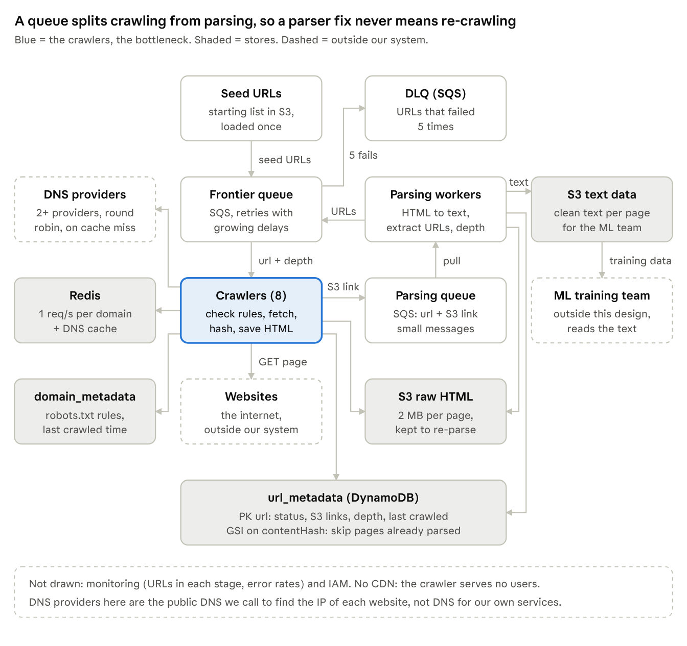

# Web Crawler for LLM Training — System Design

2026-11-22 · Arnav Jain

Based on the Hello Interview walkthrough: crawl 10B pages in 5 days and store their text for training a large language model.

## 1. Requirements

The crawler starts from seed URLs and fetches all 10B pages on the web within 5 days. It extracts each page's text and stores it in S3 for the ML team. Training the model, and even tokenising the text, is not our job: we stop once the text is stored.

### Words used in this doc

| Word | What it means | Example |
| --- | --- | --- |
| Seed URL | A starting URL we are given | `https://acme.com` |
| Frontier | The set of URLs not yet crawled; here it is a queue | Starts with 1M seed URLs and grows as links are found |
| Crawler | A worker that downloads one page and saves the HTML | Fetches `https://acme.com/docs` and saves 2 MB of HTML |
| Parsing worker | A worker that turns saved HTML into text and finds the links in it | Extracts "Getting started. Install the Acme CLI…" and 120 links |
| robots.txt | A file each site publishes saying what bots may crawl and how fast | `Disallow: /private`, `Crawl-delay: 10` |
| Crawl delay | Seconds to wait between two requests to one domain | 10 s for `acme.com` |
| Rate limiter | A counter that says "too fast, wait" | At most 1 request per second to `acme.com` |
| Jitter | A small random extra wait so retries don't all fire at once | Wait 1 s + a random 0 to 500 ms |
| Visibility timeout (SQS) | While one worker holds a message, it is hidden from other workers for this time | 30 s; if the worker dies, the message reappears |
| Exponential backoff | Each retry waits longer than the last | 30 s, 2 min, 5 min, 15 min |
| DLQ (dead letter queue) | A queue for messages that failed too many times | `https://old-shop.example` fails 5 times and goes to the DLQ |
| Content hash | A fingerprint of a page's content; same hash = same content | A mirror of Wikipedia gives the same hash as the original |
| GSI | A DynamoDB secondary index that lets us look rows up by another column | Look up `url_metadata` by `contentHash` |
| Depth | How many links away from a seed a URL is | Seed = 0, a link on it = 1 |
| Crawler trap | A site that generates endless links with no real content | A calendar with "next day" links forever |

### Functional

1. Crawl the web, starting from a set of seed URLs and following links.
2. Extract the text from each page and store it.

### Non-functional

- **Fault tolerant:** a crash must not lose progress; crawling resumes where it stopped.
- **Polite:** obey robots.txt, and send no more than 1 request per second to a domain, so we never overload a site.
- **Scalable:** handle 10B pages, about 2 MB each on average.
- **Efficient:** finish within 5 days, without crawling the same URL twice or parsing the same content twice.

### Assumptions agreed with the interviewer

- 10B pages, 2 MB average page size.
- The money budget is large ("unlimited within reason").
- The text goes to the ML team; tokenising and training are out of scope.

## 2. Traffic estimate

We must fetch about 23,000 pages a second for 5 days, which is about 370 Gbit/s of downloads. Network bandwidth, not CPU, decides how many crawlers we need. A crawler has no users, so the usual 100M DAU is replaced by "pages per second needed to finish in 5 days".

| Quantity | Math | Result |
| --- | --- | --- |
| Pages to crawl | Given | 10B |
| Time allowed | 5 days × 86,400 s | 432,000 s |
| Pages per second needed | 10B / 432,000 | about 23,000 pages/s |
| Download bandwidth | 23,000 × 2 MB | about 46 GB/s, about 370 Gbit/s |
| One crawler machine, in theory | 400 Gbit/s network card = 50 GB/s, / 2 MB | 25,000 pages/s |
| One crawler machine, in practice | About 30% of the card's speed (DNS, slow sites, rate limits, retries) | about 7,500 pages/s |
| Crawler machines | 23,000 / 7,500 | 4 machines, run 8 for 2× headroom |
| Parsing workers | Behind the crawlers, so they only need to keep up | Auto-scale on parsing-queue length |
| Links found | About 50 links per page × 23,000 | about 1.2M URL checks/s |

The video rounds this to 4 big machines. That number is very hand-wavy: in reality you would run a test crawl, measure pages per second per machine, and multiply. Deep dive 8.4 explains why the real number could be much higher.

## 3. Interface

There is no user-facing API. The system takes seed URLs in and puts text files out, with two queues carrying small messages in between.

### Input: seed URLs

A file in S3 that we load into the frontier queue once, at the start:

```text
s3://crawl-input/seeds.txt
https://acme.com
https://en.wikipedia.org
https://news.example.org
```

### Message on the frontier queue (SQS)

```json
{ "url": "https://acme.com/docs", "depth": 1 }
```

### Message on the parsing queue (SQS)

The message carries only the S3 link, not the 2 MB of HTML. Queue messages should be small (SQS allows up to 256 KB, Kafka 1 MB by default), and S3 is built for big objects. Putting the S3 link in the message also saves the parser a database read.

```json
{
  "url": "https://acme.com/docs",
  "s3HtmlLink": "s3://crawl-html/9f/3a/9f3a2c.html.gz",
  "depth": 1
}
```

### Output: text for the ML team

One file per page:

```json
s3://crawl-text/9f/3a/9f3a2c.json
{
  "url": "https://acme.com/docs",
  "crawledAt": "2026-11-22T10:02:11Z",
  "title": "Acme Docs",
  "text": "Getting started. Install the Acme CLI with one command…"
}
```

## 4. High-level design

The design is a two-stage pipeline joined by queues. Crawlers only download pages and save the HTML, which is the slow and error-prone part. Parsing workers turn the saved HTML into text and feed new URLs back to the frontier.



### Start simple, then split

The first version in the interview is one queue, one worker and S3. The worker pulls a URL, fetches the page, extracts the text, saves it and puts the links back on the queue. It meets the functional requirements, but if any step fails, all the work for that URL is lost. Fetching and parsing also can't be scaled separately, and nobody can see which stage a URL is in. So we split it into two stages with a queue in between. That is the diagram above.

### Following one URL through the system

1. The seed `https://acme.com` is loaded from S3 into the **frontier queue** (SQS) as `{url, depth: 0}`.
2. A **crawler** receives it. SQS hides the message from other crawlers for 30 s (the visibility timeout).
3. The crawler reads `acme.com` in **domain_metadata**. It's the first visit, so it fetches `https://acme.com/robots.txt` and saves the rules: `Disallow: /private`, `Crawl-delay: 10`.
4. It checks the path is allowed, that 10 s have passed since the last crawl of `acme.com`, and that the **Redis** rate limiter allows a request now.
5. It gets the IP from the Redis DNS cache. On a miss, it asks one of the **DNS providers** and caches the answer.
6. It downloads the page (2 MB of HTML) from the **website**.
7. It computes `contentHash = sha256(HTML)` and looks it up in the **url_metadata** GSI. If another URL already has this hash, the content was seen before: it records the hash and stops here.
8. Otherwise it saves the HTML to **S3 raw HTML**, updates url_metadata (`status = CRAWLED`, S3 link, hash), puts `{url, s3HtmlLink, depth}` on the **parsing queue**, and deletes the message from the frontier queue.
9. A **parsing worker** reads the message, downloads the HTML by its S3 link and extracts the text into **S3 text data**.
10. It extracts 120 links. For each new one (not already in url_metadata, depth ≤ 20), it inserts a row and puts `{url, depth: 1}` on the frontier queue. The loop repeats until the frontier is empty.
11. If a fetch keeps failing, SQS retries it with longer and longer delays. After 5 tries it moves the URL to the **DLQ**.

### Components

| Box | Stateless or stateful | Talks to | Why it exists |
| --- | --- | --- | --- |
| Seed URLs | Stateful (a file in S3) | Frontier queue | The starting point of the crawl |
| Frontier queue (SQS) | Stateful | Crawlers, parsing workers, DLQ | Holds URLs still to crawl; gives retries with growing delays and a DLQ out of the box |
| Crawlers (8 large machines) | Stateless | Frontier queue, Redis, domain_metadata, DNS providers, websites, S3 raw HTML, url_metadata, parsing queue | Do the slow, error-prone part only: fetch and save |
| Redis | Stateful (in memory) | Crawlers | Per-domain rate limit (1 request/s) and DNS cache |
| domain_metadata (DynamoDB) | Stateful | Crawlers | robots.txt rules and last crawled time per domain |
| DNS providers | External | Crawlers | Turn `acme.com` into an IP; 2 or more providers so one rate limit or outage doesn't stop us |
| Websites | External | Crawlers | The pages we download |
| S3 raw HTML | Stateful | Crawlers, parsing workers | Keeps the HTML, so a parser change means re-parsing, not re-crawling |
| url_metadata (DynamoDB) | Stateful | Crawlers, parsing workers | One row per URL; stops duplicate URLs and duplicate content |
| Parsing queue (SQS) | Stateful | Crawlers, parsing workers | Separates the 2 stages; carries small messages with an S3 link |
| Parsing workers | Stateless, auto-scaled | Parsing queue, S3 raw HTML, S3 text data, url_metadata, frontier queue | Turn HTML into text and find new URLs |
| S3 text data | Stateful | Parsing workers, ML team | The output of the whole system |
| DLQ (SQS) | Stateful | Frontier queue | Collects URLs that failed 5 times, so they stop wasting retries |

### Left out on purpose

- **Running JavaScript** to render pages built with React or Angular. It needs a headless browser and is much slower (see Wrap-up).
- **Recrawling.** This is a one-time 5-day crawl; continual updates are a push-further topic.
- **The smart scheduler** that orders URLs by domain. It's a good optimisation (deep dive 8.3) but adds complexity.
- **Monitoring and IAM.** Listed in the diagram's note, not drawn as boxes.

## 5. Flows

Six flows: crawling a page, parsing it, a site that is down, a crawler that dies, a domain asked too soon, and duplicate content.

### Flow A: Crawl one page

1. Crawler 3 receives `{url: "https://acme.com/docs", depth: 1}` from the frontier queue. For the next 30 s, no other crawler can see this message.
2. It reads `acme.com` from domain_metadata (Redis caches it). `/docs` is not under `Disallow: /private`, so it's allowed.
3. The last crawl of `acme.com` was at 10:02:00 and the crawl delay is 10 s. Now is 10:02:11, so 11 s have passed and it's OK.
4. The Redis rate limiter for `acme.com` shows 0 requests in the last second, so it's OK, and the count goes up by 1.
5. Redis DNS cache: `acme.com` is `93.184.216.34`, a hit.
6. `GET https://acme.com/docs` returns 200 with 2 MB of HTML.
7. Hash the HTML and look it up in the url_metadata GSI. It's not found, so the content is new.
8. Save the HTML to `s3://crawl-html/9f/3a/9f3a2c.html.gz`. Update url_metadata: `status = CRAWLED`, `s3HtmlLink`, `contentHash`, `lastCrawledAt`. Update domain_metadata: `lastCrawledAt = 10:02:11`.
9. Put `{url, s3HtmlLink, depth: 1}` on the parsing queue.
10. Delete the message from the frontier queue. This is the "done" signal; without it, the message reappears after 30 s.

### Flow B: Parse one page

1. A parsing worker receives `{url, s3HtmlLink, depth: 1}`. No database read is needed, because the S3 link is in the message.
2. It downloads the HTML from S3 and builds the page tree (the DOM). It drops scripts, styles and menus and keeps the visible text.
3. It saves `{url, title, text}` to `s3://crawl-text/9f/3a/9f3a2c.json` and sets `s3TextLink` in url_metadata.
4. It extracts 120 links and turns relative ones into full URLs (`../pricing` becomes `https://acme.com/pricing`).
5. The new depth is 1 + 1 = 2, which is ≤ 20, so the links are kept.
6. For each link, a conditional insert into url_metadata (only if the `url` row does not exist), with `status = QUEUED, depth = 2`. 106 already exist and are skipped; 14 are new.
7. The 14 new URLs go on the frontier queue as `{url, depth: 2}`, and the parsing message is deleted.

### Flow C: The website is down

1. `GET https://old-shop.example/` returns `503`.
2. The crawler does not delete the message. It sets the message's visibility timeout based on how many times it has been received: 30 s, then 2 min, 5 min, 15 min.
3. Another crawler picks it up after the delay. It still fails.
4. On the 5th receive, SQS moves it to the DLQ automatically (the redrive policy `maxReceiveCount = 5`).
5. The DLQ holds dead URLs. Someone can review them later; they don't block the crawl.

### Flow D: A crawler dies mid-fetch

1. Crawler 3 received `https://acme.com/docs` and crashed before deleting it.
2. After the 30 s visibility timeout, the message is visible again.
3. Crawler 5 receives it and runs Flow A from the start. If crawler 3 had already saved the HTML, crawler 5 simply overwrites the same S3 key.
4. Auto-scaling replaces crawler 3. No progress is lost, because the queue only forgets a URL after it's deleted.

### Flow E: The domain is asked too soon

1. The page had 120 links, and 80 of them are on `acme.com`. Crawlers receive several `acme.com` URLs within the same second.
2. The first one passes the rate limiter. The others see "crawled 0.3 s ago, delay is 10 s".
3. Each puts its message back by setting the visibility timeout to the remaining delay plus jitter: 9.7 s + random(0 to 2 s).
4. Thanks to the jitter, the 79 waiting URLs don't all come back in the same second and collide again.

### Flow F: Duplicate content

1. `https://mirror.example/acme-docs` returns the same HTML as `https://acme.com/docs`.
2. Its hash `c_51e0d7` is found in the url_metadata GSI under `https://acme.com/docs`.
3. The crawler marks the mirror `status = DUPLICATE` with `duplicateOf = https://acme.com/docs`. It does not save the HTML or put anything on the parsing queue.
4. The ML team doesn't get the same text twice, and we save the parsing work.

## 6. Data model

Two DynamoDB tables and Redis keys hold all the state. The pages themselves live in S3.

### `url_metadata` (DynamoDB): one row per URL

| Column | Type | Example | Notes |
| --- | --- | --- | --- |
| url (PK) | string | `https://acme.com/docs` | The primary key, so "have we seen this URL?" is one lookup |
| status | string | `CRAWLED` | QUEUED, CRAWLED, PARSED, DUPLICATE, FAILED |
| depth | number | 1 | Links away from a seed; stop above 20 |
| s3HtmlLink | string | `s3://crawl-html/9f/3a/9f3a2c.html.gz` | Empty until crawled |
| s3TextLink | string | `s3://crawl-text/9f/3a/9f3a2c.json` | Empty until parsed |
| contentHash | string | `c_51e0d7` | sha256 of the HTML; the GSI key |
| duplicateOf | string | | The URL whose content this one repeats |
| lastCrawledAt | timestamp | 2026-11-22T10:02:11Z | |

**GSI `by_content_hash`:** partition key `contentHash`. "Does any URL already have this hash?" is a direct lookup, about O(1). The video says log n, which is a common mix-up with sort-key range queries.

### `domain_metadata` (DynamoDB): one row per domain

| Column | Type | Example | Notes |
| --- | --- | --- | --- |
| domain (PK) | string | `acme.com` | |
| disallow | list | `["/private"]` | From robots.txt |
| crawlDelayS | number | 10 | From robots.txt; 1 s if not set |
| userAgent | string | `*` | Which bots the rules apply to |
| lastCrawledAt | timestamp | 2026-11-22T10:02:11Z | Checked before every fetch |
| robotsFetchedAt | timestamp | 2026-11-22T09:00:00Z | Re-fetch robots.txt after 24 h |

An example robots.txt and how it maps to this row:

```text
User-agent: *
Disallow: /private
Crawl-delay: 10
```

### Redis keys

| Key | Value | Example | Expires |
| --- | --- | --- | --- |
| `rate:{domain}` | Sorted set of request times in the last second (sliding window) | `rate:acme.com` → `[10:02:11.120]` | 2 s |
| `dns:{domain}` | IP address | `dns:acme.com` → `93.184.216.34` | The DNS record's TTL |
| `domain:{domain}` | Cached copy of the domain_metadata row | `domain:acme.com` | 10 minutes |

### S3 layout

| Bucket | Key | Content |
| --- | --- | --- |
| `crawl-input` | `seeds.txt` | Seed URLs |
| `crawl-html` | `9f/3a/9f3a2c.html.gz` | Gzipped HTML; key = hash of the URL, with prefixes so S3 spreads the load |
| `crawl-text` | `9f/3a/9f3a2c.json` | Extracted text for the ML team |

## 7. Storage estimate

About 6 PB in total, almost all of it raw HTML in S3. The DynamoDB tables add about 6 TB.

| Store | Math | Size |
| --- | --- | --- |
| S3 raw HTML, uncompressed | 10B × 2 MB | 20 PB |
| S3 raw HTML, gzipped (HTML shrinks about 4×) | 20 PB / 4 | about 5 PB |
| S3 text | Assume text is about 5% of the HTML: 10B × 100 KB | about 1 PB |
| url_metadata | 10B rows × about 500 B | about 5 TB |
| GSI on contentHash | 10B × about 60 B | about 600 GB |
| domain_metadata | About 200M domains × 1 KB | about 200 GB |
| Redis (rate limits, DNS, domain cache) | Only active domains, short TTLs | tens of GB |
| Redis hash set, if used instead of the GSI | 10B × 20 B hash | 200 GB, fits on one large Redis node |
| Frontier queue backlog at its peak | About 1B messages × 300 B | about 300 GB in SQS |

The raw HTML can move to S3 Glacier once parsing is finished and the ML team has signed off on the text.

## 8. Deep dives

Each deep dive takes one non-functional requirement and changes the simple design until it's met. Scale is covered last, because the earlier dives add new parts (the parsing queue, Redis) that also need to scale.

### 8.1 Fault tolerance: why crawling and parsing are split

| One worker does everything | Two stages with a queue between |
| --- | --- |
| A parse failure throws away a fetch that took seconds | The HTML is safe in S3, so a parse is retried without fetching again |
| Fetching and parsing scale together | 8 crawlers; parsers scale on their own with queue length |
| You can't tell how many URLs are fetched vs parsed | Each queue's length shows where work is piling up |
| ML asks for image alt text too: re-crawl 10B pages | Put the S3 links back on the parsing queue and re-parse |

The split falls at fetching because fetching is the slow, error-prone step: sites are down, slow, or rate-limit us.

### 8.2 Retries: Kafka or SQS

| Question | Kafka | SQS (chosen) |
| --- | --- | --- |
| Retry with growing delays | Not built in: you add a retry topic and put a "run after" time in each message | Visibility timeout + receive count; the crawler sets the next delay (30 s, 2 min, 5 min, 15 min) |
| Give up after N tries | Build it yourself | Redrive policy: `maxReceiveCount = 5` moves the message to the DLQ |
| A worker dies holding a message | Its offset was not committed, so another consumer in the group re-reads the message | The visibility timeout expires and the message reappears |
| Marking a message done | Commit the offset; messages are kept for the retention period (7 days by default) | Delete the message |

SQS's DLQ and receive count are configuration, not code. Note: the growing delay itself is not fully automatic. The crawler calls `ChangeMessageVisibility` with a delay based on `ApproximateReceiveCount`. The video simplifies this.

An alternative from the video's comments is to delete the message and send a new one with `attempt + 1` and a delay. This keeps the attempt count inside the message.

### 8.3 Politeness

1. **robots.txt:** the first time a domain is seen, fetch `/robots.txt` and save its disallowed paths and crawl delay in domain_metadata. Re-fetch it after 24 h, because rules can change.
2. **Crawl delay:** crawl only if `now − lastCrawledAt ≥ crawlDelay`; otherwise put the URL back with a visibility timeout equal to the remaining time.
3. **Rate limit when there's no crawl delay:** most sites don't set one, so the common standard of 1 request per second per domain applies. A Redis sliding window counts requests to `acme.com` in the last second; the check takes a few milliseconds.
4. **Jitter:** add a random 0 to 2 s to every "come back later". Without it, 10 waiting `acme.com` URLs reappear at the same moment, 1 passes, 9 are refused, and this repeats forever.

**The weakness:** one page often links to hundreds of URLs on the same domain. They fill the queue, and crawlers keep receiving `acme.com` URLs only to put them back, wasting work.

**The fix (optional): a smart scheduler.** The parser writes new URLs only into url_metadata. A scheduler reads them and fills the frontier queue in an order that mixes domains: one `acme.com` URL, then one `wikipedia.org`, and so on. A good staff-level point, but it adds a component.

### 8.4 Scale: how many crawlers

- The maths in the Traffic estimate gives 4 large network-optimised machines, run as 8 for headroom. The honest answer in an interview: "in real life I'd run a test crawl and multiply".
- **Realistic warning (from the video's comments):** 400 Gbit/s is the speed inside AWS. On the public internet, a node sustains nearer 10 Gbit/s. At that speed, 370 Gbit/s needs about 37 nodes, perhaps spread across regions. Mentioning this shows real-world sense.
- **Connections, not bandwidth, may be the limit:** if a site takes 1 s to answer, 7,500 pages/s per machine means 7,500 open connections at once. Crawlers must use async I/O (event loops), not 1 thread per request.
- **Parsing workers** come after the bottleneck, so they just keep up: auto-scale them (EC2, containers or Lambda) on the parsing queue's length.

### 8.5 DNS

At 23,000 fetches per second, a third-party DNS provider's rate limit becomes a bottleneck.

1. **Cache:** the same Redis cluster stores `dns:acme.com → IP` until the record's TTL expires. Every page after the first on a domain skips DNS entirely.
2. **Several providers, round robin:** spread lookups over 2 or more DNS providers. That avoids each one's rate limit, and one outage doesn't stop the crawl. A simple, practical answer that interviewers like.

### 8.6 Don't crawl the same URL twice

- `url` is the primary key of url_metadata, so "seen it?" is one key lookup.
- The parser inserts the row with `status = QUEUED` when it first finds the link, with a condition "only if it doesn't exist". If the row was only written after crawling, the same URL found on 50 pages would be queued 50 times before the first crawl finished.
- Normalise URLs first (lowercase the host, drop `#fragment`, sort the query parameters), or `https://Acme.com/docs#top` and `https://acme.com/docs` count as two URLs.

### 8.7 Don't parse the same content twice

Different URLs often serve identical pages (mirrors, `http` and `https`, tracking parameters). The crawler hashes the HTML and checks the hash before queuing the page for parsing.

| Option | Lookup | Cost / risk | Verdict |
| --- | --- | --- | --- |
| GSI on `contentHash` in url_metadata | One index lookup, a few ms | No extra system | **Chosen**: simplest, and the network fetch is the bottleneck anyway |
| Redis set of hashes | In memory, under 1 ms | 200 GB of RAM; must persist it in case Redis restarts | Fine if lookups must be faster |
| Bloom filter | In memory, tiny | False positives: says "seen" for some new pages, so we lose their text | Only if memory is the stated limit, and say why |

The video's warning: naming a Bloom filter without first stating a memory limit is a red flag. It sounds memorised from a book rather than reasoned.

### 8.8 Crawler traps

A trap site links to itself or to endless generated pages with no content (`/calendar?day=2099-12-31`). The fix is a max depth:

- Each message carries `depth`; a seed is 0.
- The parser gives every new link `depth = parent depth + 1`.
- If depth > 20, the link is not queued.

### 8.9 Other deep dives the interviewer may pick

- **Dynamic content:** pages built with React or Angular are empty in raw HTML. Rendering them needs a headless browser (Puppeteer), which is much slower, more error-prone and more expensive. Use it only for pages whose HTML has almost no text.
- **Huge pages:** read the `Content-Length` header and skip, or cut off, anything over a limit (for example 10 MB) before downloading it.
- **Monitoring:** watch queue lengths, the DLQ's growth rate, fetch error rates by domain, and pages per second against the 23,000 target (Datadog, CloudWatch).

## 9. Wrap-up

### 30-second summary

We crawl 10B pages in 5 days (about 23,000 pages/s) for LLM training data. The pipeline has 2 stages joined by SQS queues.

- **Crawlers:** check robots.txt and a 1 request/s per-domain limit in Redis, fetch the page, hash it, save the HTML to S3 and queue an S3 link.
- **Parsing workers:** extract the text into S3 for the ML team and send new URLs back to the frontier.
- **Reliability:** SQS gives retries with growing delays and a DLQ, and the visibility timeout means a dead worker loses nothing.
- **No repeated work:** url_metadata in DynamoDB stops duplicate URLs (primary key) and duplicate content (GSI on the hash).
- **The rest:** a max depth of 20 stops crawler traps, and DNS is cached and spread over several providers.

### Decisions

| Decision | Chosen | Instead of | Why |
| --- | --- | --- | --- |
| Pipeline shape | 2 stages: crawl, then parse | One worker does everything | A parse bug or new requirement means re-parsing from S3, not re-crawling |
| Queue | SQS | Kafka | Retries, visibility timeout and DLQ are built-in configuration |
| What goes on the parsing queue | url + S3 link | The HTML itself | 2 MB pages are too big for queue messages; the parser skips a database read |
| Politeness | robots.txt in domain_metadata + Redis sliding window + jitter | Sleeping inside the crawler | Survives crashes, and jitter stops waiting URLs all retrying at once |
| Content dedupe | GSI on contentHash | Bloom filter | No lost pages, no extra system; the fetch is the bottleneck anyway |
| Traps | Max depth 20 | Per-domain URL budget | Simple, and enough for a one-time crawl |
| DNS | Redis cache + several providers | One provider | Avoids each provider's rate limit and removes a single point of failure |

### If they push further

- **"Keep the data fresh: re-train every few months."** Add the smart scheduler: it reads url_metadata and queues URLs whose `lastCrawledAt` is old, instead of the parser queuing them directly.
- **"The same domain keeps getting bounced."** The smart scheduler mixes domains in the queue (deep dive 8.3), or use per-domain queues as in the search-crawler design.
- **"Near-duplicates: the same article with a different header."** Use SimHash or MinHash on the text, not the HTML. It costs more CPU than one sha256, so say so.
- **"Crawl JavaScript-heavy sites."** Detect pages with little text and many scripts, and send them to a separate headless-browser queue with its own workers.
- **"Our bandwidth is only 10 Gbit/s per node."** Scale out to about 40 nodes across regions, assigning each domain to the region nearest its servers.
